## The question: who touches whom?

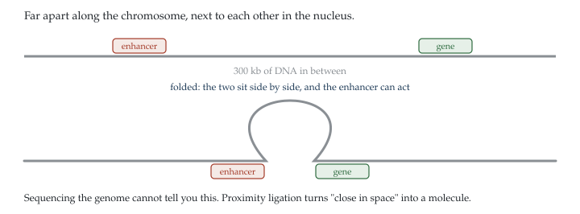{width=76%}

- A human chromosome is tens to hundreds of megabases of DNA folded into a nucleus a few micrometres across
- An enhancer can regulate a gene hundreds of kilobases away, because the fibre folds and brings them together
- Sequence alone cannot say which sites are neighbours. We need a way to turn **proximity** into a **molecule**

::: {.notes}
Part C case. The building block is proximity ligation; the rest of the unit is about what is cut, how it is joined, and what is selected.
:::

## A junction read is one observed contact

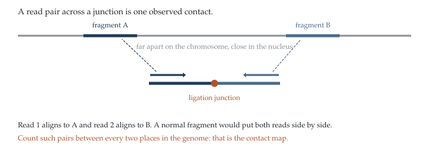{width=80%}

- A ligation joins two DNA ends that were close in the nucleus. The molecule now contains piece A next to piece B
- Sequence both ends: one read lands in A, the other in B, possibly on a different chromosome
- **One read pair is one observation of a contact**, in one cell. A map is millions of them added up

## Proximity ligation as a block

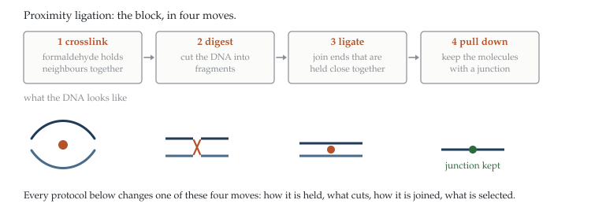{width=77%}

- Crosslink to hold neighbours, cut to make ends, ligate neighbouring ends, then select the junctions
- Each step can be swapped: a different cutter, a ligation in a different setting, a different selection
- The method names in this deck are shorthand for choices at those four steps

## Why ligate dilute, or in the nucleus

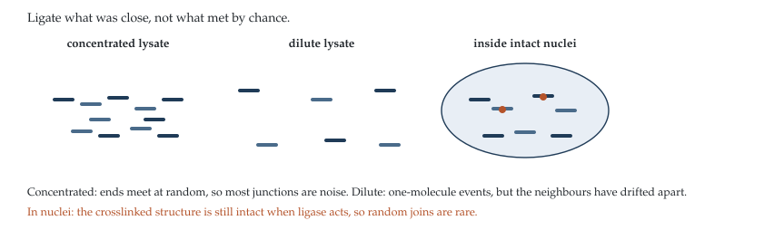{width=95%}

- Two ends in the same crosslinked complex ligate to each other, which is the signal. Ends from different complexes that meet by chance also ligate, which is noise
- Dilution lowers the noise but also the signal. Doing the reaction **inside intact nuclei** keeps the structure, and the [ligase](../enzymes/lec-ligases.qmd) concentrated

[Dekker et al. 2002, doi:10.1126/science.1067799]{.small}

## 3C: one place against one place

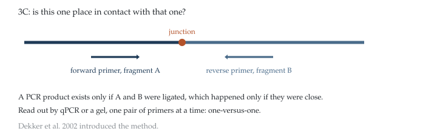{width=88%}

- The first method. Fix cells, digest, ligate under dilute conditions, reverse the crosslinks, and ask by PCR whether A and B are joined
- It needs you to know in advance which pair to test, and each pair needs its own primers
- Everything that followed was an answer to "can I ask about more pairs at once?"

[Dekker et al. 2002, doi:10.1126/science.1067799]{.small}

## 4C: one viewpoint, all partners

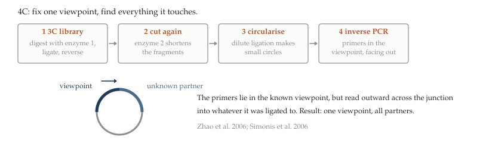{width=86%}

- Cut the 3C library with a second enzyme and ligate again, now so dilute that fragments close into circles
- Primers anchored in the viewpoint point **outwards**, so the PCR runs across the junction into whatever the viewpoint touched
- Related: **5C** (many primer pairs) and **Capture-C** (oligo capture of many viewpoints) trade breadth against depth

[Zhao et al. 2006, doi:10.1038/ng1891]{.small} · [Simonis et al. 2006, doi:10.1038/ng1896]{.small} · [Hughes et al. 2014, doi:10.1038/ng.2871]{.small} · [protocol page](https://henriksson-lab.github.io/NGS_101/4c-seq__10.1016+j.ymeth.2019.07.014/4c-seq.html){.small}

## Hi-C: mark the junction, then sequence everything

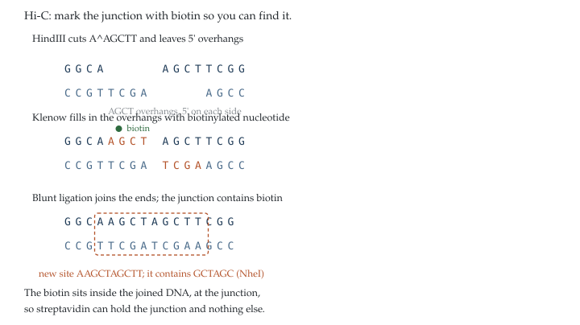{width=58%}

- [Fill in](../end-chemistry/lec.qmd) the sticky ends with a **biotinylated nucleotide** before ligation. The biotin then lies exactly at the junction
- The sequence changes too: with HindIII the junction carries a new NheI site
- Now there is no need for primers at all: sequence every junction in the library

[Lieberman-Aiden et al. 2009, doi:10.1126/science.1181369]{.small} · [protocol page](https://henriksson-lab.github.io/NGS_101/hi-c-original__10.1126+science.1181369/hi-c-original.html){.small}

## The pull-down is what makes Hi-C workable

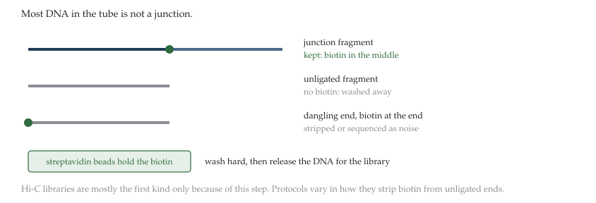{width=72%}

- After ligation, most DNA in the tube is not a junction: unligated fragments, and fragments joined to their own ends
- Streptavidin keeps the biotinylated junctions and lets the rest go. Shearing and a standard library follow
- This is a [selection](../selection/lec.qmd) step, like capture or an antibody pull-down, with biotin as the handle

[Belton et al. 2012, doi:10.1016/j.ymeth.2012.05.001]{.small}

## Read pairs become a matrix

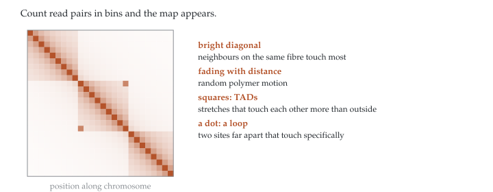{width=70%}

- Bin the genome, then count read pairs between every two bins: a symmetric matrix
- The diagonal is brightest because neighbours on a chain touch most often. Everything else is structure on top: squares along the diagonal, labelled **TADs**, are stretches that touch inside themselves more than outside, and a bright dot, a **loop**, is one pair of distant sites that touch. Both are taken apart four slides on
- The first maps resolved megabases. Resolution is a question of **how many contacts** you collect, and of fragment size

## Not every read pair is a contact

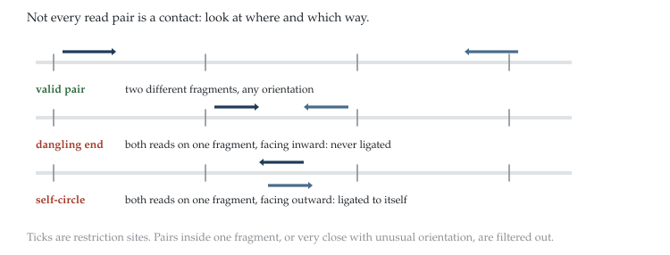{width=75%}

- Two reads that map to the **same restriction fragment** did not come from a junction between different places
- Their orientation tells you what happened: facing each other means an unligated end, facing away means the fragment circularised
- Filtering these out is the first step of the analysis. Every library has them, so quote the fraction of valid pairs when comparing protocols

## In situ Hi-C

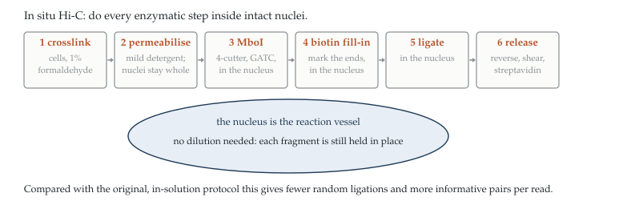{width=78%}

- Keep [the nuclei intact](../compartments/lec.qmd) through digestion, fill-in and ligation, and only then lyse
- A four-base cutter (MboI) gives a site every few hundred bp, so contacts can be placed finely
- Together with deep sequencing, this produced kilobase-resolution human maps and revealed ~10,000 loops

[Rao et al. 2014, doi:10.1016/j.cell.2014.11.021]{.small} · [protocol page](https://henriksson-lab.github.io/NGS_101/in-situ-hi-c__10.1016+j.cell.2014.11.021/in-situ-hi-c.html){.small}

## Resolution is set by the cutter

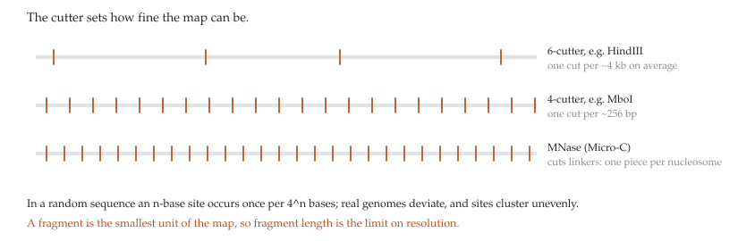{width=80%}

- In random sequence an [n-base site](../enzymes/lec-nucleases.qmd) appears once per 4^n bases: 4 kb for a six-cutter, 256 bp for a four-cutter
- A fragment is the smallest unit of the map. A contact cannot be placed more finely than the fragment it sits on
- Restriction sites are unevenly spread, so some regions are coarser than average

## Micro-C: cut with MNase

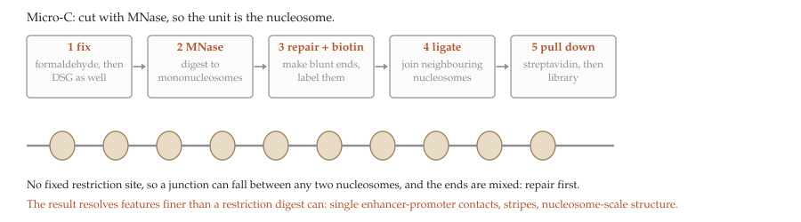{width=77%}

- Micrococcal nuclease cuts between nucleosomes with almost no sequence preference, so the map is not limited by restriction sites
- It leaves heterogeneous ends, so they are repaired and biotin-labelled before ligation
- A second crosslinker, [DSG](../chromatin/lec.qmd), in addition to formaldehyde improved mammalian maps

[Hsieh et al. 2015, doi:10.1016/j.cell.2015.05.048]{.small} · [Krietenstein et al. 2020, doi:10.1016/j.molcel.2020.03.003]{.small} · [protocol page](https://henriksson-lab.github.io/NGS_101/micro-c__10.1016+j.cell.2015.05.048/micro-c.html){.small}

## What the pattern means

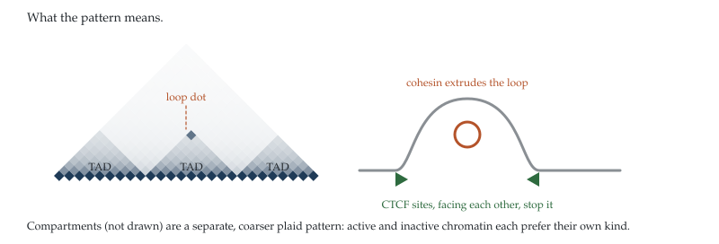{width=80%}

- **TADs**: stretches of chromosome that touch each other more than their surroundings
- **Loops**: single bright dots, typically between sites bound by CTCF and cohesin, with the CTCF motifs facing each other
- **Loop extrusion**: cohesin pulls a loop through until it meets CTCF. This model explains how TADs and loops arise

[Dixon et al. 2012, doi:10.1038/nature11082]{.small} · [Sanborn et al. 2015, doi:10.1073/pnas.1518552112]{.small} · [Fudenberg et al. 2016, doi:10.1016/j.celrep.2016.04.085]{.small}

## HiChIP: pull down the contacts of one protein

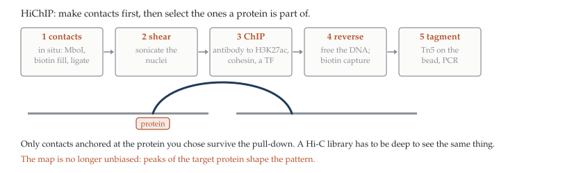{width=78%}

- Make contacts in situ as before, then shear and **[immunoprecipitate](../chromatin/lec.qmd)**. Only contacts where the target protein sits, for example at active enhancers, are kept
- Because it enriches, it needs far fewer cells and reads than Hi-C to see the same enhancer-promoter loops
- The cost is that the map is no longer unbiased: it shows contacts around the target

[Mumbach et al. 2016, doi:10.1038/nmeth.3999]{.small} · [Fang et al. 2016, doi:10.1038/cr.2016.137]{.small} · [protocol page](https://henriksson-lab.github.io/NGS_101/hichip__10.1038+nmeth.3999/hichip.html){.small}

## Bridge linkers

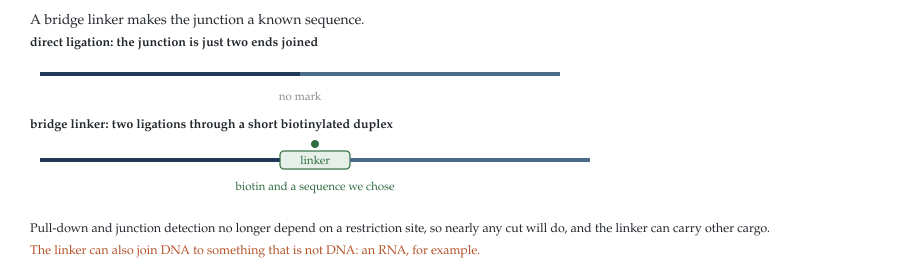{width=76%}

- Instead of ligating the two ends directly, ligate **each** to a short duplex with biotin and a sequence of your own choice
- The junction is then identifiable by the linker, independent of the cutter, and the linker can be designed with other sequences
- BL-Hi-C used this to improve capture of true contacts. A bridge can also join DNA to a different molecule

[Liang et al. 2017, doi:10.1038/s41467-017-01754-3]{.small}

## RNA–chromatin contacts

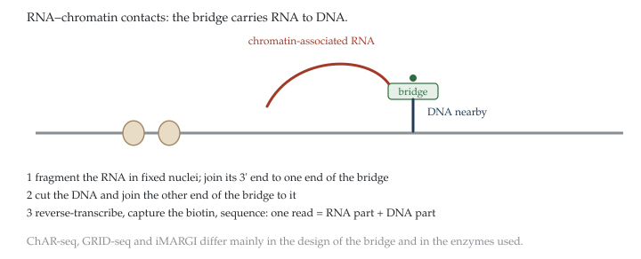{width=70%}

- The bridge idea extends to **RNA**: one end ligates to a fragmented RNA, the other to a nearby DNA end. Reverse transcription then makes a hybrid molecule
- One read carries an RNA part and a DNA part: which transcript sat on which locus
- Methods differ in the bridge and the enzymes; they see the same thing with different biases

[Bell et al. 2018, doi:10.7554/eLife.27024]{.small} · [Li et al. 2017, doi:10.1038/nbt.3968]{.small} · [Yan et al. 2019, doi:10.1073/pnas.1819788116]{.small} · [ChAR-seq protocol page](https://henriksson-lab.github.io/NGS_101/char-seq__10.7554+eLife.27024/char-seq.html){.small}

## SPRITE: replace ligation with barcodes

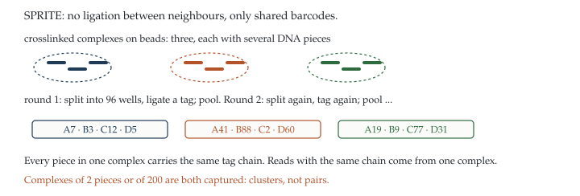{width=76%}

- Crosslinked complexes are fragmented, then split over wells in rounds, each time **ligating a well-specific tag** to every DNA end. Pieces in one complex get tagged identically, because they cannot separate
- Pool, split again, tag again. After several rounds the **chain of tags** is a [barcode](../barcodes-umis/lec.qmd) for the complex
- No proximity ligation between neighbours: you get **clusters** of many pieces, not only pairs

[Quinodoz et al. 2018, doi:10.1016/j.cell.2018.05.024]{.small} · [protocol page](https://henriksson-lab.github.io/NGS_101/sprite__10.1016+j.cell.2018.05.024/sprite.html){.small}

## Worked example: how many barcodes?

You split a pool over 96 wells in each of four rounds. An illustrative design:

- Number of possible tag chains: 96 × 96 × 96 × 96 = **84,934,656**
- Say a library contains 100,000 complexes. The chance that two particular complexes share a chain is 1 in about 85 million
- With 100,000 complexes, the expected number of colliding pairs is about 100,000²/2 / 85 million ≈ **59**, a small fraction of the complexes

What this means: every added round multiplies the number of possible chains by the number of wells, so a handful of rounds is enough. Collisions merge two clusters and are a source of false multi-way contacts.

## GAM: slice the nucleus

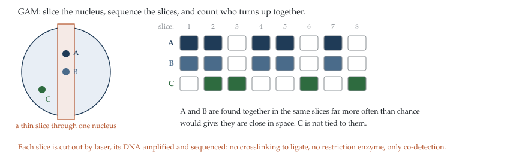{width=80%}

- Freeze fixed cells, cut ultrathin cryosections (about 220 nm), and excise one nuclear slice at a time by laser microdissection
- Sequence each slice. Regions that are close in space are found in the same slices more often than chance
- No ligation, no restriction enzyme, no antibody: the contacts come from co-detection across many slices

[Beagrie et al. 2017, doi:10.1038/nature21411]{.small} · [protocol page](https://henriksson-lab.github.io/NGS_101/gam__10.1038+nature21411/gam.html){.small}

## Why real protocols differ

| | Cutter | Ligation | Selection | Output |
|---|---|---|---|---|
| Hi-C | HindIII (6-cutter) | Dilute, after lysis | Biotin | All-vs-all pairs |
| In situ Hi-C | MboI (4-cutter) | In nuclei | Biotin | All-vs-all, finer |
| Micro-C | MNase | After repair | Biotin | Nucleosome-scale pairs |
| HiChIP | MboI | In nuclei | ChIP, then biotin | Pairs around one protein |
| 4C-seq | Two restriction enzymes | Dilute, circles | Inverse PCR | One viewpoint |
| SPRITE | Fragmentation | None: barcodes | Tag chain | Clusters |

Ask of any new method: what is cut, how is it joined, what is selected, and what does one read mean?

Going down to a single cell is possible with Hi-C chemistry [Nagano et al. 2013, doi:10.1038/nature12593]{.small}, once every molecule carries a [cell barcode](../single-cell/lec.qmd)

## What one read means

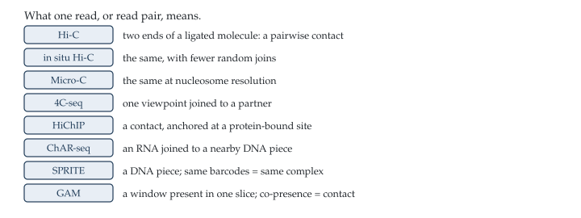{width=72%}

- Write the sentence for every method before interpreting the data
- Compare methods on the **valid fraction**, the number of unique contacts per read, and resolution

## Choosing a method

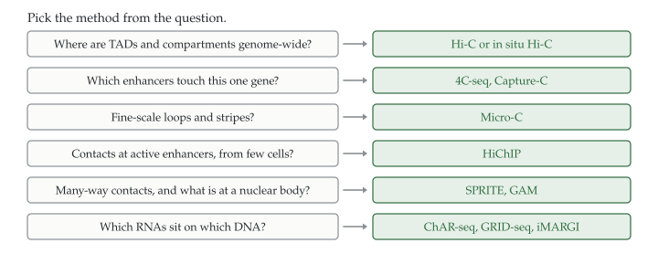{width=72%}

- Start from the scale of the question: whole-genome folding, one locus, or one protein
- When cells are scarce, enrich: HiChIP, or 4C for a single viewpoint

## Take-home

- Proximity ligation turns closeness into a **junction molecule**. Reading both sides of the junction gives a contact
- The method names are the four steps: **hold, cut, join, select**
- Finer cutting gives finer maps, and selection with an antibody or a viewpoint trades breadth for depth
- Ligation-free methods (SPRITE, GAM) read multi-way contacts and avoid the biases of enzymes and ligase

## Where this connects

**Blocks this protocol uses** — crosslink, digest, ligate, select the junction, then an ordinary library

- [Chemistry into sequence](../chemistry-to-sequence/lec.qmd) — contact written as a ligation event: the idea underneath
- [Nucleases](../enzymes/lec-nucleases.qmd) — the restriction enzyme or MNase that makes the ends, and how often it cuts
- [End chemistry](../end-chemistry/lec.qmd) — fill-in with a biotinylated base, and the repair Micro-C needs before ligating
- [Ligases](../enzymes/lec-ligases.qmd) — dilute against crowded ligation, and what the two ends must look like to join
- [Selection](../selection/lec.qmd) — streptavidin on the junction biotin, and the antibody that makes HiChIP
- [Fragmentation](../fragmentation/lec.qmd) — the shear after ligation that turns junction molecules into inserts
- [Barcodes](../barcodes-umis/lec.qmd) — SPRITE's split-pool tag chain, and the collisions it has to stay below
- [Compartments](../compartments/lec.qmd) — the intact nucleus as the vessel that holds the structure together
