## What this deck is for

One nanogram of human DNA is about 150 cells' worth of genome. A sequencer wants billions of molecules. Amplification bridges the gap, and every method of doing it pays for it in a different currency.

- **Exponential** copying (PCR) is powerful and biased, and its errors compound
- **Linear** copying (in vitro transcription, single-primer extension) makes each copy from the original
- **Isothermal** copying needs no thermal cycler, and some of it works from one cell
- **Directed** copying (inverse, nested, anchored, tiled) reads from a known sequence into an unknown one

A sequence you amplify is a sequence you have **changed the abundance of**. The question is always how.

## Exponential until it is not

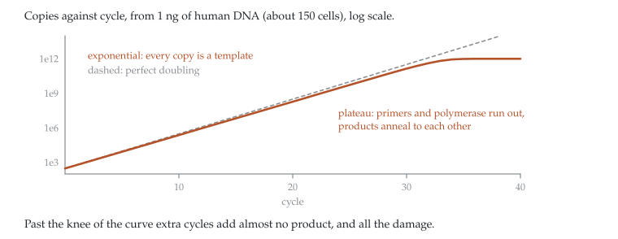{width=73%}

- Each cycle ideally doubles every molecule, so ten cycles give about a thousand-fold
- Real efficiency is below 100 %, and falls as primers and polymerase are consumed and products anneal to each other
- The plateau is not a safe place to stop: the knee is where the curve first bends away from doubling, and product made after it is mostly damage

[Saiki et al. 1988, doi:10.1126/science.2448875]{.small}

## Fidelity and cycles

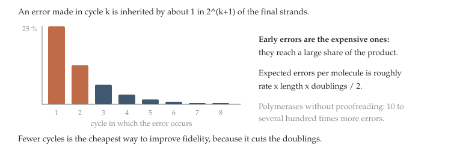{width=85%}

- A polymerase misincorporates at a small rate per base per doubling. [Proofreading enzymes](../enzymes/lec.qmd) make 10 to several hundred times fewer errors than Taq
- An error is copied along with the molecule: one made in the first cycles is carried into a large share of the library
- Fewer cycles are therefore better than any change of enzyme

## Over-amplification

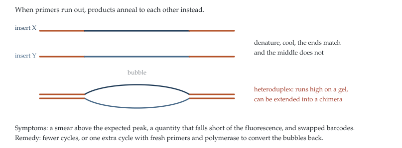{width=76%}

- When primers run out, strands of **different molecules** that share adapter ends anneal, leaving a bubble in the middle
- The bubble products run high on a gel and cause chimeras, including molecules with swapped barcodes

[Kebschull and Zador 2015, doi:10.1093/nar/gkv717]{.small}

## GC and length bias

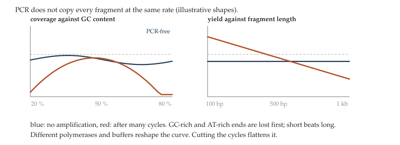{width=77%}

- GC-rich fragments denature and anneal poorly, AT-rich ones are sensitive to the extension step, and short fragments copy faster than long
- In a human genome, with its isochores and CpG islands, this shows up as uneven coverage across regions of different GC content

[Aird et al. 2011, doi:10.1186/gb-2011-12-2-r18]{.small}

## Duplicates and library complexity

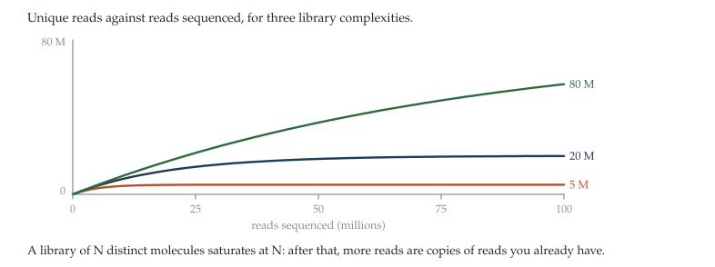{width=75%}

- A library of **N distinct molecules** gives at most N distinct reads: after that, each new read has a growing chance of being a copy
- Duplicates are a sign of complexity, not just a nuisance. Their rate lets you predict whether more sequencing is worth the money
- Duplicates made in PCR cannot be told from real coincident fragments without a molecular tag ([barcodes and UMIs](../barcodes-umis/lec.qmd))

[Daley and Smith 2013, doi:10.1038/nmeth.2375]{.small}

## PCR-free, and the cycle budget

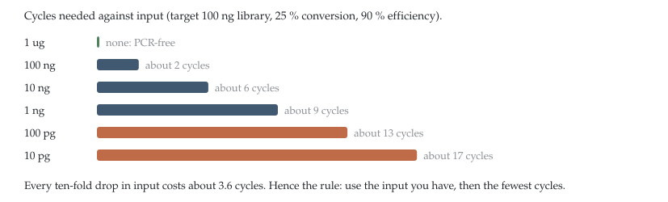{width=93%}

- With enough input, skip the PCR: [TruSeq DNA PCR-free](https://henriksson-lab.github.io/NGS_101/truseq-dna-pcr-free/truseq-dna-pcr-free.html) and [NEBNext Ultra II FS PCR-free](https://henriksson-lab.github.io/NGS_101/nebnext-ultra-ii-fs-dna-pcr-free/nebnext-ultra-ii-fs-dna-pcr-free.html) remove the bias and the duplicates
- Below that, compute the cycles from what you have and what you need, or settle it with a diagnostic qPCR on an aliquot ([QC](../qc/lec.qmd)); the figure's assumptions are illustrative

## Adapter dimers

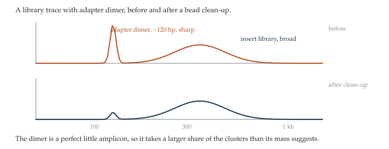{width=73%}

- Two adapters ligated together make a complete, short template that primes with the same primers as the library
- Prevention: match adapter to input, use an A/T overhang, or modify the adapters chemically so only adapter-plus-insert is a substrate ([end chemistry](../end-chemistry/lec.qmd)). Removal: beads, or a gel when the dimer is too close to the product

[Shore et al. 2016, doi:10.1371/journal.pone.0167009]{.small}

## Trick: pre-amplify, then split

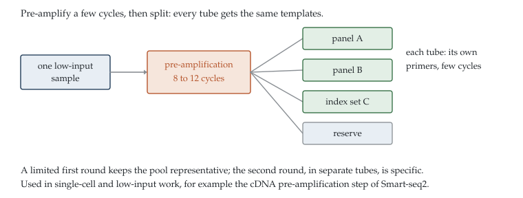{width=74%}

- A small sample can feed several assays if it is first copied in a **limited** number of cycles, then divided
- Every tube then carries the same representation of templates, and each does a specific second round
- Used in low-input RNA protocols such as [Smart-seq2](https://henriksson-lab.github.io/NGS_101/smart-seq2__10.1038+nmeth.2639/smart-seq2.html)

## Trick: polymerases and uracil

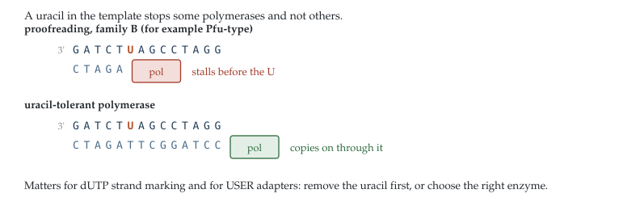{width=86%}

- Some proofreading polymerases stall when the template contains uracil. Others read through it
- Strand-specific RNA-seq marks the second strand with dUTP, and USER adapters carry a uracil that is **removed** before PCR ([nucleases](../enzymes/lec-nucleases.qmd)). In each case, the enzyme must match the plan ([NEBNext USER protocol](https://henriksson-lab.github.io/NGS_101/nebnext-ultra-ii-dna-library-prep-user-adaptor/nebnext-ultra-ii-user.html))
- Check the datasheet for uracil tolerance before choosing the polymerase

## Linear amplification: in vitro transcription

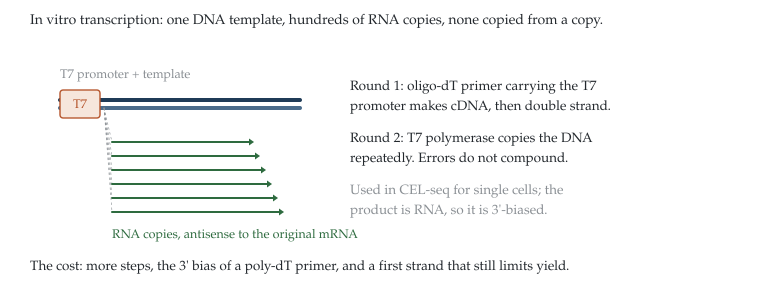{width=75%}

- A T7 promoter is built onto the cDNA, and T7 RNA polymerase transcribes it many times. Every RNA is copied from the original DNA, so **errors and biases do not compound**
- The price is extra steps and 3' bias. [CEL-seq](https://henriksson-lab.github.io/NGS_101/cel-seq__10.1016+j.celrep.2012.08.003/cel-seq.html) uses it for single cells

[Van Gelder et al. 1990, doi:10.1073/pnas.87.5.1663; Eberwine et al. 1992, doi:10.1073/pnas.89.7.3010; Hashimshony et al. 2012, doi:10.1016/j.celrep.2012.08.003]{.small}

## Linear amplification: single-primer extension

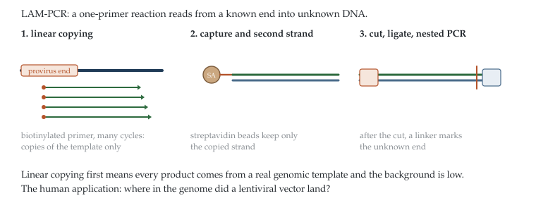{width=74%}

- One primer, many cycles: each cycle makes a new copy from the **same** template, so nothing is copied from a copy
- LAM-PCR maps where a lentiviral vector or provirus integrated in human cells: the primer sits in the known long terminal repeat and reads into the flank
- Related method: [LAM-HTGTS](https://henriksson-lab.github.io/NGS_101/lam-htgts__10.1038+nbt.3101/chem.html)

[Schmidt et al. 2007, doi:10.1038/nmeth1103]{.small}

## Isothermal: rolling circle and displacement

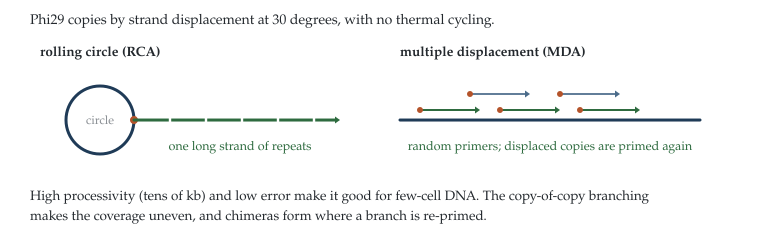{width=91%}

- **Phi29 polymerase** displaces the strand ahead of it and is highly processive. On a circle it rolls forever; on a genome with random primers it branches
- Whole-genome amplification by MDA works from a few human cells; its weakness is uneven coverage and chimeras

[Fire and Xu 1995, doi:10.1073/pnas.92.10.4641; Dean et al. 2002, doi:10.1073/pnas.082089499]{.small}

## Single cells: MDA, MALBAC, PTA

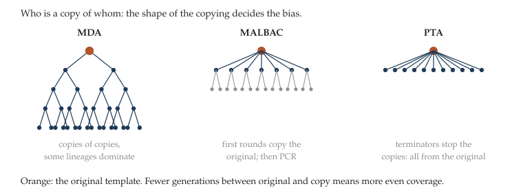{width=75%}

- The question is **how many generations stand between the original molecule and each copy**. Branching MDA has many; MALBAC copies the original first and then runs a PCR on the products; PTA terminates the copies so that they stay primary
- Cleaner, more even copies give better variant calls from a single human cell. Protocols: [MALBAC](https://henriksson-lab.github.io/NGS_101/malbac__10.1126+science.1229164/malbac.html), [PTA](https://henriksson-lab.github.io/NGS_101/pta__10.1073+pnas.2024176118/pta.html)

[Zong et al. 2012, doi:10.1126/science.1229164; Gonzalez-Pena et al. 2021, doi:10.1073/pnas.2024176118]{.small}

## LAMP

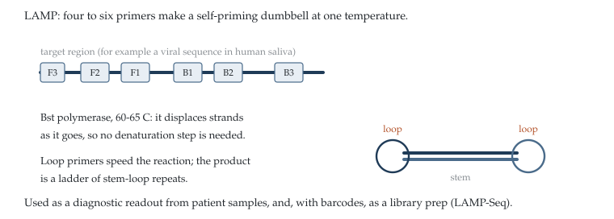{width=79%}

- Four to six primers and a strand-displacing polymerase make stem-loop products that prime themselves. No thermal cycling: a heating block or a water bath will do
- Its home is detection, for instance of a virus in a human sample; [LAMP-Seq](https://henriksson-lab.github.io/NGS_101/lamp-seq__10.1038+s41587-021-00966-9/lamp-seq.html) adds barcodes so many samples are read in one run

[Notomi et al. 2000, doi:10.1093/nar/28.12.e63; Ludwig et al. 2021, doi:10.1038/s41587-021-00966-9]{.small}

## Nicking-enzyme SDA

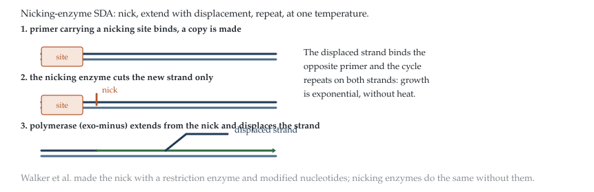{width=87%}

- A nicking enzyme cuts one strand at its site; a strand-displacing polymerase extends from the nick; the displaced strand is the next template
- Strand displacement amplification was first made with a restriction enzyme and modified nucleotides, and has been adapted to nicking enzymes

[Walker et al. 1992, doi:10.1093/nar/20.7.1691]{.small}

## Inverse PCR

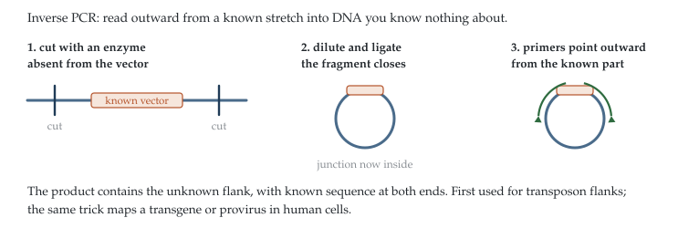{width=86%}

- Ordinary PCR needs sequence on both sides. Cut, circularise, and the **known** part is flanked by the unknown on both sides: outward-facing primers now work
- Applied here to mapping where a vector or provirus sits in a human genome. Protocol: [inverse PCR](https://henriksson-lab.github.io/NGS_101/inverse-pcr__10.1093+genetics+120.3.621/inverse_pcr.html)

[Ochman et al. 1988, doi:10.1093/genetics/120.3.621]{.small}

## Nested and anchored PCR

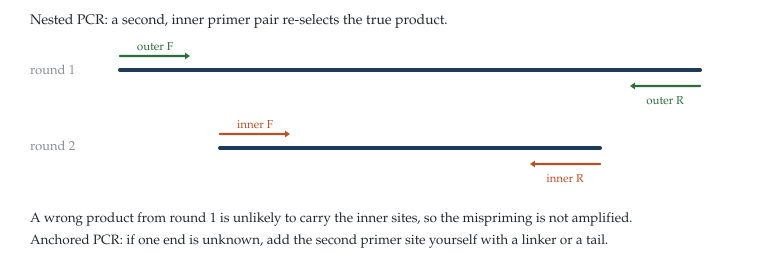{width=82%}

- A second pair of primers **inside** the first selects the right product from a messy first round. Mispriming products rarely carry both inner sites
- Anchored PCR adds the missing primer site: a linker (an adapter, in the older vocabulary of these methods), a poly-G tail or a template-switch oligo gives you something to prime from at the unknown end
- A related design is [nested patch PCR](https://henriksson-lab.github.io/NGS_101/nested-patch-pcr__10.1101+gr.078204.108/01_nested-patch-pcr.html)

## Trick: splinkerettes against one-sided background

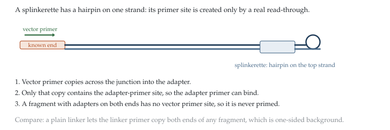{width=84%}

- A linker-ligation PCR, where an adapter goes on every fragment and the primers sit in it, amplifies **every** fragment that has a linker at each end, with or without your target. The splinkerette has a hairpin, so its primer site only exists after the vector-specific primer has copied into it
- The method is described for mapping transposon insertions; used here for mapping integrations in human cells. Protocol: [splinkerette PCR](https://henriksson-lab.github.io/NGS_101/splinkerette-pcr__10.1371+journal.pone.0010168/splinkerette.html)

[Potter and Luo 2010, doi:10.1371/journal.pone.0010168]{.small}

## Multiplex and tiled amplicons

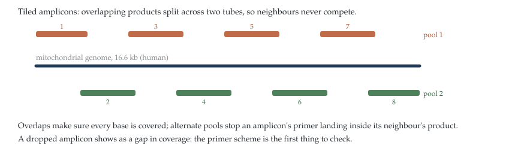{width=98%}

- **Multiplex**: many primer pairs in one tube. Pairs interfere, so each amplicon's yield must be balanced
- **Tiled**: overlapping amplicons that together cover a long target, split into two pools so neighbours are never in the same tube. Shown on the 16.6 kb human mitochondrial genome; the scheme comes from viral genomics
- The [ARTIC protocol](https://henriksson-lab.github.io/NGS_101/artic-tiled-amplicon-sequencing__10.1038+nprot.2017.066/artic-tiled-amplicon.html) is the standard example

[Quick et al. 2017, doi:10.1038/nprot.2017.066]{.small}

## Emulsion PCR

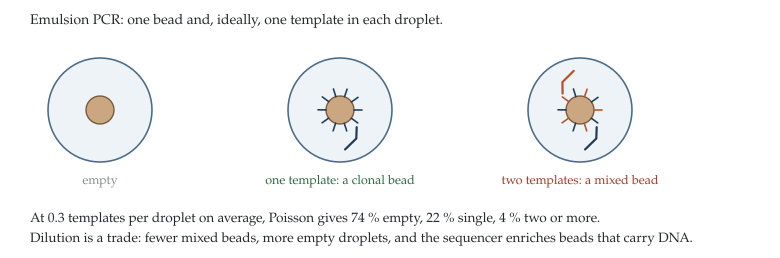{width=85%}

- Water-in-oil droplets turn one tube into millions of isolated reactors ([compartments](../compartments/lec.qmd)). With one bead and one template per droplet, each bead is covered in copies of a single molecule
- The same idea gave clonal beads for early sequencers, and, as BEAMing, a way to count rare mutations in human colorectal tumours

[Dressman et al. 2003, doi:10.1073/pnas.1133470100]{.small}

## Trick: rolling-circle consensus

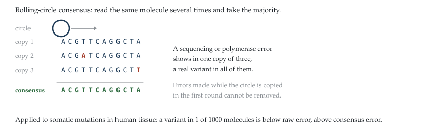{width=95%}

- Circularise the fragment, copy it by rolling circle, and read the same molecule several times in a row. Errors in one copy are outvoted by the others ([consensus tricks](../tricks/lec-more.qmd))
- Errors made while the circle is first copied stay in every repeat; later errors are removed. Protocol: [DNA circle sequencing](https://henriksson-lab.github.io/NGS_101/dna-circle-sequencing__10.1073+pnas.1319590110/01_dna_circle.html)

[Lou et al. 2013, doi:10.1073/pnas.1319590110]{.small}

## Which copy for which question

- **Plenty of DNA, short reads**: do not amplify. PCR-free
- **A little DNA, library**: fewest cycles, good polymerase, clean up dimers
- **Single-cell genome**: MDA, MALBAC or PTA, depending on what you call
- **Single-cell or low-input RNA**: IVT for even, linear copying; template-switch PCR for full length
- **Where is the vector in the genome**: LAM-PCR, inverse PCR, splinkerette
- **Many targets, one tube**: multiplex or tiled
- **Point-of-care detection**: LAMP
- **Rare variants**: consensus from circles or tags, not more cycles

## Where this connects

**Where this block is used**

- [Genomic DNA](../genomic-dna/lec.qmd) — PCR-free against whole-genome amplification, and duplicates read as complexity
- [Targeted sequencing](../targeted/lec.qmd) — multiplex and tiled amplicons, and why rare variants need tags rather than cycles
- [Screens: reading it out](../screens/lec-readout.qmd) — the whole readout is one or two PCRs off an integrated cassette
- [Small RNA, tag protocols, low input](../rna/lec-small-rna.qmd) — IVT and template-switch pre-amplification when there is almost nothing

**What PCR needs, and what it breaks**

- [Attaching a handle](../handles/lec.qmd) — PCR only copies ends you put there; truncated adapters are completed in this step
- [Tricks](../tricks/lec.qmd) — suppression PCR, two-step PCR, and the entries on adapter dimers
