## A sequence read is a place to put information

The sequencer returns bases. It does not know which are insert, which are a sample label and which are a tag for one molecule. **You** decide, by where you put them in the construct and which read covers them.

The [sequencer deck](../sequencers/lec.qmd) covered how indexes are read and why they hop. This deck is about **design**: how far apart barcodes must be, how many you can afford, where a UMI may be added, and how much of a read they use up.

::: {.notes}
Keep the previous deck's index-hopping and i5 orientation material as given; do not repeat it.
:::

## Four questions, four addresses

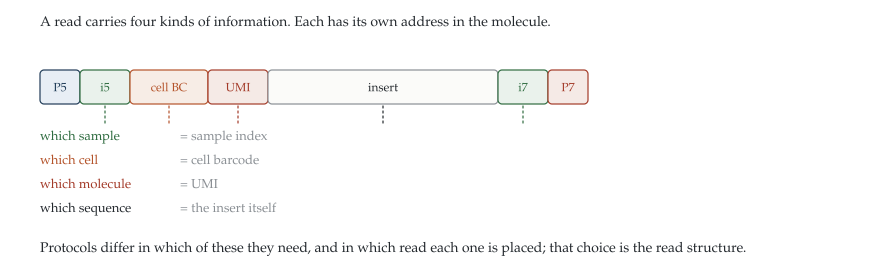{width=90%}

- Sample, cell and molecule are **added by you**; only the insert comes from the biology
- Every label costs cycles, oligo cost and a way to get it wrong

## Demultiplexing is a distance calculation

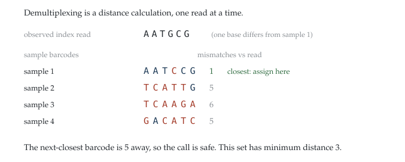{width=70%}

- Compare the observed index to every barcode; assign to the nearest if it is near enough and clearly nearer than the second
- A read that matches nothing lands in *Undetermined*: the place to look first when a run seems empty

## Minimum distance decides what an error does

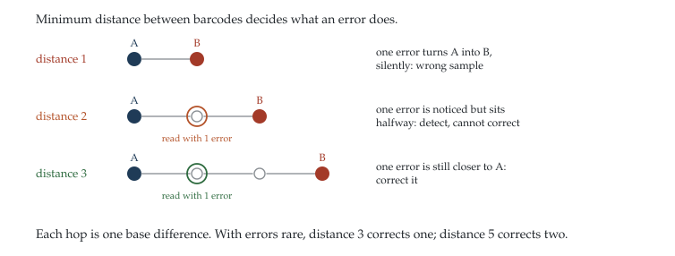{width=74%}

- **Hamming distance**: the number of positions at which two barcodes differ
- A set with minimum distance *d* detects *d* − 1 errors and corrects ⌊(*d* − 1)/2⌋

[Hamady et al. 2008, doi:10.1038/nmeth.1184]{.small}

## How many barcodes fit at a given distance?

A barcode of length *n* has 4^*n* possible sequences. To correct one error, every barcode needs a private "territory": itself and its 3*n* one-error neighbours.

- **6 nt, distance 3:** each barcode claims 1 + 3 × 6 = 19 sequences, so at most 4096 / 19 ≈ 215 barcodes, and real sets are smaller
- **8 nt, distance 3:** 1 + 3 × 8 = 25 sequences each, so at most 65,536 / 25 ≈ 2,600
- Adding a requirement for **distance 4 or 5** shrinks the set quickly

Longer barcodes buy room, and cost cycles in an index read. The trade is yours to make.

## Insertions and deletions break the Hamming picture

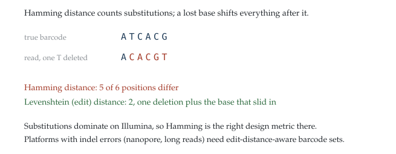{width=72%}

- One lost base shifts every later position, so a barcode that is one edit away looks five away
- Illumina's errors are mostly substitutions, so Hamming is the right metric there; for platforms with indel errors, design with **edit distance**

[Buschmann and Bystrykh 2013, doi:10.1186/1471-2105-14-272]{.small}

## Colour balance: a set that is far apart can still fail

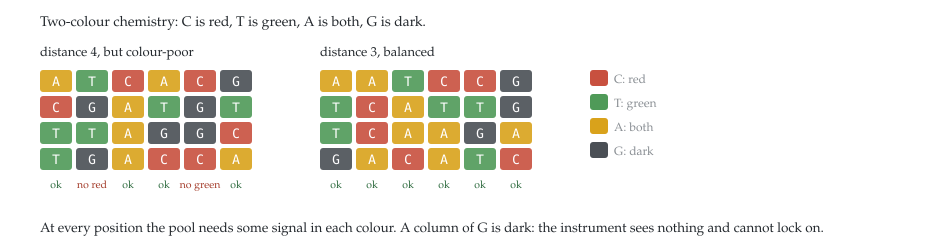{width=90%}

- On two-colour instruments, each cycle needs some signal in **both** colours across the pool; a column of G is dark
- The left set has distance 4 and still fails at two positions; the right has distance 3 and passes
- This is a rule of thumb: check your instrument's index guide

## Designing a barcode set: the checklist

1. **Distance:** at least 3 for correction, more if the run is noisy
2. **Colour balance** at every position, for the pool you will actually run (see the next point)
3. **Balance applies to the pool.** Four samples used from a large set can be unbalanced even when the full set is balanced; choose sets that are balanced per lane
4. **Avoid** homopolymers of three or more, extreme GC, self-complementarity, and sequences that resemble the adapter
5. **Check restriction sites** only if a later step digests

Commercial index plates come pre-checked for most of this, which is why a custom set needs a reason.

## Unique dual indexes

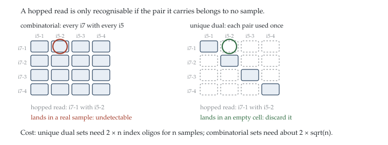{width=75%}

- Both indexes are read, and each pair is used for one sample
- A hopped read carries a pair that no sample owns: it is discarded rather than reassigned

[Kircher et al. 2012, doi:10.1093/nar/gkr771]{.small}, [Costello et al. 2018, doi:10.1186/s12864-018-4703-0]{.small}

## Cell barcodes: bead-bound

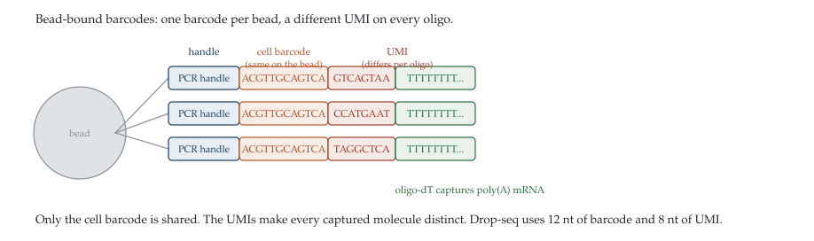{width=90%}

- Beads are made by split-pool synthesis, so each bead carries millions of copies of **one** barcode
- A cell in a [droplet](../compartments/lec.qmd) with a bead has all its mRNA tagged with that barcode

[Macosko et al. 2015, doi:10.1016/j.cell.2015.05.002]{.small}, [Drop-seq on NGS 101](https://henriksson-lab.github.io/NGS_101/drop-seq__10.1016+j.cell.2015.05.002/drop-seq.html)

## Cell barcodes: split-pool

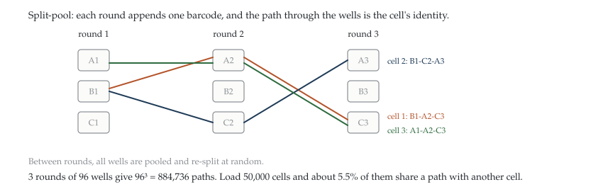{width=88%}

- No droplets and no beads: cells are barcoded in wells, pooled, re-split, and barcoded again
- The cell is identified by the path it took ([combinatorial indexing](../single-cell/lec-combinatorial.qmd)); the oligos needed are few

[Rosenberg et al. 2018, doi:10.1126/science.aam8999]{.small}, [Cao et al. 2017, doi:10.1126/science.aam8940]{.small}

## Cell barcodes: plate-based

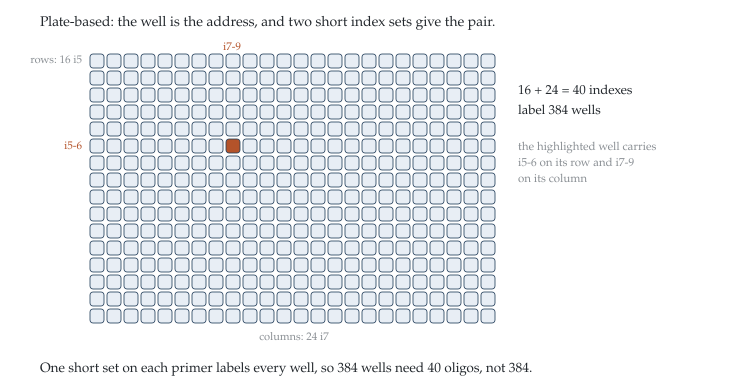{width=53%}

- Each well gets its own barcode through the primer, so the well **is** the cell
- Two index sets, one along rows and one along columns, label the whole plate

[Hashimshony et al. 2016, doi:10.1186/s13059-016-0938-8]{.small}, [CEL-Seq2 on NGS 101](https://henriksson-lab.github.io/NGS_101/cel-seq2__10.1186+s13059-016-0938-8/cel-seq2.html)

## Trick: combinatorial barcodes from a small oligo set

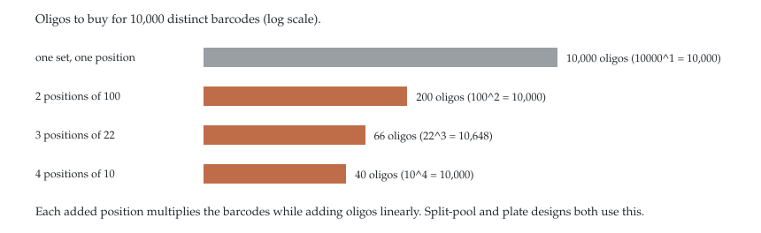{width=90%}

- Barcodes that are the **product** of several short sets need oligos that are only the **sum**
- Split-pool, plate indexing and dual indexing all use this; the limit is how many wells or rounds you can handle

## Barcode collisions and what to do about them

- **Two cells, one barcode.** In split-pool, load 50,000 cells onto 96³ = 884,736 paths and about 5.5% of cells share a path with another. Fewer cells per round keeps this low.
- **Barcode errors.** An error in a cell barcode makes a phantom cell. Correct against a **whitelist** of real barcodes when you have one, and merge near-duplicates when you do not.
- **Ambient material.** In droplets, free RNA gets tagged with the barcode of a bead that never met a cell. This is a wet-lab fix, not a barcode one.
- **Doublets.** Two real cells under one barcode. Hashing (below) makes them visible.

## UMIs count molecules, not reads

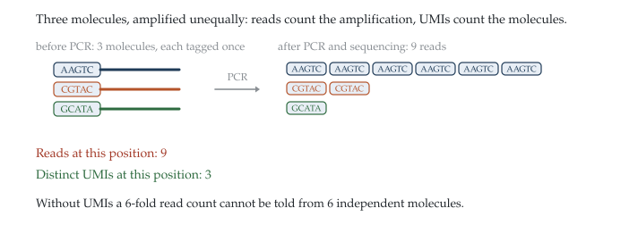{width=79%}

- A UMI is a short random sequence added to each molecule **once**, before amplification
- Reads that share position and UMI are copies of one molecule; reads with different UMIs are not

[Kivioja et al. 2012, doi:10.1038/nmeth.1778]{.small}, [Islam et al. 2014, doi:10.1038/nmeth.2772]{.small}

## Where a UMI can be added

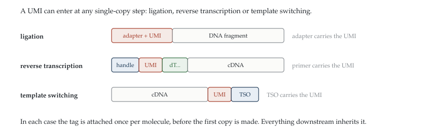{width=90%}

- **Ligation:** on the adapter, for DNA libraries — each route is one of the [five handles](../handles/lec.qmd)
- **Reverse transcription:** on the primer, in CEL-Seq2 and droplet methods
- **Template switching:** on the TSO, which tags the 5' end of the cDNA in Smart-seq3

[Hagemann-Jensen et al. 2020, doi:10.1038/s41587-020-0497-0]{.small}, [Smart-seq3 on NGS 101](https://henriksson-lab.github.io/NGS_101/smart-seq3__10.1038+s41587-020-0497-0/smart-seq3.html)

## Why never in the PCR

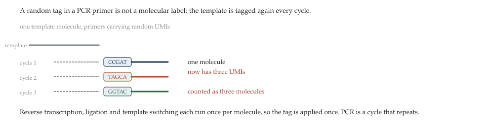{width=90%}

- A [PCR](../amplification/lec.qmd) primer meets the template again in every cycle, so one molecule collects **many** UMIs
- A tag that appears at a single-copy step is a label; one added by a repeated step is not

[Kebschull and Zador 2015, doi:10.1093/nar/gkv717]{.small}

## Collapsing: UMIs are read with errors too

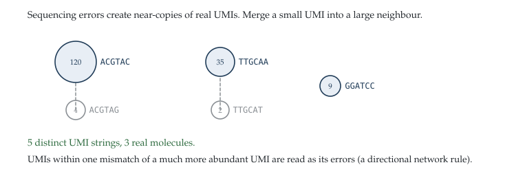{width=84%}

- An error in a UMI makes a new UMI. A UMI one base from a far more abundant one is treated as its error
- Without this, counts are inflated, most strongly for genes with many reads

[Smith et al. 2017, doi:10.1101/gr.209601.116]{.small}

## How long should a UMI be?

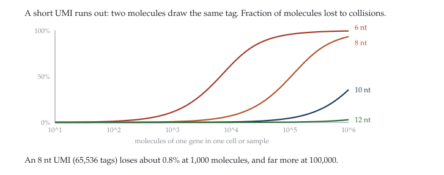{width=71%}

- With *N* possible UMIs and *m* molecules, the number of different tags seen is about *N*(1 − e^(−*m*/*N*))
- Choose the length for the **most abundant** molecule you expect, not the average

## Trick: UMI plus duplex tags

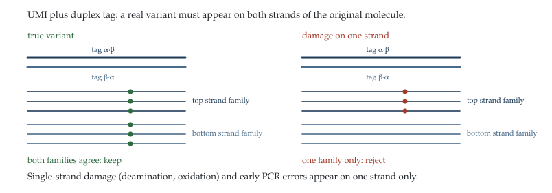{width=74%}

- Tag each strand of the original duplex so that reads from its two strands can be told apart
- A real variant appears in **both** strand families; damage on one strand does not ([rare variants](../targeted/lec.qmd))

[Schmitt et al. 2012, doi:10.1073/pnas.1208715109]{.small}, [Duplex Sequencing on NGS 101](https://henriksson-lab.github.io/NGS_101/duplex-sequencing__10.1073+pnas.1208715109/duplex-sequencing.html)

## Read-structure budgeting

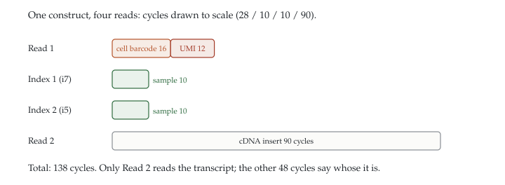{width=77%}

- Every cycle costs time and money; 138 cycles here carry 48 cycles of labels and 90 of transcript
- The [construct](../library-molecule/lec.qmd) sets the read structure, and the run must be set up to match it

## Where do the labels go?

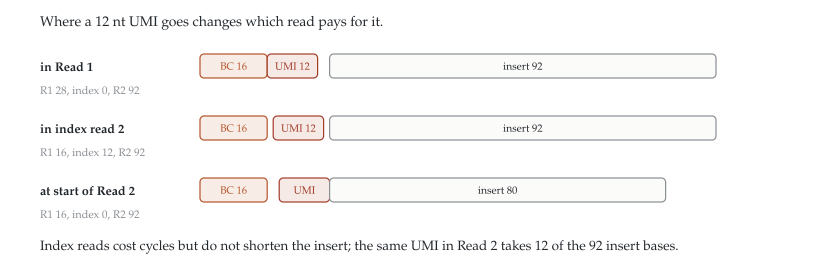{width=85%}

- Putting the UMI in an **index read** leaves the insert reads full length, at the price of extra index cycles
- Putting it in Read 2 shortens the transcript read
- Check what your kit and sequencing facility allow before committing a design

## Limits on read structure

- **A kit has a cycle budget** per read; the index reads are budgeted separately. Check the limits for your kit rather than assuming them.
- **Custom primers** let you place a read where the standard primer cannot; see the instrument deck for dark cycles and custom reads.
- **Reads must start with diverse bases.** A constant barcode scaffold or a constant amplicon start needs the fix on the next slide.
- **Paired reads are two separate budgets.** A barcode in Read 1 is not available to Read 2 unless the construct repeats it.

## Trick: staggered primers for base diversity

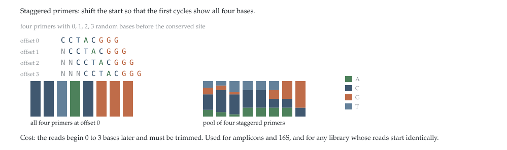{width=85%}

- Primers with 0 to 3 extra bases shift the amplicon start, so the first cycles contain a mix of bases
- The extra bases cost cycles at the start of each read and must be trimmed ([screen readouts](../screens/lec-readout.qmd) need this)

[Fadrosh et al. 2014, doi:10.1186/2049-2618-2-6]{.small}

## Trick: hashing with antibodies or lipids

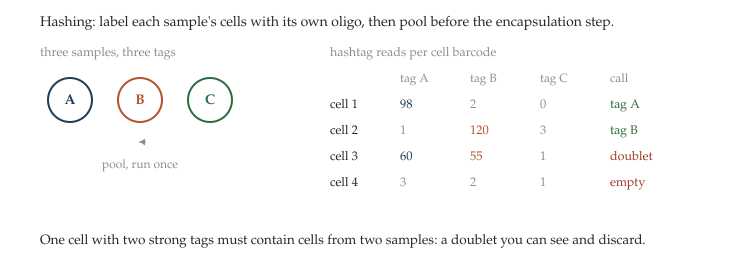{width=79%}

- Each sample's cells are labelled with an oligo attached to an antibody or a lipid; the tags are read out with the cells
- It lets you **pool samples before** the costly step and **find doublets**
- Nuclei can be hashed the same way

[Stoeckius et al. 2018, doi:10.1186/s13059-018-1603-1]{.small}, [McGinnis et al. 2019, doi:10.1038/s41592-019-0433-8]{.small}, [Srivatsan et al. 2020, doi:10.1126/science.aax6234]{.small}

## A worked design

**Goal:** single-cell RNA from 12 patient samples, 5' cDNA, one flow cell lane.

1. **Samples:** hash the 12 samples with lipid tags, pool, and run one droplet reaction. One library carries one sample index.
2. **Cell barcode:** from the bead, 16 nt, checked against a whitelist.
3. **UMI:** 12 nt on the capture oligo, added at RT. Never in the library PCR.
4. **Read structure:** Read 1 = 28 (barcode + UMI), Read 2 = 90 (cDNA), plus a sample index read.
5. **Check:** the library index set is balanced, unique dual, and distance 3 or more.

Each choice comes from a slide in this deck.

## Where this connects

**Where these blocks are used**

- [Single cells](../single-cell/lec.qmd) — every molecule carries a cell barcode and a UMI, and the read budget is spent here
- [Spatial](../spatial/lec.qmd) — a coordinate is a barcode with a position attached to it
- [Pooled screens](../screens/lec.qmd) — the guide is the barcode, and the vector's geometry decides where a read can start

**If this fails**

- [QC](../qc/lec.qmd) — pooling to equal molarity, and what a run full of *Undetermined* reads is telling you
- [Design patterns](../design/lec.qmd) — index hopping and low complexity as failure signatures, with the control for each

**Tricks**

- [Handles and the read](../tricks/lec.qmd) — inline barcode against index read, custom primers, dark cycles
- [Counting](../tricks/lec-more.qmd) — UMI length, duplex tags and spike-ins in catalogue form
