## Anything can be measured once it becomes sequence

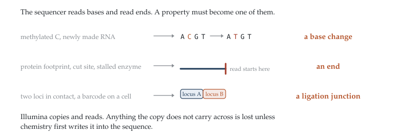{width=76%}

- A sequencer reads four bases and the places where reads start and end
- Methylation, new RNA, protein contact and 3D proximity are none of these, until chemistry says so
- Three routes: change a **base**, mark an **end**, or make a **junction**

## What the polymerase copies

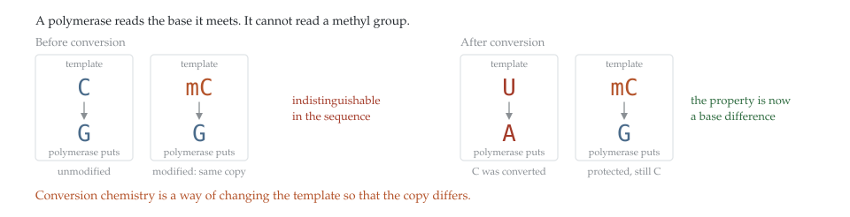{width=95%}

- A polymerase pairs the base in front of it; a methyl group on C does not change that pairing
- Conversion chemistry edits the **template**, so that the **copy** differs

## Bisulfite: unmethylated C becomes U

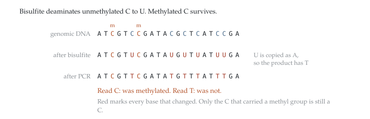{width=80%}

- Bisulfite deaminates C to U fast and 5mC very slowly, so after PCR, T means unmethylated and C means methylated
- The first method to give methylation at one base in one molecule

[Frommer et al. 1992, doi:10.1073/pnas.89.5.1827]{.small}

## Reading a converted read

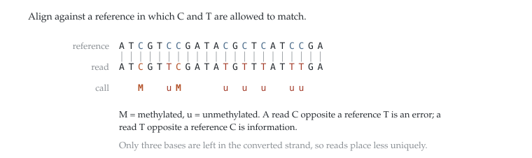{width=80%}

- Align with C and T treated as matching, then count C against T at each reference C
- Cost: harsh chemistry [fragments DNA](../fragmentation/lec.qmd), and a three-letter read maps less uniquely
- The two strands stop being complementary, so you read four strands, not two

## Controls that must ride along

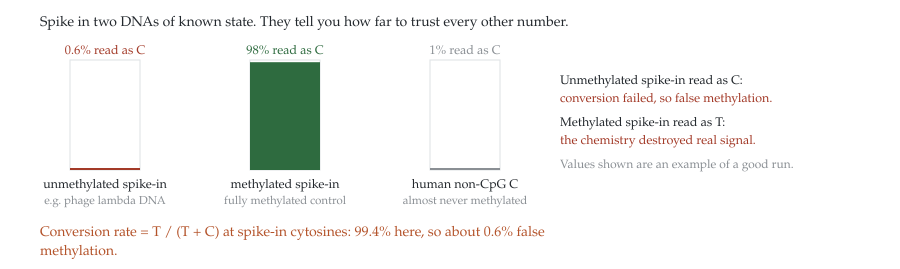{width=86%}

- Without a [spike-in](../selection/lec.qmd) you cannot tell 2% methylation from 2% failed conversion
- Human non-CpG cytosines are almost never methylated, a free internal check
- Report the conversion rate with every sample

## Which cytosines read as C?

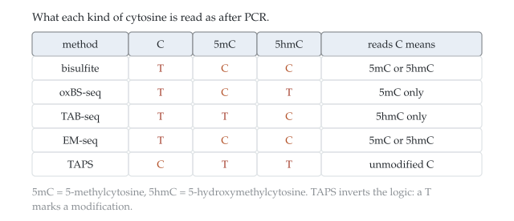{width=60%}

- Bisulfite cannot separate 5mC from 5hmC, a different mark with different biology
- Each later method changes which column reads as C

[Booth et al. 2012, doi:10.1126/science.1220671; Yu et al. 2012, doi:10.1016/j.cell.2012.04.027]{.small}

## Protect, then convert

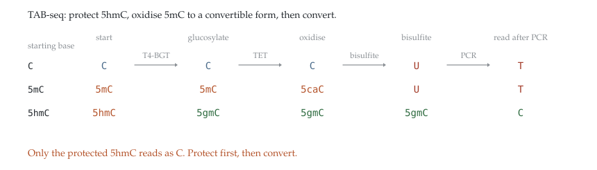{width=90%}

- Block the base you want to keep, then spend a harsher step on the rest
- TAB-seq protects 5hmC with a sugar; oxBS-seq instead oxidises 5hmC so that it converts, leaving 5mC as C
- Subtract two experiments and you have both marks; protocols: [TAB-seq](https://henriksson-lab.github.io/NGS_101/tab-seq__10.1016+j.cell.2012.04.027/tab-seq.html), [oxBS-seq](https://henriksson-lab.github.io/NGS_101/oxbs-seq__10.1126+science.1220671/oxbs-seq.html)

## EM-seq: the same readout, gentler

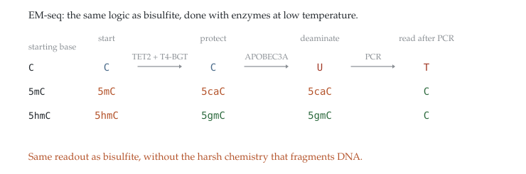{width=78%}

- [TET2 and a glucosyltransferase](../enzymes/lec-transposases.qmd) protect 5mC and 5hmC; APOBEC3A then deaminates only plain C
- The result looks like bisulfite, with less fragmentation and so lower input and better coverage

[Vaisvila et al. 2021, doi:10.1101/gr.266551.120]{.small}

## TAPS: convert the modified base instead

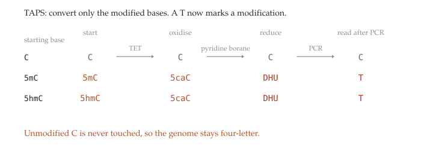{width=78%}

- TET oxidises 5mC and 5hmC to 5caC; pyridine borane reduces that to a base read as T
- Only the minority of modified cytosines change, so the read stays four-letter
- Add a protection step (TAPSβ) to restrict it to 5mC; protocol: [TAPS in NGS 101](https://henriksson-lab.github.io/NGS_101/taps__10.1038+s41587-019-0041-2/taps.html)

[Liu et al. 2019, doi:10.1038/s41587-019-0041-2]{.small}

## What the reads look like

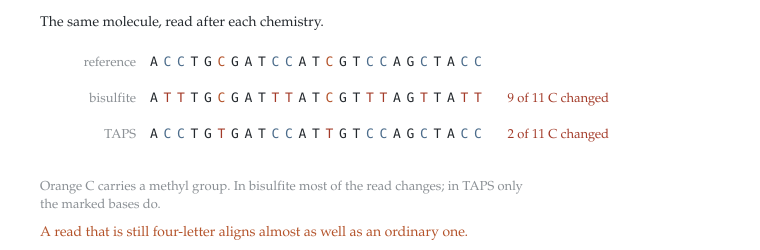{width=78%}

- Bisulfite rewrites almost every C; TAPS rewrites only the marked ones
- Less rewriting means simpler alignment and less sequence lost to ambiguity
- The price is a conversion that must reach the marked bases, so check it with a control

## The same idea on RNA

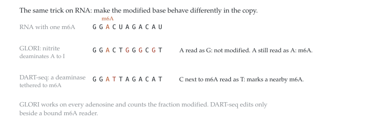{width=80%}

- GLORI deaminates unmodified A with nitrite, so m6A stands out as the A that remains
- DART-seq fuses a cytidine deaminase to an m6A reader, so a C beside m6A is edited
- Both replace an antibody with a base change, and so give a position ([GLORI](https://henriksson-lab.github.io/NGS_101/glori__10.1038+s41587-022-01487-9/glori.html), [DART-seq](https://henriksson-lab.github.io/NGS_101/dart-seq__10.1038+s41592-019-0570-0/dart-seq.html))

[Liu et al. 2022, doi:10.1038/s41587-022-01487-9; Meyer et al. 2019, doi:10.1038/s41592-019-0570-0]{.small}

## Metabolic labels: write the age into the read

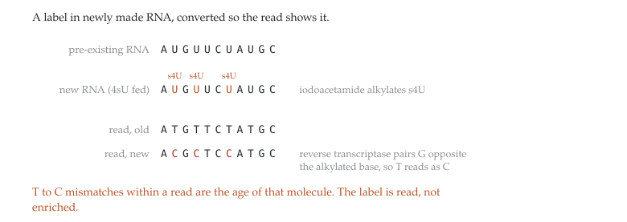{width=73%}

- Feed cells 4-thiouridine; new RNA carries it, old RNA does not
- Alkylation makes reverse transcriptase read a T as C, and the fraction of such reads gives the new-to-old ratio
- No enrichment, so no pull-down bias ([SLAM-seq](https://henriksson-lab.github.io/NGS_101/slam-seq__10.1038+nmeth.4435/slam-seq.html))

[SLAM-seq: Herzog et al. 2017, doi:10.1038/nmeth.4435; TimeLapse-seq: Schofield et al. 2018, doi:10.1038/nmeth.4582]{.small}

## Click chemistry: a handle you can pull on

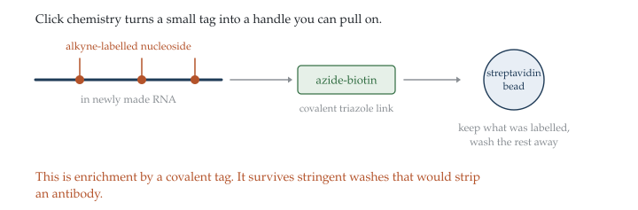{width=78%}

- A nucleoside with an alkyne is incorporated; an azide-biotin then clicks onto it covalently
- Streptavidin beads take the labelled molecules, and washes can be harsh
- Choose between reading the label (previous slide) and enriching it (this one)

## Position as information

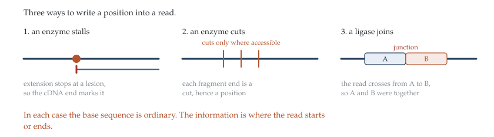{width=93%}

- The read keeps the sequence of an ordinary molecule; the **start or end** carries the measurement
- A stall, a cut and a ligation each write a position, and the next slides take one of each

## Crosslinking: a truncation

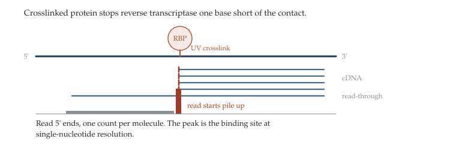{width=83%}

- UV joins an RNA-binding protein to its RNA; the peptide left after digestion stops reverse transcriptase
- The 5' end of the cDNA marks the contact to one nucleotide ([iCLIP](https://henriksson-lab.github.io/NGS_101/iclip__10.1038+nsmb.1838/iclip_partial.html))
- Reads that run through show up as noise, so the peak is the useful part

[König et al. 2010, doi:10.1038/nsmb.1838; Van Nostrand et al. 2016, doi:10.1038/nmeth.3810]{.small}

## Crosslinking: a mutation

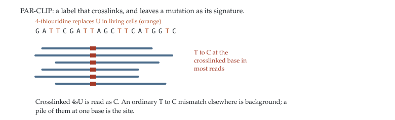{width=84%}

- PAR-CLIP feeds cells 4-thiouridine, which crosslinks efficiently under 365 nm light
- The crosslinked base is then read as C, so the signature is a mismatch inside the read
- Truncation and mutation are two signatures of the same event ([PAR-CLIP](https://henriksson-lab.github.io/NGS_101/par-clip__10.1016+j.cell.2010.03.009/par_clip.html))

[Hafner et al. 2010, doi:10.1016/j.cell.2010.03.009]{.small}

## Probing structure: a mutation per exposed base

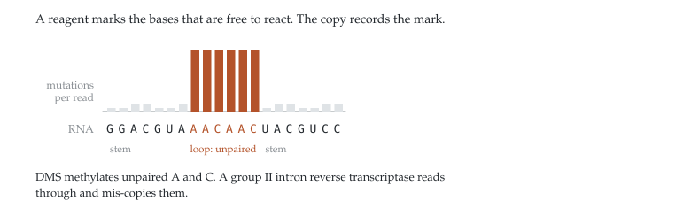{width=85%}

- DMS methylates A and C only where they are unpaired; the modified base is mis-copied
- The mutation rate along the read is a map of the fold ([DMS-MaPseq](https://henriksson-lab.github.io/NGS_101/dms-mapseq__10.1038+nmeth.4057/dms-mapseq.html))
- Choice of [reverse transcriptase](../enzymes/lec.qmd) matters: one that stops gives a stop, one that reads through gives a mutation

[Zubradt et al. 2016, doi:10.1038/nmeth.4057]{.small}

## Cuts: accessibility as read starts

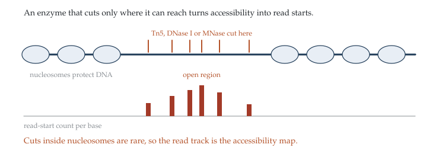{width=73%}

- Nucleases and transposase reach DNA only where [nucleosomes and factors](../chromatin/lec.qmd) are absent
- Every read begins at a cut, so **the start of the read** is the data
- Restriction enzymes do the same for sequence, a trick used on the next slides

[Boyle et al. 2008, doi:10.1016/j.cell.2007.12.014; Buenrostro et al. 2013, doi:10.1038/nmeth.2688]{.small}

## Junctions: contact as a ligation event

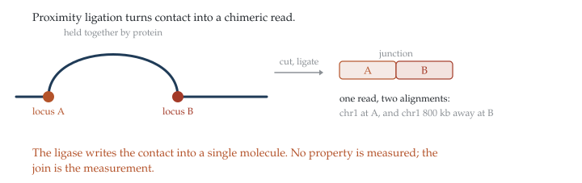{width=82%}

- Crosslink, cut, ligate: ends that were near each other are joined into one molecule
- One read now maps to two places, and the pair of places is the measurement
- Covered in the [3D genome module](../3d-genome/lec.qmd); here it is the third way to write a position

[Lieberman-Aiden et al. 2009, doi:10.1126/science.1181369]{.small}

## Affinity: an antibody instead of chemistry

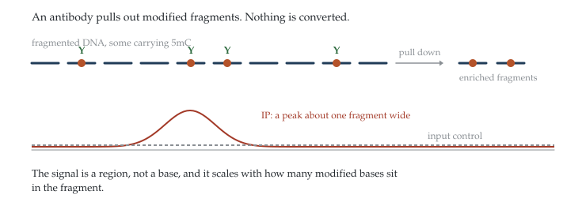{width=75%}

- Fragment, pull down the modified fragments with an antibody, sequence them ([m6A-seq](https://henriksson-lab.github.io/NGS_101/m6a-seq__10.1038+nature11112/m6a-seq.html))
- Needs no conversion and is gentle, which helps with low input
- Gives regions, not bases, and the antibody decides what you see

[Dominissini et al. 2012 (m6A-seq), doi:10.1038/nature11112]{.small}

## Choosing the readout

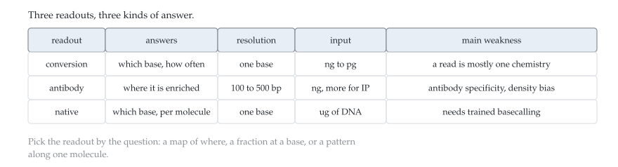{width=95%}

- Conversion gives base resolution and a fraction at each base
- Antibodies give a map of where, at lower cost per sample
- Native readout gives a pattern along one molecule, discussed next

## Native: PacBio reads the kinetics

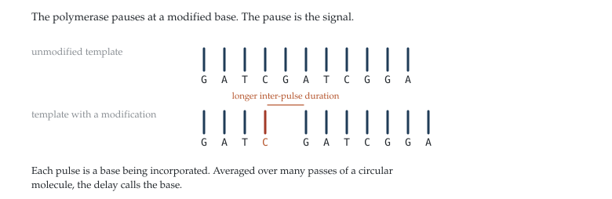{width=79%}

- No conversion: the [polymerase's speed](../sequencers/lec-platforms.qmd) is recorded for each base
- A modified template slows incorporation, seen as a longer gap between pulses
- Circular consensus gives many passes, which averages the noise from one pass

[Flusberg et al. 2010, doi:10.1038/nmeth.1459; Fiber-seq: Stergachis et al. 2020, doi:10.1126/science.aaz1646]{.small}

## Native: nanopore reads the current

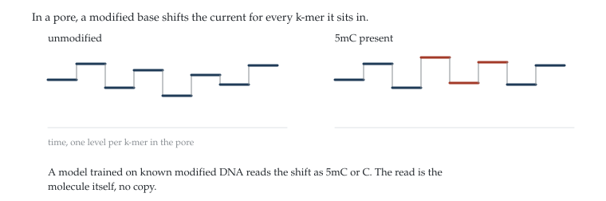{width=78%}

- A modified base changes the current for each k-mer containing it
- The basecaller is trained on known modified DNA, so what you detect depends on the training data
- One molecule can carry several marks, which conversion cannot show

[Simpson et al. 2017, doi:10.1038/nmeth.4184]{.small}

## Reduced representation: pay for what matters

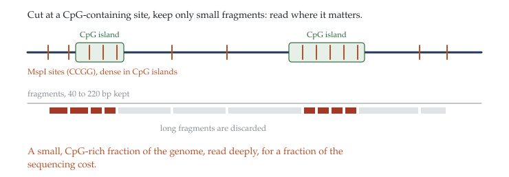{width=74%}

- MspI cuts at CCGG, so fragments cluster in CpG-rich regions; size selection keeps the short ones
- Illustration: 30x of a 3.1 Gb genome is about 93 Gb; the same depth over 2% of it is under 2 Gb
- The 2% is an assumption for the arithmetic; read the paper for the real figure
- Fragments all begin with the same bases, so spike in PhiX ([RRBS](https://henriksson-lab.github.io/NGS_101/rrbs-illumina__10.1038+nature07107/rrbs-illumina.html))

[Meissner et al. 2005, doi:10.1093/nar/gki901; Meissner et al. 2008, doi:10.1038/nature07107]{.small}

## Controls, for every readout

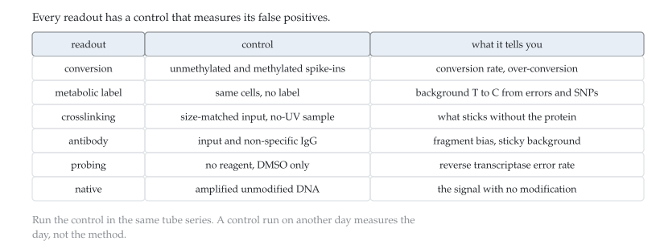{width=68%}

- Each readout has its own false positive, and its own control
- Decide the control before the experiment, not at the analysis

## Choosing a chemistry

Start from the question, not the method.

- **Where is the mark, roughly?** Antibody enrichment, or a cut-based method
- **At which base, and what fraction?** Conversion, with a spike-in; TAPS or EM-seq when DNA is precious
- **5mC or 5hmC?** Protect-then-convert, or a method that leaves one of them unconverted
- **When was this RNA made?** A metabolic label read by conversion
- **Who touched this RNA?** Crosslinking, then a truncation or a mutation
- **Is there a phase relationship along one molecule?** Native long reads

Whichever you pick, write down what a false positive and a false negative look like first.

::: {.notes}
Refer back to the first slide: base, end or junction.
:::

## Where this connects

**Where this block is used**

- [DNA modifications, damage and dynamics](../modifications/lec.qmd) — bisulfite, EM-seq, TAPS and break mapping as full protocols
- [RNA modifications and dynamics](../modifications/lec-rna.qmd) — the CLIP family, m6A, metabolic labelling and structure probing
- [Long reads](../long-reads/lec.qmd) — direct RNA and native basecalling, the route with no conversion at all

**What the chemistry then constrains**

- [Amplification](../amplification/lec.qmd) — a converted template is full of uracil, so the polymerase must tolerate it
- [End chemistry](../end-chemistry/lec.qmd) — why the adapters go on before conversion and are made of methylated cytosines
- [Tricks: bases](../tricks/lec-more.qmd) — protect-then-convert, position as information, affinity and native readout, indexed by problem
