## Three questions about one stretch of chromatin

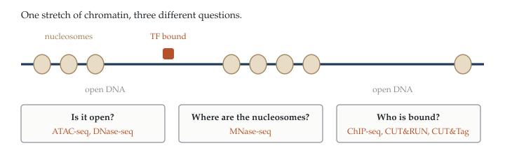{width=80%}

- Which DNA is **open**, and which is wrapped around histones?
- Where exactly do the **nucleosomes** sit?
- Which **protein** is bound, and where?

A library for any of these is the ordinary DNA library of the earlier units, plus a way of making the *position* of something show up in the reads.

::: {.notes}
Part C starts from a biological question and derives the protocol from blocks. Here the sample is human cells or nuclei, and the question is about the state of the genome rather than its sequence.
:::

## A read is the address of a cut

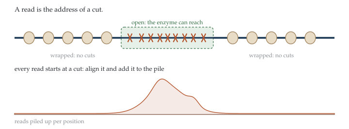{width=70%}

- Nothing in the library is the protein or the nucleosome. What you sequence is **where an enzyme or a chemical got access**
- Align the reads and count starts per position: the pile-up is the measurement
- Every method in this deck is a choice of *which enzyme*, *where it is placed*, and *what is done with the ends*

## The blocks we will reuse

| Block | What it does here | Where it appears |
|---|---|---|
| [Nuclease](../enzymes/lec-nucleases.qmd) (DNase I, MNase) | Cuts DNA where it is not protected | DNase-seq, MNase-seq, CUT&RUN |
| [Tn5 transposase](../enzymes/lec-transposases.qmd) | Cuts and ligates adapters in one step | ATAC-seq, CUT&Tag |
| Crosslinking and reversal | Freezes protein on DNA, then releases it | ChIP-seq |
| [Antibody on beads](../selection/lec.qmd) | Pulls out one protein and what it holds | ChIP-seq |
| Tether (protein A fusion) | Puts an enzyme exactly where an antibody is | CUT&RUN, CUT&Tag |
| DNA-modifying enzyme | Leaves a chemical record instead of a cut | DamID, Fiber-seq, calling cards |

Each protocol below is a small rearrangement of these. Ask of each: what is cut, what is kept, and what do the ends look like?

## DNase-seq: cut open DNA and keep the ends

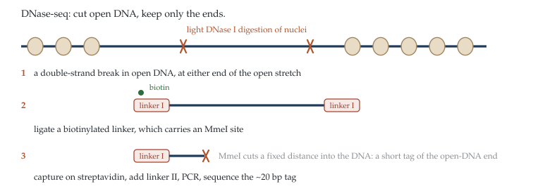{width=72%}

- DNase I cuts DNA that is not wrapped or covered. Digest lightly, so that most open stretches are cut at most once on each side
- The first genome-wide human maps used a biotinylated linker with an **MmeI** site: MmeI cuts a fixed distance away, giving a ~20 bp tag per cut
- Hypersensitive sites are regulatory elements: promoters, enhancers, insulators

[Boyle et al. 2008, doi:10.1016/j.cell.2007.12.014]{.small} · [protocol page](https://henriksson-lab.github.io/NGS_101/dnase-seq-boyle-2008__10.1016+j.cell.2007.12.014/dnase-seq-boyle-2008.html){.small}

## What a footprint is

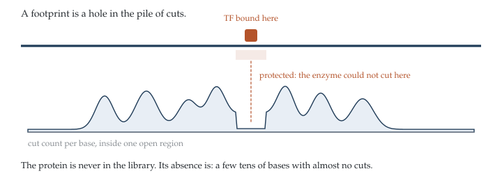{width=72%}

- A bound transcription factor shields a short stretch of DNA from the enzyme. Counted cuts dip there
- Footprinting from DNase data was first shown in yeast and then used to build a human map of motif occupancy
- Caution: nucleases and transposases have **sequence preferences**. A dip can be a cutting bias rather than a protein, so footprints are corrected against naked-DNA controls and need deep data

[Hesselberth et al. 2009, doi:10.1038/nmeth.1313]{.small} · [Neph et al. 2012, doi:10.1038/nature11212]{.small}

## Tn5: cut and ligate in a single step

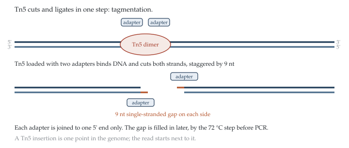{width=60%}

- A transposase, preloaded with two adapters, inserts them into DNA. This is **tagmentation**
- It replaces fragmentation, end repair, A-tailing and ligation by one reaction ([handles](../handles/lec.qmd)), and needs very little DNA
- The 9 nt gaps are filled by the polymerase in the first PCR cycle, at 72 °C. Skip that step and nothing amplifies
- Insertions are not random: they follow accessibility, with a mild sequence preference of their own

[Picelli et al. 2014, doi:10.1101/gr.177881.114]{.small}

## ATAC-seq: Tn5 as the probe

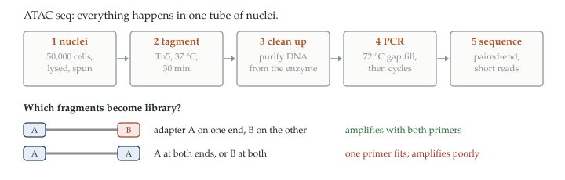{width=80%}

- Tn5 inserts its adapters into open DNA; the nucleosome-bound DNA is mostly out of reach
- 50,000 nuclei, 30 min at 37 °C: a few hours at the bench, and far less input than DNase-seq needs
- Reads are mapped, and the **insertion point** (shifted by a few bases to the Tn5 centre) is what is counted

[Buenrostro et al. 2013, doi:10.1038/nmeth.2688]{.small} · [protocol page](https://henriksson-lab.github.io/NGS_101/atac-seq__10.1038+nmeth.2688/atac-seq.html){.small}

## Fragment length carries information too

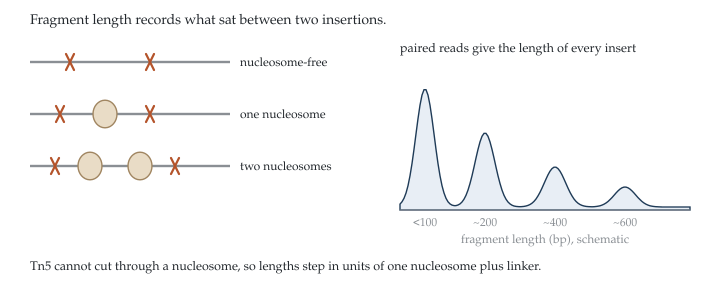{width=64%}

- Tn5 cuts twice per molecule, so each fragment has two insertion points and a length
- Short fragments come from open DNA; ~200 bp from one nucleosome; ~400 bp from two
- The length histogram is a quality check: a healthy library shows the nucleosome ladder, a failed one shows only large fragments
- Paired-end reads are needed to see this

[Buenrostro et al. 2013, doi:10.1038/nmeth.2688]{.small} · [Schep et al. 2015, doi:10.1101/gr.192294.115]{.small}

## Omni-ATAC: same enzyme, cleaner reaction

| Original ATAC | Omni-ATAC | Why it matters |
|---|---|---|
| Lysis in 0.1% IGEPAL | NP-40, Tween-20 and digitonin, 3 min on ice | Permeabilises more cell types evenly |
| Spin, transpose | Wash with Tween-20 before transposition | Removes mitochondria released by lysis |
| Water in the reaction | PBS plus digitonin and Tween-20 in the reaction | Lower background; works on frozen tissue |

- Mitochondrial DNA has no nucleosomes, so Tn5 cuts it with ease. In an unmodified protocol it can take a large share of the reads
- Each change is small. Together they raise the fraction of reads that fall in nuclear open chromatin

[Corces et al. 2017, doi:10.1038/nmeth.4396]{.small} · [protocol page](https://henriksson-lab.github.io/NGS_101/omni-atac__10.1038+nmeth.4396/omni-atac.html){.small}

## MNase-seq: sequence what the nucleosome protected

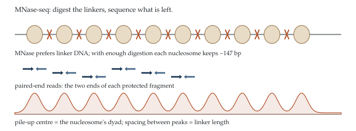{width=75%}

- Micrococcal nuclease prefers linker DNA over DNA wrapped on a histone octamer. With extended digestion, only ~147 bp per nucleosome survives
- The length of the surviving fragment is the read: its centre is the nucleosome position
- The opposite logic to ATAC. Here the **protected** DNA is the library and open DNA is destroyed
- Over-digestion loses weakly positioned nucleosomes; under-digestion keeps linkers

[Schones et al. 2008, doi:10.1016/j.cell.2008.02.022]{.small}

## Methyltransferase footprinting: mark first, read later

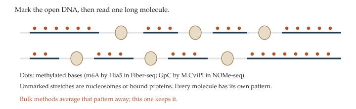{width=80%}

- Instead of cutting, add a **mark** to every accessible base. **NOMe-seq** uses a GpC methyltransferase and bisulfite. **Fiber-seq** uses an m6A methyltransferase and long reads
- Long reads see nucleosomes, factors and open DNA **on the same molecule**: which sites co-occur on one allele
- The cost is the read technology, and the need for nuclei that tolerate the enzyme

[Kelly et al. 2012, doi:10.1101/gr.143008.112]{.small} · [Stergachis et al. 2020, doi:10.1126/science.aaz1646]{.small}

## ChIP-seq: fix, break up, pull down

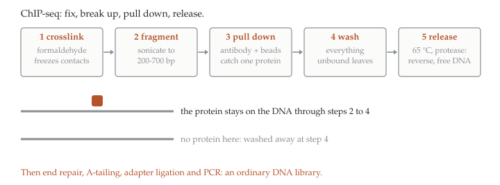{width=75%}

- The protein has to stay on the DNA through lysis, [shearing](../fragmentation/lec.qmd) and washing, so it is **fixed in place first**
- The antibody on beads is the only step that selects. Everything else is generic
- Release is the reverse of fixation: heat, protease, then purify the DNA

[Johnson et al. 2007, doi:10.1126/science.1141319]{.small} · [Robertson et al. 2007, doi:10.1038/nmeth1068]{.small} · [protocol page](https://henriksson-lab.github.io/NGS_101/chip-seq__10.1038+nmeth1068/chip-seq.html){.small}

## Crosslinking and reversal

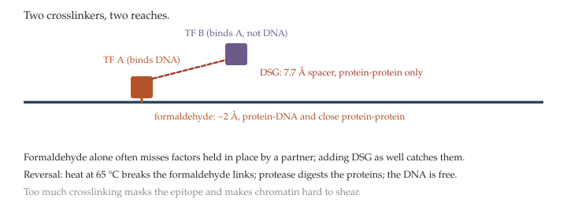{width=72%}

- Formaldehyde, typically 1% for 10 min at room temperature, then quenched with glycine
- DSG is added as a second crosslinker, before or after formaldehyde depending on the protocol, for factors that bind chromatin through partners. Heat does not reverse it, but the proteins are digested anyway
- More crosslinking gives more signal until it hides the epitope or the chromatin will not shear. Titrate it

[Robertson et al. 2007, doi:10.1038/nmeth1068]{.small}

## What ChIP reads mean

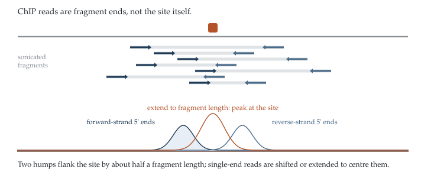{width=68%}

- Sonication gives fragments of a few hundred bp. The sequencer reads only the **ends**, and the protein sits somewhere in between
- Forward-strand and reverse-strand start counts form two humps. The site lies between them, at about half a fragment length from each
- **ChIP-exo** and **ChIP-nexus** add an exonuclease that trims each fragment back to the crosslink, so the hump collapses to base-pair resolution

[Rhee and Pugh 2011, doi:10.1016/j.cell.2011.11.013]{.small}

## The trap: easy-to-break chromatin looks like binding

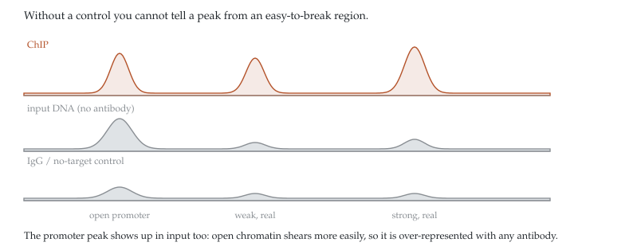{width=70%}

- Open, active chromatin shears more easily than closed chromatin, so it is over-represented in **every** ChIP, even with no antibody
- Without an input or IgG control, promoters of active genes look like binding sites for every factor
- Some loci seem to pull down unrelated proteins from several experiments. Controls and replicates are not optional

[Teytelman et al. 2013, doi:10.1073/pnas.1316064110]{.small} · [Landt et al. 2012, doi:10.1101/gr.136184.111]{.small}

## The tethered-enzyme idea

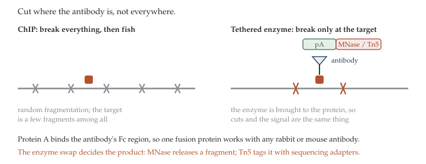{width=70%}

- In ChIP, cutting is random and selection is by antibody afterwards. A tether **reverses the order**: the antibody goes on first, and the enzyme is brought to it
- **Protein A** binds the constant region of IgG, so a protein A fusion works with any suitable antibody
- Swap the enzyme and the whole protocol changes: MNase gives CUT&RUN, Tn5 gives CUT&Tag
- This is a block in its own right, and the same idea sits behind several other methods

[Schmid et al. 2004, doi:10.1016/s1097-2765(04)00540-4]{.small}

## CUT&RUN: cut out, then release

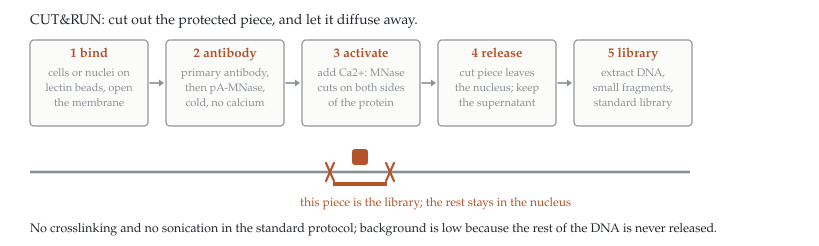{width=76%}

- No crosslinking by default and no sonication. Cells are permeabilised on beads and kept cold
- MNase is inactive without calcium, so the antibody and pA-MNase can bind and be washed first. Calcium starts the reaction
- The cut-out fragments diffuse out of the nucleus. The rest of the genome never leaves, which is why the background is low

[Skene and Henikoff 2017, doi:10.7554/eLife.21856]{.small} · [protocol page](https://henriksson-lab.github.io/NGS_101/cut-run__10.7554+eLife.21856/cut-run.html){.small}

## CUT&Tag: cut and tag in one reaction

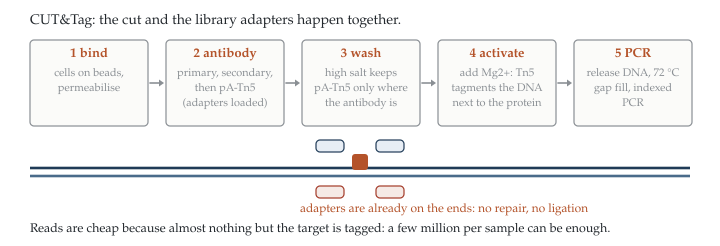{width=76%}

- The same logic with pA-Tn5, preloaded with adapters. Magnesium activates it, and the product is already a library fragment
- High-salt washes remove pA-Tn5 that is bound non-specifically, since Tn5 otherwise lands in open DNA
- Works from small samples and single cells; sequencing needs are modest

[Kaya-Okur et al. 2019, doi:10.1038/s41467-019-09982-5]{.small} · [protocol page](https://henriksson-lab.github.io/NGS_101/cut-tag__10.1038+s41467-019-09982-5/cut-tag.html){.small}

## What the reads look like

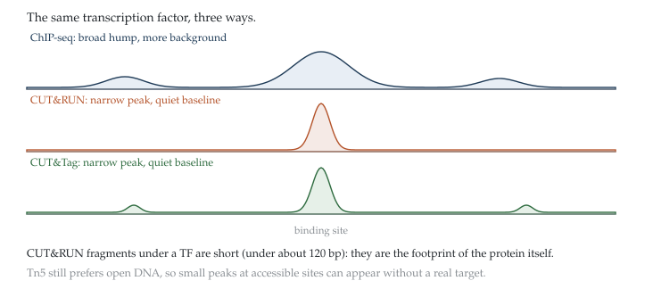{width=64%}

- Tethered methods give narrower peaks and a quieter baseline than ChIP
- For a transcription factor, CUT&RUN fragments are short: the protein protects only a few tens of bp, so the fragment **is** the footprint
- Both methods are sensitive to antibody quality and to the permeabilisation. An IgG control is still needed

[Meers et al. 2019, doi:10.7554/eLife.46314]{.small}

## ChIP-seq, CUT&RUN and CUT&Tag, side by side

| | ChIP-seq | CUT&RUN | CUT&Tag |
|---|---|---|---|
| Cells needed | Typically millions | Thousands to hundreds of thousands | Down to single cells |
| Crosslinking | Required | Optional | Optional |
| Fragmentation | Sonication | MNase at the target | Tn5 at the target |
| Library | Ligation or tagmentation | Ligation | Included in the cut |
| Background | Higher | Low | Low, but open DNA is a hazard |
| Best for | Any epitope, even fixed samples | Transcription factors | Histone marks |

If your antibody only works after crosslinking, or your sample is fixed tissue, ChIP remains the fallback.

## DamID: no antibody, no crosslinking

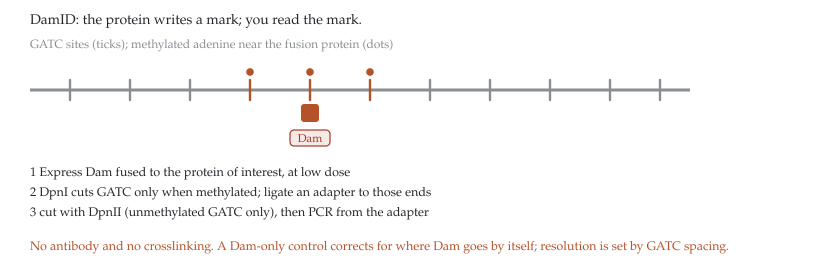{width=72%}

- Fuse *E. coli* Dam to the protein of interest. Wherever the fusion sits, nearby GATC sites are **methylated on adenine**
- DpnI cuts only methylated GATC; DpnII cuts only unmethylated GATC. The two together select the marked fragments
- The mark is a **record**, written in living cells. A single-cell version was used to map lamina contacts in human cells

[van Steensel and Henikoff 2000, doi:10.1038/74487]{.small} · [Kind et al. 2015, doi:10.1016/j.cell.2015.08.040]{.small}

## Calling cards: a record that keeps

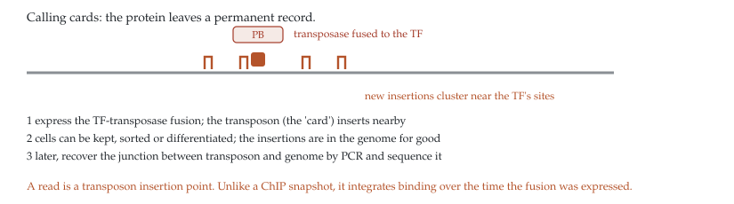{width=76%}

- A transposase fused to a TF drops transposons into the genome near the TF's binding sites
- Reads are insertion points. Because the insertions are permanent, they accumulate over time instead of showing one moment
- Mammalian versions use piggyBac. The collection page shows the earlier yeast Ty5 implementation

[Wang et al. 2012, doi:10.1534/genetics.111.137315]{.small} · [protocol page](https://henriksson-lab.github.io/NGS_101/calling-card-seq-genomic-ty5-recovery__10.1101+gr.114850.110/01_calling-card-seq.html){.small}

## DAP-seq: binding without the cell

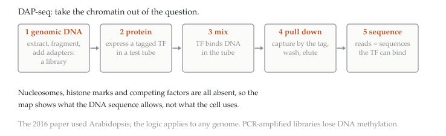{width=76%}

- DNA from any genome is made into a library, and a tagged TF made *in vitro* is allowed to bind it
- The result is the **intrinsic** specificity of the protein, without nucleosomes or competitors. Comparing with ATAC or ChIP tells you what the cell adds
- Libraries made with PCR lack DNA methylation, which may matter for the factor

[O'Malley et al. 2016, doi:10.1016/j.cell.2016.04.038]{.small} · [protocol page](https://henriksson-lab.github.io/NGS_101/dap-seq__10.1016+j.cell.2016.04.038/01_dap-seq.html){.small}

## Why the real protocols differ

Compare any two protocols and ask which block was swapped, and which problem that solves.

- **ATAC → Omni-ATAC**: same Tn5, different detergents and wash. The problem was mitochondrial and non-specific reads
- **ChIP → ChIPmentation**: sonicated chromatin on beads is tagmented with Tn5 instead of [end repair and ligation](../end-chemistry/lec.qmd). The problem was input and hands-on time [Schmidl et al. 2015, doi:10.1038/nmeth.3542]{.small}
- **ChIP → CUT&RUN**: fragment at the target instead of everywhere. The problem was background and cell number
- **CUT&RUN → CUT&Tag**: the cutter also writes the adapters. The problem was a library step with losses at low input
- **Bulk → single-cell**: the same chemistry, with the [nucleus as the compartment](../compartments/lec.qmd) and a barcode per nucleus [Bartosovic et al. 2022, doi:10.1038/s41587-022-01535-4]{.small}

## Choosing a method

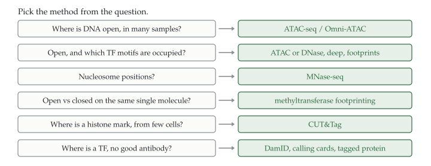{width=72%}

- Start from what you want to say about the genome, then pick the block that gives the read that carries it
- Single-molecule questions push towards long reads; few cells push towards tethered Tn5

## What one read means

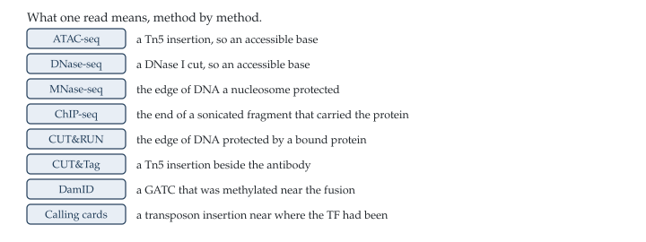{width=72%}

- Write this sentence for any new method before reading the protocol: **one read is ___**
- If you cannot complete it, you cannot interpret the track

## Take-home

- A library for chromatin is an ordinary library plus a way to turn **position** into reads
- Three mechanisms: **cut and keep** (DNase, ATAC, MNase), **pull down** (ChIP, DAP-seq), **tether** (CUT&RUN, CUT&Tag), and one that **writes a mark** (DamID, calling cards, Fiber-seq)
- The enzyme decides what the ends look like, and so which later steps are needed
- Controls decide whether a peak is believed, and [which control answers which failure](../design/lec.qmd) is a design question

::: {.notes}
Links onward: Tn5 and tagmentation are covered in the blocks unit; proximity ligation is the next unit.
:::

## Where this connects

**Blocks this protocol uses** — hold the protein in place, cut, select, and turn the fragment into a library

- [Nucleases](../enzymes/lec-nucleases.qmd) — DNase I and MNase cut by accessibility; that preference is the measurement
- [Transposases](../enzymes/lec-transposases.qmd) — what Tn5 needs, where it lands, and the 9 bp offset in the read
- [Fragmentation](../fragmentation/lec.qmd) — sonication for ChIP, and why order matters: cut before or after the pull-down
- [Selection](../selection/lec.qmd) — an antibody selects a protein and carries its DNA with it; enrichment is a ratio
- [End chemistry](../end-chemistry/lec.qmd) — the gap left by Tn5, and the ends a nuclease leaves for the ligase
- [Handles](../handles/lec.qmd) — ligation or transposition; in CUT&Tag the handle is attached by the cut itself
- [Chemistry into sequence](../chemistry-to-sequence/lec.qmd) — cuts, methyl marks and insertions are three ways to write a position
- [Compartments](../compartments/lec.qmd) — permeabilised cells and nuclei as the vessel the reaction happens in
