## Why compartments exist

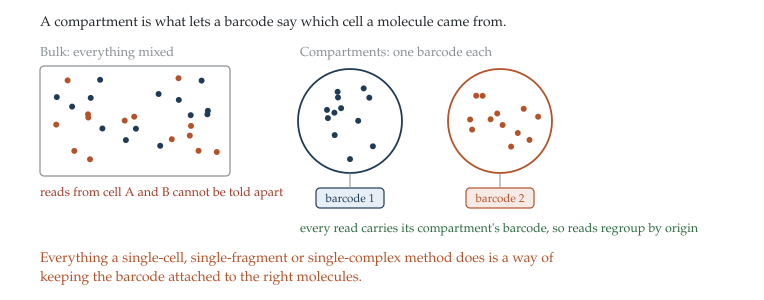{width=64%}

- Pool the molecules of two cells and you can never separate them again
- A compartment holds one cell's molecules together long enough to give them a shared barcode
- The barcode is the only thing that survives into the sequencer

## What is being kept together

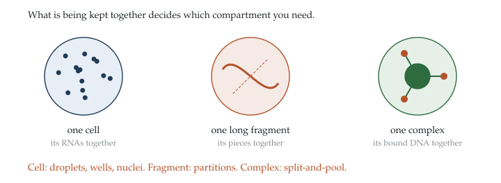{width=68%}

- A **cell**, so that its RNAs or accessible DNA can be counted as one profile
- A long **fragment**, so that short reads can be linked back to one molecule
- A **complex**, so that pieces bound together can be read as contacts

## The barcode is printed on the bead

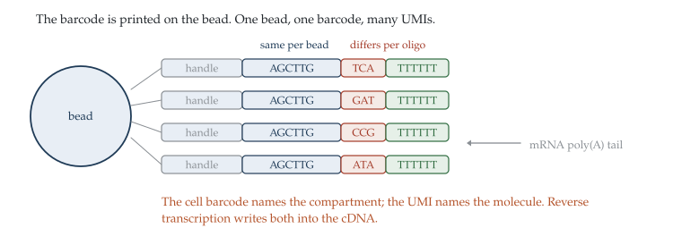{width=69%}

- Every oligo on a bead has the same cell barcode and a different [UMI](../barcodes-umis/lec.qmd)
- A cell lysed beside the bead has its mRNA captured on those oligos
- Barcode and UMI are then written into the cDNA, and every read can be traced to its compartment ([Drop-seq](https://henriksson-lab.github.io/NGS_101/drop-seq__10.1016+j.cell.2015.05.002/drop-seq.html))

[Macosko et al. 2015, doi:10.1016/j.cell.2015.05.002]{.small}

## Wells and plates

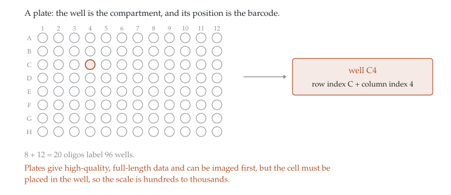{width=58%}

- Place one cell (or nucleus) per well, and let the well's position be the barcode
- Row index plus column index is enough: 20 oligos label 96 wells
- Cost is hands and time, not statistics, so the cell count stays small

## Microwells

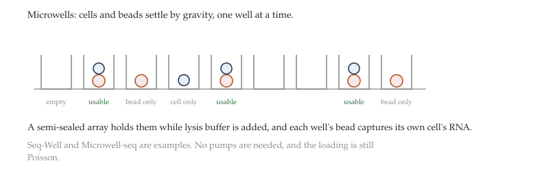{width=78%}

- Cells and barcoded beads sink into an array of wells; the array is sealed and lysed
- Seq-Well and Microwell-seq work this way, with no instrument beyond a pipette ([Seq-Well](https://henriksson-lab.github.io/NGS_101/seq-well__10.1038+nmeth.4179/seq-well.html), [Microwell-seq](https://henriksson-lab.github.io/NGS_101/microwell-seq__10.1016+j.cell.2018.02.001/microwell-seq.html))
- Fill is random, so Poisson statistics apply

[Gierahn et al. 2017, doi:10.1038/nmeth.4179]{.small}

## Droplets

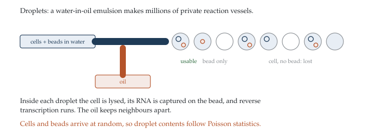{width=69%}

- Oil and water meet at a junction, and each drop becomes a compartment, as in [emulsion PCR](../amplification/lec.qmd)
- Cell, bead and lysis mix are co-encapsulated, so RNA capture happens in each drop ([inDrop](https://henriksson-lab.github.io/NGS_101/indrop-v1__10.1016+j.cell.2015.04.044/indrop-v1.html))
- Cells and beads arrive at random

[Klein et al. 2015 (inDrop), doi:10.1016/j.cell.2015.04.044; Zheng et al. 2017, doi:10.1038/ncomms14049]{.small}

## Loading is a random process

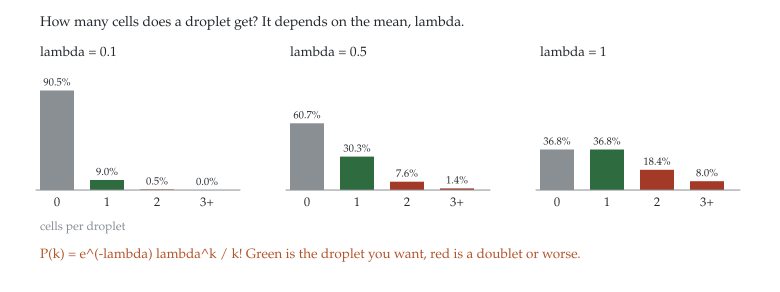{width=67%}

- If cells enter at random with a mean of $\lambda$ per droplet, the chance of exactly $k$ is $P(k)=e^{-\lambda}\lambda^k/k!$
- Lower $\lambda$: mostly empty droplets, few doublets
- Higher $\lambda$: fewer empties, more doublets

## The calculation by hand {.smaller}

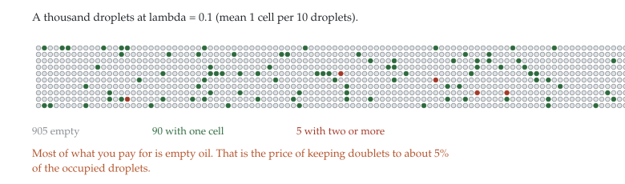{width=85%}

Load at $\lambda = 0.1$. Use $e^{-x}\approx 1-x+x^2/2$, so $P(0)=e^{-0.1}\approx 0.905$.

- One cell: $P(1)=\lambda\,P(0)=0.1\times 0.905=0.0905$; two cells: $P(2)=\lambda^2/2\times P(0)=0.0045$
- Two or more: $1-P(0)-P(1)=0.0047$, about 5 in 1000 droplets
- Of the **occupied** droplets, $0.0047/(0.0905+0.0047)\approx 5\%$ are doublets

## Choosing the loading rate

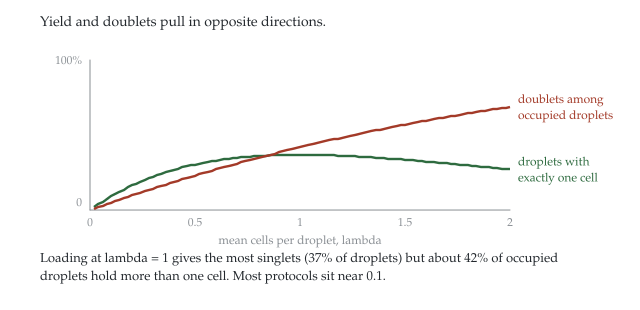{width=52%}

- Singlets peak at $\lambda=1$, but then about 42% of occupied droplets hold more than one cell
- At $\lambda=0.5$: 23% doublets; at 0.1: 5%; at 0.05: 2.5%
- A rule of thumb: doublet fraction among occupied droplets is about $\lambda/2$ when $\lambda$ is small

## Cells and beads are two draws

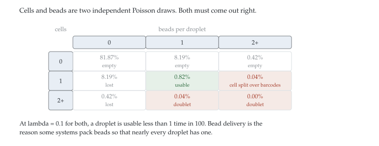{width=65%}

- A usable droplet needs one cell **and** a bead; each arrives at random
- A droplet with two beads can split one cell's RNA over two barcodes
- This is why systems that deliver beads as a packed, ordered stream are efficient: a cell finds a bead nearly every time

## Seeing doublets

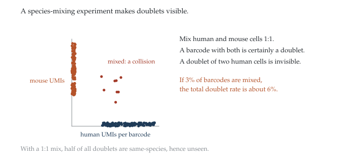{width=56%}

- Mix human and mouse cells; barcodes with both species are collisions
- Only half of doublets are mixed-species, so double the observed fraction
- Cell hashing and genotype mixing — pooling donors and telling them apart by their common SNPs — mark samples so that doublets can be flagged without species mixing

[Stoeckius et al. 2018, doi:10.1186/s13059-018-1603-1; Kang et al. 2018, doi:10.1038/nbt.4042]{.small}

## Nuclei as compartments

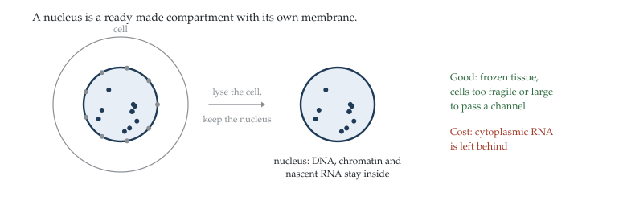{width=75%}

- A nucleus has its own membrane, so DNA, chromatin and nuclear RNA stay inside
- Nuclei can be isolated from frozen tissue and from cells too large or fragile for a channel
- Cost: cytoplasmic mRNA is lost, and nuclear RNA is more intronic

[Habib et al. 2017, doi:10.1038/nmeth.4407]{.small}

## Fix and permeabilise instead of isolating

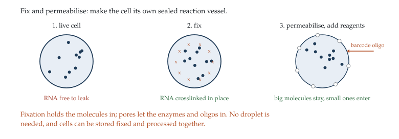{width=72%}

- Formaldehyde or methanol fixation holds the RNA in the cell
- Mild permeabilisation lets small enzymes and oligos enter
- The cell is now a reaction vessel with no oil around it ([in-vessel tricks](../tricks/lec-more.qmd)), and fixed cells keep for batch processing

## Split-and-pool is a virtual compartment

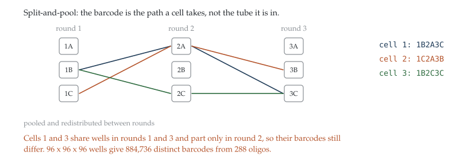{width=69%}

- Distribute cells to wells, add a barcode inside the cells, pool, redistribute, add the next
- A cell's barcode is its [path](../single-cell/lec-combinatorial.qmd); two cells collide only if every round matches
- Three rounds of 96 give 884,736 combinations from 288 oligos; published designs vary the
  round sizes ([SPLiT-seq](https://henriksson-lab.github.io/NGS_101/split-seq__10.1126+science.aam8999/split-seq.html) uses 48 wells in the first round, [sci-RNA-seq3](https://henriksson-lab.github.io/NGS_101/sci-rna-seq3__10.1038+s41586-019-0969-x/sci-rna-seq3.html))

[Rosenberg et al. 2018, doi:10.1126/science.aam8999; Cao et al. 2017, doi:10.1126/science.aam8940]{.small}

## Collisions are Poisson too

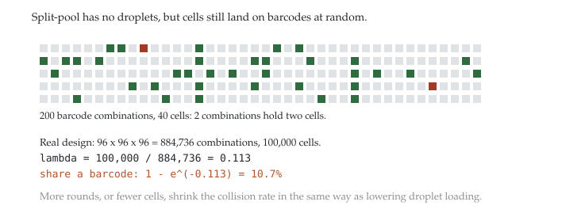{width=65%}

- With $n$ cells and $N$ combinations, each combination holds $\lambda=n/N$ cells on average
- 100,000 cells over 884,736 combinations: $\lambda=0.113$, so 10.7% of cells share a barcode
- Fewer cells or more rounds lower it; doublets cannot be seen without a species mix or a genotype

## In-situ reactions in nuclei

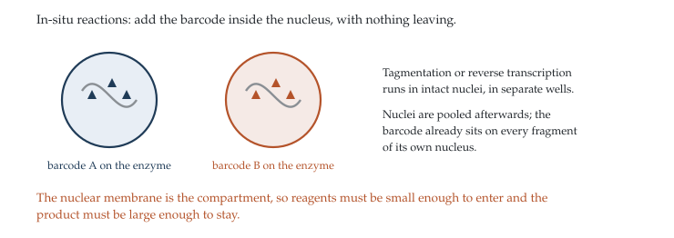{width=71%}

- [Tagmentation](../enzymes/lec-transposases.qmd) or reverse transcription runs with a barcoded enzyme or primer in each well
- The barcode goes in, and nothing comes out: the nucleus holds it
- This is the first round of most combinatorial protocols ([sci-ATAC-seq](https://henriksson-lab.github.io/NGS_101/sci-atac-seq__10.1126+science.aab1601/sci-atac-seq.html))

[Cusanovich et al. 2015, doi:10.1126/science.aab1601]{.small}

## Two-stage encapsulation

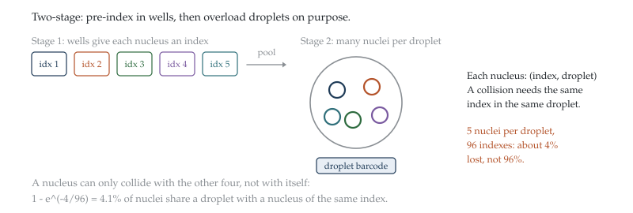{width=74%}

- Pre-index nuclei in wells, then load many per droplet
- Nuclei in one droplet share a droplet barcode but differ in the first index
- Worked: 5 nuclei per droplet, 96 indexes. A nucleus can only collide with the other four, so $1-e^{-4/96}\approx 4\%$ are ambiguous

[Lareau et al. 2019, doi:10.1038/s41587-019-0147-6; Datlinger et al. 2021, doi:10.1038/s41592-021-01153-z]{.small}

## Capsules and hydrogels

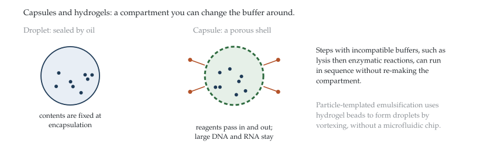{width=78%}

- A porous shell keeps cells and nucleic acids in, yet lets reagents pass
- Buffer exchange between steps becomes possible, which droplets do not allow
- Hydrogel beads can form droplets by vortexing, so no microfluidic device is needed
- The barcoded oligo is built into the gel rather than stuck to its surface: an acrydite group on the oligo copolymerises with the acrylamide, and the oligo is cleaved off when the reaction needs it ([oligo modifications](../nucleic-acids/lec.qmd))

[Clark et al. 2023, doi:10.1038/s41587-023-01685-z]{.small}

## From read to compartment

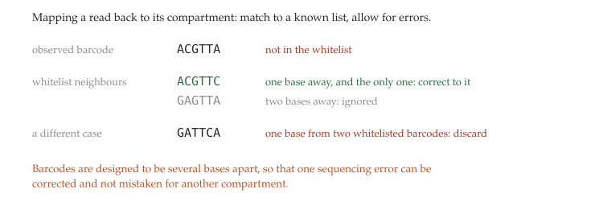{width=72%}

- Barcodes come from a known list, and a read's barcode is matched to it
- A barcode one base away from exactly one entry is corrected; one that is near two is discarded
- Barcode sets are designed with large pairwise differences for this reason

## Which barcodes are cells?

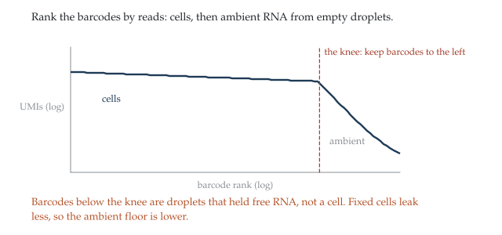{width=53%}

- Rank barcodes by their reads: real cells form a plateau, then a drop to droplets that held free RNA
- A cut at the knee separates them, with ambient RNA as the floor
- Leaky cells raise the floor, and fixed cells leak less

[Zhang et al. 2019, doi:10.1016/j.molcel.2018.10.020]{.small}

## Compartments for fragments

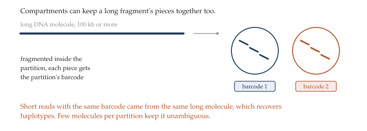{width=70%}

- Long DNA is partitioned so that each compartment holds a few molecules
- Short reads sharing a barcode are linked back to one long fragment
- Poisson again: too many molecules per partition and neighbours are confused

## Compartments for complexes

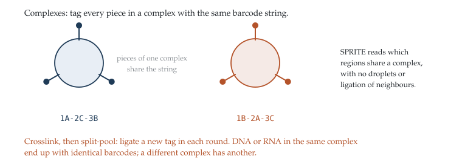{width=69%}

- Crosslinked complexes are split-pooled; each round ligates a tag onto every piece
- Pieces of one complex receive the same string of tags
- A shared barcode string means a shared complex, a [ligation-free route to contacts](../3d-genome/lec.qmd) ([SPRITE](https://henriksson-lab.github.io/NGS_101/sprite__10.1016+j.cell.2018.05.024/sprite.html))

[Quinodoz et al. 2018, doi:10.1016/j.cell.2018.05.024]{.small}

## Choosing a compartment

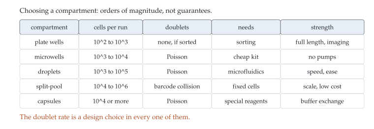{width=73%}

- Scale falls out of how many compartments you can make without hands
- Fixation, nuclei and capsules widen what can be profiled
- Figures are orders of magnitude, so check the current kit sheet

## What a compartment buys and costs

A compartment is a promise: **everything in here shares a barcode**.

- It costs yield (empty compartments), purity (doublets, ambient RNA) and sometimes chemistry
  (buffers that must be compatible for every step)
- A rule that applies in all of them: decide the loading rate first, then compute the doublet
  rate you accept
- Before any experiment, ask how a doublet would look in the data, and plan the control that
  exposes it: a species mix, a hash or a genotype

::: {.notes}
Tie back to the first figure: a barcode attached to one cell's molecules.
:::

## Where this connects

**Where this block is used**

- [Single cells](../single-cell/lec.qmd) — plates, droplets and microwells as whole protocols, with the knee plot and ambient RNA
- [Spatial](../spatial/lec.qmd) — the compartment becomes a position: an array spot, a channel crossing or a selected region
- [Genomic DNA](../genomic-dna/lec.qmd) — one cell holds 6.5 pg, so single-cell whole-genome amplification happens inside a well or droplet

**What a compartment needs**

- [Selection](../selection/lec.qmd) — sorting or fixing cells before they go in, and why a sort changes the cells
- [Attaching a handle](../handles/lec.qmd) — the barcode still has to reach the molecule inside: a bead-bound oligo, an RT primer or a ligation
