## An association is not a molecule

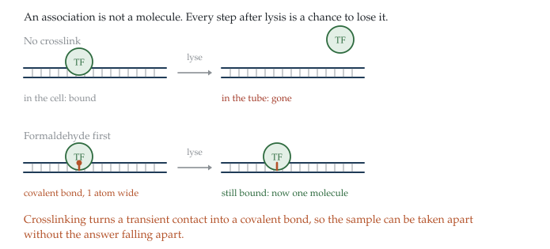{width=58%}

- A transcription factor on its site, a protein on an mRNA, two loci touching in the nucleus: all of these are held by affinity, and affinity does not survive a lysis buffer
- A crosslink converts the association into a covalent bond, so the cell can be taken apart without the answer coming apart with it
- Formaldehyde fixation of chromatin is the original form of the trick

[Jackson 1978, doi:10.1016/0092-8674(78)90278-7; Solomon and Varshavsky 1985, doi:10.1073/pnas.82.19.6470]{.small}

## What the bond has to survive

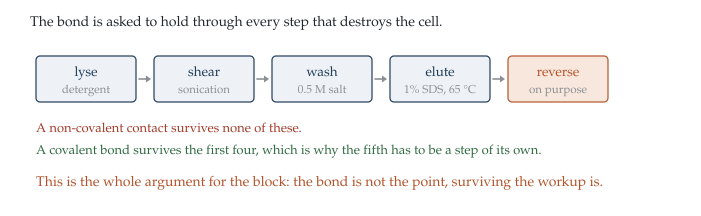{width=78%}

- The crosslink is not made for its own sake. It is made so that one association outlives detergent, sonication, high salt and a hot SDS elution
- That is also why removing it has to be a planned step, with its own chemistry, rather than something that happens on its own
- Every property in this deck follows from these two sentences

## Formaldehyde: a methylol adduct, then a bridge

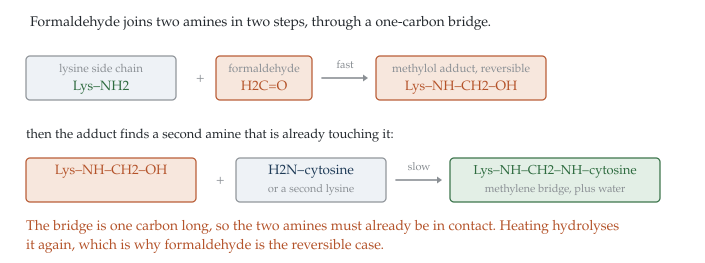{width=68%}

- Formaldehyde attacks a primary amine — a lysine side chain, or the exocyclic amino group of adenine, cytosine or guanine — and forms a **methylol adduct**, which is fast and reversible
- The adduct then condenses with a second amine nearby to give a **methylene bridge**, one carbon long, releasing water. That second step is slow, and it is the crosslink
- Both protein–protein and protein–nucleic-acid pairs are joined, because both have amines

[McGhee and von Hippel 1975, doi:10.1021/bi00677a029; Hoffman et al. 2015, doi:10.1074/jbc.R115.651679]{.small}

## The arm length is the specification

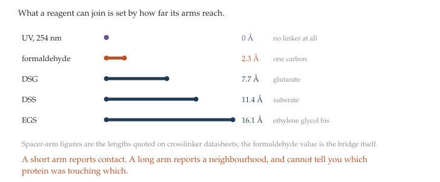{width=62%}

- A one-carbon bridge means the two amines were already touching. Formaldehyde therefore reports **contact**, not proximity
- The succinimidyl-ester crosslinkers reach 7–16 Å and report a neighbourhood: anything within the arm can be joined, and you cannot tell afterwards which pair it was
- The trade is between a bond that is informative and a bond that is likely to form at all

## Dose, time and the quench

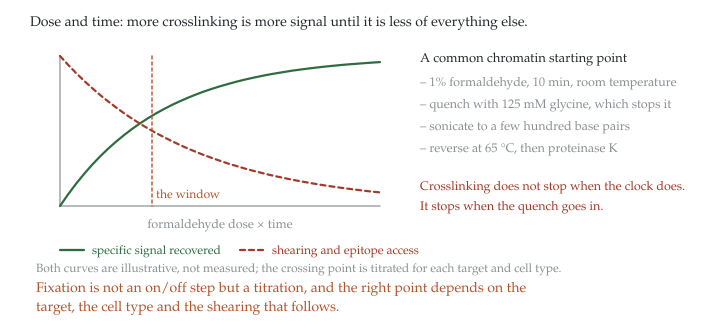{width=58%}

- 1% formaldehyde for 10 min at room temperature is a common chromatin starting point, stopped with 125 mM glycine, a small free amine that competes for the aldehyde
- The reaction runs until it is quenched, so the quench is part of the dose. Fixation is a titration, not a switch
- Longer fixation crosslinks more, and the same bonds then hide the epitope and stop the chromatin shearing or dissolving

[Schmiedeberg et al. 2009, doi:10.1371/journal.pone.0004636; Baranello et al. 2016, doi:10.1007/s10577-015-9509-1]{.small}

## A second reagent, for protein to protein

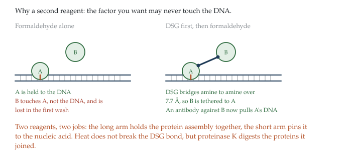{width=59%}

- A factor that binds chromatin only through a partner is never within one carbon of the DNA, so formaldehyde alone cannot hold it there
- **DSG**, disuccinimidyl glutarate, is an amine-reactive ester at both ends with a 7.7 Å arm. It joins protein to protein and nothing else, and goes in as a separate step, commonly before the formaldehyde
- Heat does not reverse it. It does not have to: the proteins it joined are digested at the end anyway

[Zeng et al. 2006, doi:10.2144/000112297; Krietenstein et al. 2020, doi:10.1016/j.molcel.2020.03.003 ([Micro-C](https://henriksson-lab.github.io/NGS_101/micro-c__10.1016+j.cell.2015.05.048/micro-c.html))]{.small}

## Reading a crosslinker datasheet

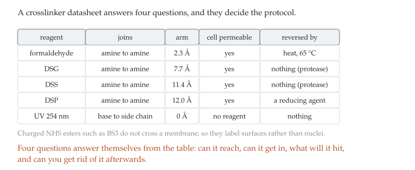{width=62%}

- Four properties decide whether a reagent can be used: what groups it reacts with, how far it reaches, whether it crosses a membrane, and what takes it apart again
- A charged ester such as BS3 stays outside the cell, so it labels surfaces; DSP carries a disulphide in the arm, so a reducing agent cleaves it
- The same four questions apply to any new crosslinker you meet

## UV: zero-length, and it stays

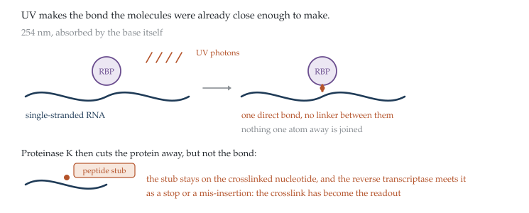{width=64%}

- At 254 nm the base itself absorbs, becomes reactive, and bonds directly to an amino acid side chain that is touching it. There is no linker, so the reach is zero
- In practice this works for RNA and protein: single-stranded RNA is accessible and the photochemistry is efficient enough to use
- Nothing undoes the bond. Proteinase K removes the protein and leaves a **peptide stub** on the crosslinked nucleotide

[Greenberg 1979, doi:10.1093/nar/6.2.715; Wagenmakers et al. 1980, doi:10.1111/j.1432-1033.1980.tb07207.x; Ule et al. 2003, doi:10.1126/science.1090095]{.small}

## 4-thiouridine moves the wavelength

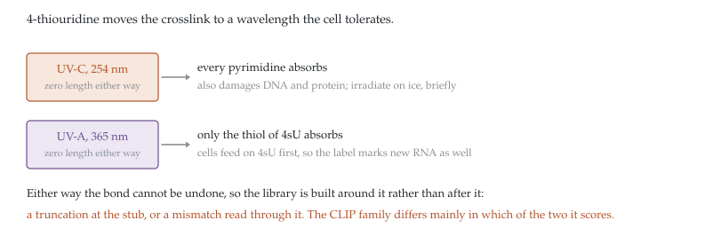{width=74%}

- UV-C damages everything that absorbs it, so the dose is kept low and the cells are kept cold
- Feed cells 4-thiouridine and the sulphur gives a group that absorbs in the UV-A, so 365 nm light activates it where the rest of the cell is nearly transparent. The crosslink is still zero-length
- The label also marks RNA made during the pulse, so one reagent carries both a crosslink and a time axis

[Hafner et al. 2010, doi:10.1016/j.cell.2010.03.009 ([PAR-CLIP](https://henriksson-lab.github.io/NGS_101/par-clip__10.1016+j.cell.2010.03.009/par_clip.html)); Lee and Ule 2018, doi:10.1016/j.molcel.2018.01.005]{.small}

## Fixing a cell rather than a complex

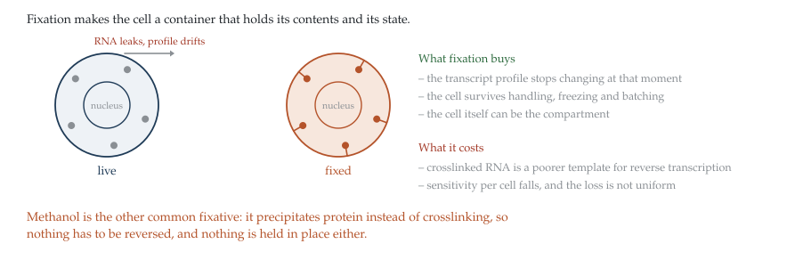{width=72%}

- The same chemistry applied to a whole cell holds the contents in place and stops the transcript profile changing while the sample waits
- A fixed cell tolerates handling, freezing and batching, and can serve as its own compartment
- The cost is that crosslinked RNA is a poorer template for reverse transcription, so sensitivity falls, and not evenly across transcripts

[Alles et al. 2017, doi:10.1186/s12915-017-0383-5]{.small}

## Permeabilisation pulls the other way

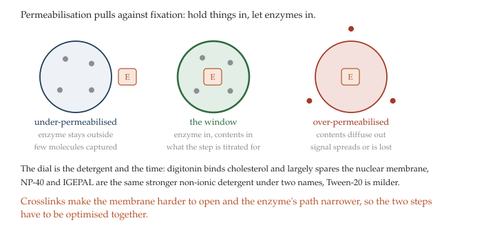{width=55%}

- Holding molecules in and letting enzymes in are opposite requirements, set by the same two dials: which detergent, and for how long
- Under-permeabilised, the enzyme never reaches the target; over-permeabilised, the contents leave before the reaction happens
- Crosslinks narrow the window from both sides, which is why fixation and permeabilisation are optimised as one step

[Corces et al. 2017, doi:10.1038/nmeth.4396 ([Omni-ATAC](https://henriksson-lab.github.io/NGS_101/omni-atac__10.1038+nmeth.4396/omni-atac.html))]{.small}

## Reversal: heat first, then protease

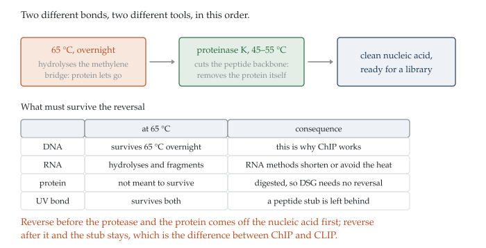{width=50%}

- Heating to 65 °C hydrolyses the methylene bridge; proteinase K cuts the peptide backbone. They are different jobs and the order changes what is left behind
- DNA survives the heat, which is why ChIP works at all. RNA does not survive it as well, so RNA protocols shorten the heat step or do without one
- Reversal is a choice rather than a rule: FAIRE keeps the crosslink and selects on it, since crosslinked chromatin partitions into the phenol phase and open DNA stays in the aqueous phase

[Giresi et al. 2007, doi:10.1101/gr.5533506]{.small}

## Worked example: formaldehyde ChIP

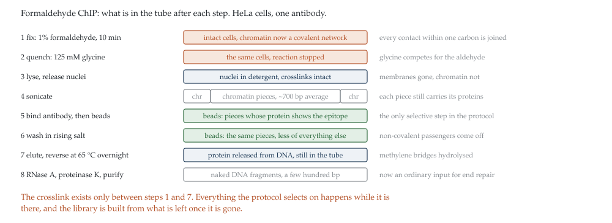{width=70%}

- The assay itself — antibody, controls, what the read pile-up means — belongs to [chromatin](../chromatin/lec.qmd). Here we follow only the material, and ask at every step what is holding it together
- The protocol is the original STAT1 ChIP-seq in HeLa cells, 1% formaldehyde for 10 min, quenched with glycine, sonicated to an average of about 700 bp

[Robertson et al. 2007, doi:10.1038/nmeth1068 ([ChIP-seq](https://henriksson-lab.github.io/NGS_101/chip-seq__10.1038+nmeth1068/chip-seq.html))]{.small}

## What is in the tube: steps 1 to 4

- **After fixing.** Intact cells. Every pair of amines that happened to be in contact is bridged, protein to protein and protein to DNA, at many sites at once. The chromatin of one nucleus is now a single covalent network
- **After the quench.** The same cells, with the free aldehyde consumed. Nothing further is joined from this point on
- **After lysis.** Nuclei, then a chromatin suspension in detergent. The membranes are gone and the network is not
- **After sonication.** Pieces averaging a few hundred base pairs, each still carrying whatever protein was crosslinked to it. That is the only reason the next step can select anything

## What is in the tube: steps 5 to 8

- **After the antibody and the beads.** The beads hold the pieces whose protein still presents the epitope. An epitope bridged by formaldehyde is invisible here, and the failure looks exactly like a poor antibody
- **After the washes.** The same pieces, with less of everything else. Salt and detergent strip off what was held by affinity; the covalent bonds stay
- **After the reversal**, 65 °C overnight. The bridges hydrolyse and the protein lets go of the DNA, though it is still in the tube
- **After RNase A and proteinase K.** Naked DNA of a few hundred base pairs, with mixed ends — an ordinary input for [end repair, dA-tailing and adapter ligation](../end-chemistry/lec.qmd)

## The contrast: UV CLIP cannot be reversed

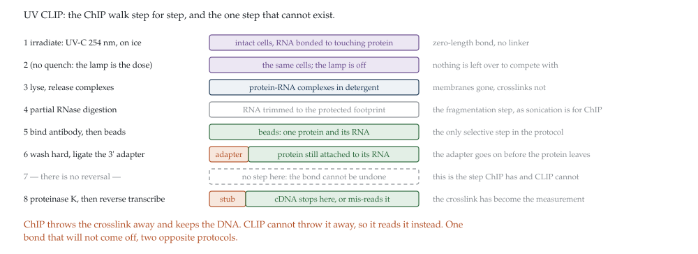{width=76%}

- The same shape of walk, with step 7 missing. The 3′ adapter is ligated while the protein is still attached, because there is no later point at which the RNA is free and intact
- Proteinase K leaves the stub, the reverse transcriptase stops at it or mis-reads it, and that event is the measurement
- The [CLIP family](../modifications/lec-rna.qmd) differs mainly in which consequence of the stub it scores

[König et al. 2010, doi:10.1038/nsmb.1838 ([iCLIP](https://henriksson-lab.github.io/NGS_101/iclip__10.1038+nsmb.1838/iclip_partial.html))]{.small}

## What crosslinking costs

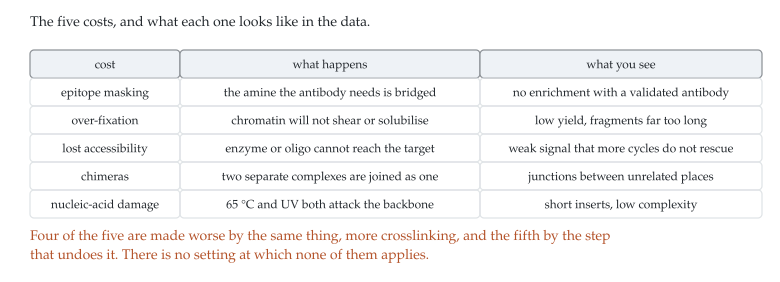{width=70%}

- Epitope masking, over-fixation and lost accessibility all get worse with more crosslinking, and the damage from reversing it gets worse with less
- Chimeras are the cost specific to methods that read a junction: two complexes joined, or two ends meeting by chance, look like one observation
- There is no dose at which none of these applies, which is why every crosslinking protocol states a concentration, a time and a temperature

[Gavrilov et al. 2015, doi:10.1093/bfgp/elu037]{.small}

## Methods built around avoiding it

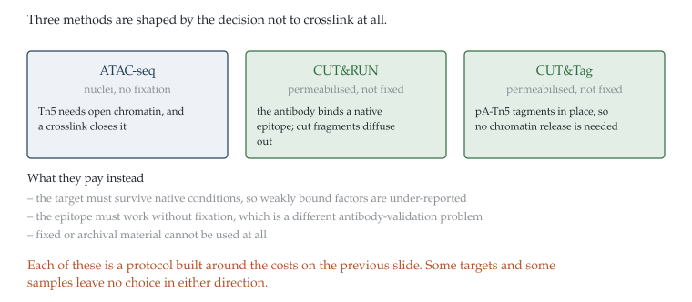{width=58%}

- ATAC, CUT&RUN and CUT&Tag work on unfixed nuclei or permeabilised cells, and each is shaped by that decision: Tn5 needs chromatin that a crosslink would close, and the antibody has to bind a native epitope
- What they pay for it: weakly bound factors are under-reported, antibody validation is a different problem, and archival fixed material cannot be used
- The assays themselves are in [chromatin](../chromatin/lec.qmd); what matters here is that the chemistry of this deck is what they were designed around

## Where this connects

**Where this block is used**

- [Chromatin and protein–DNA](../chromatin/lec.qmd) — ChIP as an assay, and the tethered-enzyme methods that do without fixation
- [Three-dimensional genome](../3d-genome/lec.qmd) — the crosslink is the measurement: hold the neighbours, cut, ligate, select the junction
- [Modifications in RNA](../modifications/lec-rna.qmd) — the CLIP family, where the stub left by UV is read as a truncation or a mismatch
- [Compartments](../compartments/lec.qmd) and [Spatial](../spatial/lec.qmd) — the fixed, permeabilised cell or section as the vessel the reaction happens in

**What this block needs**

- [Fragmentation](../fragmentation/lec.qmd) — crosslinked chromatin shears differently from naked DNA, and over-fixed chromatin barely shears at all
- [Selection](../selection/lec.qmd) — a crosslink holds a complex together but chooses nothing; an antibody, a biotin or a probe still has to
- [Nucleases and proteases](../enzymes/lec-nucleases.qmd) — what is left after the reversal decides which enzyme can act next
