## A protocol is a program of blocks

A library preparation looks like a list of reagents and times. Read it as a sequence of **blocks**, each of which does one thing to the ends or the content of the molecule.

The skill this deck teaches:

1. **Read** a protocol as blocks, and draw the construct after every step
2. **Predict** how it fails, from what each block leaves behind
3. **Choose controls** that tell the failures apart
4. **Design** your own, which is the capstone exercise

::: {.notes}
The runner uses this to tell a real failure from a cosmetic one; the designer uses it to assemble blocks that are known to work together.
:::

## Eight blocks

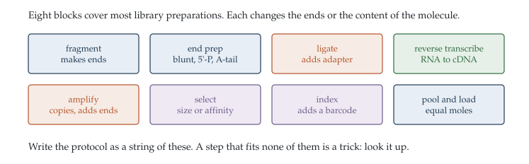{width=91%}

- Every protocol in the NGS 101 collection is a string of these, with some tricks inside
- When a step fits none of the blocks, it is a trick: look it up in [the catalogue](../tricks/lec.qmd)
- Most designs differ in how they **add ends** and how they **select**

## Draw the construct: DNA

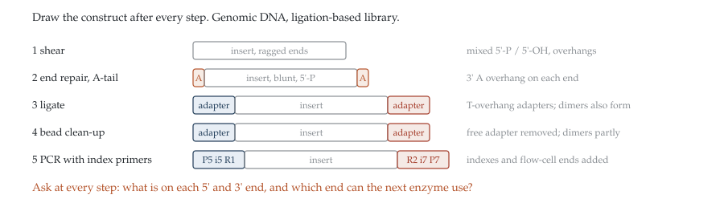{width=92%}

- Example: a ligation-based library, as in [NEBNext Ultra II](https://henriksson-lab.github.io/NGS_101/nebnext-ultra-ii-dna-library-prep-user-adaptor/nebnext-ultra-ii-user.html) or [TruSeq DNA PCR-Free](https://henriksson-lab.github.io/NGS_101/truseq-dna-pcr-free/truseq-dna-pcr-free.html)
- The question at each step is what is on the 5' and 3' end: that decides what the next enzyme can do ([end states](../nucleic-acids/lec.qmd))
- A proofreading polymerase would remove the A-tail at step 2: this is the kind of error a drawing exposes

## Draw the construct: RNA

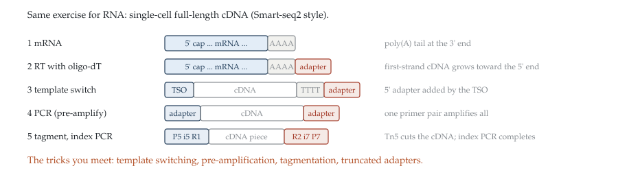{width=92%}

- Example: [SMART-seq2](https://henriksson-lab.github.io/NGS_101/smart-seq2__10.1038+nmeth.2639/smart-seq2.html) [Picelli et al. 2013, doi:10.1038/nmeth.2639]{.small}
- RNA brings new questions: which end is which (cap, poly(A)), and which strand is read ([full-length cDNA from one cell](../rna/lec-small-rna.qmd))
- Drawing also shows what cannot happen: without a poly(A) tail, step 2 has nothing to prime on

## The ledger

For each step, write four things beside the drawing:

| What | Why it matters |
|---|---|
| 5' and 3' chemistry of each end | decides ligation and extension |
| strands: single, double, hybrid | decides which enzymes act |
| what can prime, and what is blocked | decides what amplifies |
| what is removed afterwards | decides what carries over |

An unexplained step is an unexplained failure mode. If you cannot fill in a row, find the source paper or the kit's notes before you run it.

## Tool: Annotate

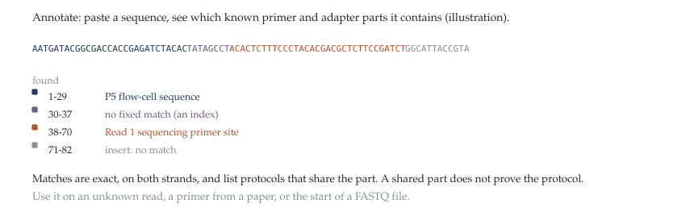{width=89%}

- The NGS 101 *Annotate sequence* tab recognises known adapter and primer parts in pasted DNA
- The variable parts, the indexes and your insert, are left unmatched: that is informative
- Try it on the first 100 bases of a FASTQ file when you do not know what library you hold

## Tool: Anneal

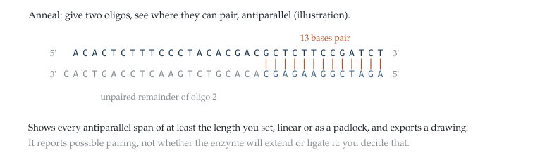{width=92%}

- The *Anneal primers* tab lists every place two oligos can pair, linear or as a padlock
- Use it to check a design: does the primer pair with the adapter where you intend, and nowhere else?
- It shows **possible** pairing: whether an enzyme extends or ligates it is your call

## Tool: Sample-sheet indexes

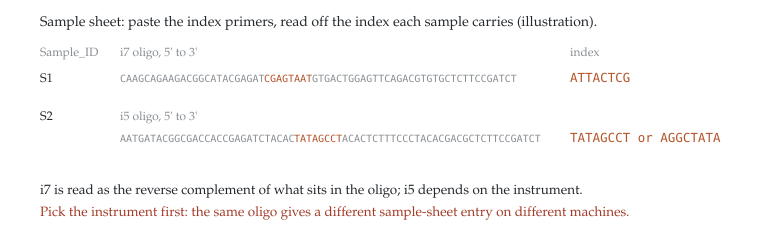{width=91%}

- The *Sample-sheet indexes* tab locates i7 and i5 in primer oligos and gives the entry for the sample sheet
- It is the quickest check that an order sheet and a sample sheet agree
- The i5 orientation depends on the instrument [Kircher et al. 2012, doi:10.1093/nar/gkr771]{.small}

## Failure modes: signature and control

Every failure has a **signature** (what you see) and a **control** (what proves the cause).

| Failure | Signature | Control |
|---|---|---|
| adapter dimers | 130 bp peak; reads all adapter | adapter-only reaction |
| one-sided products | Qubit well above qPCR | qPCR; reference sample |
| chimeras | split reads | species mix |
| index hopping | reads in empty wells | blank in pool; unique dual indexes |
| low complexity | skewed first cycles | PhiX; staggered primers |
| over-amplification | duplicates; GC bias | titration; UMIs |
| off-target ligation | skewed abundance | spike-in; no-template control |

## Adapter dimers

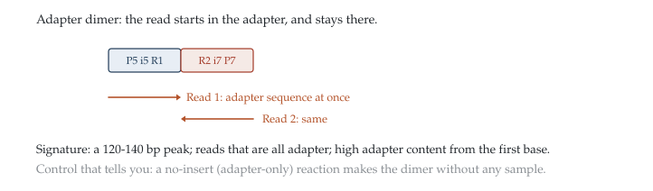{width=92%}

- **Cause:** adapters ligate to each other when insert is scarce or adapter is in excess
- **Why it is bad:** the dimer clusters better than the library and the reads are all adapter [Head et al. 2014, doi:10.2144/000114133]{.small}
- **Control:** a reaction with adapters and no insert makes the dimer on its own, so you know its size

## One-sided products

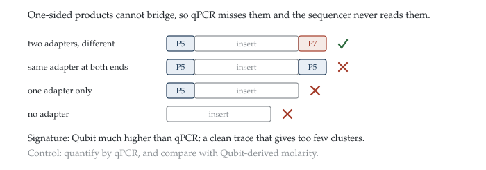{width=80%}

- **Cause:** one adapter missing, or the same adapter on both ends
- **Why it is bad:** it is DNA that carries mass but no clusters, so you over-estimate the library
- **Control:** quantify by qPCR, which only counts both-adapter molecules, and compare with Qubit

## Chimeras

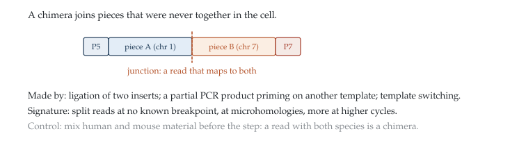{width=92%}

- **Cause:** ligation of two inserts; an incomplete PCR product priming on another template; template switching
- **Known source:** chimeras form in whole-genome amplification ([MDA, MALBAC and PTA](../genomic-dna/lec.qmd)) [Lasken and Stockwell 2007, doi:10.1186/1472-6750-7-19]{.small}
- **Control:** mix human and mouse cells or DNA before the step: a read with both species is a chimera

## Index hopping

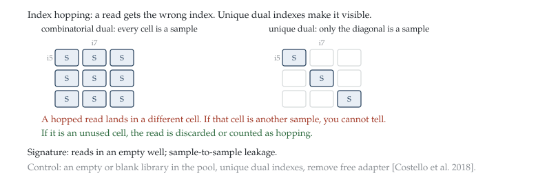{width=85%}

- **Cause:** free adapter or primer in the pool primes an extension on another molecule on the flow cell [Costello et al. 2018, doi:10.1186/s12864-018-4703-0]{.small}
- **Seen in:** patterned flow cells, and a leak of reads between samples [van der Valk et al. 2019, doi:10.1111/1755-0998.13009]{.small}
- **Fix:** unique dual indexes; thorough clean-up of free adapter before pooling

## Low complexity

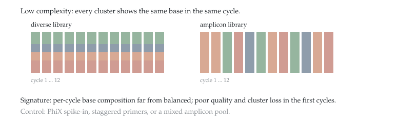{width=90%}

- **Cause:** every molecule starts the same: amplicons, CRISPR guides, restriction-site libraries
- **Effect:** the instrument cannot find clusters or estimate phasing in the first cycles
- **Fix:** PhiX, staggered primers, or a mixed pool; [the sequencer deck](../sequencers/lec.qmd) covers why, and [guide readouts](../screens/lec-readout.qmd) are where it bites

## Over-amplification

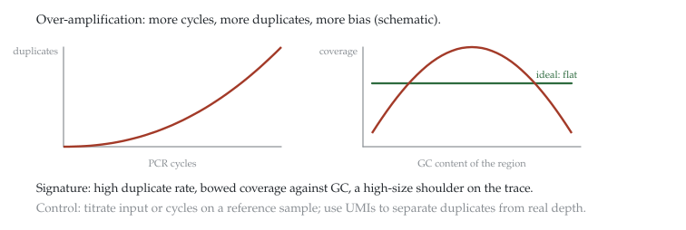{width=84%}

- **Cause:** too many cycles, or too little input
- **Effect:** duplicates, GC bias, and small differences amplified into large ones [Aird et al. 2011, doi:10.1186/gb-2011-12-2-r18]{.small}; see also [Ross et al. 2013, doi:10.1186/gb-2013-14-5-r51]{.small} and [Kebschull and Zador 2015, doi:10.1093/nar/gkv717]{.small}
- **Control:** a diagnostic qPCR, and UMIs where input is low ([collapsing reads to molecules](../targeted/lec.qmd))

## Off-target ligation

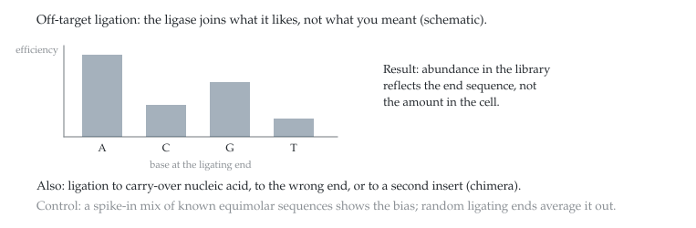{width=86%}

- **Cause:** ligases prefer some end sequences, and join what is present: carry-over, second inserts, the wrong end ([which ends a ligase joins](../enzymes/lec-ligases.qmd))
- **Effect:** abundance in the library is a property of the ligase, not the sample
- **Control:** a spike-in mix of known equimolar sequences; a no-template reaction for what the tube brings

## Controls: which one for which

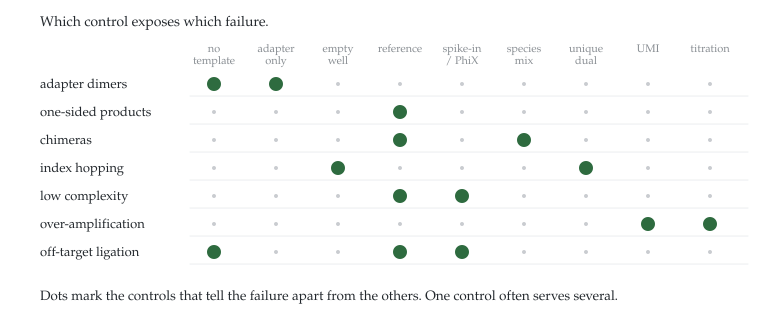{width=67%}

- One control can cover several failures: a reference sample runs through the whole protocol
- Write the expected result before the experiment, not after
- A control you cannot afford to run on every batch can be run once per kit lot

## What each control means

- **No-template:** reagents and carry-over only; reads here are contamination
- **Adapter-only:** shows the dimer's size and the cycle at which it appears
- **Empty well in the pool:** any reads are hopping or index contamination
- **Reference sample:** a cell line or standard DNA, whose result you know; flags drift between batches
- **Spike-in / PhiX:** known sequences in known amounts; show bias, error rate and diversity
- **Species mix:** human and mouse cells together; cross-species reads are chimeras or doublets ([the barnyard test](../single-cell/lec-combinatorial.qmd))
- **Titration:** the same sample at three inputs or cycle numbers; the trend shows saturation

## A worked diagnosis

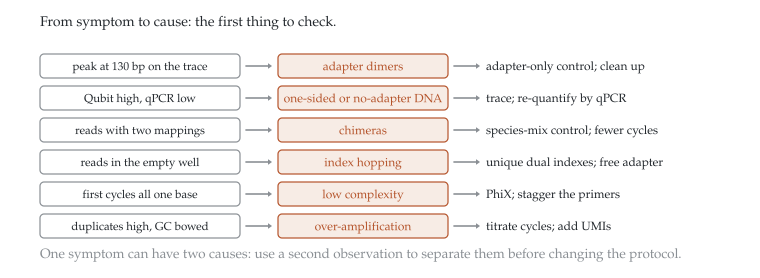{width=77%}

- The table gives the first suspect. Two symptoms together give a cause
- Example: duplicates high **and** Qubit well above qPCR points to over-amplification, not to one-sided products alone
- Change one thing at a time, and write what changed

## The capstone

Design a library preparation for a question of your own choosing. Hand in:

1. The question, and what the data must show
2. The blocks, in order
3. The construct, drawn after every step
4. Oligos and enzymes, each with a justification from the selection charts
5. The read structure
6. The controls, and the failures you expect
7. A comparison with the closest protocol in the collection

The exercise page lists it with a checklist.

## A worked outline

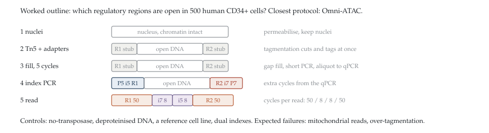{width=92%}

- Question: which regulatory regions are accessible in 500 human CD34+ cells? ([accessibility assays](../chromatin/lec.qmd))
- Closest protocol: [Omni-ATAC](https://henriksson-lab.github.io/NGS_101/omni-atac__10.1038+nmeth.4396/omni-atac.html) [Corces et al. 2017, doi:10.1038/nmeth.4396]{.small}, with the cycle choice from [ATAC-seq](https://henriksson-lab.github.io/NGS_101/atac-seq__10.1038+nmeth.2688/atac-seq.html)
- Differences to state: the cell type, the low input, and any change you would make for a smaller sample

## Justify enzymes from the selection charts

Vendor charts (for example NEB's polymerase, ligase and nuclease selection tools) are organised by **properties**, as in the [nuclease chart](../enzymes/lec-nucleases.qmd). Write which property decides:

| Choice | Deciding property |
|---|---|
| A-tailing polymerase | no 3'→5' exonuclease, so it does not remove the A |
| PCR polymerase | proofreading and bias versus speed and yield |
| RNA adapter ligase | needs ATP or pre-adenylated adapter; truncated ligase gives fewer side products |
| reverse transcriptase | template switching; RNase H activity; temperature |
| uracil cleavage | USER (UDG plus endonuclease VIII) only cuts at U |

A choice with no deciding property is not yet a choice.

## Predict the read structure

Work from the construct to cycles per read.

- Reads start at the sequencing-primer site, so Read 1 reads the first insert bases ([construct to read structure](../library-molecule/lec.qmd))
- Indexes are read by their own primers: 8 + 8 cycles for two 8-nt indexes
- Insert length sets how far reads run before reaching the other adapter: a 120 bp ATAC fragment read 50 + 50 never reaches the adapter, a 40 bp one does, and needs trimming
- Say which read holds a barcode or UMI, and how many cycles it needs

Write: `Read 1 / Index 1 / Index 2 / Read 2` as cycles, as in the example: 50 / 8 / 8 / 50.

## Checklist

- [ ] The question is stated, with the readout that answers it
- [ ] Every block is justified and ordered
- [ ] The construct is drawn after each step, with end chemistry
- [ ] Every enzyme has a deciding property
- [ ] Oligo sequences, with Tm and checks for self-pairing
- [ ] Read structure fits the construct
- [ ] Controls cover the expected failures
- [ ] The closest protocol is named, linked and compared

## Where this connects

The whole course, in the order a designer meets it.

**What the data must show**

- [Converting chemistry into sequence](../chemistry-to-sequence/lec.qmd) — a property as a base, an end or a join

**Getting the molecule into shape**

- [Fragmentation](../fragmentation/lec.qmd) — the size the question and the sequencer both need
- [Attaching a handle](../handles/lec.qmd) — the five ways to put known sequence on unknown DNA
- [End chemistry](../end-chemistry/lec.qmd) — which ends may ligate, and which are switched off
- [Selection](../selection/lec.qmd) — keeping what you came for, and what the ratio costs
- [Compartments](../compartments/lec.qmd) — when every molecule must carry its cell of origin

**Labelling and copying**

- [Barcodes and UMIs](../barcodes-umis/lec.qmd) — where each label sits, and what it costs in cycles
- [Amplification](../amplification/lec.qmd) — the cycle budget, and the duplicates you must explain

**Reagents, instrument, verdict**

- [The enzyme toolbox](../enzymes/lec.qmd) — a deciding property for every enzyme in the design
- [Other short-read platforms](../sequencers/lec-platforms.qmd) and [the long-read instruments](../long-reads/lec-instruments.qmd) — what the instrument you chose asks of the library
- [Cleanup and QC](../qc/lec.qmd) — the measurements that say whether the design worked
- [The trick catalogue](../tricks/lec-more.qmd) — for the step no block can do
