## Why a whole deck on ends

The [nucleic-acids deck](../nucleic-acids/lec.qmd) introduced the end states and what a ligase
requires of them. This deck is where they are changed on purpose, as a design tool.

- Every enzyme in a library preparation reads the **end** it meets: phosphate or hydroxyl, blocked or free, blunt or overhanging
- A step that works on one end state does nothing, silently, on another
- Most tricks in this deck are one idea: **change an end on purpose so that exactly one reaction can happen**

Aim: given a molecule and a goal, name the end state you need and the enzyme that produces it.

## A catalogue of ends

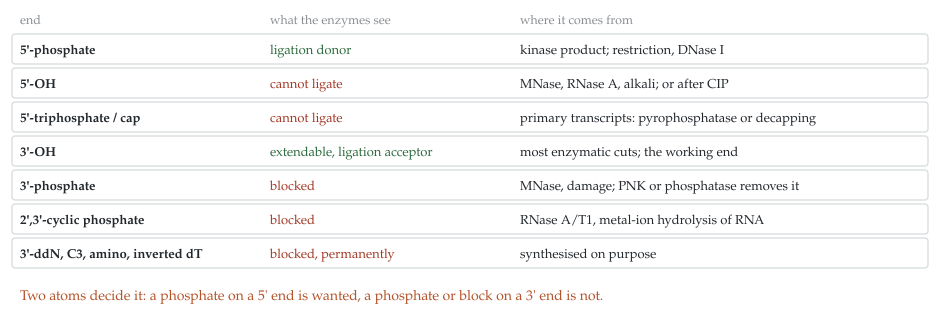{width=83%}

- Phosphate is wanted on a 5' end and unwanted on a 3' end
- Several different groups make a 3' end permanently inert; one, the phosphate, can be removed again

## Where ends come from

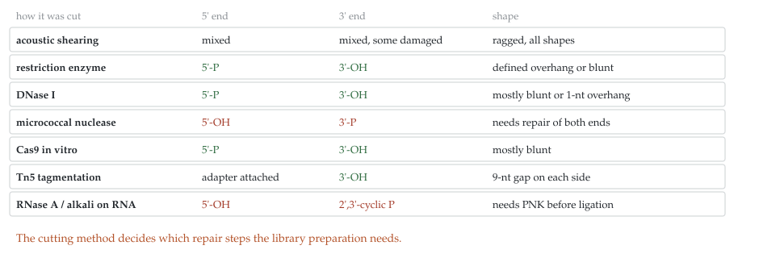{width=83%}

- The cutting method decides the end state ([nucleases](../enzymes/lec-nucleases.qmd)): a
  restriction digest gives tidy ends, MNase and RNases give the opposite polarity
- Shearing gives a mixture, which is why it needs the most repair

::: {.notes}
The MNase and RNase A ends are standard textbook enzymology. I have not attached a primary paper to this table; check the vendor pages before quoting it.
:::

## Shapes: overhangs and recessed ends

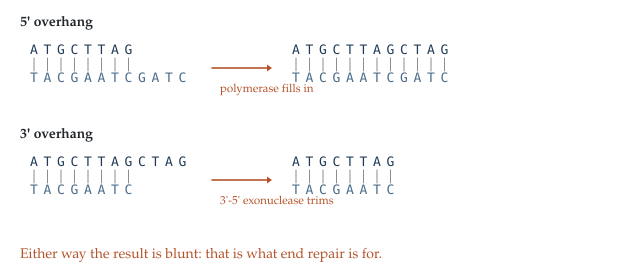{width=65%}

- A **5' overhang** has a 3'-OH recessed in the duplex, a place a polymerase can extend
- A **3' overhang** is an unpaired tail that a 3'-5' exonuclease trims
- Blunt is the point where neither has anything to do

## Nicks, gaps and flaps

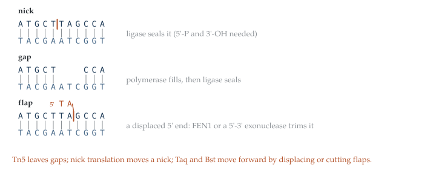{width=71%}

- A **nick** needs a ligase; a **gap** needs a polymerase and then a ligase
- A **flap** is displaced 5' sequence; it needs a flap endonuclease or a polymerase with 5'-3' exonuclease activity
- Whether a strand-displacing polymerase makes flaps or a non-displacing one stops at a nick decides what comes out of a reaction

## End repair

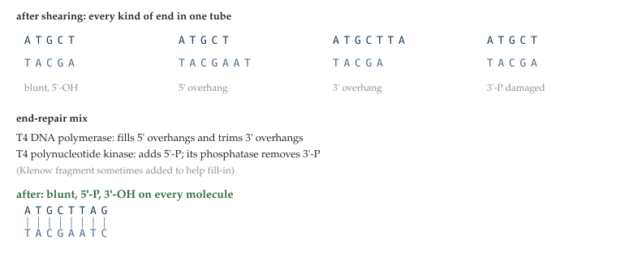{width=70%}

- T4 DNA polymerase fills 5' overhangs and trims 3' overhangs
  ([why this polymerase and not another](../enzymes/lec.qmd)); T4 PNK phosphorylates 5' ends and removes 3' phosphates
- The mix is usually sold as one tube; it needs ATP for the kinase and dNTPs for the polymerase
- Protocol: [NEBNext Ultra II FS DNA PCR-free](https://henriksson-lab.github.io/NGS_101/nebnext-ultra-ii-fs-dna-pcr-free/nebnext-ultra-ii-fs-dna-pcr-free.html)

## Blunting is an equilibrium

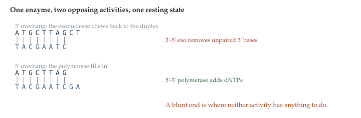{width=86%}

- T4 DNA polymerase has both activities, so it removes and adds until nothing is left to do
- With dNTPs present, the polymerase wins on 5' overhangs and the exonuclease on 3' overhangs
- Without dNTPs, the exonuclease alone chews back and can eat into the duplex

## dA-tailing

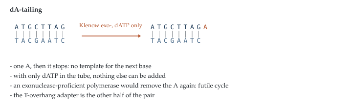{width=92%}

- Klenow fragment lacking exonuclease, or Taq, adds one non-templated A
- Only dATP in the tube, and a polymerase that cannot take it back off
- Proofreading enzymes fail here silently: the A is added and removed in cycles

[Clark 1988, doi:10.1093/nar/16.20.9677]{.small}

## Tracking the ends through a protocol

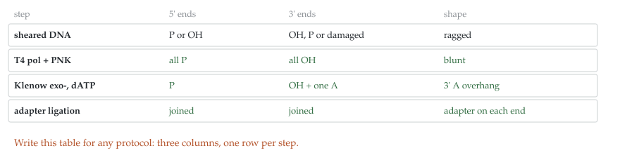{width=92%}

- Three columns and one row per step: the habit that finds bugs in a protocol before the bench does
- The table shows a standard ligation library; every step prepares the ends for the next
- Protocol: [TruSeq DNA PCR-Free](https://henriksson-lab.github.io/NGS_101/truseq-dna-pcr-free/truseq-dna-pcr-free.html)

## Fill-in

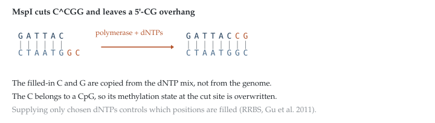{width=92%}

- Restriction enzymes such as MspI leave overhangs that a polymerase can fill with chosen dNTPs
- What the polymerase adds is a copy of the mix, so the filled positions carry no information about the sample
- In bisulfite sequencing this decides which cytosines can still be read
  ([converting chemistry into sequence](../chemistry-to-sequence/lec.qmd))
- Protocol: [RRBS](https://henriksson-lab.github.io/NGS_101/rrbs-illumina__10.1038+nature07107/rrbs-illumina.html)

[Meissner et al. 2008, doi:10.1038/nature07107; Gu et al. 2011, doi:10.1038/nprot.2010.190]{.small}

::: {.notes}
Check the exact dNTP mix in the RRBS protocol before stating which bases are unmethylated in the filled-in position.
:::

## Gap repair after tagmentation

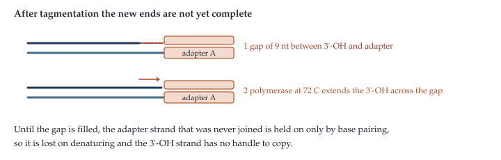{width=88%}

- Tn5 attaches adapters to the 5' ends only, leaving a 9-nt gap on each side
  ([transposases](../enzymes/lec-transposases.qmd))
- A polymerase at 72 C extends the 3'-OH across the gap before PCR
- Until then the second adapter strand is held on by base pairing only, so skipping the step costs yield

[Picelli et al. 2014, doi:10.1101/gr.177881.114]{.small}

## Dephosphorylation: switch the old ends off

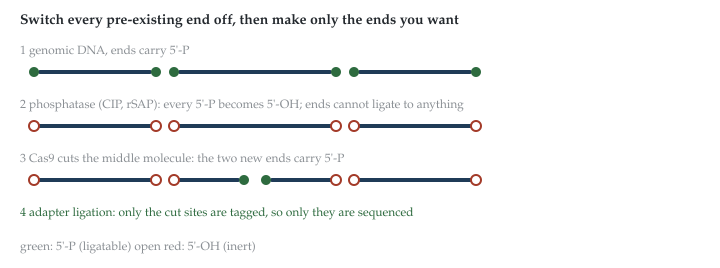{width=76%}

- A phosphatase (CIP, rSAP) turns every 5'-P into 5'-OH, which no ligase can use
  ([ligases, kinases, phosphatases](../enzymes/lec-ligases.qmd))
- Then make the ends you want: a cut, a kinase step
- Used in Cas9 cleavage mapping, so only the Cas9 ends get adapters; [RGEN-seq](https://henriksson-lab.github.io/NGS_101/rgen-seq__10.1038+s41598-021-03160-8/01_rgen-seq.html) describes optional blocking of pre-existing ends

[Kuzin et al. 2021, doi:10.1038/s41598-021-03160-8]{.small}

## Selective re-phosphorylation

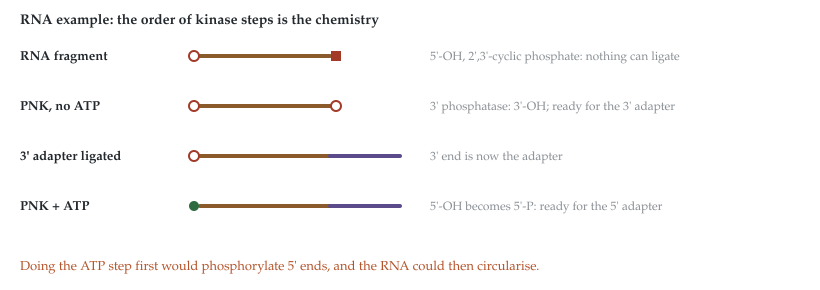{width=80%}

- The same kinase does two jobs depending on whether ATP is present: 3' phosphatase without, 5' kinase with
- That sets the order of an RNA library: clear 3' ends, ligate the 3' adapter, phosphorylate 5' ends, ligate the 5' adapter
- Getting the order wrong is a quiet failure: yield falls and nothing reports it

## Blocked 3' ends force one-sided ligation

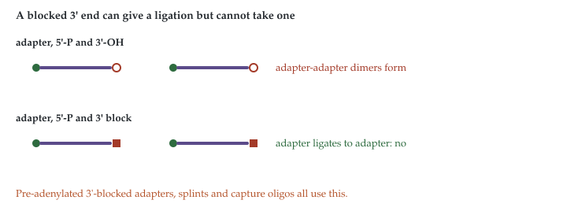{width=76%}

- If an adapter can only donate, it cannot be joined to another adapter: the end state RNA
  ligation and splinted ligation both demand ([attaching a handle](../handles/lec.qmd))
- The block is on the adapter's 3' end; the insert provides the 3'-OH
- Pre-adenylated adapters, splints and capture oligos use this

## Which block?

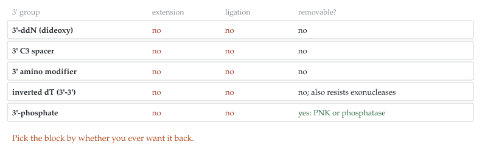{width=92%}

- Dideoxy, C3, amino and inverted dT are permanent; a 3'-phosphate can be removed later by a phosphatase
- TdT with a ddNTP puts a dideoxy block on existing 3' ends of DNA, which is how pre-existing ends are masked
- Pick by whether the block must ever come off

## dU in adapters and USER

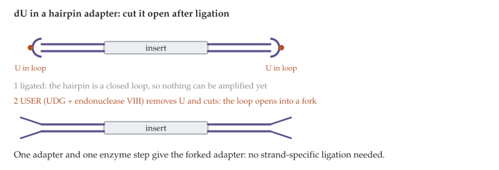{width=82%}

- A hairpin adapter with a uracil in the loop is ligated closed; UDG and endonuclease VIII (USER) open it into a fork
- One adapter and no strand-specific ligation
- Protocol: [NEBNext Ultra II DNA Library Prep, USER adaptor](https://henriksson-lab.github.io/NGS_101/nebnext-ultra-ii-dna-library-prep-user-adaptor/nebnext-ultra-ii-user.html)

[USER: Bitinaite et al. 2007, doi:10.1093/nar/gkm041]{.small}

## Methylated adapters

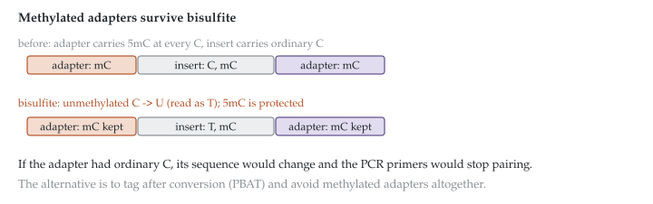{width=90%}

- Bisulfite changes unmethylated C to U, which would change an adapter too
- Adapters built with 5mC survive, so primers still anneal
- Used in RRBS, where ligation comes before conversion

[Meissner et al. 2008, doi:10.1038/nature07107]{.small}

## Hairpin adapters

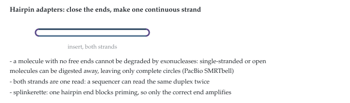{width=96%}

- A hairpin removes a free end: no 5' or 3' end is left to ligate, extend or digest
- SMRTbell libraries close both ends this way; see the
  [long-read instruments](../long-reads/lec-instruments.qmd)
- Splinkerette uses a blocked hairpin to stop one-sided priming
  ([splinkerette PCR](../amplification/lec.qmd))

## Degraded and single-stranded input

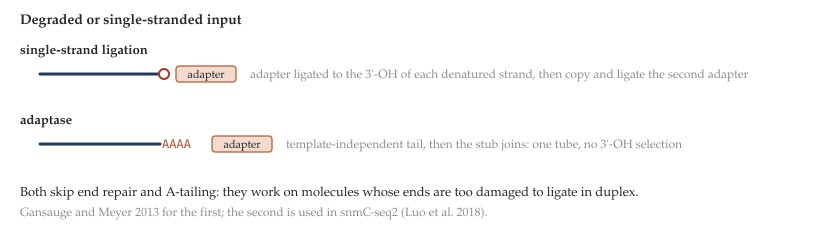{width=99%}

- When ends are too damaged for duplex ligation, work on one strand at a time
- Single-strand ligation: ligate an adapter to the 3'-OH of denatured DNA, copy, then add the other
- Adaptase, a vendor enzyme mix, tails the 3' end without a template and ligates a stub to it in one tube
- Protocol: [single-stranded ancient DNA](https://henriksson-lab.github.io/NGS_101/single-stranded-ancient-dna__10.1038+nprot.2013.038/single-stranded-library.html)

[Gansauge and Meyer 2013, doi:10.1038/nprot.2013.038; Luo et al. 2018, doi:10.1038/s41467-018-06355-2]{.small}

## Dilute ligation

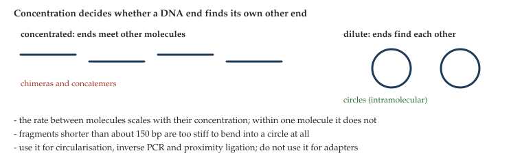{width=89%}

- Joining two ends of the same molecule does not depend on concentration; joining two molecules does
- Dilute: circles. Concentrated: [chimeras](../amplification/lec.qmd), one molecule made of two unrelated pieces
- Do the opposite for adapters, where you want molecules to meet

## What went wrong: observations

| Observation | Likely end problem |
|---|---|
| No product, no error | Missing 5'-P on the insert or adapter |
| Adapter dimers dominate | Adapter 3' end free to ligate; adapter excess |
| Chimeric inserts | Blunt ligation without A/T or without dephosphorylation |
| Low yield after bisulfite | Adapters not methylated; converted adapters cannot be primed |
| Cut sites missing in Cas9 mapping | Old ends not blocked, so background swamps |
| Poor ligation after A-tailing | A proofreading enzyme removed the A again |

## Tricks and where they appear

| Trick | Where |
|---|---|
| dA-tail and T-overhang | TruSeq, most Illumina ligation kits |
| Pre-adenylated 3'-blocked adapter | Small RNA, eCLIP |
| dU and USER | NEBNext Ultra II (USER adaptor) |
| Methylated adapters | RRBS |
| Single-strand ligation, adaptase | Ancient DNA, snmC-seq2 |
| Dephosphorylation then Cas9 | Off-target mapping |
| Circularisation | iCLIP |

## Where this connects

**Where the ends come from**

- [Fragmentation](../fragmentation/lec.qmd) — every cut hands the next enzyme an end state, tidy or ragged

**Where an end decides the outcome**

- [Amplification](../amplification/lec.qmd) — dU, 3' blocks and hairpins decide what the polymerase is allowed to copy
- [Selection](../selection/lec.qmd) — selecting by end structure rather than by sequence; exonucleases as the filter
- [3D genome](../3d-genome/lec.qmd) — digest, fill in with biotin, blunt-ligate: a whole method written in end states
- [Genomic DNA](../genomic-dna/lec.qmd) — degraded and ancient input, where single-strand ligation is the only route
- [Modifications: DNA](../modifications/lec.qmd) — methylated adapters, and breaks where the end itself is the signal

**Tricks and failures**

- [Tricks: ligation, clean-up, handles](../tricks/lec.qmd) — the end-control tricks indexed by the problem they solve
- [QC](../qc/lec.qmd) — no product, adapter dimer, chimera: what each looks like on a trace

Reference while you work: [NGS 101](https://henriksson-lab.github.io/NGS_101/).
