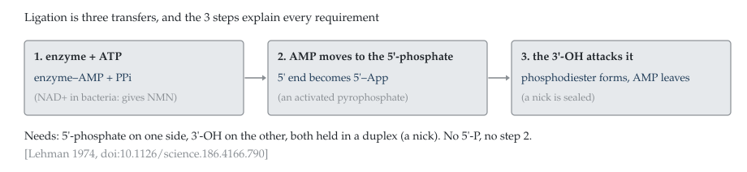
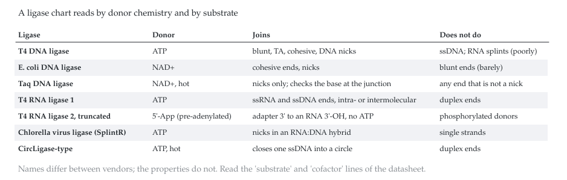
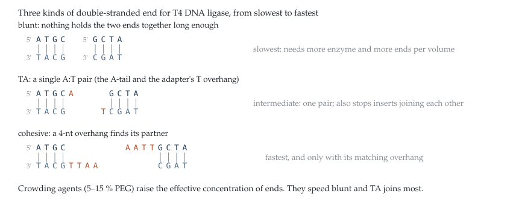
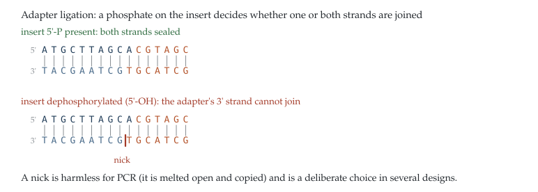
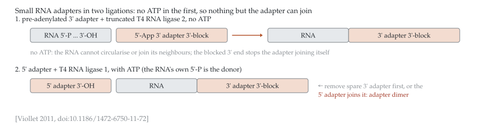
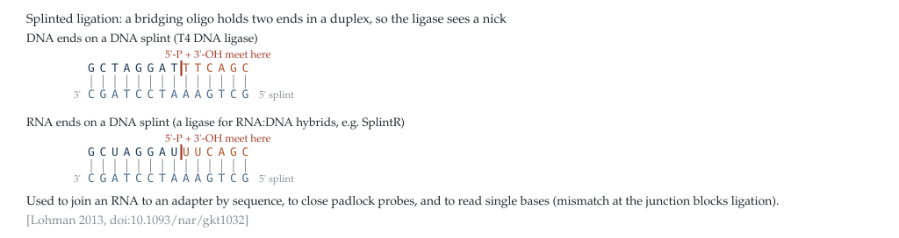
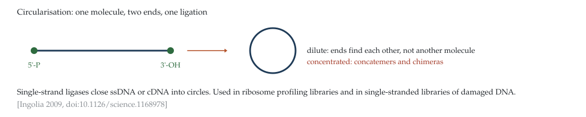
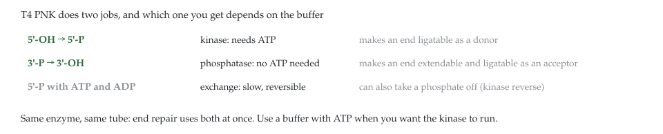
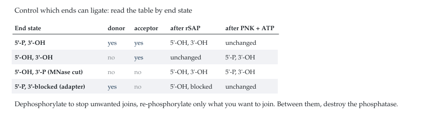
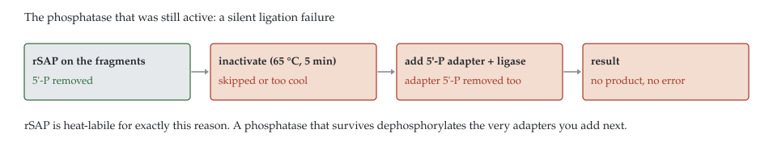

## What this deck is for

Ligases join, kinases and phosphatases decide **which ends are allowed to join**. Together they
control the chemistry of every end in a library.

- A ligation is decided by two things: the **end state** of each molecule and the **substrate
  type** (blunt, cohesive, nicked, single-stranded, splinted)
- A silent failure here is nearly always a missing or surplus phosphate
  ([end chemistry](../end-chemistry/lec.qmd) is where those ends are made on purpose)
- The skill is the same as for polymerases: read the chart, name the deciding column

Chart: [NEB's ligase and modifying-enzyme tools](https://www.neb.com/en/tools-and-resources/selection-charts)
(the ligase pages list substrate and cofactor for each enzyme).

## The mechanism explains the requirements

{width=100%}

- Step 2 needs a **5'-phosphate**. No phosphate, no activation, no joining, and no error
- Step 3 needs a **3'-OH** next to it, in a duplex or otherwise held in place
- DNA ligases of phages use ATP; bacterial ones use NAD+. That is a column on the chart

[Lehman 1974, doi:10.1126/science.186.4166.790]{.small}

## A ligase chart reads by donor and by substrate

{width=88%}

- **Donor**: ATP, NAD+, or a pre-adenylated 5' end that makes the enzyme need no cofactor
- **Joins**: what the enzyme accepts as a substrate
- Rows with the same donor can differ completely in substrate: that is where choices are made

## DNA ends for T4 DNA ligase

{width=72%}

- **Blunt** is slow and unselective: any end joins any end, including insert to insert
- **TA** is the compromise that dominates library prep: some pairing, and neither partner
  can ligate to itself ([attaching a handle](../handles/lec.qmd))
- **Cohesive** is the fastest and the most specific, and is why restriction cloning works well

## Crowding: why ligation buffers contain PEG

- Ligation of two *different* molecules is a collision problem: the ends must find each other
- 5–15 % **polyethylene glycol** excludes volume and raises the effective concentration of
  ends, which can speed blunt and TA ligation many-fold
- The cost is real: viscous mixes are hard to clean up on beads, and more concentrated ends
  also means more **concatemers and chimeras**
- A kit's ligation mix therefore gets a precise recipe. Do not substitute or dilute it

If a ligation gives a smear of high-molecular-weight product, the first suspect is too many
ends per volume ([crowding as a trick, and its price](../tricks/lec.qmd)).

## Adapter ligation: which strands get joined

{width=80%}

- Each junction has two strands, and each needs its own 5'-phosphate
- If the **insert** has no 5'-phosphate (it was dephosphorylated), only the adapter's
  5'-P strand joins: a **nick** remains on the other strand
- A nick does not stop PCR, and it is a feature in some designs and a bug in others

## Ligating RNA: the pre-adenylated 3' adapter

{width=100%}

- A **truncated T4 RNA ligase 2** cannot use ATP, so it needs the donor already adenylated
- With no ATP, the RNA's own 5'-P cannot be activated: **no circularisation, no concatemers**
- A **3' block** on the adapter (a dideoxy or amino end) stops the adapter joining itself
- Spare adapter must be removed before the 5' ligation, or it becomes adapter dimer: the
  dominant failure of [small-RNA libraries](../rna/lec-small-rna.qmd)

[Viollet 2011, doi:10.1186/1472-6750-11-72]{.small}

## Splinted ligation

{width=100%}

- Two ends that are **not** in a duplex cannot be joined by a DNA ligase. A bridging oligo
  makes them one
- Because the splint pairs with both ends, ligation is **sequence-specific** and works at low
  concentration: this is how split-and-pool adds one barcode per round
  ([combinatorial indexing](../single-cell/lec-combinatorial.qmd))
- A ligase for RNA:DNA hybrids lets the same trick join RNA, which standard T4 DNA ligase does
  poorly

[Lohman 2013, doi:10.1093/nar/gkt1032]{.small}

## Circularisation

{width=100%}

- A single-strand ligase closes one molecule into a circle when the ends find each other
  before they find another molecule
- **Dilute** the reaction to favour the circle; concentrate it for the opposite
- Circles resist exonucleases, so a circle can be separated from everything that failed to
  close ([selection](../selection/lec.qmd))

## Kinases: giving an end a phosphate

{width=100%}

- **T4 PNK** moves the γ-phosphate of ATP onto a 5'-OH: the end can now be a ligation donor
- It also removes a **3'-phosphate**, which lets a blocked end be extended or ligated
- In end repair the kinase and the repair polymerase work in one tube

## Phosphatases: taking it away

- **rSAP** (a recombinant shrimp alkaline phosphatase) removes 5' and 3' phosphates from DNA
  and RNA
- Use it to **stop unwanted joins**: a DNA with no 5'-P can only be an acceptor, so inserts
  cannot ligate to one another
- It is **heat-labile on purpose**: 65 °C for a few minutes kills it, so it does not
  dephosphorylate the next thing you add
- Older calf-intestinal phosphatase is not as easily killed, and is not used for that reason

## Control which ends can ligate

{width=100%}

- The recipe is two steps: remove every phosphate, then add one back where you want a join
- This is how a library designer makes ligation **one-sided**: a molecule that has no 5'-P
  and no usable 3'-OH is inert, and one that has both is a partner
- Read the table as a state machine: **end in, enzyme, end out**

## A phosphatase that survived

{width=100%}

- The sequence is correct on paper and still gives nothing
- The warning sign is zero yield after a step whose reagents were all present
- Remedy: verify the inactivation step, or purify the DNA between the phosphatase and the
  ligation

## Choosing a ligase in four questions

1. **Substrate**: blunt, TA, cohesive, nicked, single-stranded, or splinted?
2. **Donor**: does the 5' end carry a phosphate, an adenylate, or neither?
3. **Acceptor**: is the 3' end an OH, a block, or a phosphate?
4. **Side reactions**: what else would the ligase join in the tube, and how do I stop it?

Next: the [nucleases](lec-nucleases.qmd), which make the ends these ligases need.

## Where this connects

**Before this**

- [Nucleic acids](../nucleic-acids/lec.qmd) — what a ligase requires, stated once; here it is a column you choose on

**Where a ligation is the whole point**

- [3D genome](../3d-genome/lec.qmd) — proximity ligation: the join itself is the measurement
- [Targeted sequencing](../targeted/lec.qmd) — MIPs and padlocks close a circle only on the right target
- [Long reads](../long-reads/lec.qmd) — SMRTbell hairpins and ONT adapters are both ligations onto prepared ends

**If this fails**

- [QC](../qc/lec.qmd) — the trace that says adapter dimer rather than library
- [Design patterns and failure modes](../design/lec.qmd) — off-target ligation, one-sided products, chimeras
