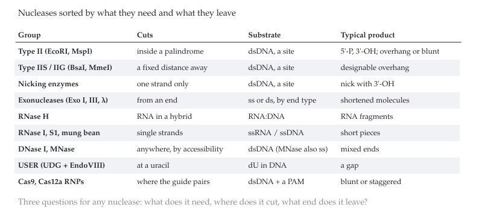
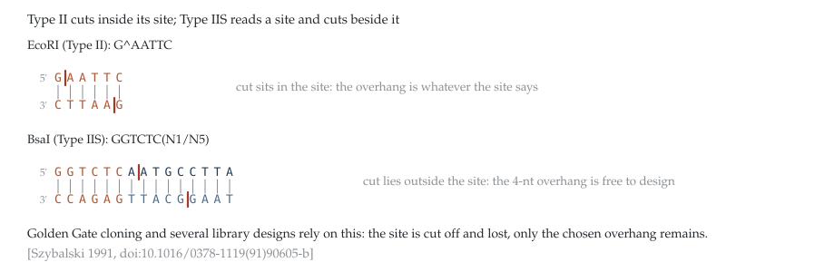
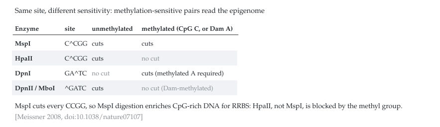
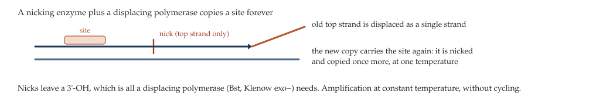
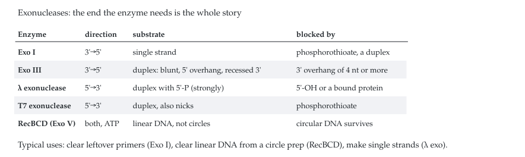
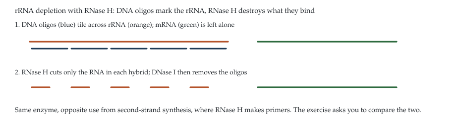
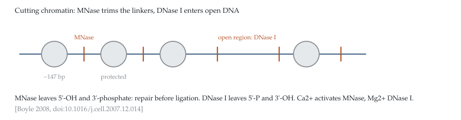
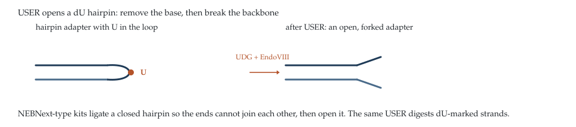
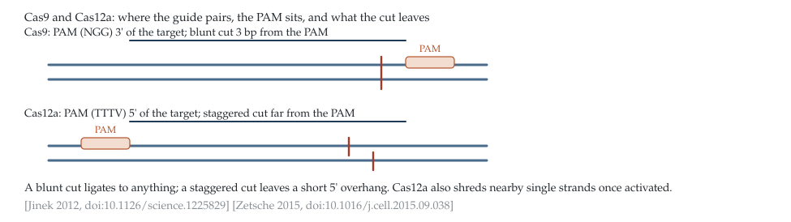

## What this deck is for

Nucleases are how a library designer **makes an end, removes a molecule or marks a position**.
They are also the commonest source of surprise, because a nuclease that is not completely
removed keeps cutting.

- Every nuclease answers three questions: what does it **need**, where does it **cut**, what
  does it **leave**?
- The product's end chemistry decides the next step: a 3'-phosphate cannot be extended, a
  5'-OH cannot be ligated
- We cover the ones the collection's protocols actually use

## A map of the nucleases

{width=70%}

- Sort first by **substrate** (DNA or RNA, single or double stranded), then by **position**
- Group names hide big differences: "exonuclease" alone tells you almost nothing, the *end* it
  needs does

## Type II and Type IIS restriction enzymes

{width=86%}

- **Type II**: cuts inside a short, usually palindromic site. Overhangs are fixed by the site
- **Type IIS / IIG**: recognises a site and cuts a defined distance away, so the **overhang is
  yours to design**, and the site is cut off and lost
- Library uses: [Golden Gate](https://henriksson-lab.github.io/NGS_101/golden-gate__10.1371+journal.pone.0003647/golden_gate.html) assembly, and tag-trimming enzymes that cut 20 bp from their site
  to give a fixed-length tag ([fragmentation](../fragmentation/lec.qmd))

[Szybalski 1991, doi:10.1016/0378-1119(91)90605-b]{.small}

## Methylation-sensitive pairs

{width=94%}

- The same site, a different answer when the C is methylated. The pair **reads the epigenome**
  without any conversion chemistry
- [RRBS](https://henriksson-lab.github.io/NGS_101/rrbs-illumina__10.1038+nature07107/rrbs-illumina.html) digests with MspI and so enriches the genome for CpG-rich DNA, which is why it is
  cheap, and why it sees only a minority of all CpGs
- Methylation is erased by PCR, so the same digest of genomic DNA and of its own PCR product
  can give different answers

[Meissner 2008, doi:10.1038/nature07107]{.small}

## Nicking enzymes

{width=100%}

- A nicking enzyme cuts **one strand** of its site. The nick has a free 3'-OH
- Combined with a **displacing polymerase** it makes a loop: nick, extend, displace, nick
- This is the engine of several isothermal amplifications and of strand-specific cuts in
  library designs

## Exonucleases

{width=94%}

- Pick by the **end** the molecule has: single or double strand, 3' or 5', protected or not
- **Exo I** cleans up leftover primers after PCR; **λ exonuclease** needs a 5'-phosphate,
  which makes it a way to turn a duplex into a single strand
- A **phosphorothioate** at an end resists most of them: a protection you can order with the
  oligo ([nucleic acids](../nucleic-acids/lec.qmd))

## RNase H and the two sides of one activity

{width=100%}

- RNase H cuts the RNA **in an RNA:DNA hybrid** and leaves everything else
- In **second-strand synthesis** it makes RNA primers; in **rRNA depletion** it removes the
  RNA that an oligo marked ([selection](../selection/lec.qmd))
- The same enzyme, opposite goals: the other component (what the DNA oligos are) decides

## RNase I, S1 and mung bean: single-strand specific

- **RNase I** cuts single-stranded RNA after any base and is the footprinting nuclease of
  **ribosome profiling** ([small RNA and tag protocols](../rna/lec-small-rna.qmd)): the
  ribosome protects ~28 nt, the rest is destroyed
- **S1 nuclease** and **mung bean nuclease** cut single-stranded DNA and the single-stranded
  overhangs and loops of a duplex, which makes them tools for **blunting** and for opening
  hairpins
- Both need to be removed or inactivated, or they keep trimming ends in the next step

[Ingolia 2009, doi:10.1126/science.1168978]{.small}

## DNase I and MNase: cutting by accessibility

{width=100%}

- **MNase** cuts linker DNA between nucleosomes and leaves ~147 bp protected: it maps
  positions and occupancy
- **DNase I** preferentially cuts open chromatin: its sites are the hypersensitive sites
  ([chromatin](../chromatin/lec.qmd))
- Their ends differ: DNase I leaves 5'-P/3'-OH, MNase leaves **5'-OH and 3'-P**, which must
  be repaired before ligation ([end chemistry](../end-chemistry/lec.qmd))

[Boyle 2008, doi:10.1016/j.cell.2007.12.014]{.small}

## USER: a cut at every uracil

{width=100%}

- A glycosylase (UDG) removes the uracil base; a lyase (EndoVIII) breaks the backbone on
  both sides, so the cut leaves a **gap**, not a nick
- A U placed in a hairpin loop gives a **closed adapter** that is opened only when you want it
  ([the trick, and where it is used](../tricks/lec.qmd))
- Uracil in a whole strand (dUTP) gives strand removal; nothing else is cut

## Cas9 and Cas12a: nucleases you aim

{width=100%}

- An RNA guide loads the nuclease, which cuts wherever the guide pairs next to a **PAM** — a
  short fixed motif the enzyme must find beside the match, so not every sequence is targetable
- **Cas9**: blunt cut. **Cas12a**: a staggered cut with a short 5' overhang
- In libraries they **deplete** unwanted sequences ([DASH](https://henriksson-lab.github.io/NGS_101/dash__10.1186+s13059-016-0904-5/01_dash.html) removes abundant sequences before
  amplification) or **cut** a target to attach adapters
  ([targeted sequencing](../targeted/lec.qmd))

[Gu 2016, doi:10.1186/s13059-016-0904-5]{.small}

## Three failures that look like success

- **Nuclease left behind**: a digest that was not stopped keeps cutting. A column or bead
  clean-up, or a proper heat step, is part of the protocol for a reason
- **Star activity**: restriction enzymes in excess glycerol, or at too much enzyme or too long
  a time, cut near-sites and fragment the DNA
- **Wrong end out**: a nuclease leaves 3'-P or 5'-OH and the next enzyme needs the opposite

None of these produces an error message. Each shows up later as low yield.

## Choosing a nuclease in four questions

1. **Substrate**: DNA, RNA, hybrid, single or double stranded?
2. **Position**: at a site, from an end, at a base, anywhere accessible, where an RNA says?
3. **Product**: which 5' and 3' end chemistry does it leave?
4. **Removal**: how will it be stopped, and what happens if it is not?

Next: [transposases](lec-transposases.qmd) and the enzymes that modify bases, ends and tails.

## Where this connects

**What the cut becomes**

- [Attaching a handle](../handles/lec.qmd) — a cut end is where a handle goes on, so the end the nuclease leaves decides which of the five ways is still open

**Where the cut carries the question**

- [RNA](../rna/lec.qmd) — RNase H depletion and Cas9 on cDNA, two ways to remove rRNA
- [3D genome](../3d-genome/lec.qmd) — the cutter sets the resolution: six-cutter, four-cutter or MNase
- [Modifications: DNA](../modifications/lec.qmd) — methylation-sensitive pairs, and break mapping where the end *is* the signal
- [Long reads](../long-reads/lec.qmd) — why a nuclease step belongs inside a ligation protocol

**If this fails**

- [Design patterns and failure modes](../design/lec.qmd) — a nuclease that was never stopped, read off its signature
