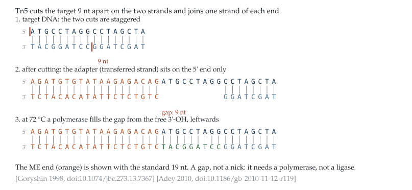
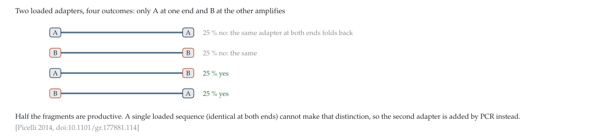
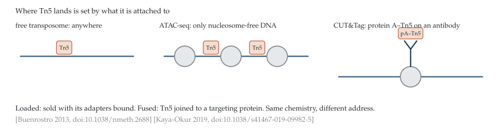
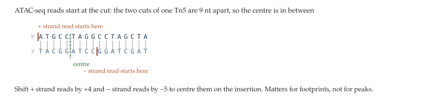
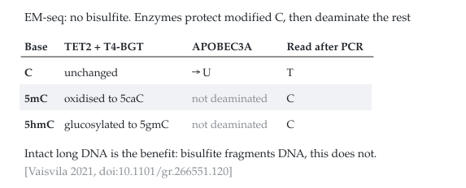
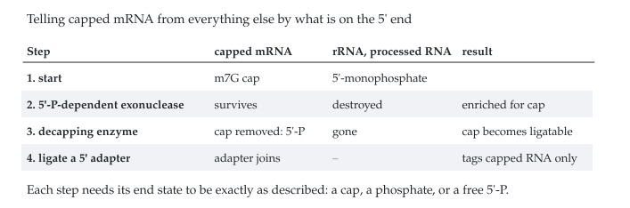
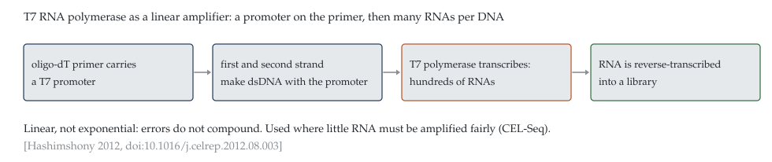
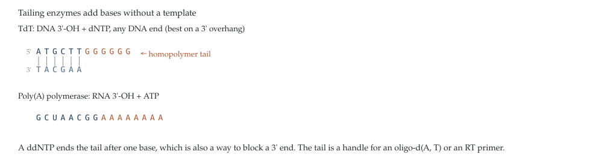
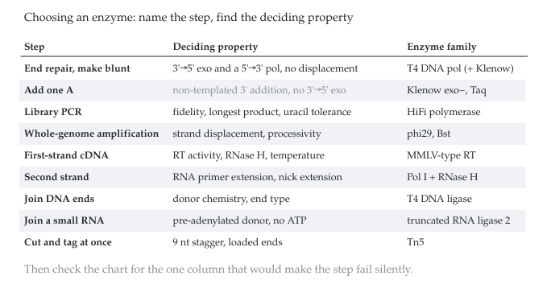
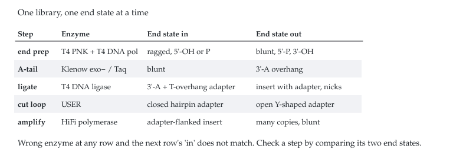

## What this deck is for

Two groups of enzymes that do not fit the cut-copy-join pattern:

- **Transposases** cut DNA and attach adapters in one step
- **Modifying enzymes** change a base, a cap or a tail: they convert methylation to a readable
  signal, mark RNA 5' ends, add handles to 3' ends, and amplify RNA linearly

Both are used for what they *happen to do*, so the skill is the same: identify the activity,
then ask what else the enzyme does in the tube. The deck closes with the skill itself.

## Tn5: cutting and tagging in one step

{width=64%}

- A Tn5 dimer carrying two 19 nt ends cuts the target **9 nt apart on the two strands** and
  joins the adapter's 3'-OH to each new 5' end
- The result: adapter on each fragment's 5' end only, and a **9 nt gap** between the
  fragment's 3'-OH and the adapter beyond
- This is **tagmentation**: fragmentation and adapter addition in one reaction
  ([fragmentation](../fragmentation/lec.qmd))

## Two adapters, four outcomes

{width=100%}

- With two loaded adapters (A, B), half of the fragments carry A at one end and B at the other
- Fragments with the same adapter at both ends mostly do not amplify: they fold back on themselves
- The proportion is a property of the chemistry, not the sample, and it is why the yield
  of usable library is lower than the DNA mass suggests
  ([attaching a handle](../handles/lec.qmd) compares this with ligation)

## Controlling size and stopping the reaction

- **Fragment size** is set by transposome per DNA: more enzyme, more cuts, shorter pieces
- **Mg2+** starts the reaction, and Tn5 **stays bound** to the product after cutting
- It must be stripped (SDS, heat, or a column) before PCR, or the fragments will not amplify
- A hyperactive Tn5 with a few point mutations is what makes in vitro tagmentation efficient

[Goryshin 1998, doi:10.1074/jbc.273.13.7367]{.small}

## The gap is a polymerase step, not a ligase step

- A gap has **bases missing**; a ligase cannot close it ([end chemistry](../end-chemistry/lec.qmd))
- At 72 °C a polymerase extends the fragment's 3'-OH across the gap and copies the adapter
  beyond it. Ordinary PCR enzymes do this, which is why the step is hidden inside the first
  cycle
- Any polymerase that can extend a 3'-OH and is happy at 72 °C will do it. The step shows why
  the choice of PCR enzyme still matters: a gap needs a polymerase, not a ligase

[Adey 2010, doi:10.1186/gb-2010-11-12-r119]{.small}

## Where Tn5 lands is set by what it is attached to

{width=100%}

- Free transposome: genome-wide, a little sequence bias
- **[ATAC-seq](https://henriksson-lab.github.io/NGS_101/atac-seq__10.1038+nmeth.2688/atac-seq.html)**: nucleosomes block Tn5, so tags land in open chromatin
  ([chromatin](../chromatin/lec.qmd))
- **Fused** variants carry Tn5 to a protein target: [CUT&Tag](https://henriksson-lab.github.io/NGS_101/cut-tag__10.1038+s41467-019-09982-5/cut-tag.html) uses **protein A**, which binds
  any antibody, to park Tn5 at an antibody-bound histone mark ([tethering](../chromatin/lec.qmd))

[Buenrostro 2013, doi:10.1038/nmeth.2688]{.small}

## A 9 bp offset that matters at base resolution

{width=100%}

- Read starts mark the **cut**, not the centre of the insertion
- The two ends of one Tn5 event are 9 nt apart, so reads from the two strands are offset by 9
- Footprinting analyses shift + strand reads by +4 and − strand reads by −5

## Other transposases, and Tn5 on RNA

- **Tn5 on RNA:DNA hybrids**: the enzyme will tagment a hybrid, which lets RNA-seq libraries
  be made without ligation or second-strand synthesis
  ([small RNA, tag protocols, low input](../rna/lec-small-rna.qmd))
- **MuA** is a phage transposase that works in vitro on the same principle, leaving a **5 bp**
  stagger rather than 9
- Because transposition has sequence preferences, **choice of transposase** changes which
  regions are under-represented

[Di 2020, doi:10.1073/pnas.1919800117]{.small} [Haapa 1999, doi:10.1101/gr.9.3.308]{.small}

## Converting methylation without bisulfite

{width=75%}

- **TET2** oxidises 5mC and 5hmC; **T4-BGT** glucosylates 5hmC. Both are protected
- **APOBEC3A** deaminates the cytosine that is left, turning C into U, read as T: a chemical
  property turned into a base change ([converting chemistry into sequence](../chemistry-to-sequence/lec.qmd))
- The DNA is not damaged by harsh chemistry — **bisulfite** conversion deaminates C but
  fragments the DNA as it goes ([modifications](../modifications/lec.qmd)) — so libraries can
  be built from far less input

[Vaisvila 2021, doi:10.1101/gr.266551.120]{.small}

## Glycosylases and repair mixes

- A **uracil glycosylase** (UDG) removes U from DNA: used to clean **ancient DNA** and
  FFPE-damaged DNA of deaminated cytosines, which would read as C→T
- **FPG** and similar enzymes remove oxidised bases such as 8-oxoG
- "Repair mixes" bundle glycosylases, lyases, polymerases and ligase so damaged templates can
  be copied
- Used on a library that depends on U (dUTP strand marking) a glycosylase destroys the mark:
  check what a master mix contains

## Capping and decapping

{width=90%}

- A 5' cap is a 7-methylguanosine joined by a triphosphate. A ligase cannot use it
- A **decapping enzyme** leaves 5'-P, which a ligase *can* use. A 5'-P-dependent exonuclease
  removes uncapped RNA first
- The sequence of enzymes makes the difference between "all 5' ends" and "capped 5' ends only"

## T7 RNA polymerase: linear amplification

{width=100%}

- T7 recognises a ~17 bp promoter and makes hundreds of RNA copies per DNA
- Linear amplification compounds **no copy errors**, so it is fairer than exponential PCR
  ([amplification](../amplification/lec.qmd))
- The cost is an extra RT round, and a bias towards the 3' end of transcripts

[Hashimshony 2012, doi:10.1016/j.celrep.2012.08.003]{.small}

## TdT and poly(A) polymerase: tails without a template

{width=100%}

- **TdT** adds nucleotides to a DNA 3'-OH with no template. Use a single dNTP for a
  homopolymer, a ddNTP to stop and block
- **Poly(A) polymerase** adds A's to RNA 3' ends, so any RNA can be primed by oligo-dT
- Both generate a handle on an end that has no sequence of its own
  ([tailing as a trick](../tricks/lec.qmd))

## The skill: choosing an enzyme

{width=62%}

- Name the **step**, then the **deciding property**: the family follows
- Then find the one chart column that could make the step fail silently, and check it

## Putting it together: one ligation library

{width=90%}

- Every row's "end state out" must match the next row's "end state in"
- Read a protocol you meet this way: if the end states do not line up, either the protocol
  has a step you cannot see or one of the enzymes is doing something unexpected

## What to take away

- Polymerases: read the **chart columns**, not the product name
- Ligases need a **5'-phosphate and a 3'-OH**, and everything else is about substrates
- Nucleases: ask **what end they need and what end they leave**
- Transposases combine cutting and tagging; the **gap** is a polymerase job
- A silent failure is nearly always an activity you did not know the enzyme had

Next in Part B: attaching a handle to an unknown molecule, using these enzymes.

## Where this connects

**Also in the toolbox**

- [Polymerases and RTs](lec.qmd) — the gap Tn5 leaves is filled by one of them, in the first PCR cycle

**Where these enzymes are the protocol**

- [Library molecule](../library-molecule/lec.qmd) — the Nextera construct, and why tagmented libraries start from a stub
- [Genomic DNA](../genomic-dna/lec.qmd) — tagmentation does fragmentation, repair and adapter addition in one tube
- [Combinatorial indexing](../single-cell/lec-combinatorial.qmd) — sci-ATAC uses Tn5 itself as the first barcoding round
- [Modifications: RNA](../modifications/lec-rna.qmd) — decapping and cap trapping decide whether a 5' end is readable

**If this fails**

- [QC](../qc/lec.qmd) — insert size is set by the enzyme-to-DNA ratio and shows up directly on the trace
