## What this deck is for

Every library preparation is a chain of enzyme steps, and most failures are not a missing
reagent. They are an enzyme doing something you did not ask for.

- This deck teaches **polymerases by their properties**, not by product name
- One library runs through it, step by step, and each property is introduced where it
  decides one of those steps
- The vendor **selection chart** lists the same properties as columns. It is the reference
  block near the end of the deck, not the way in

Open [NEB's selection charts](https://www.neb.com/en/tools-and-resources/selection-charts)
next to the reference block. The chart is the lookup; the slides explain what its columns mean.

::: {.notes}
neb.com refuses automated fetches, which is why the figures here are built from the properties
rather than copied from the chart. Students should read the live chart.
:::

## The backbone: TruSeq DNA PCR-free

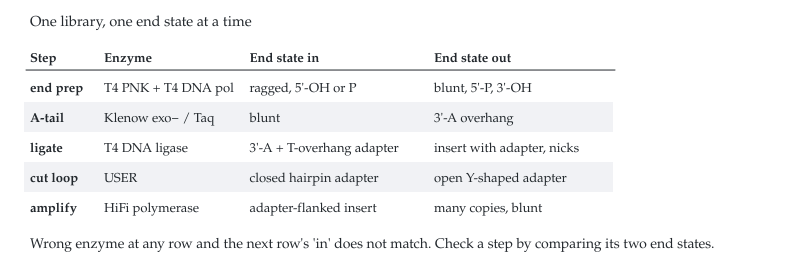{width=80%}

- Each row's **end state out** is the next row's **end state in**, and one enzyme property decides each row
- Rows 1 to 4 are the ligation route; **tagmentation** does all four in one reaction ([transposases](lec-transposases.qmd))
- [TruSeq DNA PCR-free](https://henriksson-lab.github.io/NGS_101/truseq-dna-pcr-free/truseq-dna-pcr-free.html) is traced block by block in [genomic DNA](../genomic-dna/lec.qmd)
- If two end states in a protocol do not line up, there is a step you cannot see or an enzyme doing something unasked

## What a polymerase does

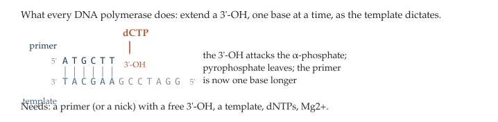{width=100%}

- One chemistry for every enzyme in this deck: a **3'-OH** attacks an incoming dNTP
- Everything that differs between enzymes is what *else* they do: check, cut, displace, tail
- Backbone rows 2, 3 and 5 are polymerase jobs; row 4 belongs to a ligase and row 1 to no enzyme at all
- A polymerase that cannot find a free 3'-OH does nothing, which is why blocked ends matter
  ([end chemistry](../end-chemistry/lec.qmd))

## Error rate: what it costs, and when it matters

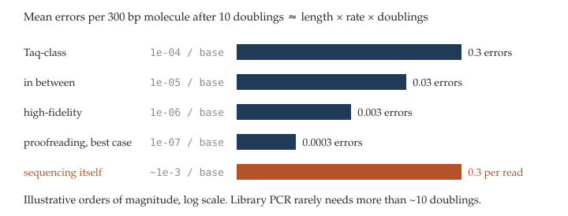{width=72%}

- Decides **row 5**, and nothing else: with no PCR, no base of the library has been copied
- A high-fidelity library PCR changes the sequence of far fewer molecules than **sequencing
  itself** does. For counting reads, error rate rarely matters
- It matters for **variant calling from low-frequency molecules**
  ([targeted sequencing](../targeted/lec.qmd)), long amplicons, cloning
  and long reads where each error is a single base on a single molecule
- Rates are assay-dependent: compare enzymes inside one vendor's chart, not across vendors

[Lundberg 1991, a proofreading archaeal polymerase, doi:10.1016/0378-1119(91)90480-Y]{.small}

## 3'→5' exonuclease: the proofreader

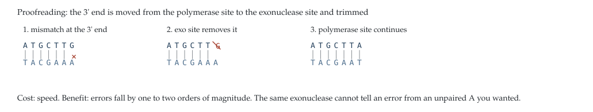{width=100%}

- A misincorporated base at the primer's 3' end stalls extension. The strand frays, slides
  into the exonuclease site and the base is removed
- That is the whole mechanism of **proofreading**, and it costs speed
- The enzyme has no memory of *why* a 3' base is unpaired: any unpaired 3' base is treated
  as an error
- Which is what **row 2** uses it for: a 3' overhang is unpaired, so it is trimmed away

## The same exonuclease repairs ends

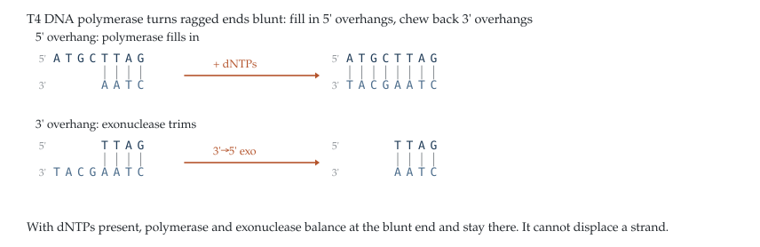{width=84%}

- **Row 2** of the backbone: **T4 DNA polymerase** has a strong 3'→5' exo and no strand displacement
- On a **3' overhang** the exo trims back until the strand is paired
- On a **5' overhang** the polymerase fills in. With dNTPs present both reach the same
  blunt end
- Because it cannot displace, it will not wreck the other strand of a nick or a gap

## 5'→3' exonuclease and flap endonuclease

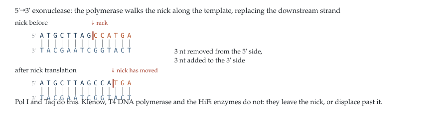{width=92%}

- Pol I and Taq cut away the strand in front of them as they copy. That is **nick translation**
- Taq's activity cuts a flap, not a nucleotide at a time: the basis of **hydrolysis probes**,
  the labelled oligos a real-time PCR cuts apart to give its signal
- It is why a **nick is not a stable mark** in a reaction with these enzymes, and why **row 2**
  cannot be done with one of them
- Klenow lacks it (the large fragment was made by removing that domain); T4 DNA polymerase
  and the HiFi enzymes never had it — **HiFi** here names the high-fidelity enzyme class, not
  PacBio's HiFi reads ([long-read instruments](../long-reads/lec-instruments.qmd))

## Strand displacement: three ways to meet a downstream strand

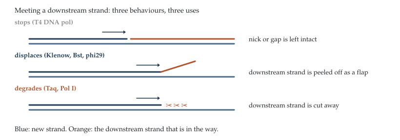{width=80%}

- **Stop**: leaves nicks and gaps in place. Good for end repair, so **row 2** wants it
- **Displace**: peels the strand off and keeps going. Needed for amplification at constant
  temperature, and for copying through a nick
- **Degrade**: chews the strand away. Good for replacing RNA primers, bad for preserving a mark

## Using displacement: rolling circles and whole-genome amplification

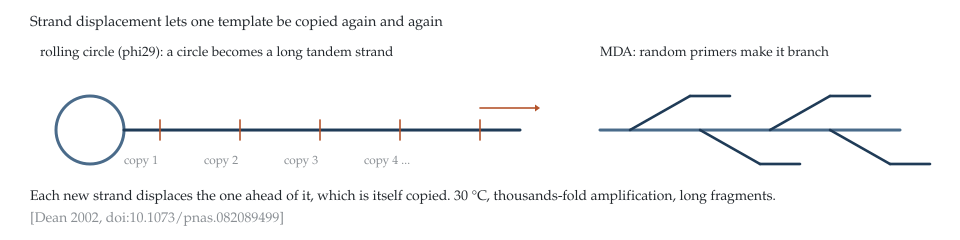{width=100%}

- No row of the backbone needs this: it is displacement spent outside library preparation
- **phi29** proofreads, has very high **processivity** — bases added before letting go — and
  very strong displacement at 30 °C: no cycling, and products tens of kb long
- **MDA** adds random primers, so each displaced strand is itself primed and copied
  ([amplification](../amplification/lec.qmd))
- **Bst** large fragment does the same at 60–65 °C, which is why it is the enzyme of
  [LAMP](../amplification/lec.qmd) and of many nicking-based amplifications

## The 3' end the enzyme leaves

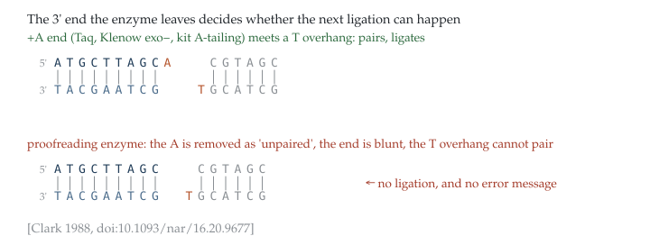{width=74%}

- **Row 3** is this property and nothing else: enzymes without a 3'→5' exo often add one
  **non-templated A**, and **Klenow exo−** does it efficiently, which is why row 3 uses it
- A proofreading enzyme removes that A again, so it makes **blunt** ends
- Row 4 is what the choice is for: a T-overhang adapter needs the A, a blunt adapter needs
  blunt ([attaching a handle](../handles/lec.qmd))

## Reverse transcriptase activity

The next three slides leave the DNA backbone. An RNA library needs rows of its own, and they
are worked out at the end of the deck.

- A reverse transcriptase is a DNA polymerase that also reads RNA, with three consequences
- **No proofreading.** Error rates are similar to, or worse than, Taq-class enzymes
- **RNase H domain.** MMLV-derived enzymes degrade the RNA in a hybrid as they copy. The
  H− variants do not, which gives longer cDNA
- **Processivity and heat.** Structured RNA stops an enzyme at low temperature. Engineered
  MMLV works at 50 °C or above; a group II intron RT (TGIRT) is more processive through
  structured RNA and switches templates on its own

At a damaged or modified base an RT either **stops** or **misincorporates**. Both leave a
signature in the data, and some methods read it on purpose.

[Mohr 2013, doi:10.1261/rna.039743.113]{.small}

## An activity RT was not sold for: template switching

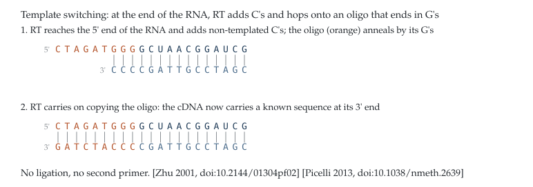{width=80%}

- At the 5' end of the RNA, MMLV RT adds a few non-templated C's
- An oligo ending in G's pairs with them and RT hops onto it as a second template
- The cDNA gets a **known sequence at its 5' end with no ligation**: this is how [Smart-seq2](https://henriksson-lab.github.io/NGS_101/smart-seq2__10.1038+nmeth.2639/smart-seq2.html)
  makes full-length libraries ([NGS 101](https://henriksson-lab.github.io/NGS_101/))

## RNA primers and nicks: second-strand synthesis

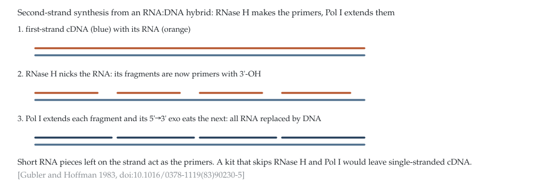{width=80%}

- The RNA route's own row 2, and it needs two properties at once
- **RNA primer extension**: the polymerase must extend an RNA 3'-OH with DNA. Pol I-family
  enzymes do; the HiFi enzymes do not. The primers come from RNase H
  ([nucleases](lec-nucleases.qmd))
- **Nick extension**: it must start at a nick. Displacers and degraders do, a pure filler like
  T4 DNA polymerase does not
- Gubler–Hoffman second strand needs both, plus a 5'→3' exo to remove the RNA ahead

## dU tolerance: reading through uracil

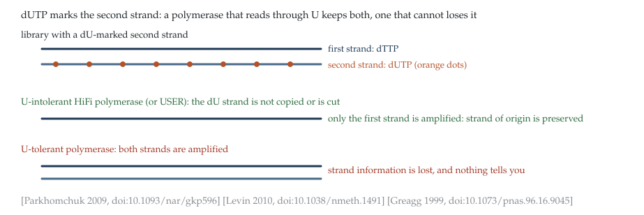{width=84%}

- Archaeal family-B enzymes (Pfu and its engineered descendants) have a **read-ahead pocket** that detects
  uracil in the template and stalls. It protects them from deaminated cytosine
- **dUTP second strand** exploits it: stranded RNA-seq kits ([RNA](../rna/lec.qmd)) mark the
  second strand with dU, then put a stalling enzyme in row 5 — or USER before it
  ([a cut at every uracil](lec-nucleases.qmd)) — so only the first strand is amplified
- Uracil-tolerant variants have the pocket engineered out: pick them when the template
  *contains* dU you want to keep

[Parkhomchuk 2009, doi:10.1093/nar/gkp596]{.small}

## Extension temperature

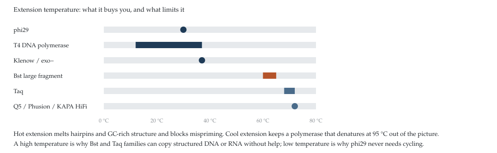{width=90%}

- A row-5 property: 72 °C is also where a tagmented library's gap is filled, inside the first cycle
- Temperature is about more than speed. It sets how much **secondary structure** the enzyme must
  cope with and how specific priming is
- The longest product follows processivity, not temperature: phi29 is the extreme, HiFi
  enzymes with a processivity domain come next
- Library inserts are short, so maximum product rarely limits a library, but it limits
  long-read and long-range work

## Reference: one chart, eleven columns

Every property above is a column of a vendor chart, which compares polymerases on the same
axes. Grouped by the question they answer:

- **Copying the template:** error rate · 3'→5' exonuclease · 5'→3' exonuclease or flap
  endonuclease · strand displacement · reverse transcriptase activity
- **What you get out:** the 3' end made (blunt or +A) · longest product
- **What it can start from:** RNA primer extension · nick extension · dU tolerance
- **Conditions:** extension temperature

Each column is a yes-or-no question with a consequence for a library step. The next two slides
are the lookup table, for the same eight enzymes used throughout.

## Reference: the chart, part 1

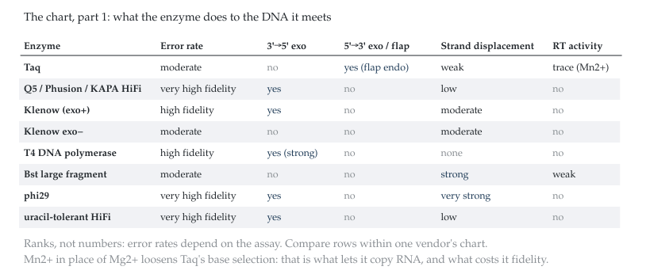{width=80%}

- Read a **row** to learn what an enzyme can do; read a **column** to pick an enzyme for a step
- Note how the groups separate: proofreading enzymes have a 3'→5' exo, Pol I-like enzymes have
  the 5'→3' one, and displacement is the third axis

## Reference: the chart, part 2

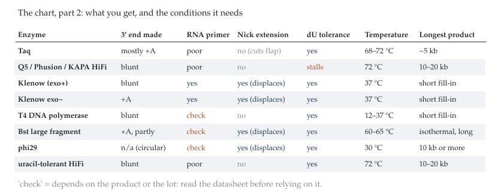{width=80%}

- The cells marked *check* vary between products and lots: vendors change the formulation
- Blunt versus +A is not a quirk. It decides whether the next ligation can happen at all

## The payoff: choosing the enzyme for row 2

Step: turn a mix of ragged, 5'-OH and 5'-P ends into ligatable blunt ends.

1. Needed: fill 5' overhangs, trim 3' overhangs, no strand displacement, no +A → **T4 DNA
   polymerase** (3'→5' exo yes, displacement none, blunt)
2. Needed: a 5'-phosphate on every end → T4 PNK, a separate enzyme
3. Rejected: Taq (adds A and nick-translates), Klenow exo− (+A, displaces), a HiFi enzyme
   (proofreads, but is built for 72 °C amplification, not for this step)

The deciding columns were **3' end made** and **strand displacement**, and the answer is the
enzyme the backbone's row 2 names.

## The payoff: the RNA route, with its strand marked

Step: make double-stranded cDNA from an RNA:DNA hybrid and keep track of which strand came
from the RNA.

1. RNase H nicks the RNA, Pol I extends: needs **RNA primer extension** and **5'→3' exo**
2. dUTP is used in place of dTTP: needs **dU tolerance** in that enzyme
3. In row 5 the dU strand must *not* be copied: needs a **U-intolerant** HiFi
   polymerase, or USER before the PCR

Two enzymes, opposite values in the same column, two rows apart. That is what the chart is for.

## Tricks: activities used for something they were not sold for

- **Taq adds an A** to blunt ends: the basis of TA cloning and TA ligation
- **phi29** was a replication enzyme; its displacement makes rolling-circle amplification
- **MMLV RT switches templates**: the basis of Smart-seq-type libraries
- **Bst** displaces at 65 °C: LAMP and most isothermal amplification
- **Klenow exo−** is a Klenow with the proofreading deleted so it can be used to add one base

Each of these was discovered by someone reading a side-effect as a feature. The
[trick catalogue](../tricks/lec.qmd) collects them by the problem they solve.

## Four silent failures

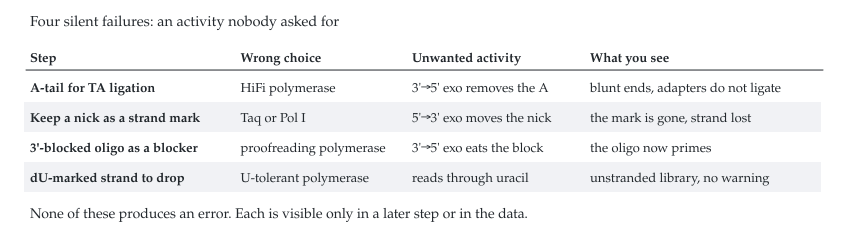{width=100%}

- None of these gives an error. A reaction with the wrong activity looks like a reaction
  that worked
- The defence is to ask of every step: *which activity of this enzyme could act on the
  molecule I just made?*

## Choosing a polymerase in four questions

1. What is the **template**: DNA, RNA, a hybrid, a circle, a nick?
2. What **end** should come out: blunt, +A, protected?
3. Is there an **unwanted activity** that would act on the product: a 3'→5' exo on a tail,
   a 5'→3' exo on a nick, a displaced strand?
4. What **conditions** does the rest of the protocol impose: temperature, uracil, length?

Run the backbone again and answer them for each row; the chart settles the last two.

Next: how the enzymes that join things ([ligases](lec-ligases.qmd)) and mark them (kinases,
phosphatases) work.

## Where this connects

**Before this**

- [Nucleic acids](../nucleic-acids/lec.qmd) — the ends, pairing and Tm every enzyme here acts on

**Where these enzymes decide the step**

- [Genomic DNA](../genomic-dna/lec.qmd) — the backbone above, traced one block at a time
- [Fragmentation](../fragmentation/lec.qmd) — enzymatic cutting, and the repair any ragged end needs
- [Amplification](../amplification/lec.qmd) — MDA, MALBAC and PTA are three ways of spending displacement
- [Modifications: DNA](../modifications/lec.qmd) — converted DNA carries uracil, so the dU column picks the PCR enzyme
- [Long reads](../long-reads/lec.qmd) — where processivity and longest product stop being academic

**If this fails**

- [Design patterns and failure modes](../design/lec.qmd) — the silent failures above, with the control that exposes each
- [QC](../qc/lec.qmd) — what over-amplification and lost complexity look like on a trace
