## What this deck is for

A library preparation is a sequence of chemical steps performed on the ends of molecules.

Almost every step in every protocol is one of:

- change what an end looks like
- join two molecules together
- copy a molecule
- keep or throw away a subset

To design any of that, you need to be fluent in what a nucleic-acid molecule *is* as a
physical object — not as a string of letters.

::: {.notes}
The aim is not to re-teach base pairing. It is to install the habit of asking, at every
protocol step: what is the state of the ends now?
:::

## A strand has a direction {.smaller}

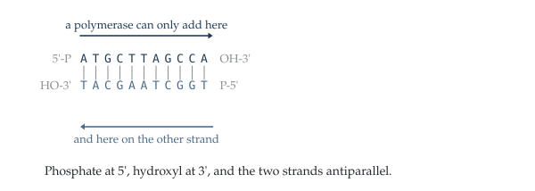{width=68%}

- The backbone is asymmetric: a **5'-phosphate** at one end, a **3'-hydroxyl** at the other
- Polymerases only ever add to a **3'-OH**. There is no enzyme that extends a 5' end
- The two strands of a duplex run antiparallel, so "the left end" is 5' on one strand and
  3' on the other

## Two ends, two chemistries {.smaller}

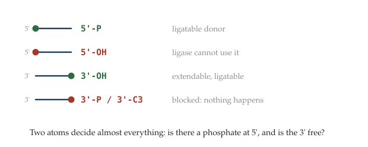{width=60%}

- A ligase needs a **5'-phosphate** on one side and a **free 3'-OH** on the other
- Synthetic oligos arrive **without** a 5'-phosphate unless you pay for one
- A blocked 3' end is a deliberate dead end — useful when you want a molecule to prime
  nothing and ligate nowhere

## Cut ends have a shape {.smaller}

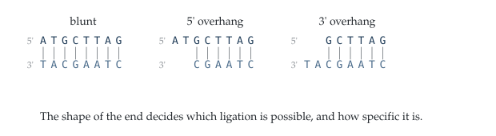{width=88%}

- **Blunt**: ligates to anything, inefficiently and unselectively
- **Overhangs**: ligate only to a matching overhang, efficiently and selectively
- Shearing gives you ragged, damaged ends — a mixture of all of the above, which is why
  end repair exists

## Nicks and gaps are not the same thing {.smaller}

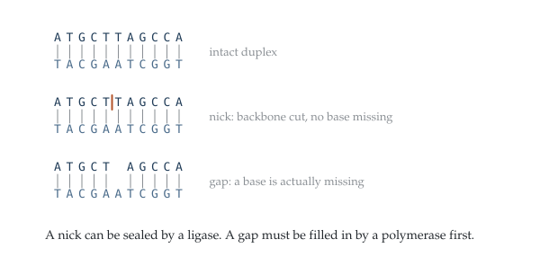{width=52%}

- A **nick** is a broken backbone with every base present: a ligase can seal it
- A **gap** is missing bases: a polymerase must fill it in first, then a ligase seals
- Several protocols depend on this distinction — Tn5 leaves a 9 nt gap, nick translation
  walks a nick along the molecule

## What a ligase actually requires {.smaller}

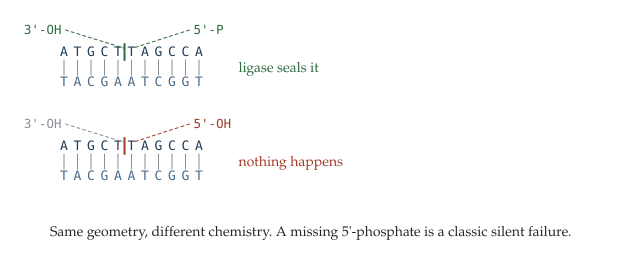{width=60%}

- The geometry is identical in both cases. Only the chemistry differs
- Forgetting a 5'-phosphate is one of the most common silent failures in library prep:
  no error, no warning, just no product
- It is also used deliberately — leave the phosphate off and only one strand gets joined

[Lehman 1974, *DNA ligase: structure, mechanism, and function*, doi:10.1126/science.186.4166.790]{.small}

## End state decides what is possible {.smaller}

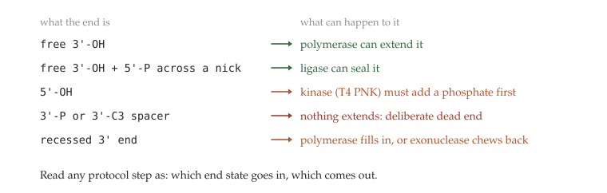{width=76%}

Read every protocol step as a transformation: **which end state goes in, which comes out.**

## Worked example: why end repair and A-tailing exist

You sheared genomic DNA. The ends are ragged, some 5'-phosphates are missing, some 3' ends
are blocked by damage. Adapters cannot ligate.

1. **End repair** — a polymerase fills in 5' overhangs and chews back 3' overhangs; a kinase
   (T4 PNK) puts a phosphate on every 5' end → uniform, blunt, ligatable
2. **A-tailing** — a polymerase adds a single non-templated A to each 3' end
3. The adapter carries a matching single **T** overhang

The A/T pair is not for strength. It is to stop inserts ligating to each other and adapters
ligating to each other.

[Non-templated A addition: Clark 1988, doi:10.1093/nar/16.20.9677]{.small}

## Hybridisation and Tm {.smaller}

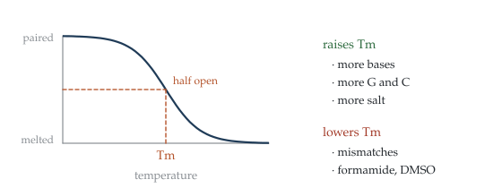{width=64%}

- **Tm** is a property of a duplex *in a buffer*, not of one oligo on its own
- Every primer, probe, splint, bait and capture step is a hybridisation whose Tm you are
  choosing, whether you meant to or not

[SantaLucia 1998, nearest-neighbour thermodynamics, doi:10.1073/pnas.95.4.1460]{.small}

## Tm in practice

Where it bites:

- **Primer annealing** — two primers in one reaction should have similar Tm, or one dominates
- **Bead washes** — wash too warm or too low-salt and your captured material comes off
- **Hybridisation capture** — hours at a fixed temperature; the bait set must be designed to
  work at one temperature
- **Poly(A) capture** — oligo-dT–RNA duplexes are weak and AT-only; this is why poly(A)
  selection uses cold binding and warm elution

Rules of thumb: longer and more GC-rich raises Tm; mismatches and formamide lower it; salt
raises it by shielding the backbone's negative charge.

## When oligos do the wrong thing {.smaller}

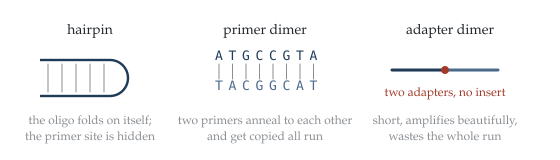{width=85%}

- An oligo that folds on itself cannot prime
- Two oligos that anneal to each other get amplified as enthusiastically as your real target

## Adapter dimers deserve their own slide

They are short, perfectly formed, and amplify better than anything else in the tube.

- A dimer is ~120 bp against an insert of ~300–500 bp: it clusters more efficiently and can
  take over a sequencing run
- Prevention: keep adapter concentration matched to the amount of input DNA, use A/T
  overhangs so adapters cannot self-ligate, remove them by size selection
- Detection: a sharp low peak on a fragment-analyser trace, or a flood of adapter-only reads

[Head et al. 2014, *Library construction for NGS: overviews and challenges*, doi:10.2144/000114133]{.small}

## Writing a molecule down {.smaller}

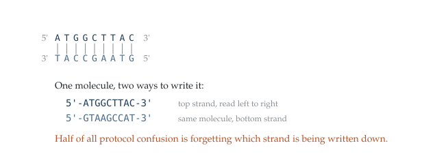{width=60%}

- Convention: sequences are always written **5'→3'** unless stated otherwise
- The same molecule has two equally valid written forms
- When a protocol gives you an oligo, you must work out which strand it anneals to

## Degenerate positions {.smaller}

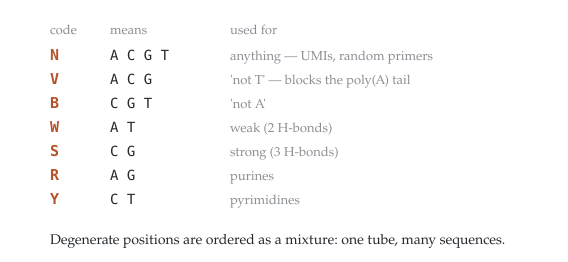{width=52%}

- `N` means the synthesiser used all four bases at that position: one tube, many molecules
- This is how **UMIs** and **random hexamers** are made
- `VN` anchors an oligo-dT primer at the start of the poly(A) tail

[UMIs: Kivioja et al. 2011, doi:10.1038/nmeth.1778]{.small}

## An oligo is more than its sequence {.smaller}

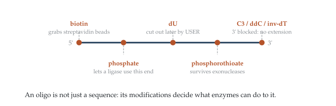{width=77%}

What you specify when ordering decides which enzymes can act on it.

## Ordering oligos in practice

- **Scale** (25 nmol, 100 nmol…) — how much you get; almost always more than you need
- **Purification** — desalted is fine for ordinary primers; HPLC or PAGE when every molecule
  must be full length, which matters for long adapters and for anything carrying a barcode
- **Modifications** cost extra and some combinations cannot be synthesised together
- **Truncation products** are the hidden problem: synthesis is ~99% efficient per base, so a
  60-mer is only ~55% full length before purification

This is why adapters are often ordered as two shorter oligos and annealed, rather than as one
long one.

## DNA and RNA are different materials {.smaller}

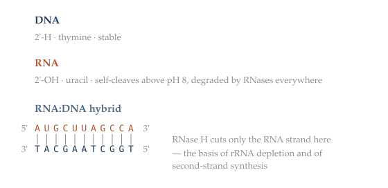{width=50%}

- The 2'-OH makes RNA chemically reactive: it self-cleaves at alkaline pH and at high
  temperature
- RNases are everywhere, need no cofactors, and survive autoclaving
- The RNA:DNA hybrid is its own substrate, with its own enzymes

## RNA ends are more varied than DNA ends {.smaller}

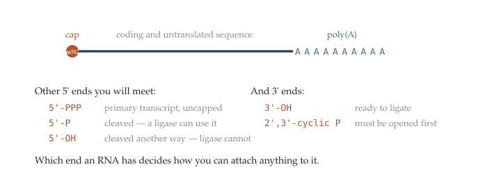{width=67%}

The end a transcript happens to have determines which chemistry can attach anything to it.

## Working with RNA

Bench practice that follows directly from the chemistry:

- Keep it **cold** and keep it **acidic to neutral** — alkaline conditions cleave RNA
- Use RNase-free plasticware and filter tips; wear gloves and change them
- Add an **RNase inhibitor** to enzymatic reactions, but remember it is a protein and dies
  when heated
- **DNase** treatment of an RNA prep is usually necessary; genomic DNA otherwise shows up as
  intronic and intergenic reads
- Keep a sample for QC: RNA integrity is worth measuring before you commit it to a library

## The five questions

Ask these about any molecule at any step of any protocol:

1. Is it single- or double-stranded? DNA, RNA, or a hybrid?
2. What is at the 5' end — phosphate, hydroxyl, cap, something else?
3. What is at the 3' end — hydroxyl, blocked, a tail?
4. What shape is the end — blunt, 5' overhang, 3' overhang?
5. What is it hybridised to, and at what temperature does that stop being true?

If you can answer these after every step, you can read any protocol in the collection.

## Where this goes next

- **How sequencers read DNA** — what the finished molecule must look like
- **Anatomy of a library molecule** — P5, index, read primer sites, insert
- **The enzyme toolbox** — the enzymes that perform the transformations in this deck

Reference while you work: [NGS 101](https://henriksson-lab.github.io/NGS_101/) draws every
protocol in the collection base by base, with the end states at every step.
