## What this deck is for

A human genome is three billion bases in 46 pieces. A sequencer reads a few hundred bases at a time, or, on a long-read machine, tens of kilobases. Between the two sits a cutting step, and then a sorting step.

- **Cut** the DNA or RNA to a length the instrument and the question want
- **Sort** the pieces so the library contains that length and little else
- The cut leaves the ends in a particular state, which decides what you have to do next ([end chemistry](../end-chemistry/lec.qmd))

This deck covers the main ways of cutting, the targets set by the sequencer, and how to select by size, with one of the most-used and least-understood steps at the bench in detail: the bead ratio.

## Why we cut

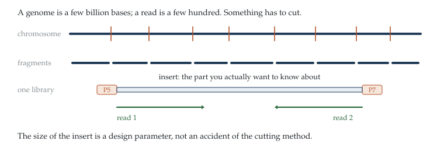{width=84%}

- A short-read library is a population of inserts with the **same adapters on both ends** and a length you chose
- Too long and clusters form poorly; too short and the reads run into the adapter
- Fragment *position* is usually meant to be random, so every part of the genome is covered evenly

## Seven ways to cut

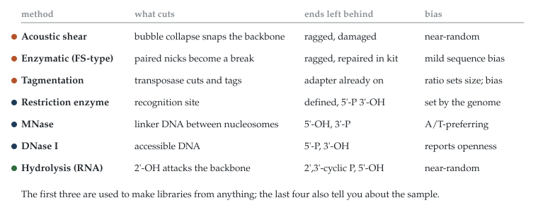{width=72%}

- Each leaves **different ends** and a **different bias**: that is what you select on
- The first three are for making libraries from anything. The next three also report on the chromatin the DNA came from

## Acoustic shearing

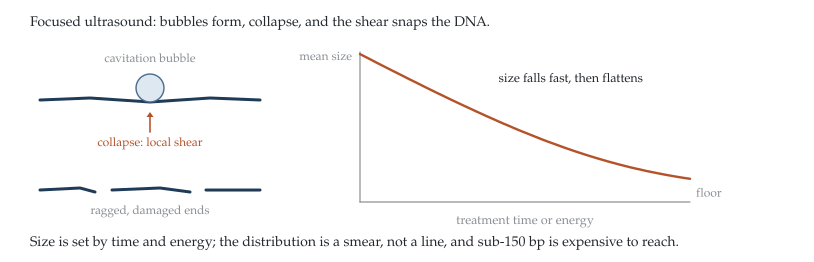{width=87%}

- Focused ultrasound makes bubbles that collapse; the local shear force breaks the backbone. Nothing in it recognises sequence
- Size is tuned by time and intensity. The output is near-random but ragged and damaged: **end repair is needed** ([end chemistry](../end-chemistry/lec.qmd))
- The cost is an instrument and a tube per sample

[Knierim et al. 2011, doi:10.1371/journal.pone.0028240]{.small}

## Enzymatic fragmentation

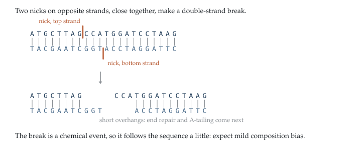{width=70%}

- Kits (for example [NEBNext Ultra II FS](https://henriksson-lab.github.io/NGS_101/nebnext-ultra-ii-fs-dna-pcr-free/nebnext-ultra-ii-fs-dna-pcr-free.html)) fragment, repair and A-tail in **one tube** by time and temperature
- No instrument, low input, easy to automate. A price: mild sequence bias, and artefacts if the reaction runs long

[Poptsova et al. 2014, doi:10.1038/srep04532]{.small}

## Tagmentation

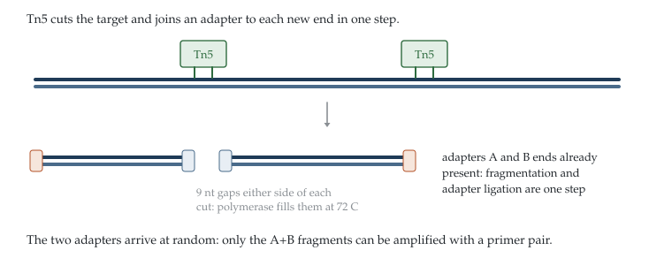{width=73%}

- A hyperactive Tn5 transposase cuts the target and **ligates an adapter to each new 5' end** in the same step, leaving a 9 nt gap that a polymerase fills in ([transposases](../enzymes/lec-transposases.qmd))
- Fragmentation and adapter attachment become one reaction: the fastest prep, used in [Nextera XT](https://henriksson-lab.github.io/NGS_101/nextera-xt-dna-library-prep/nextera-xt.html) and [ATAC-seq](https://henriksson-lab.github.io/NGS_101/atac-seq__10.1038+nmeth.2688/atac-seq.html)

[Adey et al. 2010, doi:10.1186/gb-2010-11-12-r119; Picelli et al. 2014, doi:10.1101/gr.177881.114]{.small}

## Tagmentation: the size is set by a ratio

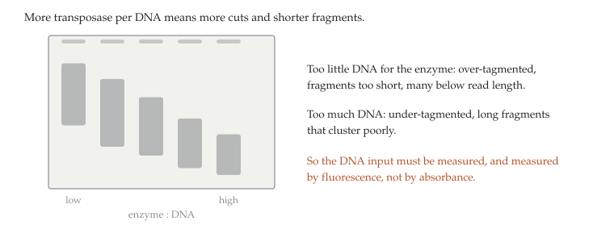{width=75%}

- Tn5 cuts until it runs out of enzyme, not until it runs out of time. Fragment size therefore depends on the **ratio of enzyme to DNA**
- Quantify input by fluorescence: contaminating RNA or free nucleotides make absorbance read high, and the library comes out too long

## Restriction digests

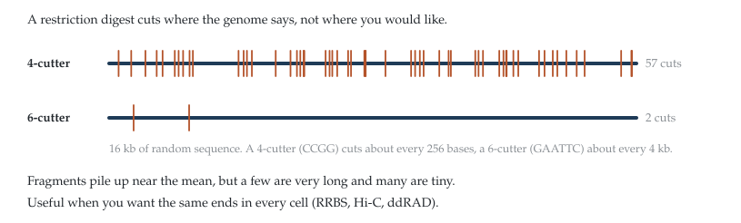{width=93%}

- Every fragment starts and ends at a recognition site: identical ends in every cell, but sizes set by the genome, not by you
- That is a feature when you want the same loci every time (reduced-representation bisulfite sequencing, Hi-C, ddRAD), a flaw when you want even coverage

[Meissner et al. 2005, doi:10.1093/nar/gki901]{.small}

## MNase and DNase I

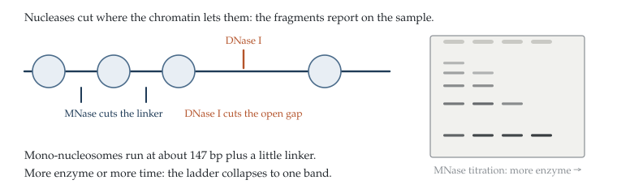{width=90%}

- **MNase** digests linker DNA between nucleosomes and leaves nucleosome-sized fragments. **DNase I** cuts DNA the chromatin has left open
- The fragment is the measurement: where the cut falls reports what was bound. Protocols: [DNase-seq](https://henriksson-lab.github.io/NGS_101/dnase-seq-boyle-2008__10.1016+j.cell.2007.12.014/dnase-seq-boyle-2008.html), [scMNase-seq](https://henriksson-lab.github.io/NGS_101/scmnase-seq__10.1038+s41586-018-0567-3/scmnase-seq.html)

[Boyle et al. 2008, doi:10.1016/j.cell.2007.12.014; Schones et al. 2008, doi:10.1016/j.cell.2008.02.022]{.small}

## Chemical and alkaline hydrolysis

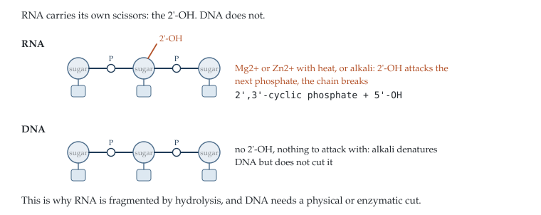{width=71%}

- RNA is fragmented in a buffer with divalent metal ions at 85-95 degrees, giving 2',3'-cyclic phosphate and 5'-OH ends. These ends **block direct ligation** until repaired
- Alkali denatures DNA but does not cut it. DNA breaks by depurination (heat, acid) or radicals, which is why bisulfite treatment fragments DNA by itself

[Mortazavi et al. 2008, doi:10.1038/nmeth.1226]{.small}

## What the sequencer wants

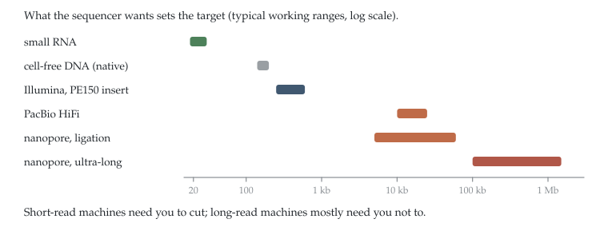{width=75%}

- Short-read clusters want inserts of a few hundred bases; **long-read machines want what you started with**
- Cell-free DNA and nucleosome-protected fragments arrive at their own natural length: size selection should not fight it
- Ranges are typical working ones, not limits; check the current kit

## Insert length against read length

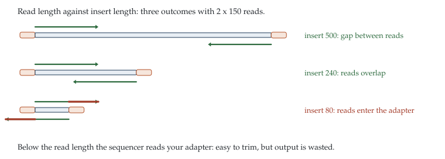{width=79%}

- Insert shorter than a read: the read goes through into the adapter and is wasted
- Insert shorter than two reads: they overlap, which is fine and sometimes useful
- Rule: choose the insert for the [read length](../sequencers/lec.qmd), then the method that delivers it

## A cut gives a distribution, not a length

A sheared sample is a smear, typically two-fold either side of the mean. Three populations hurt you:

- **Too long**: cluster poorly, or never leave the flow-cell surface
- **Too short**: reads read adapter. Also, inserts shorter than the reads waste the cycles
- **Adapter dimers**: about 120 bp of adapters with no insert, which amplify and cluster better than anything else

Size selection narrows the distribution and removes the worst. It does **not** make it a line: whichever method you use, the edge of the selection is a slope.

[Head et al. 2014, doi:10.2144/000114133]{.small}

## Which window do you ask for?

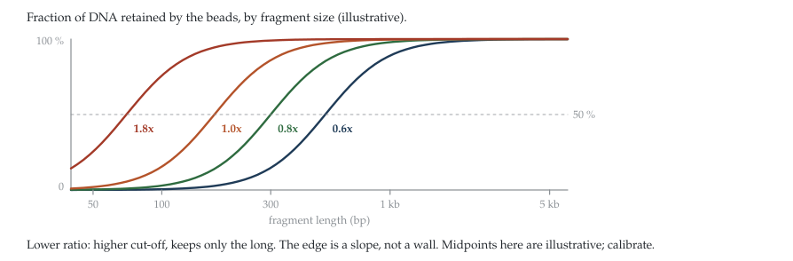{width=86%}

- The ratio is **volume of bead suspension to volume of sample**. A lower ratio means less PEG and binds only the long DNA. How the beads bind, and how to work out a bead volume, are in [QC](../qc/lec.qmd); here the question is which window to ask for
- 1.8x binds nearly everything above ~100 bp, so it clears primers and nucleotides; ~0.8x begins to leave the short end behind
- The curves are illustrative. Run your own ladder through your own beads

[Hawkins et al. 1994, doi:10.1093/nar/22.21.4543; Rohland and Reich 2012, doi:10.1101/gr.128124.111]{.small}

## Two edges make a window

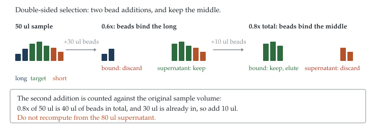{width=83%}

- Step 1 at a **low ratio** binds the long fragments. Keep the supernatant
- Step 2 raises the ratio. Now the target binds, and the short fragments stay in solution. Keep the beads
- Together the two edges give a window; each edge is still a slope

## A ratio is a PEG concentration

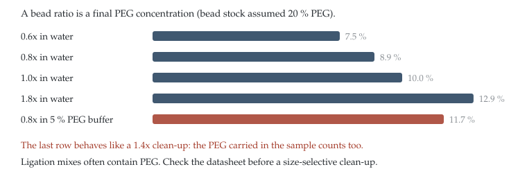{width=84%}

- The final PEG concentration is a weighted average of sample and beads. Whatever PEG is already in the sample **adds to the beads**
- The bead stock is assumed to be 20 % PEG here; vendors do not always publish it

## What goes wrong with beads

- **PEG in the sample** (ligase buffers, some master mixes): the same nominal ratio gives a lower cut-off
- **Wrong volume base** in a double-sided clean-up: the second addition counted from the supernatant
- **Beads not at room temperature or not resuspended**: the settled beads are the suspension's weakest part, so the true ratio is off
- **Over-dried beads** crack and release DNA poorly; **old ethanol** is not 80 % any more and washes away DNA
- **Small volumes**: pipetting 3 ul of beads has an error that is a large part of the ratio

When a library looks wrong, ask about the beads before you blame the enzyme. The same ratios come back as a clean-up step, measured rather than designed, in [QC](../qc/lec.qmd).

## Gel and PAGE

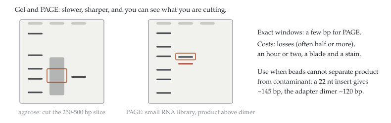{width=89%}

- A gel puts a **window on a ruler**: you see the smear and cut the slice you want. PAGE does the same for small molecules to a few bases
- It is slower and loses material; use it when two species are too close for beads to tell apart

## Order changes the answer

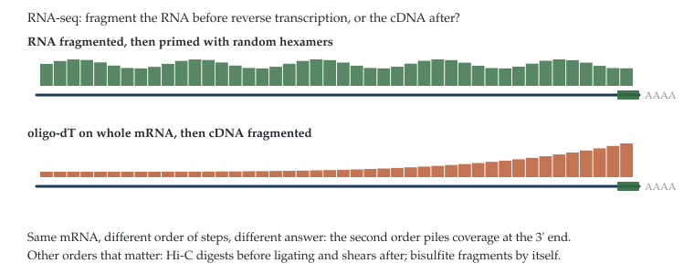{width=71%}

- **Before or after the key chemistry**? For [RNA](../rna/lec.qmd), fragmenting first gives even coverage, cutting the cDNA afterwards is biased to the 3' end
- Hi-C digests the chromatin **before** ligating and shears **after**, because ligation junctions are the data. Bisulfite fragments DNA by itself, so adapters go on after it, as in [PBAT](https://doi.org/10.1093/nar/gks454), or are made of methylated cytosines
- Tagmentation of nuclei **is** the chemistry in ATAC-seq

[Lieberman-Aiden et al. 2009, doi:10.1126/science.1181369; Miura et al. 2012, doi:10.1093/nar/gks454; Buenrostro et al. 2013, doi:10.1038/nmeth.2688]{.small}

## Partial digestion

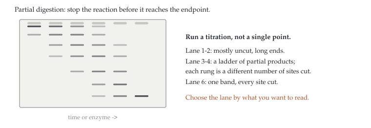{width=82%}

- A complete digest tells you what is **between neighbouring sites**. A partial digest gives overlapping fragments from which you can build a map
- With MNase or DNase I the titration chooses what you measure: mono-nucleosomes with plenty of enzyme, a ladder with less. Always run a time course on a new sample
- Under-digestion is a common silent fault in a Hi-C prep. Check a small aliquot before moving on

## Bottleneck dilution: endpoints as labels

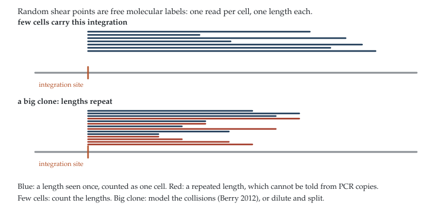{width=60%}

- Random shear points are a free label. In a human cancer or T-cell clone, every cell with a provirus in one place has the same junction but a different shear length. Count the lengths, count the cells
- Dilution is the bottleneck: the number of molecules entering PCR should stay below the number of possible lengths, or the labels collide

[Gillet et al. 2011, doi:10.1182/blood-2010-10-312926; Berry et al. 2012, doi:10.1093/bioinformatics/bts004]{.small}

## Fixed-length tags from Type IIS and IIG enzymes

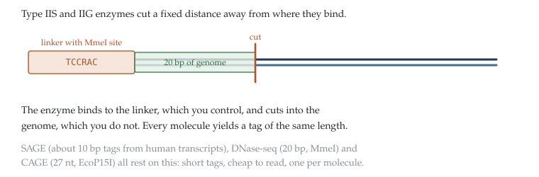{width=85%}

- Ordinary enzymes cut inside their site. A Type IIS or IIG enzyme **binds in your linker and cuts into the neighbouring DNA**
- The tag is the same length for every molecule, so a few dozen bases identify a transcript or a cut position. [CAGE](https://henriksson-lab.github.io/NGS_101/cage__10.1038+nprot.2012.005/cage.html) makes 27 nt tags with EcoP15I

[Velculescu et al. 1995, doi:10.1126/science.270.5235.484; Takahashi et al. 2012, doi:10.1038/nprot.2012.005]{.small}

## Not cutting at all

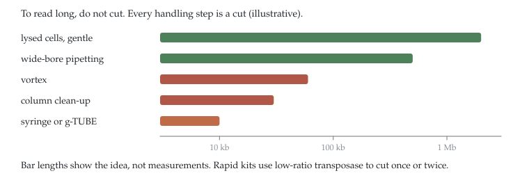{width=83%}

- Long-read sequencing wants the molecule intact, so the protocol is mostly about **not breaking it**: wide-bore tips, no vortexing, few transfers, gentle lysis
- Rapid and ultra-long kits use a transposase at a low ratio so that each molecule is cut once, not many times: [rapid](https://henriksson-lab.github.io/NGS_101/oxford-nanopore-rapid-sequencing-v14/rapid-sequencing-v14.html), [ultra-long](https://henriksson-lab.github.io/NGS_101/oxford-nanopore-ultra-long-v14/ultra-long-v14.html)

[Jain et al. 2018, doi:10.1038/nbt.4060]{.small}

## Which cut for which question

- **Whole-genome short reads**: acoustic or enzymatic, then end repair and adapters. PCR-free needs more DNA and an instrument
- **Low input, fast**: tagmentation; measure the input
- **Same loci in every cell**: restriction digest
- **What was bound to the DNA**: MNase or DNase I; tagmentation in nuclei
- **RNA**: metal-ion hydrolysis before reverse transcription
- **Long reads**: do not cut; or cut once
- **Always**: pick the size window from the read length, choose beads or a gel by how close the contaminant is to your product, and calibrate on a ladder

## Where this connects

**Where this block is used**

- [Genomic DNA](../genomic-dna/lec.qmd) — the fragmentation route follows from how much DNA you have
- [Chromatin](../chromatin/lec.qmd) — MNase, DNase I and Tn5, where the cut position *is* the measurement
- [Three-dimensional genome](../3d-genome/lec.qmd) — the restriction enzyme you pick sets the contact resolution
- [Small RNA and low input](../rna/lec-small-rna.qmd) — when the molecule is already short, the size window is most of the protocol
- [Long reads](../long-reads/lec.qmd) — the unit where the aim is not to cut, and what shears HMW DNA anyway

**Enzymes and tricks**

- [Nucleases](../enzymes/lec-nucleases.qmd) — restriction enzymes, MNase and DNase I seen from the enzyme side
- [Tricks](../tricks/lec.qmd) — methylation-sensitive digestion, and cutting used as a way to select
