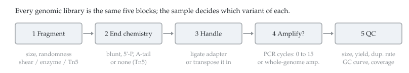
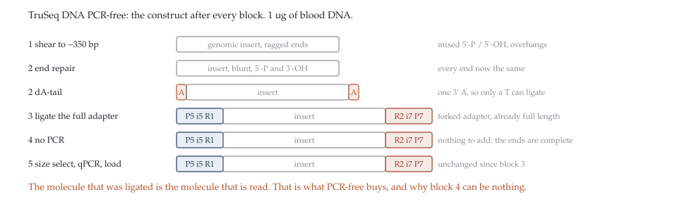
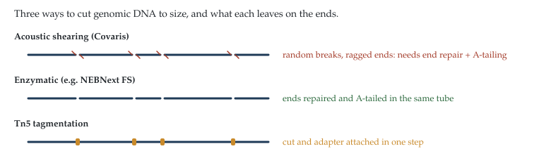
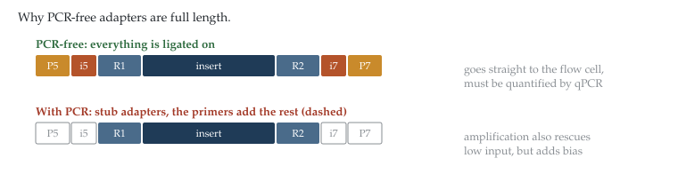
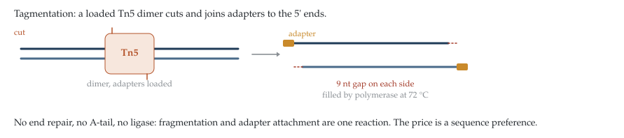
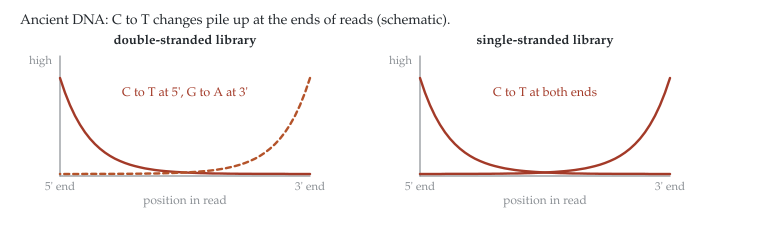
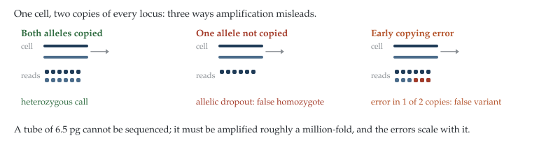

## Start from the question, not the kit

A genomic library answers one of a few questions about a human genome:

- **Variants** in a germline or tumour genome: needs even coverage and few artefacts
- **Copy number**: needs coverage that tracks the template, not the chemistry
- **Ancient or forensic DNA**: the molecules are short and damaged before you touch them
- **One cell**: there are two copies of each locus, and you have to make more

This deck derives the library for each, then reads real protocols and asks why they differ.

::: {.notes}
Part C pattern: question and sample first, blocks second, vendor protocol last. Students should
be able to predict most of the kit before they see it.
:::

## Five blocks, and the sample picks the variant

{width=95%}

- The blocks are the ones from Part B: fragmentation, end chemistry, handle, amplification, QC
- For every genomic protocol, ask which variant of each block it chose, and what in the sample forced it
- Most differences between kits are a different answer to block 4: **is there PCR?**

## Mass of DNA decides the route

{width=94%}

- A human diploid cell holds about 6.5 pg; a blood draw gives micrograms
- Input ranges are from the vendor guides in the collection and change between versions: check the current guide
- Protocols named here: [TruSeq DNA PCR-Free](https://henriksson-lab.github.io/NGS_101/truseq-dna-pcr-free/truseq-dna-pcr-free.html), [NEBNext Ultra II FS PCR-free](https://henriksson-lab.github.io/NGS_101/nebnext-ultra-ii-fs-dna-pcr-free/nebnext-ultra-ii-fs-dna-pcr-free.html), [Illumina DNA Prep](https://henriksson-lab.github.io/NGS_101/illumina-dna-prep/illumina-dna-prep.html), [Nextera XT](https://henriksson-lab.github.io/NGS_101/nextera-xt-dna-library-prep/nextera-xt.html)

## Design: a clinical whole genome from 1 µg of blood DNA

{width=70%}

Question: germline variants and copy number across the whole genome, GC-extremes included.
Sample: a blood draw, so micrograms of long, intact DNA.

- With that much input, block 4 can be **nothing**, and the other four blocks have to hand the sequencer a finished molecule on their own
- The whole walk is above; the next four slides take it one block at a time, asking after each what sits on the two ends. The protocol is [TruSeq DNA PCR-Free](https://henriksson-lab.github.io/NGS_101/truseq-dna-pcr-free/truseq-dna-pcr-free.html)
- [NEBNext Ultra II FS PCR-free](https://henriksson-lab.github.io/NGS_101/nebnext-ultra-ii-fs-dna-pcr-free/nebnext-ultra-ii-fs-dna-pcr-free.html) makes the same choices with enzymatic fragmentation; the same blocks with 5 to 12 cycles of PCR are the [NEBNext Ultra II](https://henriksson-lab.github.io/NGS_101/nebnext-ultra-ii-dna-library-prep-user-adaptor/nebnext-ultra-ii-user.html) family

## Block 1: shear the 1 µg to about 350 bp

{width=88%}

- Acoustic shearing is unbiased by sequence, which is what even coverage needs ([fragmentation](../fragmentation/lec.qmd))
- 350 bp is set against the read length and the cluster, not against the chemistry ([what the sequencer wants](../sequencers/lec.qmd))
- **Construct now**: insert of about 350 bp, ragged ends, a mixture of overhangs and 5'-OH, which no ligase can use
- Row 2 repairs and A-tails in the same tube; row 3 does blocks 1 to 3 at once, and returns later in this deck

## Blocks 2 and 3: repair the ends, add one A, ligate the adapter

{width=85%}

- End repair leaves every end blunt with a 5'-phosphate, one 3' A is added, and the adapter carries the matching T ([end chemistry](../end-chemistry/lec.qmd))
- The A/T handshake is what keeps the product clean: inserts cannot join each other, and adapters cannot join each other
- **Construct now**: adapter – insert – adapter, one at each end, the unpaired arms of each fork still single-stranded
- Each of those enzyme steps ends in a bead clean-up, and every clean-up loses molecules

[A-tailing and end repair as in Illumina's TruSeq guide, see the collection page for TruSeq PCR-Free]{.small}

## Block 4: nothing, because the fork was already full length

{width=92%}

- A **full-length** adapter arrives with P5, i5 and R1 on one end and R2, i7 and P7 on the other, so the molecule is finished the moment it is ligated ([the molecule](../library-molecule/lec.qmd))
- **Construct now**, read out: P5-i5-R1-insert-R2-i7-P7. Every ligated fragment can seed a cluster, and no base of it has been copied
- With stub adapters the flow-cell ends are missing and PCR installs them, so block 4 stops being optional
- What that PCR costs — GC and length bias, duplicates, library complexity — is worked out in [amplification](../amplification/lec.qmd)

[Kozarewa et al. 2009, doi:10.1038/nmeth.1311]{.small}

## Block 5: size select, count by qPCR, load

{width=90%}

- Bead size selection brings the trace to one peak at the design size; a sharp peak near 130 bp is adapter dimers, which would take cluster space
- Fluorescence counts every molecule, including the ones that lost an adapter: **qPCR** counts only those carrying both flow-cell ends ([cleanup and QC](../qc/lec.qmd))
- **Construct at the flow cell**: unchanged since block 3. The molecule that was ligated is the molecule that is read
- The third trace belongs to the PCR route, where a second, larger peak means too many cycles

## The same spine, blocks 1 to 3 in one enzyme: tagmentation

{width=92%}

- A Tn5 dimer loaded with adapters cuts the DNA and joins an adapter to each 5' end ([transposases](../enzymes/lec-transposases.qmd))
- **Construct after that one step**: adapter – insert – adapter, with a 9 nt gap on the other strand at each end
- The adapters are stubs and the gap is unfilled, so the first PCR does both jobs: block 4 is not optional here
- Less input and fewer steps, at the price of a sequence preference: [Nextera XT](https://henriksson-lab.github.io/NGS_101/nextera-xt-dna-library-prep/nextera-xt.html) and Illumina DNA Prep

[Adey et al. 2010, doi:10.1186/gb-2010-11-12-r119]{.small}

## What the field does, side by side

{width=95%}

- Tagmentation kits give up PCR-free-ness for input and speed; ligation kits give up input for flatness
- Illumina DNA Prep uses **bead-linked transposomes**, Tn5 held on beads so that a fixed number of enzyme sites does the cutting: yield saturates, and libraries pool without individual quantification above 100 ng
- Nextera XT was designed around small genomes, and its 1 ng input is matched to them rather than to a human genome

## Worked example: how many molecules do you really have?

10 ng of human DNA, 3.3 pg per haploid genome:

- 10 000 pg / 3.3 pg is about **3000 copies** of every locus
- Assume 20% of fragments end up with an adapter at both ends (an assumption: check your protocol): about **600 molecules** per locus
- 30x sequencing: $x = 30/600 = 0.05$ reads per molecule, so about **97% unique** on the saturation curve ([amplification](../amplification/lec.qmd))
- Now 100 pg: 30 copies, about 6 molecules per locus, $x = 5$ at 30x, and **about 20% unique**

At 100 pg, no extra sequencing rescues the library. Only more input or a different method does.

## Degraded DNA is damaged before you start

{width=88%}

- Ancient and some forensic DNA, or DNA from FFPE blocks (formalin-fixed, paraffin-embedded tissue), is short, nicked, and full of deaminated cytosines (C becomes U, read as T)
- The damage accumulates at molecule ends, so the read-end pattern is the signature that the DNA is authentic
- Library prep must keep short molecules and decide what to do about the uracils

[Briggs et al. 2007, doi:10.1073/pnas.0704665104]{.small}

## Deal with the uracils: UDG

{width=95%}

- Uracil-DNA glycosylase plus an endonuclease removes uracil, so calls become clean
- **Partial** UDG removes it internally but leaves the ends, so authenticity can still be tested
- See [partial-UDG double-stranded ancient DNA](https://henriksson-lab.github.io/NGS_101/double-stranded-ancient-dna-with-partial-udg__10.1098+rstb.2013.0624/partial-udg-ds-adna.html)

[Rohland et al. 2015, doi:10.1098/rstb.2013.0624]{.small}

## Short and nicked: make the library from single strands

{width=87%}

- A ligation library needs both strands of a duplex intact at the ends ([what a ligase requires](../enzymes/lec-ligases.qmd)); ancient DNA often is not
- Denature first, ligate an adapter to every single strand, copy, then ligate the second adapter
- [Single-stranded ancient DNA library](https://henriksson-lab.github.io/NGS_101/single-stranded-ancient-dna__10.1038+nprot.2013.038/single-stranded-library.html): more molecules recovered, at the cost of more steps

[Gansauge and Meyer 2013, doi:10.1038/nprot.2013.038]{.small}

## One cell: there is nothing to prepare a library from

{width=95%}

- A cell holds about 6.5 pg: two copies of each locus
- Amplification must produce nanograms to micrograms, and it can fail in the three ways shown
- Every single-cell WGA method is a different attempt to make that amplification even and faithful

## Amplifying one genome is not amplifying a library

- A bulk library is already millions of distinct molecules and PCR makes more of each. Whole-genome amplification has to **create** the library first, roughly a million-fold from two copies, and only then do blocks 1 to 3 run
- So unevenness that a bulk library would absorb arrives here as a genotype: a locus copied from one allele and not the other reads as a homozygote, and an error made in the first copy sits in half the reads
- MDA, MALBAC and PTA are three attempts at that amplification, and they differ in how many generations stand between the original molecule and each copy ([amplification](../amplification/lec.qmd)); the product then enters an ordinary ligation library
- What you can call follows from the evenness you get: copy number tolerates noise in depth, single-nucleotide variants tolerate neither dropout nor an early error

## After sequencing: read the run back

- Duplicate rate and insert-size distribution say whether the library held as many distinct molecules as the run asked for
- The GC-versus-coverage curve says whether the chemistry tracked the template or its own preferences
- **Fold-80 base penalty**: how much more depth you would need for 80% of positions to reach the mean coverage. 1 is perfectly even, 2 means half the run went on evenness
- These are the numbers that answer the question on the first slide; the Bioanalyzer trace only said the library was built

## Design from the sample, then compare

{width=80%}

- The recurring exercise: given the question and the sample, derive the library, then compare with the kit
- Where your design and the kit differ, ask what the vendor knew about the sample that you did not
- Next: targeted sequencing uses the same blocks and adds a selection step

## Summary

- The sample decides the route: micrograms of intact DNA allow a PCR-free ligation library, in which the ligated molecule is the sequenced molecule
- Low input is what forces PCR or tagmentation, and [amplification](../amplification/lec.qmd) holds what that costs
- Damaged DNA needs end and uracil choices; a single-stranded library recovers the shortest molecules
- A single cell has no library to prepare: whole-genome amplification has to make one, and its evenness decides what can be called
- Read a library by its complexity, not only by its yield

## Where this connects

**Blocks this protocol uses**

- [Fragmentation](../fragmentation/lec.qmd) — shearing, enzymatic cutting or tagmentation, and the size window
- [End chemistry](../end-chemistry/lec.qmd) — why end repair and dA-tailing stand between the shear and the ligation
- [Handles](../handles/lec.qmd) — adapter ligation and transposition: two of the five ways to attach a known sequence
- [Amplification](../amplification/lec.qmd) — the cycle budget, GC bias, duplicates; and MDA, MALBAC, PTA for one cell
- [Barcodes and UMIs](../barcodes-umis/lec.qmd) — the index that lets libraries be pooled, the UMI that separates a duplicate from a coincidence

**Before and after**

- [Anatomy of a library molecule](../library-molecule/lec.qmd) — full against truncated adapters, which is what decides whether PCR is optional
- [Cleanup and QC](../qc/lec.qmd) — qPCR counts only molecules with both adapters, and the trace shows dimers and over-amplification
- [Trick catalogue](../tricks/lec.qmd) — single-strand ligation for degraded input, and what to do about adapter dimers
