## Start from the question, not the kit

A genomic library answers one of a few questions about a human genome:

- **Variants** in a germline or tumour genome: needs even coverage and few artefacts
- **Copy number**: needs coverage that tracks the template, not the chemistry
- **Ancient or forensic DNA**: the molecules are short and damaged before you touch them
- **One cell**: there are two copies of each locus, and you have to make more

This deck derives the library for each, then reads real protocols and asks why they differ.

::: {.notes}
Part C pattern: question and sample first, blocks second, vendor protocol last. Students should
be able to predict most of the kit before they see it.
:::

## Five blocks, and the sample picks the variant

{width=95%}

- The blocks are the ones from Part B: fragmentation, end chemistry, handle, amplification, QC
- For every genomic protocol, ask which variant of each block it chose, and what in the sample forced it
- Most differences between kits are a different answer to block 4: **is there PCR?**

## Mass of DNA decides the route

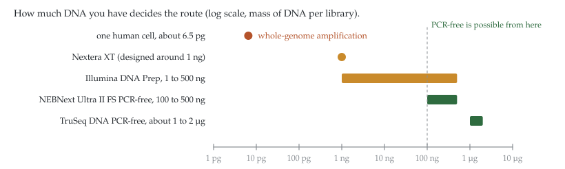{width=94%}

- A human diploid cell holds about 6.5 pg; a blood draw gives micrograms
- Input ranges are from the vendor guides in the collection and change between versions: check the current guide
- Protocols named here: [TruSeq DNA PCR-Free](https://henriksson-lab.github.io/NGS_101/truseq-dna-pcr-free/truseq-dna-pcr-free.html), [NEBNext Ultra II FS PCR-free](https://henriksson-lab.github.io/NGS_101/nebnext-ultra-ii-fs-dna-pcr-free/nebnext-ultra-ii-fs-dna-pcr-free.html), [Illumina DNA Prep](https://henriksson-lab.github.io/NGS_101/illumina-dna-prep/illumina-dna-prep.html), [Nextera XT](https://henriksson-lab.github.io/NGS_101/nextera-xt-dna-library-prep/nextera-xt.html)

## Block 1: three ways to fragment

{width=95%}

- Human DNA is megabases long; Illumina clusters want a few hundred base pairs ([what the sequencer wants](../sequencers/lec.qmd))
- Shearing is unbiased by sequence but leaves ragged ends, so everything downstream must repair them
- Enzymatic fragmentation trades a little sequence preference for a one-tube, low-input workflow

## Blocks 2 and 3: the ligation library

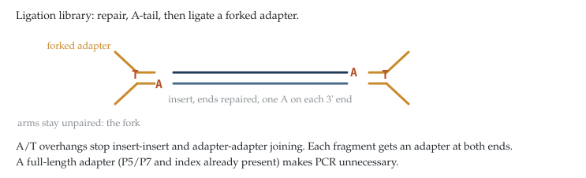{width=92%}

- End repair makes ends blunt with 5'-phosphate, A-tailing adds one 3' A, the adapter carries a T ([end chemistry](../end-chemistry/lec.qmd))
- That A/T handshake is the reason the product is clean: inserts cannot join each other
- The cost is several enzymatic steps and bead clean-ups, each of which loses molecules

[A-tailing and end repair as in Illumina's TruSeq guide, see the collection page for TruSeq PCR-Free]{.small}

## Blocks 1 to 3 in one reaction: tagmentation

{width=95%}

- A Tn5 transposase dimer loaded with adapters cuts the DNA and attaches the adapter to each 5' end
- A 9 nt gap remains on the other strand, filled by the polymerase in the first PCR step ([transposases](../enzymes/lec-transposases.qmd))
- Less input and fewer steps: this is the idea behind [Nextera XT](https://henriksson-lab.github.io/NGS_101/nextera-xt-dna-library-prep/nextera-xt.html) and Illumina DNA Prep

[Adey et al. 2010, doi:10.1186/gb-2010-11-12-r119]{.small}

## Block 4: do you need PCR at all?

{width=95%}

- If the ligated adapter already carries P5, P7 and the index ([the molecule](../library-molecule/lec.qmd)), every ligated fragment can seed a cluster
- With stub adapters, PCR is what installs the flow-cell sequences, so it is mandatory
- A PCR-free library cannot be quantified by fluorescence alone: **qPCR** counts only molecules with both adapters

[Kozarewa et al. 2009, doi:10.1038/nmeth.1311]{.small}

## What PCR costs, step one: unequal efficiency compounds

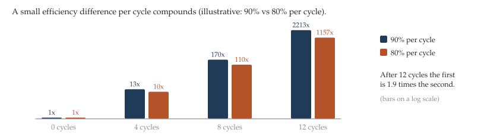{width=95%}

- Fragments do not amplify equally: GC content, length and secondary structure all change efficiency
- A 10-point efficiency gap per cycle, twelve cycles, and one fragment is nearly twice as common
- The numbers are illustrative; the point is that the gap grows with every cycle

## What PCR costs, step two: GC bias

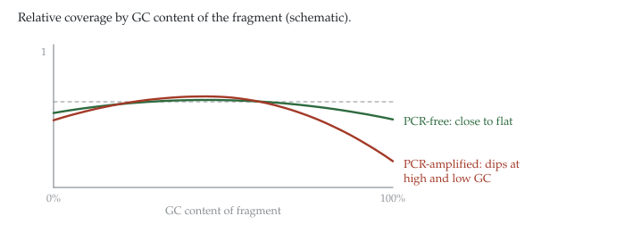{width=73%}

- Very GC-rich fragments melt incompletely; very AT-rich ones can be lost in the same cycling
- Result: coverage that tracks GC content, with regions such as GC-rich promoters and first exons under-covered
- PCR-free libraries are much flatter, which is why clinical genome pipelines favour them

[Aird et al. 2011, doi:10.1186/gb-2011-12-2-r18; Ross et al. 2013, doi:10.1186/gb-2013-14-5-r51]{.small}

## What PCR costs, step three: duplicates

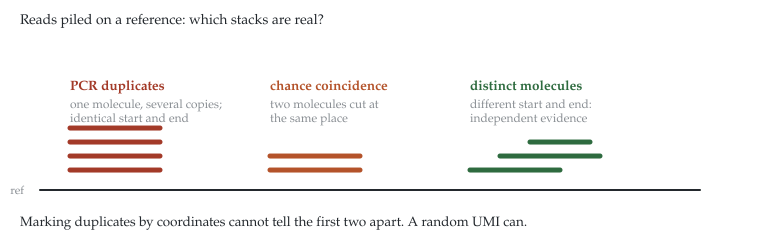{width=88%}

- A PCR duplicate is one original molecule sequenced more than once: it adds no information and can fake a variant
- Tools mark duplicates by coordinates, which also flags molecules that merely coincided
- A [UMI](../barcodes-umis/lec.qmd) in the adapter (some PCR-free kits include one) separates the two cases

## Duplicates are really about complexity

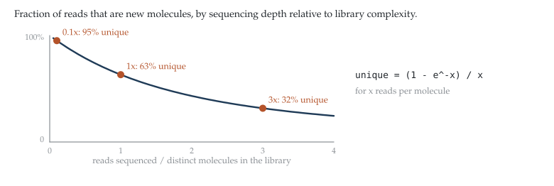{width=84%}

- If the library holds M distinct molecules and you read N, the fraction of new reads is about $(1-e^{-x})/x$ with $x=N/M$
- Below $x=0.1$ almost every read is new; at $x=3$ two reads in three repeat an earlier one
- More sequencing then buys nothing: a high duplicate rate is a **library** problem, not a sequencer problem

## Worked example: how many molecules do you really have?

10 ng of human DNA, 3.3 pg per haploid genome:

- 10 000 pg / 3.3 pg is about **3000 copies** of every locus
- Assume 20% of fragments end up with an adapter at both ends (an assumption: check your protocol): about **600 molecules** per locus
- 30x sequencing: $x = 30/600 = 0.05$, about **97% unique**. Fine
- Now 100 pg: 30 copies, about 6 molecules per locus, $x = 5$ at 30x: **about 20% unique**

At 100 pg, no extra sequencing rescues the library. Only more input or a different method does.

## Design 1: clinical whole genome, 1 µg of blood DNA

Question: germline variants and copy number, good coverage of GC-extremes. Sample: plenty, intact.

- Fragment to about 350 bp, end repair, A-tail, ligate **full-length** adapters, size select, **no PCR**
- That is [TruSeq DNA PCR-Free](https://henriksson-lab.github.io/NGS_101/truseq-dna-pcr-free/truseq-dna-pcr-free.html); [NEBNext Ultra II FS PCR-free](https://henriksson-lab.github.io/NGS_101/nebnext-ultra-ii-fs-dna-pcr-free/nebnext-ultra-ii-fs-dna-pcr-free.html) makes the same choice with enzymatic fragmentation
- Quantify by qPCR; pool by molarity
- The same blocks with 5 to 12 PCR cycles are the NEBNext Ultra II family, e.g. [Ultra II (USER adaptor)](https://henriksson-lab.github.io/NGS_101/nebnext-ultra-ii-dna-library-prep-user-adaptor/nebnext-ultra-ii-user.html)

## What the field does, side by side

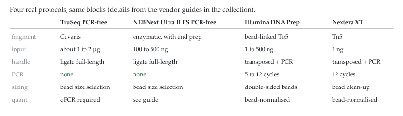{width=95%}

- Tagmentation kits give up PCR-free-ness for input and speed; ligation kits give up input for flatness
- Illumina DNA Prep uses **bead-linked transposomes**, Tn5 held on beads so that a fixed number of enzyme sites does the cutting: yield saturates, and libraries pool without individual quantification above 100 ng
- Nextera XT was designed around small genomes; for a human genome prefer a protocol built for 100 ng and up

## Degraded DNA is damaged before you start

{width=88%}

- Ancient and some forensic DNA, or DNA from FFPE blocks (formalin-fixed, paraffin-embedded tissue), is short, nicked, and full of deaminated cytosines (C becomes U, read as T)
- The damage accumulates at molecule ends, so the read-end pattern is the signature that the DNA is authentic
- Library prep must keep short molecules and decide what to do about the uracils

[Briggs et al. 2007, doi:10.1073/pnas.0704665104]{.small}

## Deal with the uracils: UDG

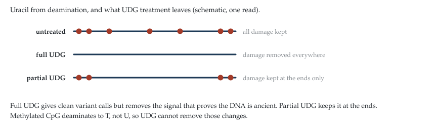{width=95%}

- Uracil-DNA glycosylase plus an endonuclease removes uracil, so calls become clean
- **Partial** UDG removes it internally but leaves the ends, so authenticity can still be tested
- See [partial-UDG double-stranded ancient DNA](https://henriksson-lab.github.io/NGS_101/double-stranded-ancient-dna-with-partial-udg__10.1098+rstb.2013.0624/partial-udg-ds-adna.html)

[Rohland et al. 2015, doi:10.1098/rstb.2013.0624]{.small}

## Short and nicked: make the library from single strands

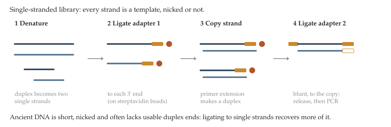{width=87%}

- A ligation library needs both strands of a duplex intact at the ends ([what a ligase requires](../enzymes/lec-ligases.qmd)); ancient DNA often is not
- Denature first, ligate an adapter to every single strand, copy, then ligate the second adapter
- [Single-stranded ancient DNA library](https://henriksson-lab.github.io/NGS_101/single-stranded-ancient-dna__10.1038+nprot.2013.038/single-stranded-library.html): more molecules recovered, at the cost of more steps

[Gansauge and Meyer 2013, doi:10.1038/nprot.2013.038]{.small}

## One cell: there is nothing to prepare a library from

{width=95%}

- A cell holds about 6.5 pg: two copies of each locus
- Amplification must produce nanograms to micrograms, and it can fail in the three ways shown
- Every single-cell WGA method is a different attempt to make that amplification even and faithful

## MDA: the isothermal route

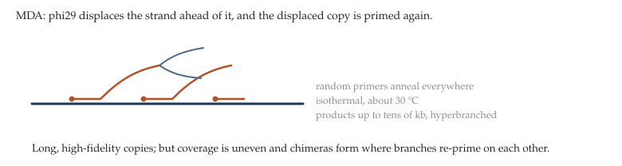{width=95%}

- Phi29 is processive and [strand-displacing](../enzymes/lec.qmd), with proofreading, so copies are long and accurate
- Displaced strands get primed again and the product hyperbranches
- Coverage is uneven and chimeric molecules form

[Dean et al. 2002, doi:10.1073/pnas.082089499]{.small}

## MALBAC: stop the copies from becoming templates

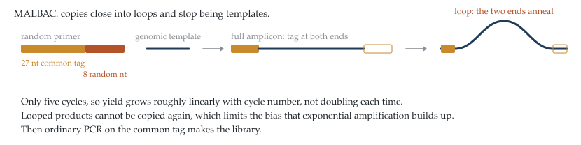{width=95%}

- Primers carry a common 27 nt tag, so full copies have complementary ends and fold into loops
- Five quasi-linear cycles, then PCR on the tag
- Aimed at even coverage for copy number; see [MALBAC](https://henriksson-lab.github.io/NGS_101/malbac__10.1126+science.1229164/malbac.html)

[Zong et al. 2012, doi:10.1126/science.1229164]{.small}

## PTA: limit the size of every copy

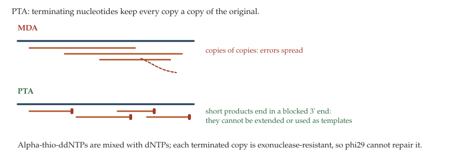{width=84%}

- Terminating nucleotides stop each copy early, so products stay short and are not re-amplified as templates
- The aim is uniform coverage and few false single-nucleotide variants from a single cell
- See [PTA](https://henriksson-lab.github.io/NGS_101/pta__10.1073+pnas.2024176118/pta.html); the product then goes through an ordinary ligation library

[Gonzalez-Pena et al. 2021, doi:10.1073/pnas.2024176118]{.small}

## Comparing the three

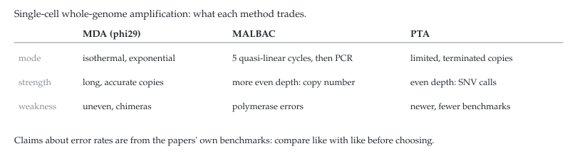{width=95%}

- Pick by what you will call: copy number tolerates noise in depth, SNVs tolerate neither dropout nor early errors
- Doublets and contaminants are a library-level risk for all three
- Statements here are qualitative and come from each method's own paper: check benchmarks before relying on them

## Check the library before you sequence it

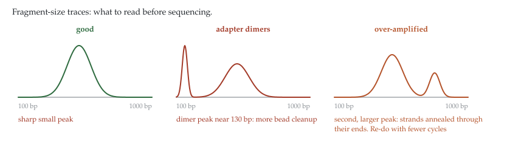{width=95%}

- Size trace: one peak at the design size. A peak near 130 bp is adapter dimers
- A second, larger peak means over-amplification; cut cycles, do not re-purify
- After sequencing: duplicate rate, insert size, GC-versus-coverage curve, and the **fold-80 base penalty** — how much more depth you would need for 80% of positions to reach the mean coverage, so 1 is perfectly even and 2 means half the run is wasted on evenness

## Design from the sample, then compare

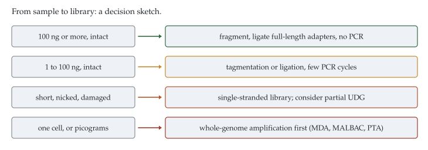{width=80%}

- The recurring exercise: given the question and the sample, derive the library, then compare with the kit
- Where your design and the kit differ, ask what the vendor knew about the sample that you did not
- Next: targeted sequencing uses the same blocks and adds a selection step

## Summary

- **Do PCR-free when input allows**: flatter coverage, fewer duplicates, no amplification artefacts
- Low input forces PCR or tagmentation; duplicates and GC bias are the price
- Damaged DNA needs end and uracil choices; single-stranded libraries recover the shortest molecules
- A single cell needs whole-genome amplification first, and each method trades evenness against errors
- Always read the library by its complexity, not only its yield

## Where this connects

**Blocks this protocol uses**

- [Fragmentation](../fragmentation/lec.qmd) — shearing, enzymatic cutting or tagmentation, and the size window
- [End chemistry](../end-chemistry/lec.qmd) — why end repair and dA-tailing stand between the shear and the ligation
- [Handles](../handles/lec.qmd) — adapter ligation and transposition: two of the five ways to attach a known sequence
- [Amplification](../amplification/lec.qmd) — the cycle budget, GC bias, duplicates; and MDA, MALBAC, PTA for one cell
- [Barcodes and UMIs](../barcodes-umis/lec.qmd) — the index that lets libraries be pooled, the UMI that separates a duplicate from a coincidence

**Before and after**

- [Anatomy of a library molecule](../library-molecule/lec.qmd) — full against truncated adapters, which is what decides whether PCR is optional
- [Cleanup and QC](../qc/lec.qmd) — qPCR counts only molecules with both adapters, and the trace shows dimers and over-amplification
- [Trick catalogue](../tricks/lec.qmd) — single-strand ligation for degraded input, and what to do about adapter dimers
