## The problem every library has

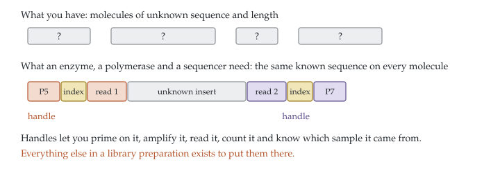{width=83%}

- Your molecules have unknown sequence, so no primer can be designed for them
- A **handle** is a known sequence put on every molecule: a place to prime, a barcode, a flow-cell anchor
- There are only a few ways to put one on. Learn those and any protocol becomes a combination of them

::: {.notes}
The whole course reduces to this: you cannot design a primer for what you do not know, so you give every molecule a known end.
:::

## Five ways to attach a handle

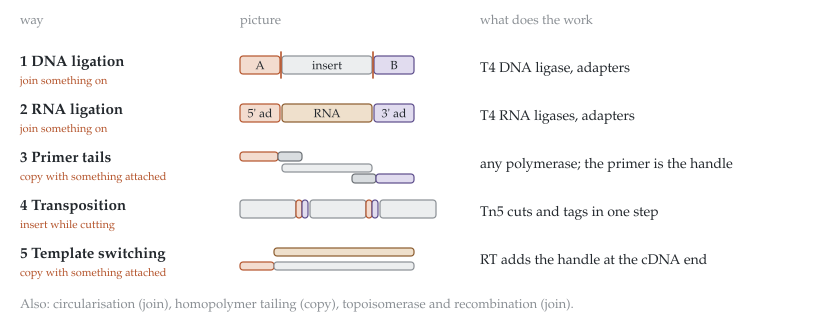{width=68%}

- Each way differs in **which end it uses**, **what it needs the end to look like**
  ([end chemistry](../end-chemistry/lec.qmd) gives every end state named here), and **what it does to the rest of the molecule**
- Pick by the starting material, not by habit: the last slide of this deck is a decision table

## DNA ligation: four flavours

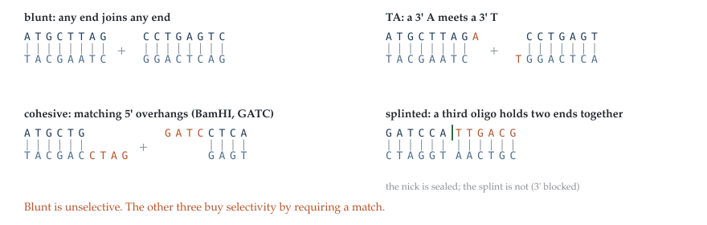{width=88%}

- T4 DNA ligase joins a 5'-phosphate to a 3'-OH when both sit side by side in a duplex
  ([ligases, kinases, phosphatases](../enzymes/lec-ligases.qmd))
- The end shape sets how selective it is. A splint turns ligation of any two ends into ligation of two chosen ends
- Protocol: [TruSeq DNA PCR-Free](https://henriksson-lab.github.io/NGS_101/truseq-dna-pcr-free/truseq-dna-pcr-free.html) ligates adapters this way

[Ligase requirements: Lehman 1974, doi:10.1126/science.186.4166.790]{.small}

## Blunt against TA: what the overhang is for

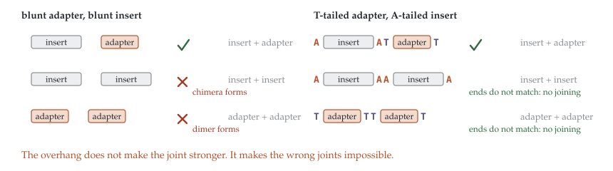{width=92%}

- Blunt ends join to anything: inserts to each other, adapters to each other
- One extra A on the insert and one T on the adapter allows only insert-adapter pairs
- The A comes from a polymerase that adds a base without a template

[Non-templated A addition: Clark 1988, doi:10.1093/nar/16.20.9677]{.small}

## Asymmetric adapters

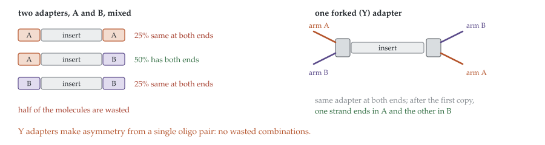{width=92%}

- Two different adapters mixed leave half the molecules with the same handle at both ends
- A forked (Y) adapter puts both arms on every end; the strands become different after the first copy
- This is how nearly all Illumina libraries get a P5 end and a P7 end

[Index design and adapters: Kircher et al. 2012, doi:10.1093/nar/gkr771]{.small}

## Splinted ligation

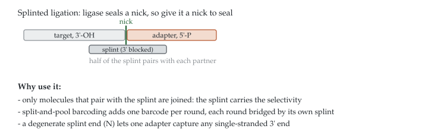{width=87%}

- The splint is a third oligo that pairs across the junction, so ligase sees a nick
- Block its 3' end, so the splint is neither extended nor ligated
- Used where one specific pair must join: split-and-pool barcoding adds one barcode per round
  this way ([combinatorial indexing](../single-cell/lec-combinatorial.qmd))

## Ligation in practice

Four things decide yield:

- **Adapter to insert ratio.** Too little leaves unligated inserts; too much makes adapter dimers
- **Crowding and temperature.** PEG raises the effective concentration of ends; blunt ligation needs it, TA ligation less
- **The ends.** If the insert is not repaired, phosphorylated and A-tailed, ligation fails silently
- **Cleanup afterwards.** Unligated adapter must be removed by beads before PCR, or it becomes dimers

Only the third is end chemistry. Crowding is a property of the ligase, and the clean-up is a
QC step — both are linked at the end of this deck.

## RNA ligation: the 3' adapter first

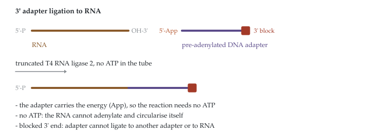{width=76%}

- RNA ligase 2 truncated, the K227Q mutant ([T4 RNA ligase 2](../enzymes/lec-ligases.qmd)), joins a pre-adenylated adapter to a 3'-OH without ATP
- The adapter is blocked at its 3' end and has an adenylated 5' end, so it cannot join to itself
- Protocol: [NEBNext Low-bias Small RNA](https://henriksson-lab.github.io/NGS_101/nebnext-low-bias-small-rna/nebnext-low-bias-small-rna.html)

[Small-RNA cloning: Hafner et al. 2008, doi:10.1016/j.ymeth.2007.09.009]{.small}

::: {.notes}
Mention that the original small-RNA cloning methods used a different, ATP-dependent route; the App adapter is the modern form.
:::

## The 5' adapter goes on second

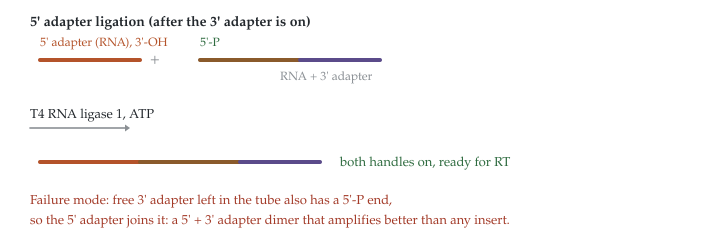{width=84%}

- T4 RNA ligase 1 needs ATP and a 5'-phosphate on the donor RNA; the 5' adapter provides the 3'-OH
- The order matters: the 3' adapter is already on, so the RNA 3' end is no longer free to react
- The adapter dimer is this method's characteristic failure and is removed by size selection

[eCLIP uses a variation of these steps: Van Nostrand et al. 2016, doi:10.1038/nmeth.3810]{.small}

## RNA ligases are biased

Ligation efficiency depends on the sequence and structure at the junction, not only on the abundance of the RNA:

- Some small RNAs ligate many times better than others
- The bias comes from both the adapter end and the RNA end
- Randomised bases at the adapter end average the preference out and reduce the bias
- Lower PEG and shorter times increase the bias

Counts from this kind of library are comparable between samples, but not between different
RNAs ([small RNA protocols](../rna/lec-small-rna.qmd)).

[Jayaprakash et al. 2011, doi:10.1093/nar/gkr693]{.small}

## Circularisation

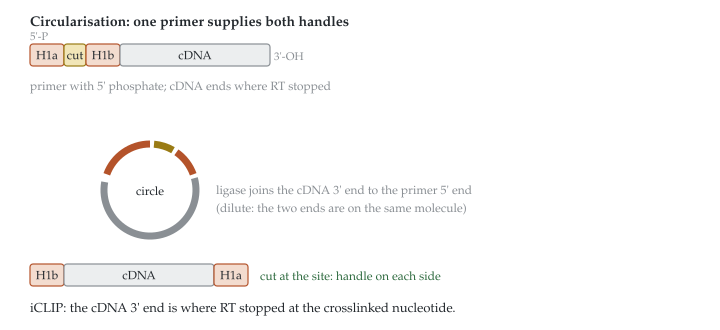{width=61%}

- A ligase joins the two ends of a single molecule when the concentration is low enough
- The cDNA 3' end meets the primer's 5' end, so one primer supplies handles at both ends
- iCLIP uses this ([the CLIP family](../modifications/lec-rna.qmd)); the cDNA 3' end marks
  where RT stopped at the crosslink

[iCLIP: König et al. 2010, doi:10.1038/nsmb.1838; protocol: Huppertz et al. 2014, doi:10.1016/j.ymeth.2013.10.011]{.small}

## Primer tails

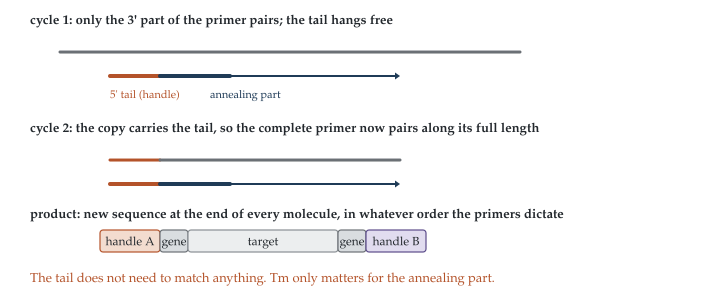{width=55%}

- Any sequence on a primer's 5' end is copied into the product from the second cycle on
  ([amplification](../amplification/lec.qmd))
- The tail adds no specificity: only the 3' part decides where the primer anneals
- This is how amplicon, RACE (rapid amplification of cDNA ends) and many single-cell methods add their handles

## The RT primer as the handle

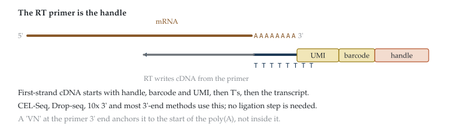{width=92%}

- Handle, barcode and UMI all ride on one oligo-dT primer
- Protocols: [CEL-Seq](https://henriksson-lab.github.io/NGS_101/cel-seq__10.1016+j.celrep.2012.08.003/cel-seq.html), [Drop-seq](https://henriksson-lab.github.io/NGS_101/drop-seq__10.1016+j.cell.2015.05.002/drop-seq.html)
- The handle is on the 5' end of the cDNA first strand, in the same tube as RT

[CEL-Seq: Hashimshony et al. 2012, doi:10.1016/j.celrep.2012.08.003; Drop-seq: Macosko et al. 2015, doi:10.1016/j.cell.2015.05.002]{.small}

## Tailed random primers

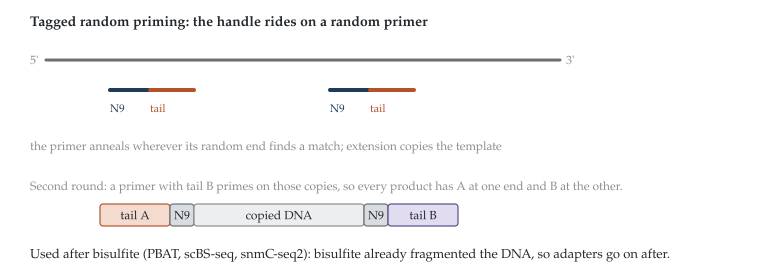{width=78%}

- When the DNA is already fragmented, random primers carrying a tail attach the handle anywhere
- [Bisulfite conversion](../chemistry-to-sequence/lec.qmd) breaks DNA, so ligating adapters beforehand wastes the input
- Protocol: [PBAT](https://henriksson-lab.github.io/NGS_101/pbat__10.1093+nar+gks454/pbat.html)

[Miura et al. 2012, doi:10.1093/nar/gks454; Smallwood et al. 2014, doi:10.1038/nmeth.3035]{.small}

## Transposition: cut and tag in one step

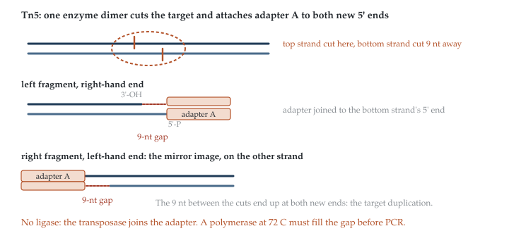{width=60%}

- Tn5 loaded with adapter oligos cuts the target and joins the adapter's 3' end to each new
  5' end ([transposases](../enzymes/lec-transposases.qmd))
- No fragmentation, end repair or ligation is needed beforehand
- The 9 nt between the two cuts leave a gap that is filled in later
- Protocol: [ATAC-seq](https://henriksson-lab.github.io/NGS_101/atac-seq__10.1038+nmeth.2688/atac-seq.html)

[Reznikoff 2008, doi:10.1146/annurev.genet.42.110807.091656; Adey et al. 2010, doi:10.1186/gb-2010-11-12-r119; Buenrostro et al. 2013, doi:10.1038/nmeth.2688]{.small}

## What tagmentation produces

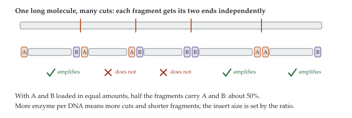{width=83%}

- Each fragment's two ends are tagged independently, so some molecules carry A at both ends
- Only A-B fragments amplify well: this wastes about half of the product
- Enzyme-to-DNA ratio sets the insert size, which is why input must be measured accurately
- Home-made Tn5 can be loaded and tested cheaply

[Picelli et al. 2014, doi:10.1101/gr.177881.114]{.small}

## Template switching

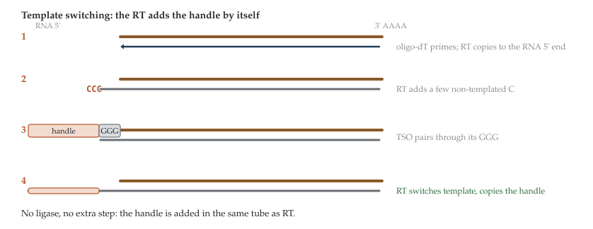{width=73%}

- Reverse transcriptase reaches the 5' end of the RNA, adds a few C's, and uses a GGG oligo
  as a new template ([polymerases and RTs](../enzymes/lec.qmd))
- The handle lands on the first-strand cDNA, which now has the same end at both ends
- Protocols: [SMART-seq2](https://henriksson-lab.github.io/NGS_101/smart-seq2__10.1038+nmeth.2639/smart-seq2.html), [SMART-seq3](https://henriksson-lab.github.io/NGS_101/smart-seq3__10.1038+s41587-020-0497-0/smart-seq3.html)

[Zhu et al. 2001, doi:10.2144/01304pf02; Picelli et al. 2013, doi:10.1038/nmeth.2639]{.small}

## Template switching: what to watch for

- The extra C's are added most often at a **capped** end, so full-length cDNA is enriched, but the process is not a perfect test of the cap
- The template-switch oligo (TSO) can pair with internal runs of G or C and add the handle in the middle of a transcript
- Free TSO can also be copied and joined to itself, giving a by-product that competes in PCR
- Smart-seq3 adds an internal-tag and UMI to the TSO to count molecules
  ([barcodes and UMIs](../barcodes-umis/lec.qmd))

[Hagemann-Jensen et al. 2020, doi:10.1038/s41587-020-0497-0]{.small}

## Homopolymer tailing

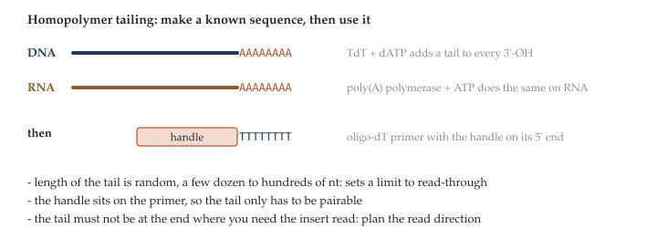{width=77%}

- Terminal transferase adds nucleotides to any 3'-OH on DNA; poly(A) polymerase does the same for RNA
- The tail gives a pairing sequence, so a primer with a handle can start from it
- Handy for input with no usable ends, but tail length varies and the tail takes read length

## Topoisomerase and recombination

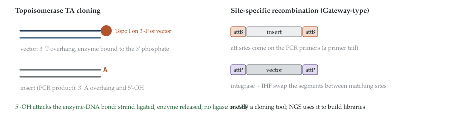{width=92%}

- Both are cloning tools more than library chemistry; both attach a handle without a ligase
- Topoisomerase I keeps the energy of the broken bond and spends it joining the insert
- Recombination swaps segments between att sites that came on PCR primers
- Other overlap-based joins such as Gibson assembly rely on homology arms from primer tails

[Shuman 1994, doi:10.1016/s0021-9258(18)31688-0; Hartley et al. 2000, doi:10.1101/gr.143000; Gibson et al. 2009, doi:10.1038/nmeth.1318]{.small}

## Trick: truncated adapters and index PCR

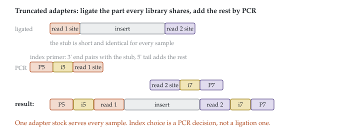{width=76%}

- Ligate or tag only the stub, the [truncated adapter](../library-molecule/lec.qmd) every sample shares; add P5, P7 and the index by PCR
- One adapter stock for the whole lab; the index is chosen at the PCR step
- Double indexing guards against reads that carry the wrong sample's index

[Meyer and Kircher 2010, doi:10.1101/pdb.prot5448; Kircher et al. 2012, doi:10.1093/nar/gkr771]{.small}

## Trick: two-step PCR

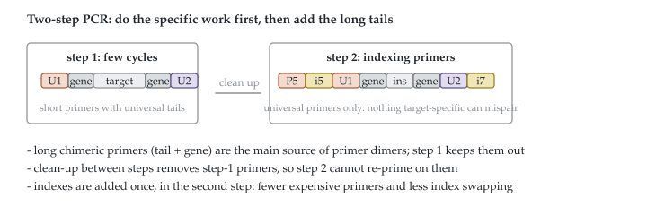{width=88%}

- Step 1 is specific and has few cycles; step 2 uses only universal primers
- Long chimeric primers mispair and make dimers; keeping them to step 1 limits what they can do
- General practice in amplicon sequencing; the cycle numbers are protocol-specific

## Trick: nested handles

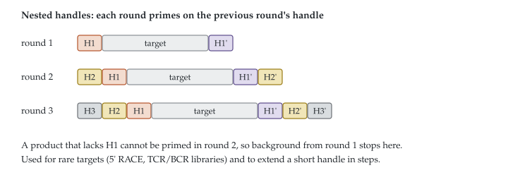{width=82%}

- Each round primes on the previous handle and adds a new one outside it
- Background from the earlier round lacks the inner handle and stops
- Also a way to add a long handle that a single oligo would synthesise badly

## Trick: bead-bound handles

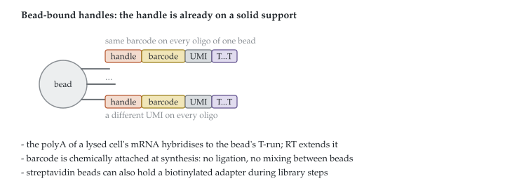{width=76%}

- The handle is chemically attached to a bead, so the barcode is fixed per bead
- Cells are lysed in contact with the bead, which captures mRNA by its poly(A)
- Beads link one barcode to one cell's RNA without a ligation step

## Choosing a way

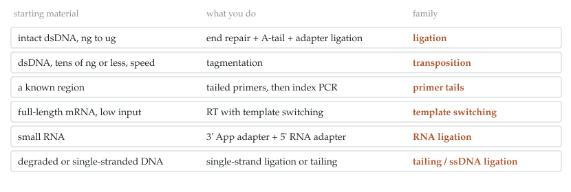{width=83%}

- Start from the material you have, not from the kit you own
- The families combine: tagmentation then index PCR, template switching then tagmentation of the cDNA, ligation then index PCR

## Protocols as combinations

| Protocol | Handles added by |
|---|---|
| TruSeq DNA | Repair, A-tail, ligation; index PCR for the rest |
| ATAC-seq | Tn5, then PCR with indexed primer tails |
| SMART-seq2 | RT primer tail and template switching; Tn5 for the final library |
| CEL-Seq | RT primer tail carrying a T7 promoter; the second handle is added after [in vitro transcription](../amplification/lec.qmd) |
| iCLIP | 3' RNA adapter ligation, RT primer tail, circularisation |
| PBAT | Tailed random primers after bisulfite |

Draw the molecule after each step; every handle arrives by one of the five ways.

## Where this connects

**Before a handle can go on**

- [Fragmentation](../fragmentation/lec.qmd) — the cut decides which ends exist, and doing it after the chemistry changes the answer
- [Library molecule](../library-molecule/lec.qmd) — what the finished construct must carry before it clusters

**Where these ways are assembled**

- [Genomic DNA](../genomic-dna/lec.qmd) — ligation against tagmentation on the same input
- [RNA](../rna/lec.qmd) — RT priming, second strand, and where the handle ends up
- [Long reads](../long-reads/lec.qmd) — ligation, rapid attachment and hairpin adapters

**Tricks that apply here**

- [Tricks: ligation, clean-up, handles](../tricks/lec.qmd) — splints, hairpins, completing the adapter later, suppression PCR
- [Tricks: counting, low input, compartments](../tricks/lec-more.qmd) — bead-bound handles and split-and-pool, in detail

**If this fails**

- [QC](../qc/lec.qmd) — adapter dimer against library: which peak on the trace says the handle went on the wrong partner

Reference while you work: [NGS 101](https://henriksson-lab.github.io/NGS_101/) draws every protocol base by base.
