## The last molecule in every protocol

Every protocol in the collection, however different its first steps, ends at the same place:
a molecule an Illumina flow cell can grab and a sequencer can read.

The previous deck said what the machine requires. This deck draws the molecule that meets
those requirements, and teaches one skill: **given any protocol, write down its final
molecule, and from it the read structure.**

- Everything you will build in Part B is a way of making one of the parts in this deck
- Everything that goes wrong at the sequencer is a part that is missing, wrong or in the wrong place

::: {.notes}
Bridge slide. The student has just seen clusters, bridge amplification, read order. Now we
build the thing that is clustered.
:::

## The molecule, part by part

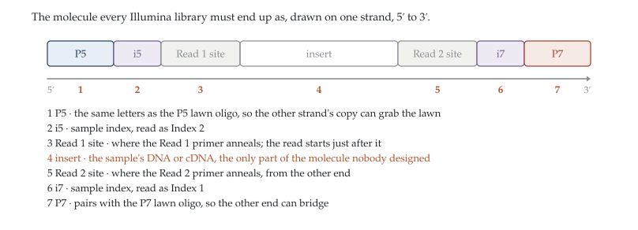{width=78%}

- Seven parts, always in this order. Four are fixed by the platform, **two are chosen per sample**, one is yours
- Read it as a map: each read starts at a primer site and runs toward the next part

## Two strands, four primers

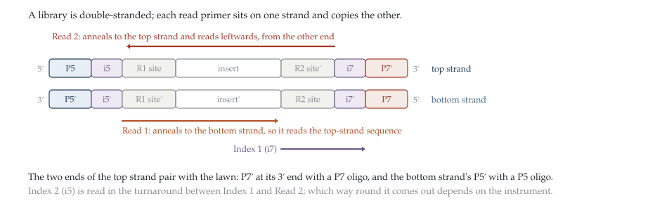{width=89%}

- A primer has the sequence of one strand, so it anneals to the other and **reads the first strand's sequence**
- That is why the Read 2 site on the drawn strand is written as its complement (R2 site′)

## Real sequences: the TruSeq arms

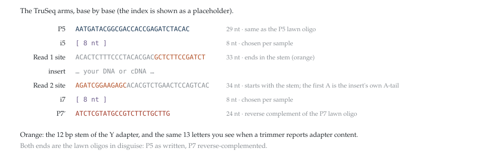{width=87%}

- Nothing mystical: 29 + 8 + 33 bases on one oligo, 33 + 8 + 24 on the other, plus the insert's own A
- The stem letters are the key to the next slides: they hold the two arms together

[Illumina Adapter Sequences, as listed for [TruSeq DNA PCR-free](https://henriksson-lab.github.io/NGS_101/truseq-dna-pcr-free/truseq-dna-pcr-free.html) in the collection]{.small}

## The Y adapter

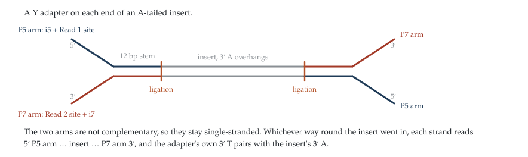{width=94%}

- Two oligos pair only along a 12 bp stem; beyond it the arms are free and different
- Ligated to **both** ends, so every strand is P5 arm … insert … P7 arm

[Meyer & Kircher 2010, doi:10.1101/pdb.prot5448]{.small}

## Why fork it?

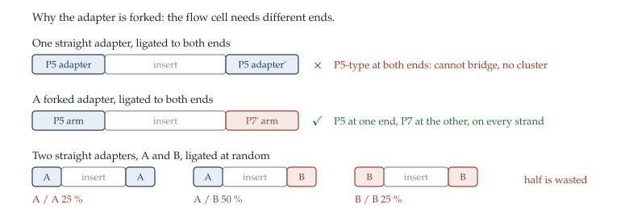{width=81%}

- A straight adapter gives the same end twice: such a molecule cannot bridge and never clusters
- Two straight adapters, mixed, waste half the library; the fork makes every end usable

## Full adapters: everything arrives in the ligation

In [TruSeq DNA PCR-free](https://henriksson-lab.github.io/NGS_101/truseq-dna-pcr-free/truseq-dna-pcr-free.html)
the purchased adapter already carries P5, P7, the index and both primer sites.

- After end repair, A-tailing and ligation ([end chemistry](../end-chemistry/lec.qmd)), the
  molecule is **finished**; no PCR is needed
- That is the point of the kit: no PCR duplicates, no PCR bias in GC-rich DNA
- The price: the library is quantified by qPCR, because only molecules with an adapter at **both**
  ends cluster, and a gel or Qubit cannot tell those from the rest
  ([what qPCR and Qubit each measure](../qc/lec.qmd))
- The price again: all adapters are long oligos, each index a separate purchase

## Tagmentation: one enzyme, two jobs

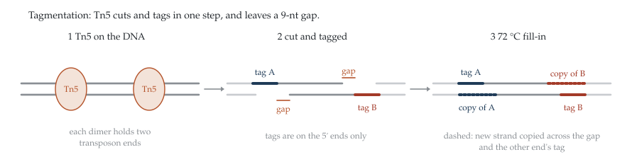{width=100%}

- Tn5 loaded with adapter ends **fragments and tags** in a single reaction, at the same time
- The tags join only the 5′ ends, leaving a 9-nt gap per end; in Nextera XT the 72 °C step before
  PCR fills it ([transposases](../enzymes/lec-transposases.qmd))

[Adey et al. 2010, doi:10.1186/gb-2010-11-12-r119; Picelli et al. 2014, doi:10.1101/gr.177881.114; Tn5 9-bp stagger: Reznikoff 2008, doi:10.1146/annurev.genet.42.110807.091656]{.small}

## Tn5 does not choose which tag goes where

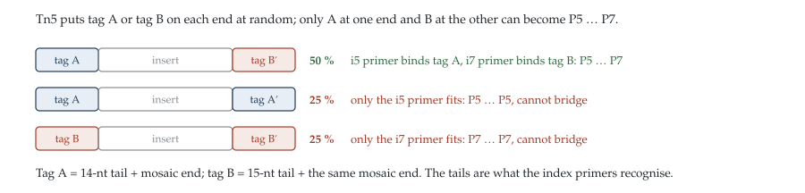{width=100%}

- Tag A and tag B are loaded at random, so half the fragments are A/A or B/B
- Those carry the **same sequence at both ends**, so each strand's two ends are an inverted repeat. On denaturation they snap shut into a panhandle and the primer cannot get on
- So they are not merely unamplifiable, they are **suppressed** — and that is what makes the system work: the PCR is spent on A/B, the only product that can end up with P5 at one end and P7 at the other ([suppression PCR](../tricks/lec.qmd))
- It still costs half the input molecules. This is the Nextera equivalent of the Y adapter

## The Nextera molecule

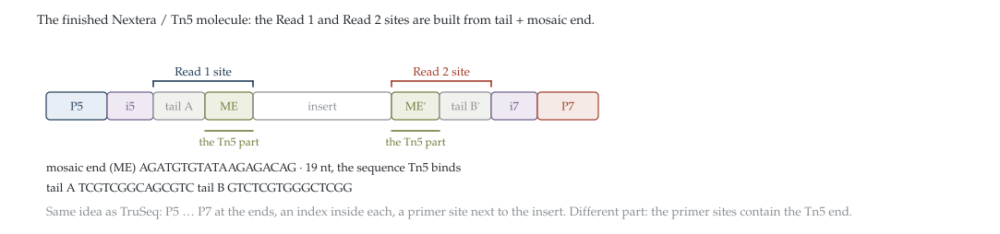{width=100%}

- Same parts as TruSeq, different junction: the primer sites **contain the Tn5 mosaic end**
- [Nextera XT](https://henriksson-lab.github.io/NGS_101/nextera-xt-dna-library-prep/nextera-xt.html) and
  [Illumina DNA Prep](https://henriksson-lab.github.io/NGS_101/illumina-dna-prep/illumina-dna-prep.html)
  share this architecture; DNA Prep runs the tagmentation on beads, and uses 10-base unique dual indexes

## Truncated adapters, completed by PCR

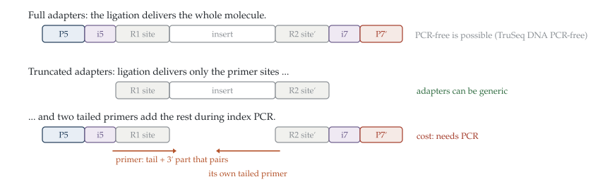{width=97%}

- The ligation or tagmentation delivers only what is **generic**: the primer sites
- Sample-specific parts, and the flow-cell ends, arrive as **5′ tails on PCR primers**
  ([attaching a handle](../handles/lec.qmd))
- In Nextera the tailed PCR is not optional: it is what turns half the fragments into clusterable molecules

## A tailed primer, cycle by cycle

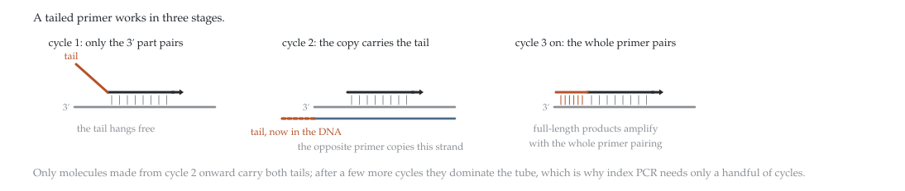{width=100%}

- In cycle 1 only the 3′ part of the primer pairs; the tail is carried along
- From cycle 2 the copies contain the tail, and from cycle 3 the whole primer pairs

## Full or truncated: what you trade

| | Full adapters | Truncated adapters + tailed PCR |
|---|---|---|
| Where P5, P7, indexes arrive | in the ligation | in the index PCR |
| PCR needed | no, so PCR-free is possible | yes, a few cycles |
| Input | micrograms (1–2 µg for TruSeq PCR-free) | little (Nextera XT: 1 ng) |
| Adapter stock | long, indexed, expensive | short and generic |
| Index swapping to watch | free adapter left in the pool | free primer left in the pool |

Both kinds hop indexes if free oligo survives into the pool: clean-up decides, not architecture.
[Costello et al. 2018, doi:10.1186/s12864-018-4703-0]{.small}

## Where the information lives

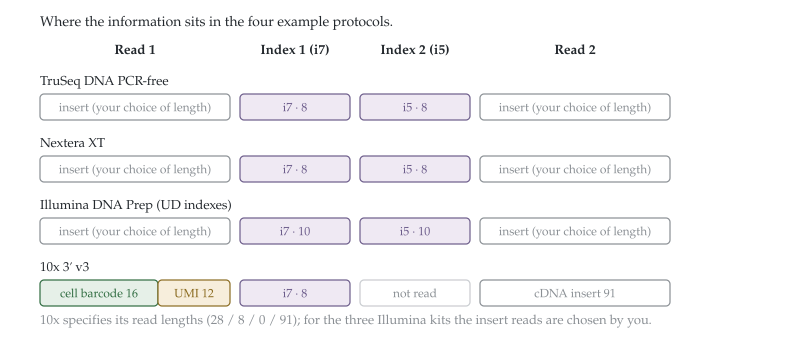{width=65%}

- Every library carries two kinds of content: the **insert**, which is the biology, and the **sample index**, which says whose it is
- Some protocols add further labels in the same places — a cell barcode, a UMI — and those belong to the protocols that need them ([barcodes and UMIs](../barcodes-umis/lec.qmd), [single cells](../single-cell/lec.qmd))
- What matters here is the geometry: a label is only readable if a primer site sits next to it

## Placing a label

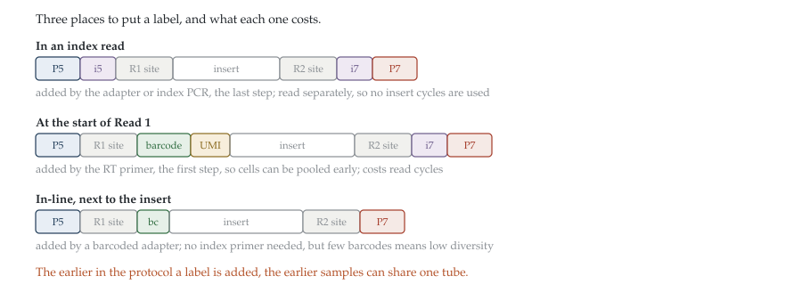{width=77%}

- A label can sit in an index read, at the start of a read, or next to the insert
- The earlier it is added, the earlier material can be pooled, and everything after that is one tube instead of many

## When is strand information kept?

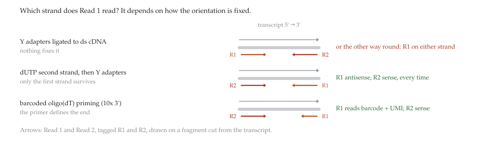{width=93%}

- A DNA library has no strand information: ligated Y adapters go on either strand
- RNA libraries keep it only if chemistry forces it: dUTP marking, or a primer that defines the end
- [TruSeq stranded mRNA](https://henriksson-lab.github.io/NGS_101/truseq-stranded-mrna/truseq-stranded-mrna.html)
  uses the dUTP route, worked through in [RNA](../rna/lec.qmd)

[Parkhomchuk et al. 2009, doi:10.1093/nar/gkp596; Levin et al. 2010, doi:10.1038/nmeth.1491]{.small}

## What does not cluster or read

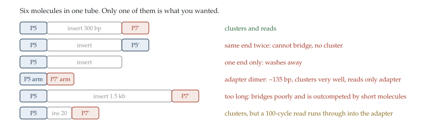{width=95%}

- A tube holds many kinds of molecule; the flow cell sorts them by whether they **bridge**
- Adapter dimers are the worst: short, perfect, and they take clusters from the library
- Size selection and bead clean-ups exist mostly to remove the bottom rows, and a trace shows
  you whether they worked ([cleanup and QC](../qc/lec.qmd))

[Head et al. 2014, doi:10.2144/000114133]{.small}

## When the read outruns the insert

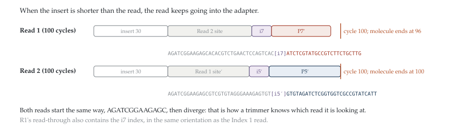{width=100%}

- The adapter in your FASTQ is a measure of fragment size, not of a failed run
- Both reads start AGATCGGAAGAGC; after that they differ, so one adapter list does not fit both

## Construct to read structure

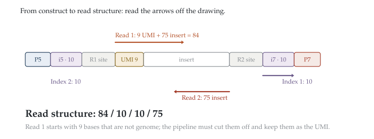{width=75%}

- Step 1: list the parts in order. Step 2: draw each read as an arrow from its primer site
- Step 3: count the bases the arrow covers. Anything between the site and the insert is read first
- Step 4: add the sample-sheet entries: one cycle count per read, 0 for a read you skip

## Read structure to construct

A core facility offers you 151 bases in Read 1, 151 in Read 2, and two 8-base index reads.
Work backwards to the molecule:

1. Two index reads means two indexes, one at each end: i5 by P5, i7 by P7
2. Read 1 enters the insert from one side, Read 2 from the other, so there is a primer site
   on each side of the insert
3. 151 + 151 of insert means an insert of at least about 300 bp, or the reads meet and run
   into the opposite adapter
4. The molecule is therefore P5 – i5 – Read 1 site – insert – Read 2 site – i7 – P7
5. State the cycle numbers as `151 / 8 / 8 / 151`

If a design cannot be drawn this way, it cannot be sequenced as written; that is cheaper to learn
on paper.

## Using the NGS 101 tools

Two tools on [NGS 101](https://henriksson-lab.github.io/NGS_101/) turn this deck into practice:

- **[Annotate sequence](https://henriksson-lab.github.io/NGS_101/annotate.html):** paste a final
  molecule or an oligo. It marks every known adapter, primer or site, on either strand, and
  lists protocols that share them. Press *Set example sequence* and read the match table
- **[Sample-sheet indexes](https://henriksson-lab.github.io/NGS_101/samplesheet.html):** paste
  the two primers; it locates i5 and i7 and writes the sample-sheet columns for the instrument
  you pick, including the i5 orientation that differs between instruments
- The Annotate tool matches exactly: it identifies parts, it does not prove a protocol

## A protocol-reading routine

1. Find the final library in the protocol page; list its parts left to right
2. Say which parts arrive in which step: ligation, tagmentation, PCR, RT
3. Mark P5 and P7 ends and say whether they are the same
4. Mark every read arrow, then the read structure: R1 / I1 / I2 / R2
5. Ask which molecules in the tube cannot cluster, and which clusters but is useless
6. Ask where strand and orientation are decided

Try it on the four collection examples: TruSeq PCR-free, Nextera XT, Illumina DNA Prep, 10x 3′ v3.

## Where this connects

**Before this**

- [Nucleic acids](../nucleic-acids/lec.qmd) — the ends every junction in this molecule is made of
- [How sequencers read DNA](../sequencers/lec.qmd) — why the parts are these parts

**Blocks that make the parts**

- [Fragmentation](../fragmentation/lec.qmd) — sets the insert, the only part you choose freely
- [Amplification](../amplification/lec.qmd) — the index PCR that completes a truncated adapter,
  and what the extra cycles cost

**Where the drawing habit is used**

- [Genomic DNA](../genomic-dna/lec.qmd) — ligation or tagmentation, chosen by how much input there is
- [Design patterns](../design/lec.qmd) — draw the construct after every step, and read failures
  off the drawing
