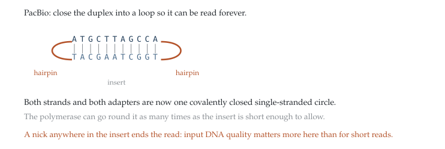
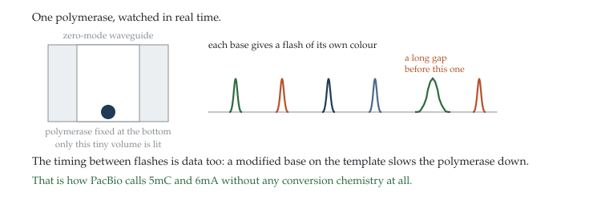
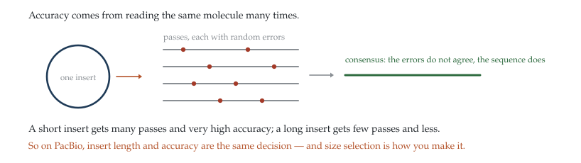
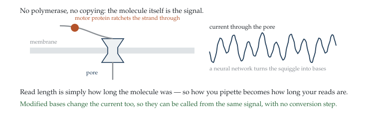
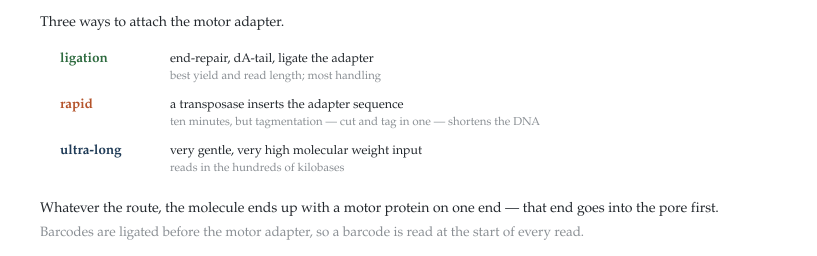
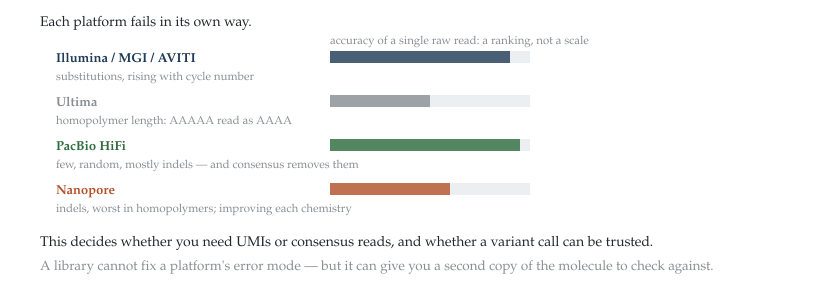
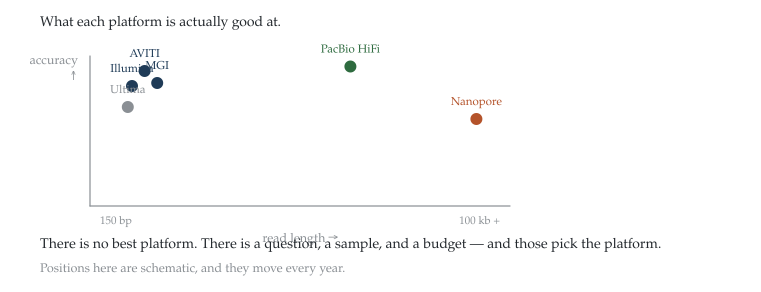

## Two instruments that read one molecule

Everything so far has been a short-read library: a population of fragments, read a few
hundred bases at a time. These two machines read a single native molecule end to end, which
changes what the library must protect and what the prep is allowed to do to it.

- **PacBio** reads one molecule many times over and takes the consensus
- **Nanopore** reads it once, as an electrical signal, with no copying at all
- Both put the same demand on you: whatever length you want to read, the molecule has to
  survive the prep at that length

Next: how each one reads, then what that asks of the library.

## PacBio: the SMRTbell

{width=83%}

- Hairpin adapters close the duplex into one single-stranded circle: a molecule with no free
  end left to ligate, extend or digest ([end chemistry](../end-chemistry/lec.qmd))

## One polymerase, watched in real time

{width=87%}

- The timing between flashes reports modified bases — no conversion chemistry

[Eid et al. 2009, doi:10.1126/science.1162986]{.small}

## HiFi: accuracy from repetition

{width=92%}

- Insert length and accuracy are the same decision, and size selection is how you make it

[Wenger et al. 2019, doi:10.1038/s41587-019-0217-9]{.small}

## What PacBio asks of your library

- **Intact DNA.** A nick inside the insert ends the read. Shearing, vortexing, freeze-thaw
  and old samples all cost you length.
- **A tight size distribution.** Short molecules are loaded preferentially, so a few short
  fragments can dominate the run. Size selection is not optional.
- **No damaged ends.** Damage repair before ligation is a standard step.
- **Barcodes in the adapters or primers**, read as part of the insert rather than as separate
  index reads.

The whole prep is shorter than an Illumina one, and far more sensitive to how you handled the
sample; [long reads](../long-reads/lec.qmd) is that prep, kit by kit.

## Nanopore: the molecule is the signal

{width=92%}

- Read length is how long your molecule was, so pipetting technique becomes read length

[Jain et al. 2016, doi:10.1186/s13059-016-1103-0]{.small}

## Three ways to attach the motor

{width=90%}

- Ligation for yield and length; rapid for speed; ultra-long for hundreds of kilobases

[Ultra-long: Jain et al. 2018, doi:10.1038/nbt.4060]{.small}

## Direct RNA, and modifications

- Nanopore can sequence **RNA itself** — no reverse transcription, no PCR, no cDNA bias. The
  adapter is ligated to the RNA's 3' end, and the molecule is read 3' to 5'.
- Yield is lower and error higher than cDNA routes, and you need a lot of intact RNA.
- Both platforms call **base modifications** from the raw signal: 5mC and 6mA on DNA, and a
  growing list on RNA including m6A and pseudouridine.

This is the one capability that no amount of clever library chemistry gives you on a
short-read instrument — there you must first convert the modification into a base change
([converting chemistry into sequence](../chemistry-to-sequence/lec.qmd)).

## Basecalling and error

{width=80%}

- Decides whether you need UMIs, duplex reads or consensus to trust a variant call
  ([barcodes and UMIs](../barcodes-umis/lec.qmd))

[Nanopore review: Wang et al. 2021, doi:10.1038/s41587-021-01108-x]{.small}

## Adaptive sampling

A nanopore can decide, part-way through a molecule, that it does not want it — and eject it.

- The first fraction of a second of signal is basecalled and compared with a target list
- Unwanted molecules are rejected and the pore takes the next one
- Enrichment without any wet-lab capture step

It is a reminder that on these platforms, some of what used to be library chemistry has moved
into software. When you design a prep, ask whether the wet-lab enrichment you are planning
([selection](../selection/lec.qmd)) could be done at the pore instead.

## Choosing a platform

{width=73%}

- There is no best platform: there is a question, a sample and a budget

## What each platform asks for

| Platform | Ends it needs | Cares most about |
|---|---|---|
| Illumina | P5 / P7, dual indexes | insert size, dimers, diversity |
| MGI | its own adapters, circularisable | same, plus clean circularisation |
| PacBio | hairpin SMRTbell adapters | intact high-molecular-weight (HMW) DNA, size selection |
| Nanopore | motor-protein adapter | molecule length, gentle handling |

The chemistry in the rest of this course is largely shared. What changes between platforms is
the handle you put on the ends — and how much you must protect the molecule to get there.

