## Start from the question

You choose a long-read library when the answer lies in how far apart two things are on one molecule:

- **Structural variants and repeats** in a human genome, where a short read cannot span the breakpoint
- **Haplotypes**: which variants sit on the same chromosome
- **Isoforms**: which exons belong to the same transcript
- **Modifications** on the native strand, with [no conversion chemistry](../chemistry-to-sequence/lec.qmd) at all

In each case the library must keep the molecule as long as it was in the cell. The [instrument deck](lec-instruments.qmd) explains how the instruments read; this deck is about getting the molecule to the instrument whole.

## What shears HMW DNA

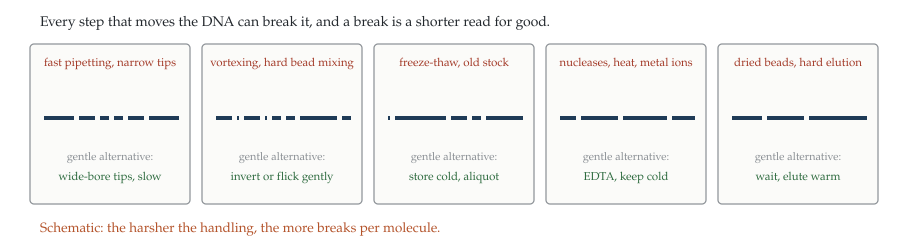{width=95%}

- A long molecule is a bigger target for every mechanical and enzymatic break, so length is lost at every step

## Handling rules

- **Gentle extraction**, ideally one that does not push DNA through narrow channels
- **Wide-bore tips**, slow pipetting, and mixing by inversion or flicking rather than vortexing
- **No repeated freeze-thaw**, and no long storage at warm temperatures
- **Elute warm and wait.** A 37 °C elution improves recovery of high-molecular-weight DNA from beads
- **Measure the right thing.** A spectrophotometer reports purity and says nothing about breaks. Use fluorometric mass, then a size method that works for long DNA

Length is lost silently: the library looks normal, and the N50 is half of what you expected. The **N50** is the length at which half of all the bases sit in reads (or molecules) at least that long, so it reports where the bulk of the sequence is, not the longest read you can find.

## Count molecules, not mass

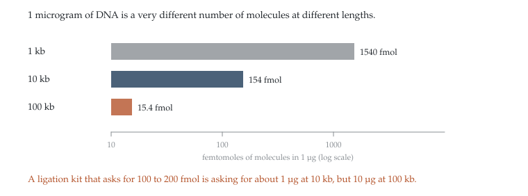{width=76%}

- A mass-based input gives you very few long molecules, so adapter ligation has fewer ends to find

## PacBio: SMRTbell prep 3.0

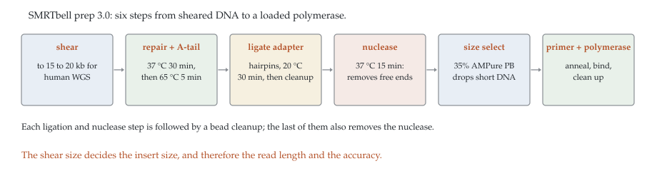{width=95%}

- The [SMRTbell prep kit 3.0](https://henriksson-lab.github.io/NGS_101/pacbio-smrtbell-prep-kit-3-0/smrtbell-prep-kit-3-0.html) is PCR-free: every step acts on the native molecule

[Travers et al. 2010, doi:10.1093/nar/gkq543]{.small}

## Why a nuclease step belongs in a ligation protocol

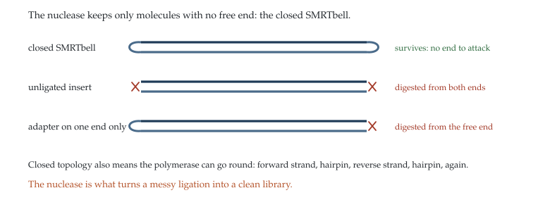{width=77%}

- A SMRTbell has no ends, so an exonuclease can strip away everything that failed to close

[Wenger et al. 2019, doi:10.1038/s41587-019-0217-9]{.small}

## Size selection sets the accuracy

- The polymerase reads a closed insert round and round. A **shorter insert gives more passes**, so more consensus support and a more accurate read
- A **longer insert gives fewer passes** and a longer read, and a less accurate one
- The selection step in the protocol is a bead cleanup that depletes fragments under about 5 kb; libraries under 10 kb use a plain 1X cleanup instead
- Short fragments load preferentially, so without selection a minority of short molecules can take most of the reads

You choose the shear size and the cut-off in the same decision. It is a decision about the question, not a default.

## Iso-Seq: full-length cDNA in one read

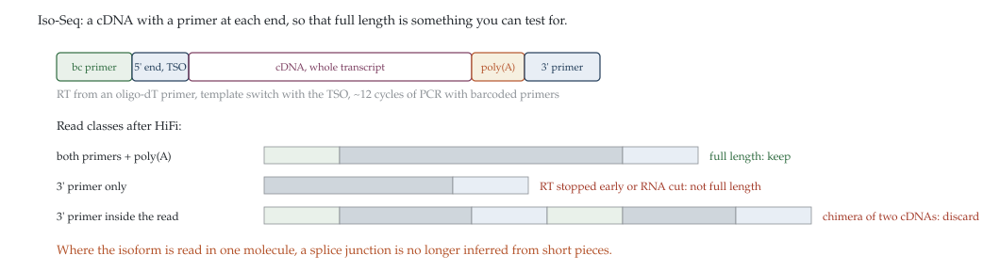{width=95%}

- The [Iso-Seq](https://henriksson-lab.github.io/NGS_101/pacbio-isoseq-smrtbell-prep-kit-3-0/pacbio-isoseq.html) kit starts from 300 ng of total RNA of good integrity and adds a barcode at the PCR step. Both ends of the cDNA come from [template switching](../handles/lec.qmd), so an RT that stops early costs you the whole molecule

- A full-length read also carries the poly(A) tail, which a short read never does. [FLAM-seq](https://henriksson-lab.github.io/NGS_101/flam-seq__10.1038+s41592-019-0503-y/01_chem.html) exploits that: the tail is measured on the same molecule as the isoform it belongs to, rather than inferred [Legnini et al. 2019, doi:10.1038/s41592-019-0503-y]{.small}

[Sharon et al. 2013, doi:10.1038/nbt.2705]{.small}

## Kinnex: many transcripts per read

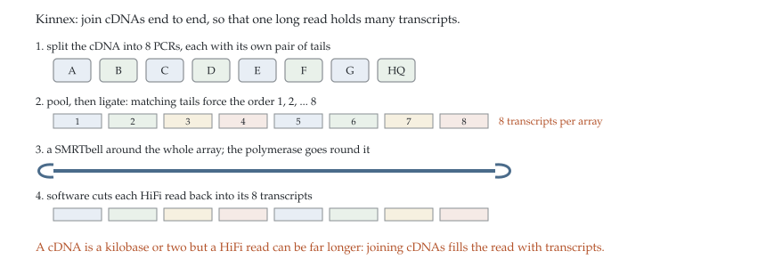{width=81%}

- [Kinnex full-length RNA](https://henriksson-lab.github.io/NGS_101/pacbio-kinnex-full-length-rna/kinnex-full-length-rna.html) joins cDNAs into an array, and the library is then an ordinary SMRTbell

[Al'Khafaji et al. 2024, doi:10.1038/s41587-023-01815-7]{.small}

## Nanopore: ligation sequencing, SQK-LSK114

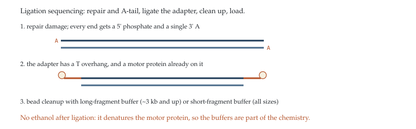{width=91%}

- [LSK114](https://henriksson-lab.github.io/NGS_101/oxford-nanopore-ligation-sequencing-v14/nanopore-ligation-v14.html) takes about 1 µg or 100 to 200 fmol and is the standard PCR-free ligation route

[Jain et al. 2016, doi:10.1186/s13059-016-1103-0]{.small}

## Rapid sequencing, SQK-RAD114

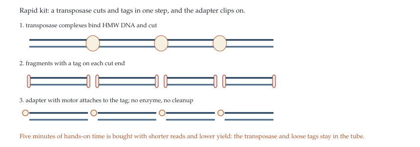{width=80%}

- [RAD114](https://henriksson-lab.github.io/NGS_101/oxford-nanopore-rapid-sequencing-v14/rapid-sequencing-v14.html) uses 100 to 150 ng and two short incubations. It has no cleanup, so the [transposase](../enzymes/lec-transposases.qmd) stays in the library, and yield is lower

## Ultra-long sequencing, SQK-ULK114

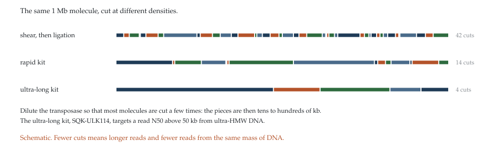{width=91%}

- [ULK114](https://henriksson-lab.github.io/NGS_101/oxford-nanopore-ultra-long-v14/ultra-long-v14.html) starts from ultra-HMW DNA from millions of cells, uses a very dilute transposase, and recovers the library by precipitation, not beads

[Jain et al. 2018, doi:10.1038/nbt.4060]{.small}

## Native barcoding, SQK-NBD114.24

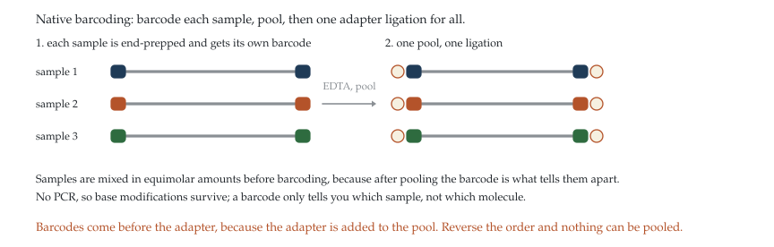{width=88%}

- [NBD114.24](https://henriksson-lab.github.io/NGS_101/oxford-nanopore-native-barcoding-v14/native-barcoding-v14.html) multiplexes up to 24 samples without PCR, so modification calls survive. The [barcode](../barcodes-umis/lec.qmd) is ligated onto the molecule rather than carried in on a primer, so its design is constrained by the ligation, not by a read

## From RNA to cDNA on nanopore

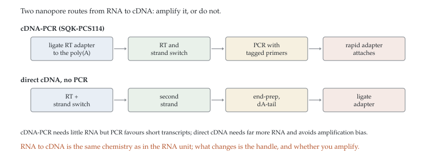{width=79%}

- [cDNA-PCR V14](https://henriksson-lab.github.io/NGS_101/oxford-nanopore-cdna-pcr-sequencing-v14/cdna-pcr.html) is the low-input route. The older [direct cDNA](https://henriksson-lab.github.io/NGS_101/oxford-nanopore-direct-cdna-sequencing/direct-cdna.html) kit is listed as no longer available, but it shows the PCR-free design

## Direct RNA, SQK-RNA004

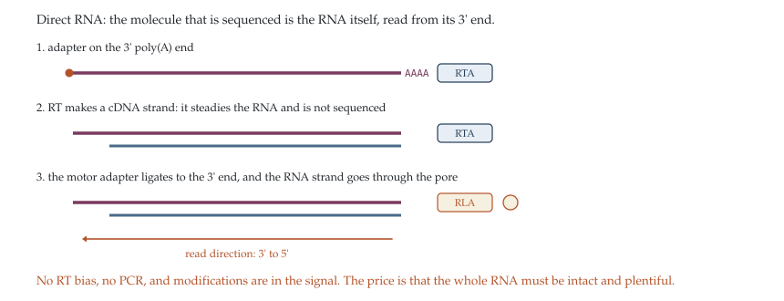{width=73%}

- [RNA004](https://henriksson-lab.github.io/NGS_101/oxford-nanopore-direct-rna-sequencing-rna004/direct-rna.html) takes 300 ng of poly(A) RNA or 1 µg of total RNA. With no RT in the path it escapes the [reverse-transcriptase readouts](../modifications/lec-rna.qmd) that every other m6A method depends on

[Garalde et al. 2018, doi:10.1038/nmeth.4577; Workman et al. 2019, doi:10.1038/s41592-019-0617-2]{.small}

## Six protocols, side by side

| Protocol | Input | What is cut or ligated | Cleanup | Reads |
|---|---|---|---|---|
| SMRTbell prep 3.0 | sheared DNA, 15 to 20 kb | hairpin adapters on both ends | beads, nuclease | HiFi consensus |
| Iso-Seq | 300 ng total RNA | TSO, PCR with barcodes | beads | full-length cDNA |
| LSK114 | 1 µg or 100 to 200 fmol | A-tail, adapter with T overhang | beads | long, native |
| RAD114 | 100 to 150 ng | transposase tags, adapter clips on | none | shorter, fast |
| ULK114 | millions of cells | dilute transposase | precipitation | ultra-long |
| RNA004 | 300 ng poly(A) RNA | adapter ligated to the RNA | beads | native RNA |

Ask of each row: where could the molecule break, and what is lost to cleanup?

## Cas9 enrichment

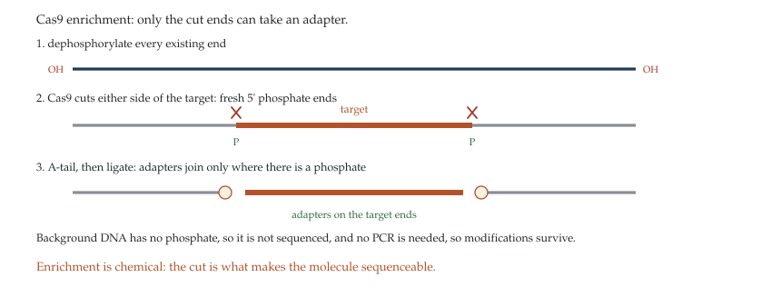{width=77%}

- [nCATS](https://henriksson-lab.github.io/NGS_101/nanopore-cas9-targeted-sequencing-ncats__10.1038+s41587-020-0407-5/ncats.html) starts from about 3 µg of HMW DNA and reads the target and its methylation in one molecule; the short-read form of the same block is in [targeted sequencing](../targeted/lec.qmd)

[Gilpatrick et al. 2020, doi:10.1038/s41587-020-0407-5]{.small}

## Adaptive sampling

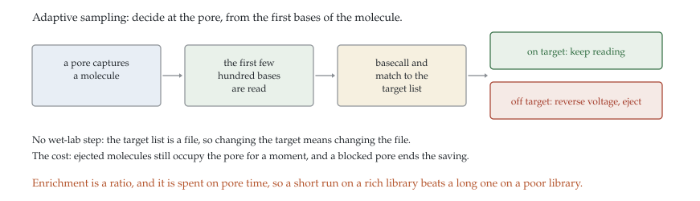{width=95%}

- Selection by software, on the instrument, with no change to the library

[Loose et al. 2016, doi:10.1038/nmeth.3930; Payne et al. 2021, doi:10.1038/s41587-020-00746-x]{.small}

## Capture in the lab or at the pore

| | Cas9 enrichment | Adaptive sampling |
|---|---|---|
| Where selection happens | chemistry, before loading | software, on the instrument |
| Changing the target | new guide RNAs | a new target file |
| Input | microgram of HMW DNA | ordinary library |
| What it costs | background DNA is never sequenced | pore time spent on ejected molecules |
| Limit | efficiency per guide | a fraction of pore capacity is wasted |

The two are not exclusive. Which to use depends on how many targets you have, and how often they change.

## When it goes wrong

| Observation | Likely cause |
|---|---|
| Read N50 far below the input size | breaks from handling or extraction |
| A few short fragments dominate a PacBio run | no size selection |
| Adapter-ligation yield collapses on nanopore | ethanol carry-over, which denatures the motor |
| Rapid kit gives low yield | no cleanup; transposase and free tags remain |
| Iso-Seq reads without a 5' primer | RT stopped early; RNA not intact |
| Direct RNA yield very low | too little RNA, or degraded |

## Choosing a route

| Question | Route |
|---|---|
| Variants and phasing, accurate | PacBio HiFi, SMRTbell prep 3.0 |
| Structural variants and long repeats | LSK114 |
| Spanning a megabase repeat | ULK114 |
| A quick look at a sample | RAD114 |
| Many samples, one run | native barcoding |
| Isoforms | Iso-Seq or Kinnex; cDNA-PCR on nanopore |
| RNA modifications | RNA004 |
| A few loci in many samples | Cas9 enrichment or adaptive sampling |

## What to take with you

- A long-read library is the same blocks as before: repair, add ends, clean up. The difference is that every step is judged by **whether it breaks the molecule**
- Handling is part of the protocol. Input is a number of molecules
- The adapter chemistry, closed hairpin or motor protein, decides what you can clean up and how
- Enrichment can be chemical (Cas9) or computational (adaptive sampling)
- Try the [exercises](exercise.qmd) next

## Where this connects

**Blocks this protocol uses**

- [Fragmentation and size control](../fragmentation/lec.qmd) — the one block this deck spends its time *avoiding*; when you do shear, the target size is set by the pass count or the pore, not by a read length, and the bead cut-off is now a lower bound
- [End chemistry](../end-chemistry/lec.qmd) — A-tail and T-overhang on LSK114, a hairpin closing a SMRTbell into a molecule with no ends at all; the end state is what the adapter chemistry is chosen for
- [Ligases, kinases, phosphatases](../enzymes/lec-ligases.qmd) — one ligation decides the whole yield, and with few long molecules there are very few ends for it to find
- [Nucleases](../enzymes/lec-nucleases.qmd) — the exonuclease that strips away everything which failed to close is why a dumbbell is worth making
- [Amplification](../amplification/lec.qmd) — PCR-free is the default here, because PCR caps the length and erases the base modifications you came for
- [Selection](../selection/lec.qmd) — nCATS works by making the Cas9 cut the only ligatable end in the tube, which is selection by *end structure* rather than by sequence; the same deck explains why an exonuclease is a trap you can set for your own product

**Before this**

- [The long-read instruments](lec-instruments.qmd) — what a SMRTbell and a motor protein actually are, and what each instrument demands of the molecule you hand it

**If this fails**

- [QC](../qc/lec.qmd) — why a spectrophotometer cannot see breaks, and how to convert a mass into the molar input these kits are really specified in
