## Start from the question

RNA carries chemical marks, like DNA. It is also a moving target: made, processed and destroyed within minutes to hours. A standard RNA-seq library shows a snapshot of the steady state and none of the chemistry.

Questions this deck answers, each with a different handle:

- **Where is a mark** such as m6A?
- **Which RNA does a protein touch?**
- **What was made in the last few minutes**, and where are the polymerases?
- **Where do transcripts start**, and **which bases are paired?**

In every case the reverse transcriptase is the reporter: what it does at a modified base decides what the library can show.

## Most marks are silent to reverse transcriptase

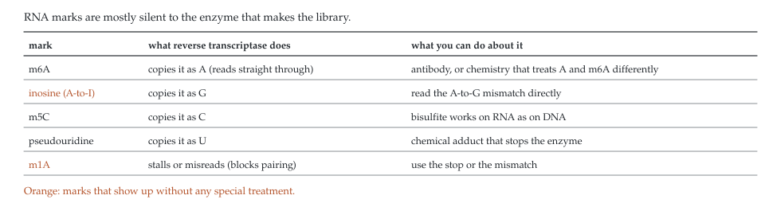{width=87%}

- The enzyme reads a template by Watson-Crick pairing; a mark away from that edge changes nothing, so the library hides it
- **m6A** is the commonest internal mark in mRNA, found in a DRACH motif and enriched near stop codons and in 3' UTRs
- Marks that block pairing leave a trace as a stop or a mismatch: that is a handle you do not have to add

[Dominissini et al. 2012, doi:10.1038/nature11112; Meyer et al. 2012, doi:10.1016/j.cell.2012.05.003]{.small}

## m6A-seq: pull down the fragments that carry the mark

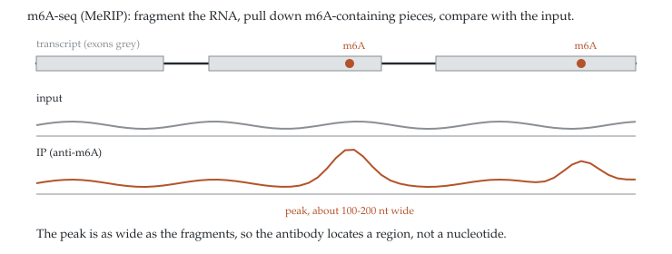{width=68%}

- Fragment the RNA to about 100 nt, immunoprecipitate with an anti-m6A antibody, and make one library from the pull-down and one from the input ([m6A-seq](https://henriksson-lab.github.io/NGS_101/https://henriksson-lab.github.io/NGS_101/m6a-seq__10.1038+nature11112/m6a-seq.html))
- A peak in IP over input is a region of about the fragment size that contains at least one m6A
- Position is approximate and the signal is relative: it does not say what fraction of molecules are methylated

## miCLIP: crosslink the antibody to get single-base resolution

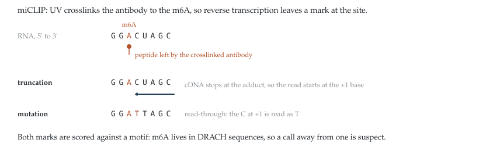{width=81%}

- UV light bonds the antibody to the RNA it sits on; after proteinase K a peptide stub remains at the crosslinked site
- The reverse transcriptase then truncates at the stub or miscopies the base next to it, and that position is the call ([miCLIP](https://henriksson-lab.github.io/NGS_101/https://henriksson-lab.github.io/NGS_101/miclip__10.1038+nmeth.3453/miclip.html))
- A DRACH motif at the call is a sanity check: calls away from one are suspect

[Linder et al. 2015, doi:10.1038/nmeth.3453]{.small}

## The CLIP family: freeze the protein on the RNA

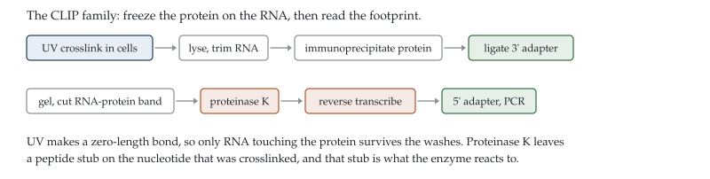{width=92%}

- The same idea finds where an RNA-binding protein touches its targets: UV crosslink, immunoprecipitate the protein, trim the RNA to a footprint with a single-strand-specific [nuclease](../enzymes/lec-nucleases.qmd)
- A 3' adapter goes on while the complex is still on the beads; the complex is purified by gel before proteinase K and RT. What an RNA ligase can accept depends on the 5' and 3' groups the RNA happens to carry ([nucleic acids](../nucleic-acids/lec.qmd))
- HITS-CLIP is the original form; the variants differ mainly in how the crosslink site is read

[Licatalosi et al. 2008, doi:10.1038/nature07488]{.small}

## Truncation or mutation: how the crosslink is read

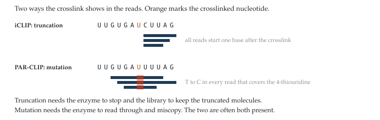{width=74%}

- **iCLIP:** the enzyme stops at the stub, so reads start one base after the crosslink; the truncated cDNAs must survive library preparation ([iCLIP](https://henriksson-lab.github.io/NGS_101/https://henriksson-lab.github.io/NGS_101/iclip__10.1038+nsmb.1838/iclip_partial.html))
- **PAR-CLIP:** cells grow with 4-thiouridine; at the crosslinked base the enzyme reads T as C, so T-to-C marks the site ([PAR-CLIP](https://henriksson-lab.github.io/NGS_101/https://henriksson-lab.github.io/NGS_101/par-clip__10.1016+j.cell.2010.03.009/par_clip.html))
- Truncation needs the library to keep short cDNAs; mutation needs a read-through, and 4sU-labelled cells

[König et al. 2010, doi:10.1038/nsmb.1838; Hafner et al. 2010, doi:10.1016/j.cell.2010.03.009]{.small}

## eCLIP: a control for every IP

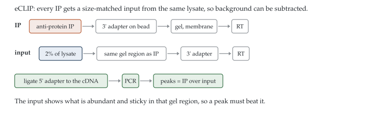{width=81%}

- UV crosslinking is inefficient, so CLIP libraries start from little RNA and need many PCR cycles
- A **size-matched input** taken before the IP goes through the same gel region and library steps; a peak must exceed it
- A second adapter with random bases is ligated to the cDNA itself — [single-strand ligation](../tricks/lec.qmd), the trick that rescues a molecule with only one usable end — so truncated cDNAs are kept and PCR duplicates can be removed ([eCLIP](https://henriksson-lab.github.io/NGS_101/https://henriksson-lab.github.io/NGS_101/eclip__10.1038+nmeth.3810/eclip.html))

[Van Nostrand et al. 2016, doi:10.1038/nmeth.3810]{.small}

## Dynamics: steady state hides turnover

Total RNA-seq measures the level of an RNA, which is synthesis divided by decay. Two genes can give the same number for opposite reasons.

- Gene A: made at 10 molecules per minute, decays with half-life 7 minutes: level = 10 / 0.1 = **100**
- Gene B: made at 1 molecule per minute, half-life 70 minutes: level = 1 / 0.01 = **100**
- Same RNA-seq coverage, one regulated by transcription and one by stability

To separate synthesis from decay you need a **time axis in the library**: mark the RNA that was made after a chosen moment. The marker is either a nucleotide analogue, or the engaged polymerase itself.

## Metabolic labelling: mark what was made in the pulse

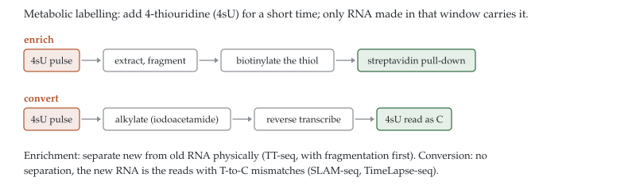{width=79%}

- Cells take up 4-thiouridine (4sU) and incorporate it into new RNA; the thiol is a chemical handle that natural RNA lacks
- **Enrich:** biotinylate the thiol and pull down; with fragmentation first, whole transcripts are covered ([TT-seq](https://henriksson-lab.github.io/NGS_101/https://henriksson-lab.github.io/NGS_101/tt-seq__10.1126+science.aad9841/tt-seq.html))
- **Convert:** alkylation makes 4sU read as C, so new RNA is the reads with T-to-C changes, with no pull-down ([SLAM-seq](https://henriksson-lab.github.io/NGS_101/https://henriksson-lab.github.io/NGS_101/slam-seq__10.1038+nmeth.4435/slam-seq.html))

[Schwalb et al. 2016, doi:10.1126/science.aad9841; Herzog et al. 2017, doi:10.1038/nmeth.4435; Schofield et al. 2018, doi:10.1038/nmeth.4582]{.small}

## From labelled fraction to half-life

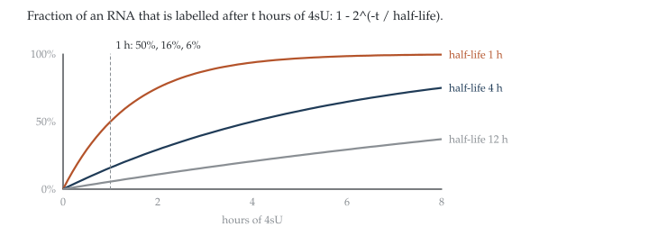{width=64%}

- After t hours the labelled fraction of an RNA is 1 - 2^(-t / half-life), if the RNA is at steady state
- Worked example: 30% labelled after 1 h gives k = -ln(0.7) = 0.36 per hour, so half-life = ln 2 / 0.36 = **1.9 h**
- Short pulses read synthesis; long pulses read stability. Use the lowest dose and the shortest time that works, because 4sU itself stresses cells

## GRO-seq: let the engaged polymerases run on

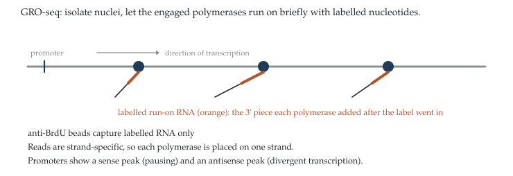{width=71%}

- Isolate nuclei, so transcription stops; then supply labelled nucleotides and let each engaged polymerase extend briefly ([GRO-seq](https://henriksson-lab.github.io/NGS_101/https://henriksson-lab.github.io/NGS_101/gro-seq__10.1126+science.1162228/gro-seq.html))
- Pull down the labelled nascent RNA and sequence it: reads are strand-specific, so every polymerase is placed on a strand
- At human promoters this showed pausing shortly after the start site and a second, divergent peak on the opposite strand

[Core et al. 2008, doi:10.1126/science.1162228]{.small}

## PRO-seq: one nucleotide, one position

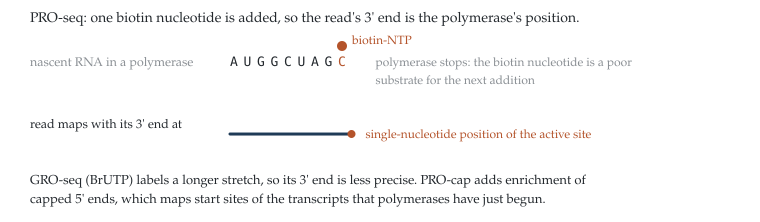{width=80%}

- Biotinylated nucleotides are poor substrates for the next addition, so the polymerase usually stops after one: the read's 3' end is the active site, at single-nucleotide resolution ([PRO-seq](https://henriksson-lab.github.io/NGS_101/https://henriksson-lab.github.io/NGS_101/pro-seq__10.1126+science.1229386/pro-seq.html))
- Pull-down is on the biotin, so no antibody is needed
- Adding a step that keeps capped RNA only turns the same idea into a start-site map ([PRO-cap](https://henriksson-lab.github.io/NGS_101/https://henriksson-lab.github.io/NGS_101/pro-cap__10.1126+science.1229386/pro-cap.html))

[Kwak et al. 2013, doi:10.1126/science.1229386]{.small}

## NET-seq: a handle without labelling

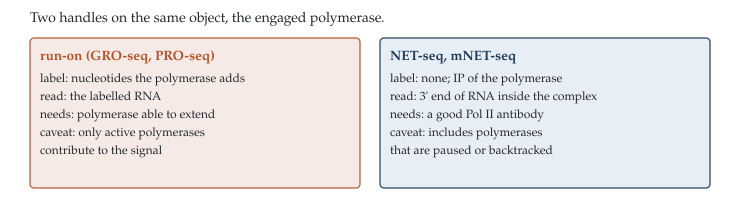{width=85%}

- Instead of labelling what the polymerase adds, immunoprecipitate the polymerase and sequence the 3' ends of the RNA inside it
- No incorporation step, so polymerases that cannot extend, such as paused or backtracked ones, still contribute
- MNase and an antibody against the polymerase are the blocks of a [chromatin](../chromatin/lec.qmd) pull-down, with the RNA kept instead of the DNA; the human versions differ in how the elongation complex is isolated: [NET-seq](https://henriksson-lab.github.io/NGS_101/https://henriksson-lab.github.io/NGS_101/human-net-seq__10.1016+j.cell.2015.03.010/human-net-seq.html) uses cell lysis, [mNET-seq](https://henriksson-lab.github.io/NGS_101/https://henriksson-lab.github.io/NGS_101/mnet-seq__10.1016+j.cell.2015.03.027/mnet-seq.html) uses chromatin and MNase

[Mayer et al. 2015, doi:10.1016/j.cell.2015.03.010; Nojima et al. 2015, doi:10.1016/j.cell.2015.03.027]{.small}

## Transcription start sites: keep the cap

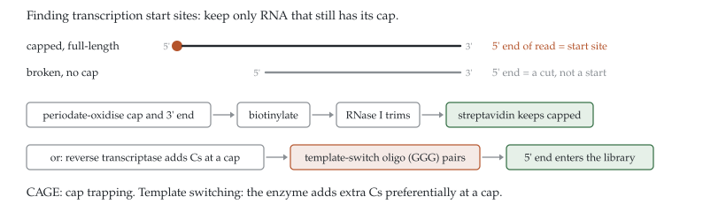{width=80%}

- A read's 5' end marks a start site only if the RNA was whole; a broken RNA also has a 5' end, but it is a cut
- The 5' cap separates the two: capped RNA is selected by **cap trapping** or by the template-switching reaction, which prefers capped ends ([CAGE](https://henriksson-lab.github.io/NGS_101/https://henriksson-lab.github.io/NGS_101/cage__10.1038+nprot.2012.005/cage.html))
- This is the same template-switching step used in full-length [single-cell protocols](../single-cell/lec.qmd)

[Takahashi et al. 2012, doi:10.1038/nprot.2012.005]{.small}

## Structure probing: modify the unpaired bases

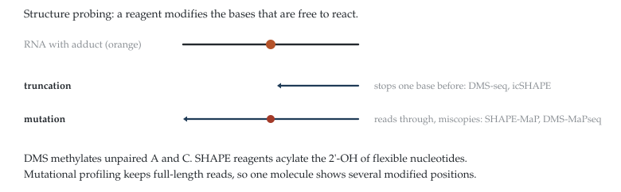{width=63%}

- A small reagent modifies bases that are free to react; paired and protected bases escape
- The adduct is read as a stop ([DMS-seq](https://henriksson-lab.github.io/NGS_101/https://henriksson-lab.github.io/NGS_101/dms-seq__10.1038+nature12894/dms-seq.html), [icSHAPE](https://henriksson-lab.github.io/NGS_101/https://henriksson-lab.github.io/NGS_101/icshape__10.1038+nprot.2016.011/icshape.html)) or as a mutation ([SHAPE-MaP](https://henriksson-lab.github.io/NGS_101/https://henriksson-lab.github.io/NGS_101/shape-map__10.1038+nmeth.3029/shape-map.html), [DMS-MaPseq](https://henriksson-lab.github.io/NGS_101/https://henriksson-lab.github.io/NGS_101/dms-mapseq__10.1038+nmeth.4057/dms-mapseq.html)), exactly as a crosslink is in CLIP
- Done in living cells, the profile shows structure as it is, including where proteins and ribosomes remove it

[Rouskin et al. 2014, doi:10.1038/nature12894; Siegfried et al. 2014, doi:10.1038/nmeth.3029; Zubradt et al. 2017, doi:10.1038/nmeth.4057; Flynn et al. 2016, doi:10.1038/nprot.2016.011]{.small}

## Reading a reactivity profile

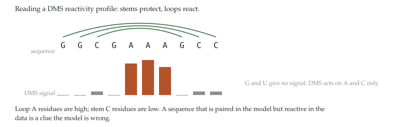{width=74%}

- DMS acts on A and C only, so G and U positions give no signal, however exposed they are
- In this hairpin the loop A residues are high and the paired stem is low; a model that pairs a reactive base is questioned
- A control without reagent measures the enzyme's own error rate, which the treated signal must exceed

## One idea, three readouts

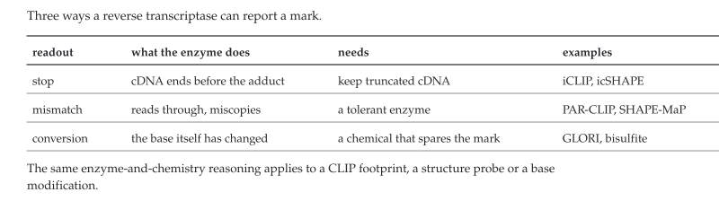{width=84%}

- A mark, a crosslink and an adduct are all chemical changes to the template; the enzyme reports them as a stop, as a mismatch, or after chemistry has changed the base
- Ask of any protocol which of the three it uses, and what it costs: lost short cDNAs, a tolerant enzyme, or a damaging reaction
- Truncation and mutation can sit in the same library: a protocol that sees only one is discarding information

## Antibody-free m6A: GLORI

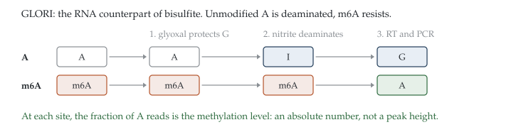{width=92%}

- Glyoxal protects G, and nitrite deaminates unmodified A to inosine, read as G; m6A resists, so it stays A ([GLORI](https://henriksson-lab.github.io/NGS_101/https://henriksson-lab.github.io/NGS_101/glori__10.1038+s41587-022-01487-9/glori.html))
- This is bisulfite logic for RNA: the unmodified base changes, and the fraction of A at a site is the methylation level
- A second approach uses an enzyme: MazF cuts at unmethylated ACA motifs, so a site that stays whole is methylated ([MAZTER-seq](https://henriksson-lab.github.io/NGS_101/https://henriksson-lab.github.io/NGS_101/mazter-seq__10.1016+j.cell.2019.06.013/mazter-seq.html))

[Liu et al. 2023, doi:10.1038/s41587-022-01487-9; Garcia-Campos et al. 2019, doi:10.1016/j.cell.2019.06.013]{.small}

## Five answers to where m6A is

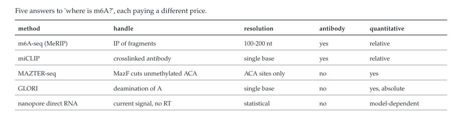{width=85%}

- Antibody methods map many sites with little input but cannot give a fraction; chemical and enzymatic ones give single bases and often a fraction, at the price of harsher steps or fewer sites
- [Direct RNA nanopore sequencing](../sequencers/lec-platforms.qmd) needs no RT at all and reads the mark from the current; calls are statistical [Pratanwanich et al. 2021, doi:10.1038/s41587-021-00949-w]{.small}
- Pick by the question: a map, a position, or a stoichiometry

## What goes wrong

- **Antibodies:** m6A antibodies can also bind the related cap mark m6Am; check the specificity, and use input
- **Crosslinking:** low efficiency, so duplicates and background dominate; use adapters with random bases and a size-matched input
- **Labelling:** 4sU at high dose or long exposure alters the cell; keep it low and short, and include an unlabelled control
- **Run-on and NET-seq:** nuclei or chromatin must be intact and RNase-free, or the nascent RNA is lost
- **Probing:** the enzyme has its own errors and stops; the no-reagent control is not optional

## One table: question, handle, protocol

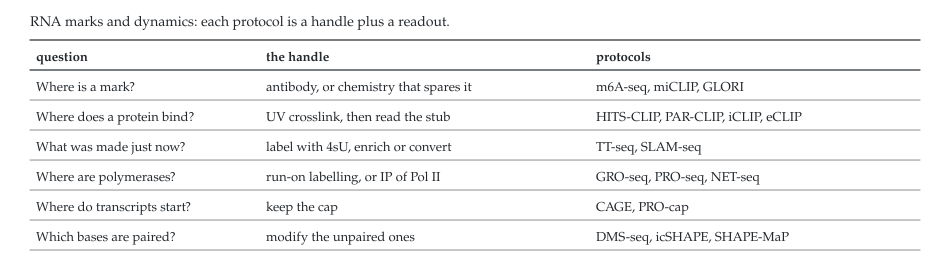{width=83%}

- RNA protocols are a handle (an antibody, a crosslink, a label, a cap) plus a readout (a stop, a mismatch, a conversion)
- The next unit puts the same RNA-seq blocks inside single cells, where the extra requirement is a barcode on every molecule

## Where this connects

**Blocks this protocol uses**

- [Converting chemistry into sequence](../chemistry-to-sequence/lec.qmd) — the three readouts on one slide: a stop, a mismatch, a converted base
- [Attaching a handle](../handles/lec.qmd) — RNA ligation (3' adapter first, 5' second) is the backbone of every CLIP protocol; template switching is how CAGE keeps the cap
- [Polymerases and RTs](../enzymes/lec.qmd) — the RT *is* the reporter here, so whether it truncates or misreads at an adduct is an enzyme choice, not an accident
- [Selection](../selection/lec.qmd) — an antibody against a mark or a protein, streptavidin on biotinylated 4sU, oligo-dT for what is left: every protocol here is an affinity step plus a readout, and the affinity step sets the background
- [Fragmentation](../fragmentation/lec.qmd) — m6A-seq peaks are only as sharp as the ~100 nt fragments; a CLIP footprint is set by how far the nuclease trims
- [Barcodes and UMIs](../barcodes-umis/lec.qmd) — random-mer adapters are what make a 20-cycle CLIP library countable at all
- [Amplification](../amplification/lec.qmd) — crosslinking is inefficient, so these libraries are low-input and over-cycled by design

**Overlapping ground**

- [Small RNA, tag protocols, low input](../rna/lec-small-rna.qmd) — the two-adapter ligation and its dimers are worked through there; this deck assumes it and spends its slides on the handle
