## Start from the question

A sequencer reads four letters. Cells care about more than that: which cytosines carry a methyl group, where the DNA is broken, when a region is copied, how a break was repaired.

None of these is sequence. Each protocol in this deck is a way of **turning a chemical difference into a sequence difference**, and then reusing the ordinary blocks (ends, adapters, amplification) to read it.

- **Methylation:** a base change that depends on the mark
- **Breaks:** the free DNA end is the handle
- **Repair:** read across the cut
- **Replication timing:** label new DNA, or count copies

::: {.notes}
Frame the whole deck as: handle plus readout. Students should be able to name, for every protocol, what is changed in the molecule and what makes the change visible.
:::

## Methylated cytosine is invisible to a polymerase

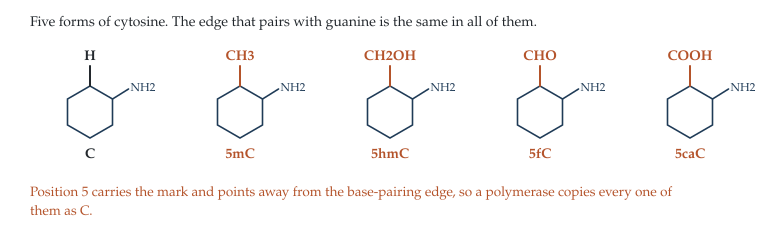{width=92%}

- In human somatic cells most CpGs carry 5-methylcytosine (5mC); TET enzymes oxidise it step by step to 5hmC, 5fC and 5caC
- All five pair with guanine, so every one is copied as C
- A library of native DNA therefore holds no trace of the marks: the chemistry has to change the letters first

## Bisulfite: deaminate what is not protected

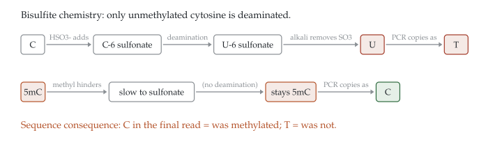{width=92%}

- Bisulfite adds to cytosine, which is then deaminated to uracil; the methyl group of 5mC hinders the first step, so 5mC stays C
- After PCR: **C in the read = methylated, T = unmethylated**
- Used on DNA since the 1990s, and still the reference all other methods are compared against

[Frommer et al. 1992, doi:10.1073/pnas.89.5.1827]{.small}

## Reading a bisulfite read

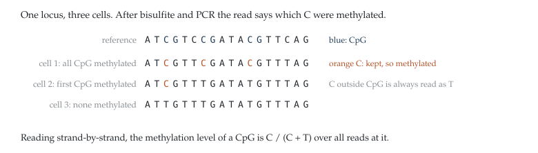{width=92%}

- The methylation level of a CpG is C / (C + T) over all reads covering it, so it is a fraction of molecules, not a yes or no
- A cytosine outside a CpG is read as T: in most human tissues it is not methylated
- After conversion the two strands are no longer complementary, so the aligner treats them separately

## The adapters must survive the chemistry too

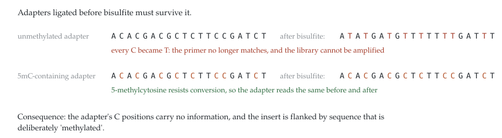{width=92%}

- Adapters added before conversion are made with 5mC in place of C, as in the original [RRBS](https://henriksson-lab.github.io/NGS_101/https://henriksson-lab.github.io/NGS_101/rrbs-illumina__10.1038+nature07107/rrbs-illumina.html) protocol
- Bisulfite also breaks DNA: a molecule cut between its two adapters cannot be amplified
- Tagging **after** conversion (PBAT, post-bisulfite adapter tagging) puts adapters on what survived, and is the common choice for single cells

[Meissner et al. 2008, doi:10.1038/nature07107; Smallwood et al. 2014, doi:10.1038/nmeth.3035; Olova et al. 2018, doi:10.1186/s13059-018-1408-2]{.small}

## What a three-letter alphabet costs

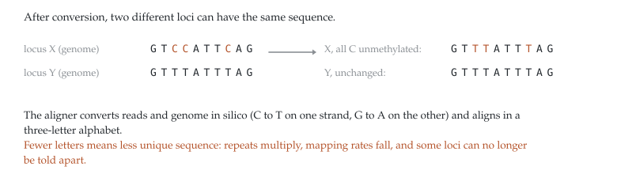{width=92%}

- Reads from an unmethylated region contain almost no C, so fewer distinct sequences are left and mapping becomes ambiguous
- The library is low in diversity: the same problem as the first cycles on the [sequencer deck](../sequencers/lec.qmd), and the same remedy (PhiX)
- Damage and low diversity together are why bisulfite libraries need more input and more reads than ordinary DNA

## Bisulfite cannot tell 5mC from 5hmC

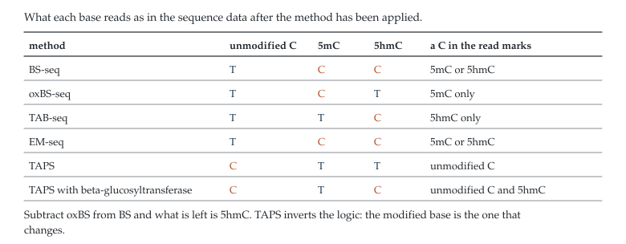{width=76%}

- 5hmC also resists deamination, so both marks read as C
- In brain and in stem cells 5hmC is abundant, and the two marks have different meanings
- The table is the map for the next slides: what each base reads as, once the method has run

## oxBS-seq and TAB-seq: protect one, change the other

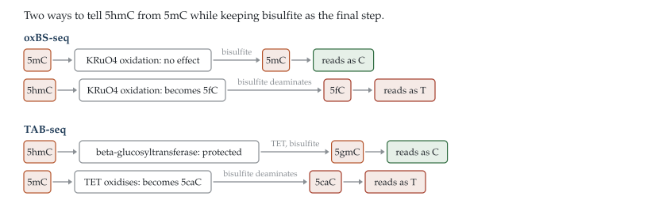{width=92%}

- **oxBS:** an oxidant turns 5hmC into 5fC, which bisulfite deaminates. A C then means 5mC only; 5hmC is the difference between BS and oxBS
- **TAB-seq:** a glucosyl group protects 5hmC while TET oxidises 5mC to 5caC, which bisulfite converts. A C then means 5hmC directly
- Both add steps to bisulfite and inherit its damage; a difference of two noisy numbers is itself noisy

[Booth et al. 2012, doi:10.1126/science.1220671; Yu et al. 2012, doi:10.1016/j.cell.2012.04.027]{.small}

## EM-seq: enzymes instead of bisulfite

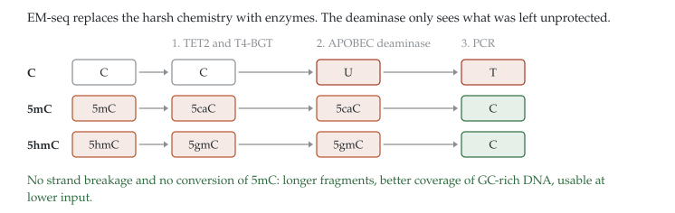{width=89%}

- TET2 and a glucosyltransferase protect 5mC and 5hmC; a cytidine deaminase (APOBEC) then converts only what is left unprotected
- The library is built first with ordinary adapters, so the DNA is not fragmented by the conversion
- Same reading rule as bisulfite, with longer inserts, more even coverage and lower input; see the [NEBNext EM-seq v2 kit](https://henriksson-lab.github.io/NGS_101/https://henriksson-lab.github.io/NGS_101/nebnext-enzymatic-methyl-seq-v2/nebnext-em-seq-v2.html)

[Vaisvila et al. 2021, doi:10.1101/gr.266551.120]{.small}

## TAPS: change the modified base instead

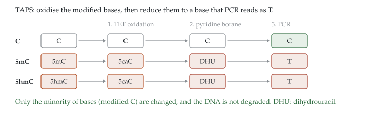{width=92%}

- TET oxidises 5mC and 5hmC to 5caC; pyridine borane reduces 5caC to dihydrouracil, which PCR reads as T
- Unmodified C is left alone, so the sequence keeps its four letters and mapping is easy, and the DNA is not degraded
- With a glucosyltransferase to protect 5hmC the method reports 5mC only (TAPS beta). See [TAPS](https://henriksson-lab.github.io/NGS_101/https://henriksson-lab.github.io/NGS_101/taps__10.1038+s41587-019-0041-2/taps.html)

[Liu et al. 2019, doi:10.1038/s41587-019-0041-2]{.small}

## Controls tell you how far to trust a number

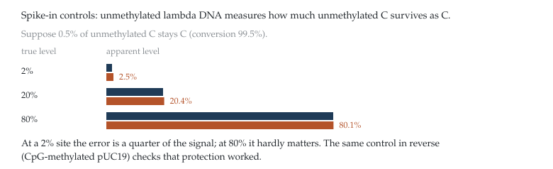{width=90%}

- Add unmethylated lambda DNA to measure how much C fails to convert, and a CpG-methylated control (for example pUC19) to check that protection worked
- Incomplete conversion pushes methylation up; incomplete protection or oxidation pushes it down
- Report the control values with the data: a 2% site cannot be believed without them

## RRBS: spend the reads where the CpGs are

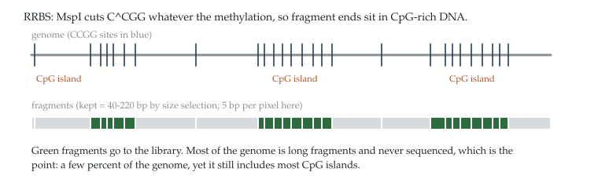{width=92%}

- **MspI** cuts C^CGG whatever the methylation ([nucleases](../enzymes/lec-nucleases.qmd) places it among the methylation-sensitive pairs), so every fragment starts at a CpG and CpG islands are cut densely
- Size selection keeps short fragments, which come mostly from islands and promoters; then methylated adapters and bisulfite
- [Targeted sequencing](../targeted/lec.qmd) treats RRBS as a *selection* method; here it is the methylation readout that the selection serves
- The end-repair fill-in rebuilds the cut-site cytosine, so that one position carries no information and is trimmed

[Meissner et al. 2008, doi:10.1038/nature07107]{.small}

## Choosing a methylation method

- **Whole-genome 5mC, ordinary input:** bisulfite or EM-seq; prefer EM-seq for low input or fragile DNA such as cell-free DNA
- **5hmC separately** (brain, TET-mutant tumours): oxBS, TAB-seq or TAPS beta
- **Many samples, promoters and islands only:** RRBS
- **Long molecules, phasing, repeats:** [nanopore sequencing](../long-reads/lec-instruments.qmd) reads modified bases from the current signal, with no conversion at all [Simpson et al. 2017, doi:10.1038/nmeth.4184]{.small}
- **Whatever you choose:** spike-in controls, and say in the paper what fraction converted

## DNA breaks: the end is the handle

A genome-wide library breaks the DNA itself, by sonication or tagmentation. So how do you tell a real break in the cell from one you made in the tube?

**Label the break before anything else is done to the DNA.** A real break has a free end; ligate an adapter to it in the intact sample, and only broken sites carry that adapter.

- The first adapter is the handle; the rest of the library is ordinary
- Handling is the enemy: the DNA must not be sheared while you work
- Methods differ in how they protect, mark and recover the broken end: [BLESS](https://henriksson-lab.github.io/NGS_101/https://henriksson-lab.github.io/NGS_101/bless__10.1038+nmeth.2408/bless.html), [DSBCapture](https://henriksson-lab.github.io/NGS_101/https://henriksson-lab.github.io/NGS_101/dsbcapture__10.1038+nmeth.3960/dsbcapture.html), [END-seq](https://henriksson-lab.github.io/NGS_101/https://henriksson-lab.github.io/NGS_101/end-seq__10.1016+j.molcel.2016.06.034/end-seq.html)

## END-seq: label the break first

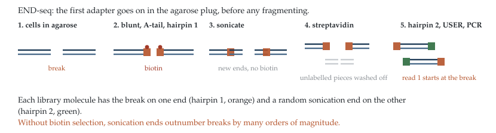{width=92%}

- Cells are embedded in **agarose**, so long DNA is protected while proteins are digested away
- Ends are blunted, A-tailed and ligated to a **biotinylated** hairpin: only true break ends get it
- Then sonicate, capture on streptavidin, ligate a second hairpin to the sonication end and amplify

[Canela et al. 2016, doi:10.1016/j.molcel.2016.06.034]{.small}

## Why the first adapter carries biotin

Count the ends in one diploid human cell, about 6.2 Gb of DNA, sonicated to 200 bp:

- 6.2 × 10^9 / 200 = 3.1 × 10^7 fragments, so **6 × 10^7 sonication ends**
- Suppose a treatment makes 10 breaks per cell: **20 break ends** (an illustrative number)
- Signal to background is about **1 in 3 million**, so without selection nearly every read would come from your own sonication
- With biotin on the first hairpin only, the second adapter (on the sonication end) is useful only on molecules that started at a real break

## END-seq also measures what the cell did to the end

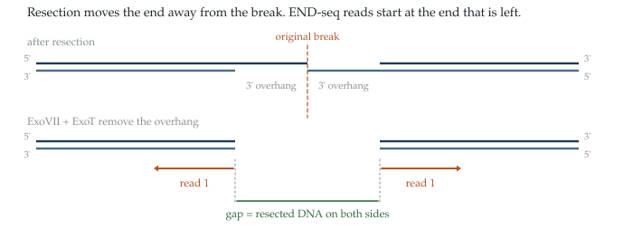{width=78%}

- Repair starts by resecting the 5' strand, leaving 3' single-stranded overhangs
- Exonucleases then trim the overhang, so read 1 begins where the duplex now ends
- At a break whose position is known, the distance from the cut to the read start is the **resection length**, on each side

[Canela et al. 2016, doi:10.1016/j.molcel.2016.06.034]{.small}

## GUIDE-seq: tag the break in living cells

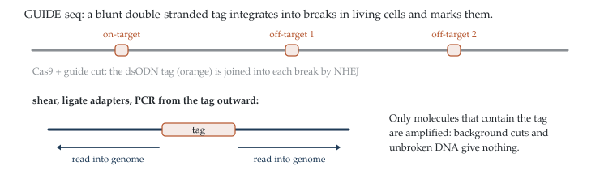{width=92%}

- A blunt, protected double-stranded oligonucleotide is transfected with Cas9; NHEJ joins it into each break
- Fragment, ligate adapters, and PCR from the tag outward: only broken sites are amplified
- Reads begin in the tag and continue into the flanking genome, which locates every cut, including off-target ones. One end known and one unknown is a readout problem in its own right, worked through in [reading screens out](../screens/lec-readout.qmd) ([GUIDE-seq](https://henriksson-lab.github.io/NGS_101/https://henriksson-lab.github.io/NGS_101/guide-seq__10.1038+nbt.3117/guide-seq.html))

[Tsai et al. 2015, doi:10.1038/nbt.3117]{.small}

## Three handles for finding where a nuclease cuts

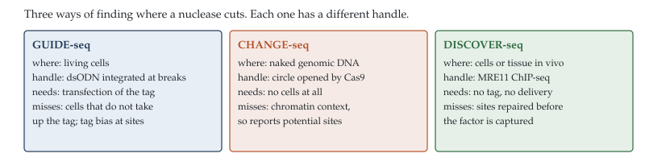{width=92%}

- **[CHANGE-seq](https://henriksson-lab.github.io/NGS_101/https://henriksson-lab.github.io/NGS_101/change-seq__10.1038+s41587-020-0555-7/change-seq.html):** tagment purified DNA, close it into circles, let Cas9 open them; only cut molecules get adapters
- **[DISCOVER-seq](https://henriksson-lab.github.io/NGS_101/https://henriksson-lab.github.io/NGS_101/discover-seq__10.1126+science.aav9023/discover-seq.html):** ChIP-seq of MRE11, a repair factor that gathers at breaks; no tag needed, so it works in tissue
- In vitro methods find more sites than any cell will cut; cell-based methods find the ones that matter

[Lazzarotto et al. 2020, doi:10.1038/s41587-020-0555-7; Wienert et al. 2019, doi:10.1126/science.aav9023]{.small}

## Repair outcomes: read across the cut

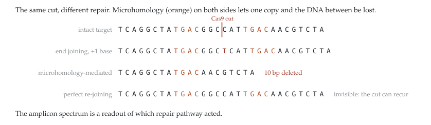{width=92%}

- Amplify a few hundred bases around the cut and sequence the amplicon: each read is one repair event
- Typical products: a one-base insertion (NHEJ), a deletion between short repeats (microhomology-mediated end joining), or perfect re-joining
- Worked example: the 10 bp deletion removes one copy of TGAC and the 6 bp between; either copy could be the lost one, so the alignment is ambiguous

## Repair-seq: which gene shapes the outcome

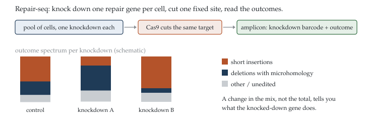{width=85%}

- Knock down one repair-related gene per cell in a [pooled screen](../screens/lec.qmd), cut the same site in all of them, and read the outcome together with the knockdown identity
- The signal is a change in the **mix** of outcomes between knockdowns, so each needs many cells
- A targeted amplicon library with a perturbation barcode: no new chemistry, a new design ([Repair-seq](https://henriksson-lab.github.io/NGS_101/https://henriksson-lab.github.io/NGS_101/repair-seq-crispr-outcomes__10.1016+j.cell.2021.10.002/01_repair-seq-crispr-outcomes.html))

[Hussmann et al. 2021, doi:10.1016/j.cell.2021.10.002]{.small}

## Replication timing: sort by S phase, read the new DNA

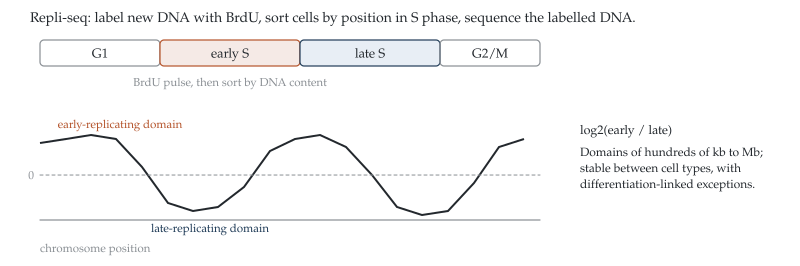{width=87%}

- Pulse cells with BrdU, stain DNA content, and sort **early** and **late** S-phase cells
- Pull down BrdU-labelled DNA from each, sequence, and plot log2(early / late): peaks are early-replicating domains ([E/L Repli-seq](https://henriksson-lab.github.io/NGS_101/https://henriksson-lab.github.io/NGS_101/e-l-repli-seq__10.1038+nprot.2017.148/el-repli-seq.html))
- Early domains tend to be open and gene-rich; late domains silent and lamina-associated

[Marchal et al. 2018, doi:10.1038/nprot.2017.148]{.small}

## The order of steps in E/L Repli-seq

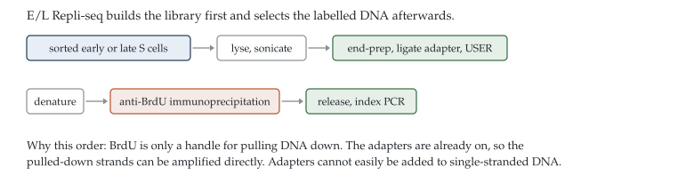{width=92%}

- The library is built **before** the immunoprecipitation, so adapters are already on the labelled DNA
- After denaturation the anti-BrdU antibody pulls out the new strands, which are amplified directly
- BrdU is a handle for selection, not a base read in the sequence

## You can also count copies

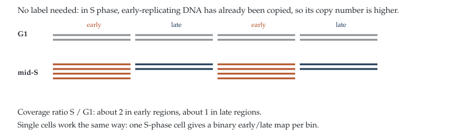{width=92%}

- Without any label, compare coverage between S-phase and G1 cells: early-replicating DNA has already doubled
- The ratio ranges only from 1 to 2, so counting statistics matter more than in a BrdU pull-down, which amplifies the contrast
- One S-phase cell is enough for a binary early or late call per bin: see [scRepli-seq](https://henriksson-lab.github.io/NGS_101/https://henriksson-lab.github.io/NGS_101/screpli-seq__10.1038+s41596-020-0378-5/screpli-seq.html) [Miura et al. 2020, doi:10.1038/s41596-020-0378-5]{.small}

## One table: question, handle, protocol

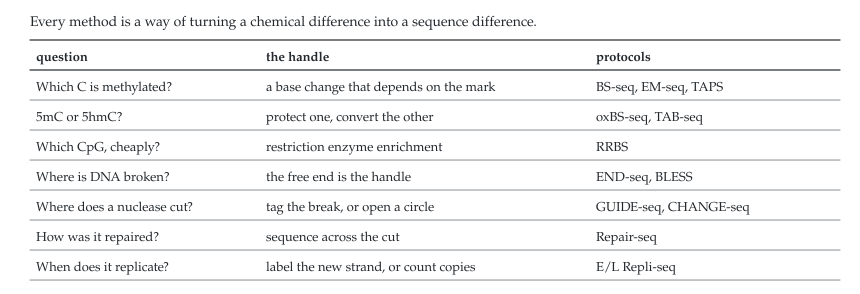{width=82%}

- Ask three questions of any new protocol: what changes in the molecule, what makes the change visible to the polymerase, and which control measures how much of it worked
- [The next deck](lec-rna.qmd) applies the same reasoning to RNA, where the reverse transcriptase is the reporter

## Where this connects

**Blocks this protocol uses**

- [Converting chemistry into sequence](../chemistry-to-sequence/lec.qmd) — the general rule every assay here obeys: a mark must become a base change, an end, or an affinity handle
- [End chemistry](../end-chemistry/lec.qmd) — methylated adapters that survive bisulfite; blunting, A-tailing and the hairpin that goes on a break end first
- [Fragmentation](../fragmentation/lec.qmd) — MspI in RRBS, sonication only *after* the break is tagged; where you cut decides what a read start means
- [Selection](../selection/lec.qmd) — streptavidin on the biotinylated hairpin, anti-BrdU on labelled strands; one break end in three million is found by affinity, never by reading more
- [Amplification](../amplification/lec.qmd) — a converted library is uracil-rich and damaged, so the polymerase and the cycle count are part of the chemistry
- [Transposases and modifying enzymes](../enzymes/lec-transposases.qmd) — TET, glucosyltransferase and APOBEC: the enzymes that let EM-seq and TAPS replace bisulfite

**The same handle elsewhere**

- [Chromatin](../chromatin/lec.qmd) — methyltransferase footprinting writes an accessibility mark and then reads it as a base change, exactly as here

**If this fails**

- [QC](../qc/lec.qmd) — a converted library is low in complexity and easy to over-amplify; the trace says so before the run does
