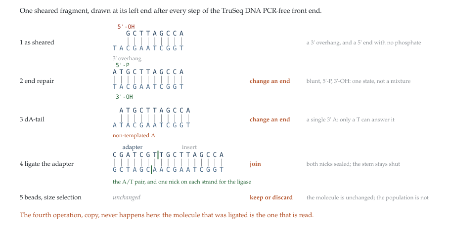
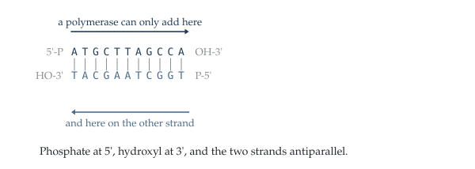
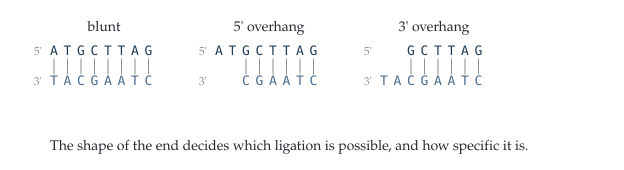
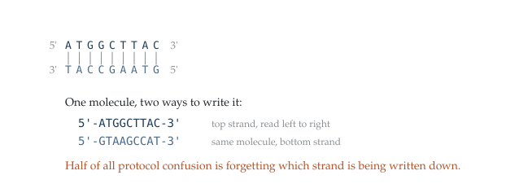
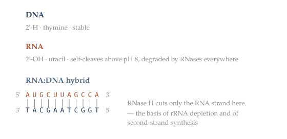
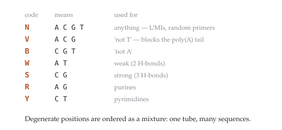

## What this deck is for

A library preparation is a sequence of chemical steps performed on the ends of molecules.

Almost every step in every protocol is one of four **operations**:

- **change an end** — make it into something a chosen enzyme will accept
- **join** — put two molecules together
- **copy** — make more of what you have
- **keep or discard** — throw a subset away

To design any of that, you need to be fluent in what a nucleic-acid molecule *is* as a
physical object — not as a string of letters. The next eleven slides earn that fluency on
one real molecule.

::: {.notes}
The aim is not to re-teach base pairing. It is to install the habit of asking, at every
protocol step: what is the state of the ends now?
:::

## One fragment, carried from ragged ends to a clusterable molecule

{width=56%}

- The thread is the front end of **TruSeq DNA PCR-free**: one sheared piece of human genomic
  DNA, drawn at its left end until it carries an **adapter**, the sequence the sequencer needs
- Each step is one of the four operations, named on the right; the absent one is **copy**
- Steps, not the protocol's five blocks: those run on to the loaded flow cell and are traced
  in [genomic DNA libraries](../genomic-dna/lec.qmd). This deck stays on the molecule

## Change an end: which end can an enzyme even touch?

{width=79%}

- The backbone is asymmetric: a **5'-phosphate** at one end, a **3'-hydroxyl** at the other
- Polymerases only ever add to a **3'-OH**. There is no enzyme that extends a 5' end
- The two strands run antiparallel, so our fragment's left end is 5' on one strand and 3' on
  the other. Step 2 therefore needs two different enzymes, one for each

## What the sheared ends actually are

{width=73%}

- Shearing breaks the backbone wherever it likes, so our fragment arrives carrying a mixture
  of these four states, and only some of them are usable
- A ligase needs a **5'-phosphate** on one side and a **free 3'-OH** on the other, so an end
  left with 5'-OH is invisible to it
- Synthetic oligos, adapters included, arrive **without** a 5'-phosphate unless you pay for
  one — which matters at step 4

## And what shape they are

{width=92%}

- **Blunt**: ligates to anything, inefficiently and unselectively
- **Overhangs**: ligate only to a matching overhang, efficiently and selectively
- Our fragment has all of these at once, each end different. That mixture is the problem end
  repair exists to remove

## A nick is not a gap

{width=61%}

- A **nick** is a broken backbone with every base present: a ligase can seal it
- A **gap** is missing bases: a polymerase must fill it in first, then a ligase seals
- Both ideas appear in our walk: at step 2 a polymerase fills in a recessed 3' end, and at
  step 4 the ligation leaves one nick on each strand for a ligase to seal
- Elsewhere: Tn5 leaves a 9 nt gap ([transposases](../enzymes/lec-transposases.qmd)), and
  **nick translation** walks a nick along a molecule ([enzymes](../enzymes/lec.qmd))

## Step 2, *change an end*: what end repair must produce

{width=88%}

Read every step as a transformation: **which end state goes in, which comes out.** End repair
takes the mixture above and returns one state: blunt, 5'-phosphate, free 3'-OH, on every end
of every fragment in the tube.

Making a chosen end state on purpose — and switching an end off so that only one reaction can
happen — is the whole of [end chemistry](../end-chemistry/lec.qmd).

## Step 3, *change an end*: one A, so that only one T can answer

A blunt end ligates to any other blunt end, which is exactly the problem: our fragments would
join each other, and the adapters would join each other. So the end is changed once more.

- A single non-templated **A** is added to each 3' end, making a one-base 3' overhang
- The adapter is supplied with a matching single **T** overhang, so each can only pair with
  the other
- The A/T pair is not there for strength — one base pair holds nothing. It is there to make
  the ligation **selective**, which is what a one-base overhang buys over a blunt end

How the A gets there, and what else a one-base overhang costs, is
[end chemistry](../end-chemistry/lec.qmd); the family of overhang tricks is
[handles](../handles/lec.qmd).

## Step 4, *join*: what the ligase is given on each strand

{width=74%}

- At the top nick the **adapter** brings the 3'-OH and our **insert** — the unknown piece
  between the adapters — brings the 5'-phosphate that end repair put there
- At the bottom nick it is the other way round, so the adapter has to carry a 5'-phosphate
  of its own, which is why it is ordered with one
- Leave that phosphate off and there is no error and no warning and no product: a missing
  5'-phosphate is the classic silent failure of library prep

[Lehman 1974, *DNA ligase: structure, mechanism, and function*, doi:10.1126/science.186.4166.790]{.small}

## Why the adapter is still a duplex at room temperature

{width=62%}

- **Tm** is a property of a duplex *in a buffer*, not of one oligo on its own
- The adapter is two oligos paired over a 12 bp stem ([the Y
  adapter](../library-molecule/lec.qmd)). A ligase needs a double-stranded end, so if the stem
  opened there would be nothing to join
- It stays shut because the ligation runs at room temperature in a high-salt buffer, and
  salt, length and GC all push Tm up
- Every primer, probe, splint and bait later in the course is this same calculation, made on
  purpose ([selection](../selection/lec.qmd))

[SantaLucia 1998, nearest-neighbour thermodynamics, doi:10.1073/pnas.95.4.1460]{.small}

## Step 5, *keep or discard*: what the beads take out

{width=80%}

- The join step also makes **adapter dimers** — two adapters and no insert, ~120 bp against
  our ~350 bp insert. Short molecules cluster more readily
  ([how a cluster forms](../sequencers/lec.qmd)), so a dimer can take over a run
- The other two panels are the same fault, earlier: an oligo folded into a **hairpin**, or
  two oligos annealed to each other, pair with the wrong partner and do nothing you wanted
- A bead ratio chosen to leave short fragments behind discards the dimers; a sharp low peak
  on a trace is the signature ([QC](../qc/lec.qmd))
- Note what this operation does **not** do: not one molecule is altered, only the mixture is

[Head et al. 2014, *Library construction for NGS: overviews and challenges*, doi:10.2144/000114133]{.small}

## The operation this protocol never performs

**Copy** is the fourth operation, and TruSeq DNA PCR-free does without it. That is the whole
claim in its name, and it has a consequence for the material:

- Every base that reaches the sequencer is a base of the original genome. No polymerase has
  read it, so no polymerase can have mis-read it
- The price is paid at step 4: whatever fails to ligate is gone, because there is no later
  step that makes more of what worked
- What copying would add, and cost, is [amplification](../amplification/lec.qmd)

## The five questions the walk kept asking

Ask these about any molecule at any step of any protocol:

1. Is it single- or double-stranded? DNA, RNA, or a hybrid?
2. What is at the 5' end — phosphate, hydroxyl, cap, something else?
3. What is at the 3' end — hydroxyl, blocked, a tail?
4. What shape is the end — blunt, 5' overhang, 3' overhang?
5. What is it hybridised to, and at what temperature does that stop being true?

Five steps, five questions, one molecule. If you can answer them after every step, you can
read any protocol in the collection.

## Writing the walk's molecule down

{width=81%}

- Convention: sequences are always written **5'→3'** unless stated otherwise
- Every construct in this deck was drawn from the top strand only; the same molecule has two
  equally valid written forms
- When a protocol gives you an oligo — an adapter arm, say — you must work out which strand
  it anneals to before you can see what the step does

## The same five questions, asked of RNA

{width=58%}

The walk was a DNA molecule. Ask question 1 of an RNA one and the answers to the other four
change, because the material is not the same:

- The 2'-OH makes RNA chemically reactive: it self-cleaves at alkaline pH and at high
  temperature
- RNases are everywhere, need no cofactors, and survive autoclaving
- The RNA:DNA hybrid is its own substrate, with its own enzymes

## RNA ends are more varied than DNA ends

{width=78%}

The end a transcript happens to have determines which chemistry can attach anything to it —
a small RNA library is built around nothing else
([small RNA and tag protocols](../rna/lec-small-rna.qmd)).

## Working with RNA

Bench practice that follows directly from the chemistry:

- Keep it **cold** and keep it **acidic to neutral** — alkaline conditions cleave RNA
- Use RNase-free plasticware and filter tips; wear gloves and change them
- Add an **RNase inhibitor** to enzymatic reactions, but remember it is a protein and dies
  when heated
- **DNase** treatment of an RNA prep is usually necessary; genomic DNA otherwise shows up as
  intronic and intergenic reads
- Keep a sample for QC: RNA integrity is worth measuring before you commit it to a library

## Reference: degenerate positions

{width=61%}

The last three slides are reference, not part of the argument: they are what you will look up
when you come to order an oligo of your own.

- `N` means the synthesiser used all four bases at that position: one tube, many molecules
- This is how **UMIs** and **random hexamers** are made; how long a random stretch has to be,
  and where it may sit, is [barcodes and UMIs](../barcodes-umis/lec.qmd)
- `VN` anchors an oligo-dT primer at the start of the poly(A) tail

[UMIs: Kivioja et al. 2012, doi:10.1038/nmeth.1778]{.small}

## Reference: an oligo is more than its sequence

{width=89%}

What you specify when ordering decides which enzymes can act on it — the phosphate the
adapter needed at step 4 is one entry on this list. A lipid anchor is the odd one: it binds
nothing in the reaction, it inserts the oligo into a cell membrane, so a barcode can be put
onto a cell without touching its genome ([hashing](../barcodes-umis/lec.qmd)). An acrydite
group is the same idea applied to a gel: it copolymerises into polyacrylamide, so the oligo
becomes part of a [bead](../compartments/lec.qmd) rather than something dissolved beside it.

## Reference: ordering oligos in practice

- **Scale** (25 nmol, 100 nmol…) — how much you get; almost always more than you need
- **Purification** — desalted is fine for ordinary primers; HPLC or PAGE when every molecule
  must be full length, which matters for long adapters and for anything carrying a barcode
- **Modifications** cost extra and some combinations cannot be synthesised together
- **Truncation products** are the hidden problem: synthesis is ~99% efficient per base, so a
  60-mer is only ~55% full length before purification

This is why adapters are often ordered as two shorter oligos and annealed, rather than as one
long one.

## Where this connects

**Read these next**

- [How sequencers read DNA](../sequencers/lec.qmd) — what the finished molecule must look like
- [Anatomy of a library molecule](../library-molecule/lec.qmd) — P5, index, primer sites, insert

**Who finishes the walk**

- [Fragmentation](../fragmentation/lec.qmd) — step 1, and where ragged, damaged ends come from
- [End chemistry](../end-chemistry/lec.qmd) — steps 2 and 3, and end states used as a design tool
- [Attaching a handle](../handles/lec.qmd) — step 4, ligation as one of five ways to join a
  known sequence to an unknown one
- [Genomic DNA libraries](../genomic-dna/lec.qmd) — the same protocol, all five blocks, to the
  loaded flow cell

**Where this vocabulary is used**

- [The enzyme toolbox](../enzymes/lec.qmd) — the enzymes that perform the four operations
- [Amplification](../amplification/lec.qmd) — the operation this walk skipped
- [Design patterns](../design/lec.qmd) — the five questions become a ledger kept step by step

Reference while you work: [NGS 101](https://henriksson-lab.github.io/NGS_101/) draws every
protocol base by base, with the end states at every step.
