## You cannot see a library

A library is a few microlitres of clear liquid. Whether it is good is decided by three questions, each answered by a different measurement:

1. **How much, and how many molecules?** Qubit, qPCR
2. **What size, and what else is in there?** fragment analyser trace
3. **Does it do what you think?** a test run, PhiX, demultiplexing

This unit covers how to clean up, how to measure, how to pool and load, and how to read a trace. It ends with three habits that save samples: double-sided selection, diagnostic qPCR, and analytical aliquots.

::: {.notes}
The calculations are done by hand. Do them at least once with a pencil before trusting a spreadsheet.
:::

## Four ways to clean up

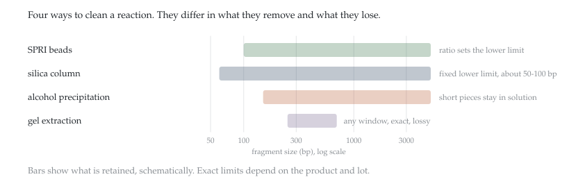{width=88%}

- Every step ends with a clean-up: it removes enzyme, salt, free adapter or primer
- Beads are the default because they scale, need no spin and can select a size: the same beads set the insert size in [fragmentation](../fragmentation/lec.qmd), and are used here to clean up
- Columns are fixed and simple; gels are exact but lose most of the sample

## SPRI beads

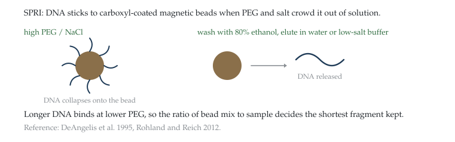{width=90%}

- Paramagnetic beads coated with carboxyl groups, in PEG and salt: PEG crowds the DNA out of solution onto the bead — the same crowding that speeds a ligation ([PEG crowding](../tricks/lec.qmd)) [DeAngelis et al. 1995, doi:10.1093/nar/23.22.4742]{.small}
- Wash with ethanol (which keeps DNA stuck), dry briefly, elute in low-salt buffer
- Over-drying cracks the bead pellet and DNA elutes poorly

## The ratio sets the cut-off

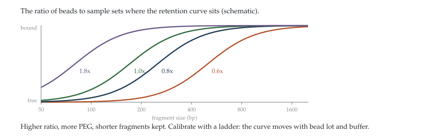{width=85%}

- Ratio = volume of bead suspension to volume of sample
- More beads means more PEG, which pulls shorter fragments onto the beads
- The cut-off is a curve, not a step: fragments near it are partly lost [Rohland and Reich 2012, doi:10.1101/gr.128124.111]{.small}

## Worked: choose a bead volume

100 µL sample, you want to remove everything shorter than about 150 bp.

- Read the curve: about 1.0× keeps fragments above roughly 150 bp, so add **100 µL** of beads
- To also remove fragments below about 250 bp, use 0.8×: **80 µL** of beads
- Calculate from the final sample volume: if you add water to raise a small sample to 50 µL, the ratio refers to the 50 µL
- The cut-off values above come from the schematic curve, not a rule: check them against a ladder

Bead lots differ. Run a ladder through your own bead lot once and write the cut-offs on the tube rack.

## Double-sided selection

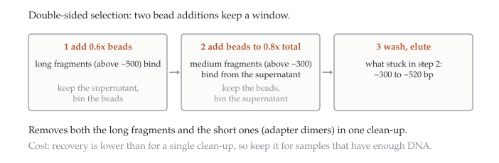{width=86%}

- First addition removes the long fragments; second addition captures the window
- Worked: 100 µL sample. Add 60 µL (0.6×), keep the 160 µL supernatant, add 20 µL more beads (total 80 µL, 0.8× of the **original** volume), keep the beads
- Used before sequencing to tighten insert size and drop adapter dimers [Meyer and Kircher 2010, doi:10.1101/pdb.prot5448]{.small}

## Columns, precipitation, gels

**Silica columns:** DNA binds to silica in a chaotropic salt (one that strips the ordered water around the DNA, such as guanidinium) and ethanol, is washed, then eluted. Fast, but a fixed lower limit (about 50–100 bp, product-dependent) and the elution volume is not small.

**Alcohol precipitation:** salt plus ethanol or isopropanol, spin hard. Short pieces and low concentrations are lost, so add a carrier (glycogen, linear acrylamide) for small samples ([carrier nucleic acid](../tricks/lec-more.qmd)).

**Gel extraction:** the only way to pick any window precisely, and to separate similar sizes. It loses much of the DNA and adds an agarose or dye contaminant, so use it where size accuracy matters.

Choose by what must be removed, what size you want to keep, and how little DNA you have.

## Three measurements

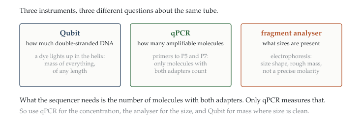{width=83%}

- None of them replaces the others
- The sequencer needs a count of molecules with both adapters, and only qPCR delivers that
- A fragment analyser tells you whether the sample is the right shape, not how much of it there is

## Absorbance and Qubit

**NanoDrop (absorbance at 260 nm):** counts every nucleic acid and free nucleotide, and is blind below a few ng/µL. Use it for stock DNA, not libraries.

**Qubit (fluorescent dye):** the dye fluoresces when it binds double-stranded DNA, so it measures **mass** of dsDNA, with good sensitivity to about 0.1 ng/µL.

It counts any double-stranded DNA of any length: adapter dimers, fragments without adapters, one-sided products. For a library, it is a rough upper bound on what you could load.

## qPCR: count what can amplify

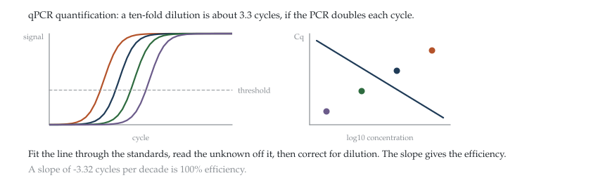{width=91%}

- Primers to P5 and P7 amplify only molecules that have both ends, which are the ones that cluster ([the anatomy of that molecule](../library-molecule/lec.qmd)) [Buehler et al. 2010, doi:10.1016/j.ymeth.2010.01.004]{.small}
- Run a dilution series of a standard of known concentration; read your sample off its line
- **Cq** is the cycle at which a sample's signal crosses the detection threshold: the more amplifiable molecules you started with, the earlier it is crossed
- A tenfold dilution should shift Cq by about 3.3 cycles; a different slope means the PCR is not 100% efficient

## Why Qubit and qPCR disagree

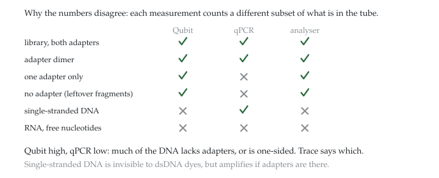{width=69%}

- A library with a high Qubit value and a low qPCR value is mostly unusable DNA
- Over-amplified libraries are the opposite trap: Qubit looks fine, qPCR undercounts because heteroduplex products do not prime (see traces below)

## Worked: ng/µL to nM

A double-stranded base pair weighs about 660 g/mol, so a library of mean length L bp weighs 660 × L g/mol.

$$ \mathrm{nM} = \frac{c\,[\mathrm{ng/\mu L}] \times 10^{6}}{660 \times L\,[\mathrm{bp}]} $$

Carry the units once. 1 ng/µL is 10^-3 g/L. Divide by 660 × L g/mol to get mol/L, and multiply by 10^9 to get nM: the two powers of ten give the 10^6.

**Example.** 2.0 ng/µL, mean length 450 bp: 2.0 × 10^6 / (660 × 450) = 2.0 × 10^6 / 297,000 = **6.7 nM**.

## Which length to use

Use the length of the whole molecule: the insert **plus both adapters**. For full-length adapters that is about 120 bp more than the insert (check your kit).

**Example.** 4.0 ng/µL, 300 bp insert: L = 420, so 4.0 × 10^6 / (660 × 420) = **14.4 nM**.

- Take the average size of the library region from the trace, not the position of the tallest point
- Leave out an adapter-dimer peak if you will remove it, and include it if you will not
- Qubit mass with a trace length gives an estimate; qPCR gives the molecules directly

## Pooling to equal molarity

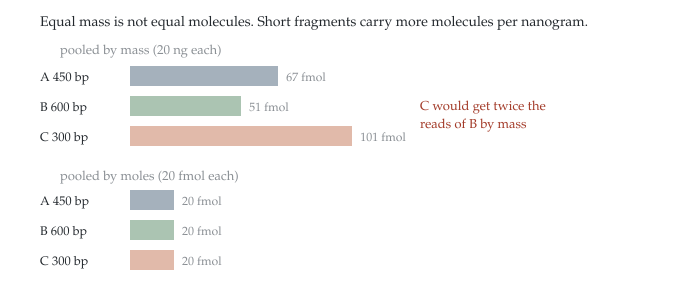{width=67%}

- Same mass does not mean same molecules: a 300 bp library has twice the molecules of a 600 bp library per nanogram
- Pool by **moles**, so that every sample gets the reads you intended
- If samples need different depths, weigh the moles by the target depth

## Worked: a three-library pool

| Library | ng/µL | bp | nM |
|---|---|---|---|
| A | 3.0 | 450 | 3.0×10^6 / 297,000 = 10.1 |
| B | 8.0 | 600 | 8.0×10^6 / 396,000 = 20.2 |
| C | 1.5 | 300 | 1.5×10^6 / 198,000 = 7.6 |

1 nM is 1 fmol/µL. For 20 fmol of each: A 20/10.1 = **2.0 µL**, B 20/20.2 = **1.0 µL**, C 20/7.6 = **2.6 µL**. The pool holds 60 fmol in 5.6 µL: 10.7 nM.

Pipetting below about 2 µL is inaccurate: dilute B first (for example 1 in 4) and take 4 µL.

## Denature and load

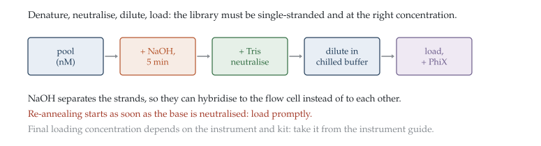{width=92%}

- Worked dilution: to make 20 µL of 2 nM from the 10.7 nM pool, take 2 × 20 / 10.7 = **3.7 µL** and add 16.3 µL of buffer
- The loading concentration is instrument and kit specific: use the number in the instrument guide; patterned flow cells and non-patterned ones differ
- Too little library wastes the run; too much merges clusters on non-patterned flow cells

## PhiX

PhiX is a small phage genome with balanced base composition, sold by the instrument maker.

- It adds **diversity** to a low-diversity library (amplicons, CRISPR guides), so the first cycles are readable ([colour balance in a barcode set](../barcodes-umis/lec.qmd); [guide libraries](../screens/lec-readout.qmd))
- It serves as a **control**: its reads give an error rate and a phasing estimate that do not depend on your library
- Typical spike: about 1% for diverse libraries, and more (often 5% or higher, up to tens of percent) for low diversity; take the figure from the instrument guide

PhiX reads are discarded at demultiplexing. Check the fraction that aligns to PhiX: if it is far from what you added, the quantification of your library was off.

## A clean trace

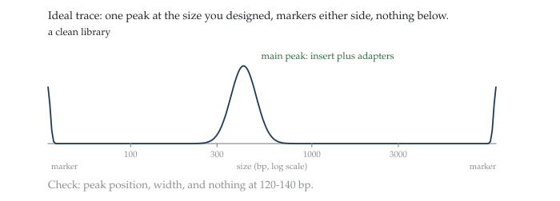{width=78%}

- Two markers fix the size scale; the library should be one peak between them
- The peak should sit where your design predicts: insert plus adapters
- Width tells you the size distribution: a narrow peak means the shearing or size selection worked

## Adapter dimers

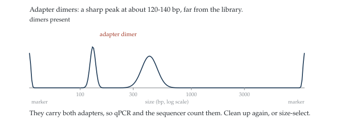{width=80%}

- A narrow peak at about 120-140 bp: adapters ligated with no insert
- They clustered better than your library, so even a minor peak takes a large share of reads [Head et al. 2014, doi:10.2144/000114133]{.small}
- Fix: a further clean-up at 0.8-0.9×, or a gel; prevent next time by less adapter or more input ([matching adapter to insert](../handles/lec.qmd)) or by ends that cannot join ([end chemistry](../end-chemistry/lec.qmd))

## Over-amplification

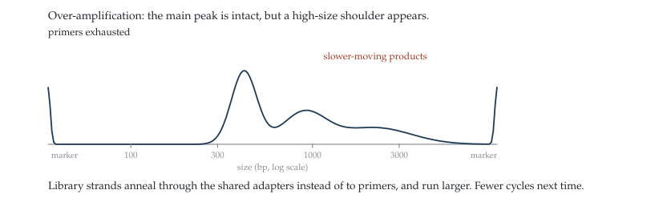{width=92%}

- A high-size shoulder or second hump after the main peak
- Primers ran out, so the library strands annealed through the shared adapter regions and ran as larger, partly single-stranded products
- Consequences: PCR duplicates, skewed GC bias, and low qPCR counts [Aird et al. 2011, doi:10.1186/gb-2011-12-2-r18]{.small}; amplification without PCR avoids it [Kozarewa et al. 2009, doi:10.1038/nmeth.1311]{.small}
- Fix: fewer cycles; or two cycles in fresh primer mix to convert the heteroduplexes ([cycles, bias and duplicates](../amplification/lec.qmd))

## Other traces

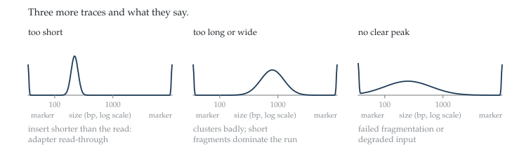{width=89%}

- **Too short:** insert shorter than the read, so reads run through the insert into the adapter
- **Too long or wide:** the short end clusters better and dominates the data
- **No peak:** fragmentation failed or the input was degraded: stop here

## Trick 1: diagnostic qPCR

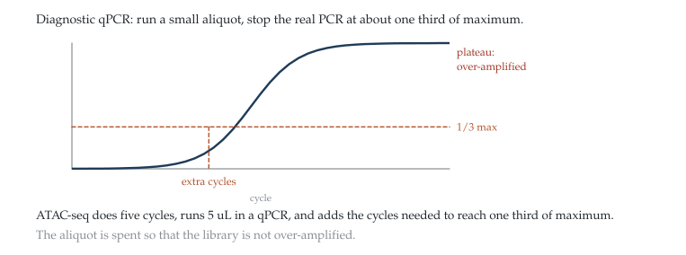{width=76%}

- **Problem:** the right PCR cycle number depends on the input, which you do not know
- **Trick:** pre-amplify a few cycles, take a small aliquot into a qPCR with a dye, and stop the main PCR at about one third of maximum signal
- ATAC-seq does exactly this [ATAC-seq](https://henriksson-lab.github.io/NGS_101/atac-seq__10.1038+nmeth.2688/atac-seq.html) [Buenrostro et al. 2013, doi:10.1038/nmeth.2688]{.small}; see also [Omni-ATAC](https://henriksson-lab.github.io/NGS_101/omni-atac__10.1038+nmeth.4396/omni-atac.html) and the [assay it belongs to](../chromatin/lec.qmd)

## Trick 2: analytical aliquots

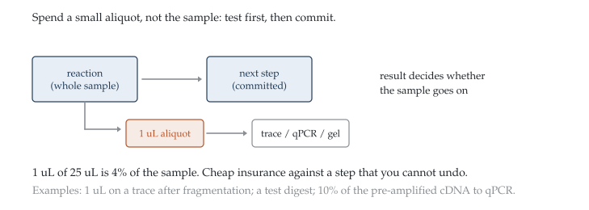{width=79%}

- Spend 1 µL to learn what you would otherwise learn at the sequencer
- Examples: a trace after fragmentation; a test digest; a quarter of the pre-amplified product into qPCR
- Write the decision rule before you run the test: what size, what Cq, makes you stop?

## Where to look

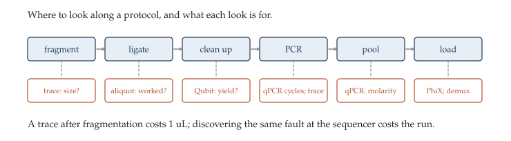{width=92%}

- A short list of checkpoints is enough. The question is not how many, but what you would do with the answer
- Each check should be one that can make you stop, repeat a step, or change an amount

## Summary

| Question | Tool |
|---|---|
| Remove short or long fragments | SPRI ratio; double-sided selection |
| How much DNA by mass | Qubit |
| How many clusterable molecules | qPCR |
| What size, what contaminants | fragment analyser trace |
| ng/µL to nM | c × 10^6 / (660 × L) |
| Equal reads per sample | pool by moles |
| Diverse first cycles, error control | PhiX |
| Right PCR cycles | diagnostic qPCR on an aliquot |

## Where this connects

**Why the number came out wrong**

- [Nucleic acids](../nucleic-acids/lec.qmd) — Tm and end states: why adapters dimerise at all
- [Selection](../selection/lec.qmd) — a capture or depletion step changes the trace you should expect

**What QC cannot see until the run**

- [How sequencers read DNA](../sequencers/lec.qmd) — index hopping: reads in a sample you did not load
- [Other platforms](../sequencers/lec-platforms.qmd) — what each instrument asks of a finished library

**The same arithmetic elsewhere**

- [Genomic DNA](../genomic-dna/lec.qmd) — checking a library against the molecules you started with
- [Long reads](../long-reads/lec.qmd) — count molecules, not mass, with very different cut-offs

**Then**

- [Design patterns and failure modes](../design/lec.qmd) — each signature here, with the control that proves the cause
