## Small RNA is a different problem

A 22 nt microRNA has no tail to prime from, and is too short to fragment. Two things follow:

- **Handles must be put on by ligation**, because the RNA is shorter than most primers — of [the five ways](../handles/lec.qmd), only one is left
- **Ends decide everything.** Whether an RNA enters the library depends on its 5' and 3' chemistry, not its sequence

The same logic covers the ribosome footprints of Ribo-seq — the piece of mRNA a ribosome shields from nuclease, with its own slide later in this deck — at about 28 nt, and tRNA fragments, snoRNAs and piRNAs.

This deck first covers the tricks for short RNAs: ligation order, dimer suppression and circularisation. It then covers tag and full-length protocols, which solve a different problem: seeing very little RNA, or seeing a whole transcript.

## The ends decide

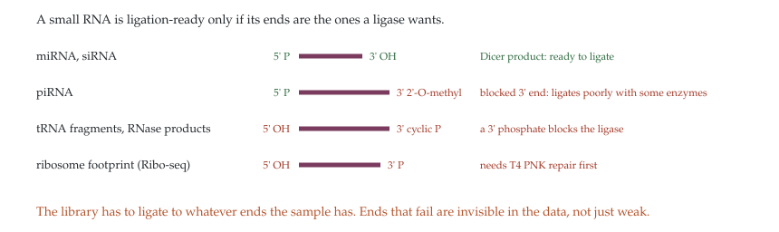{width=94%}

- An RNA with a [blocked end](../end-chemistry/lec.qmd) is not weakly represented; it is absent

## Step 1: the 3' adapter, pre-adenylated

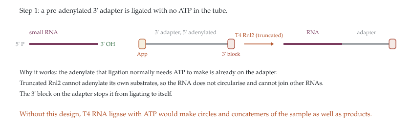{width=93%}

- No ATP means the [ligase](../enzymes/lec-ligases.qmd) can only use the adapter that already carries the adenylate

[Hafner et al. 2008, doi:10.1016/j.ymeth.2007.09.009]{.small}

## Step 2: the 5' adapter

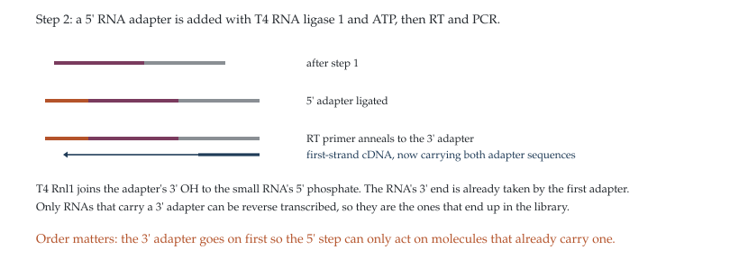{width=80%}

- Two ligations in a fixed order, then one RT and PCR: only molecules that took both adapters amplify

[Hafner et al. 2008, doi:10.1016/j.ymeth.2007.09.009]{.small}

## Adapter dimers

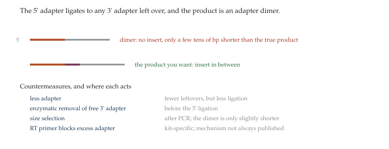{width=73%}

- A dimer is almost as long as a real product, so it competes for clusters and resists size selection ([what to do](../tricks/lec.qmd))

## Choosing the size window

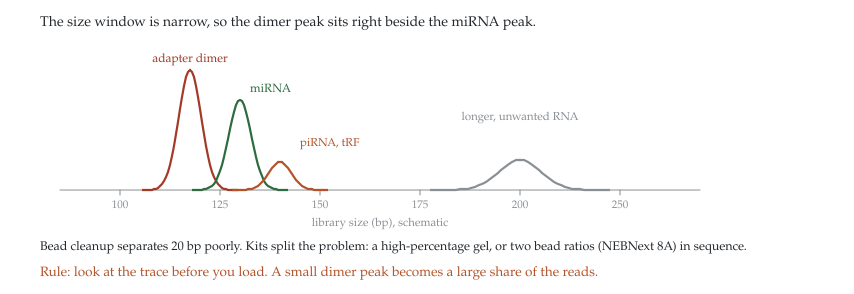{width=82%}

- Choose the window from the biology: miRNA only, or miRNA with piRNA and tRNA fragments

## Ligation bias

The library you get is not the RNA you had.

- Each ligase prefers certain end sequences and structures, so the counts for two microRNAs can differ several-fold for reasons unrelated to how many there were
- Fixed adapters with the same ends join RNAs unequally. **Degenerate bases at the ligation junction** of the adapters, and **PEG crowding**, reduce this
- Kits advertised as low-bias have done both. A bias that is the same in every sample does not break a comparison between samples, but it makes absolute abundance meaningless

[Jayaprakash et al. 2011, doi:10.1093/nar/gkr693]{.small}

Ask of any small-RNA count: compared with what? Within a miRNA across conditions is safe; between two miRNAs it is not.

## NEBNext low-bias small RNA

The [NEBNext Low-bias Small RNA](https://henriksson-lab.github.io/NGS_101/nebnext-low-bias-small-rna/nebnext-low-bias-small-rna.html) kit follows this scheme with the following choices:

- RNA with a 5' phosphate and 3' hydroxyl, up to about 120 nt, is eligible
- 3' adapter ligation, then an enzyme that removes excess adapter before the second ligation; the manual does not give the mechanism in full
- RT creates the first strand; PCR adds dual indexes
- A short-insert purification branch uses two bead ratios in sequence to keep the small product and discard larger products
- A single 56-base read is typically enough

Compare with the generic scheme on the previous slides, and ask which of its steps the kit has replaced.

## Ribo-seq: sequence what a ribosome covers

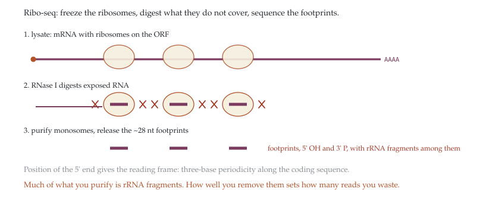{width=68%}

- A footprint of about 28 nt tells you where the ribosome was and in which frame

[Ingolia et al. 2009, doi:10.1126/science.1168978]{.small}

## From footprint to library

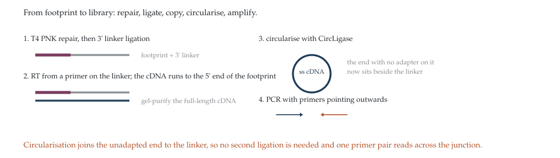{width=95%}

- The footprint has the wrong ends for ligation and no tail; the library repairs one and circularises past the other

[Ingolia et al. 2012, doi:10.1038/nprot.2012.086]{.small}

## Counting, or reading the whole transcript

The remaining protocols answer a different question. For expression you need to count molecules; for isoforms you need the structure.

- A **tag protocol** reads one end only. All the reads for a gene land in one place, so each cell needs very few reads and barcodes can go into the first primer
- A **full-length protocol** spreads reads along the whole transcript. You see exons, junctions and variants, and you pay in reads and in the lack of early barcoding
- Both start from small amounts of RNA, so both must add a known sequence to the cDNA without a ligation. **Template switching** is the step that does this

The full-length protocol followed through here is **SMART-seq2**: the next three slides build its molecule, and the ones after that are variations on it.

## Template switching

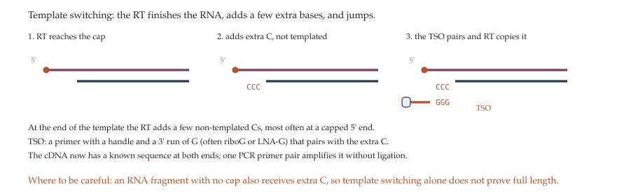{width=92%}

- The extra Cs are added by [the RT itself](../enzymes/lec.qmd); a primer ending in G pairs with them, and the RT copies the primer
- This is the second reaction in SMART-seq2, and it happens in the same tube as the first

[Zhu et al. 2001, doi:10.2144/01304pf02]{.small}

## Designing the TSO

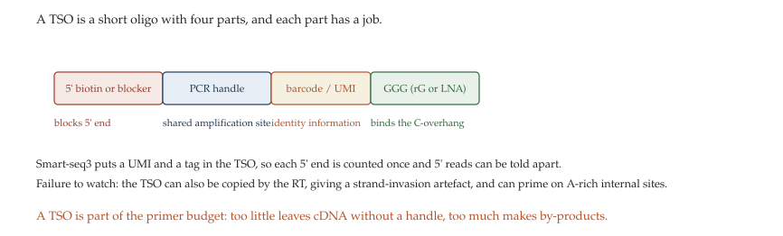{width=93%}

- Each of the four parts has a failure that you can recognise in the data
- SMART-seq2 fills the handle and the GGG and leaves the barcode slot empty; Smart-seq3 uses that slot, which is where its UMIs come from

[Hagemann-Jensen et al. 2020, doi:10.1038/s41587-020-0497-0]{.small}

## SMART-seq2, followed to the end

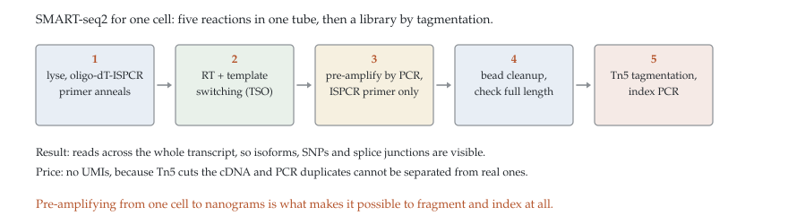{width=95%}

- [SMART-seq2](https://henriksson-lab.github.io/NGS_101/smart-seq2__10.1038+nmeth.2639/smart-seq2.html) reads the whole transcript, at the cost of one tube per cell and no early barcodes
- Steps 1 and 2 are the two previous slides; steps 3 to 5 are an ordinary tagmentation library made from the cDNA those two produced. Everything after this slide is a variation on one of the five

[Picelli et al. 2013, doi:10.1038/nmeth.2639]{.small}

## Linear amplification by IVT

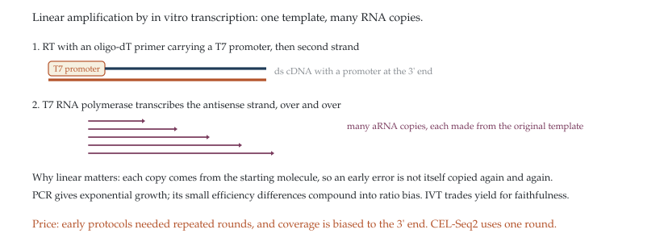{width=77%}

- Pooling cells before the [IVT](../amplification/lec.qmd) step is what lets one reaction serve many cells

[Eberwine et al. 1992, doi:10.1073/pnas.89.7.3010]{.small}

## Three constructs, one idea

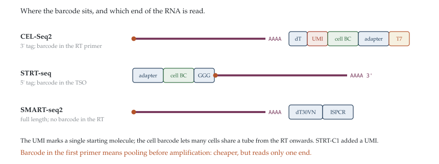{width=75%}

- [CEL-Seq2](https://henriksson-lab.github.io/NGS_101/cel-seq2__10.1186+s13059-016-0938-8/cel-seq2.html) is a 3' tag with IVT, [STRT-seq](https://henriksson-lab.github.io/NGS_101/strt-seq__10.1101+gr.110882.110/strt-seq.html) a 5' tag from template switching

[Hashimshony et al. 2016, doi:10.1186/s13059-016-0938-8; Islam et al. 2011, doi:10.1101/gr.110882.110]{.small}

## Where the reads land

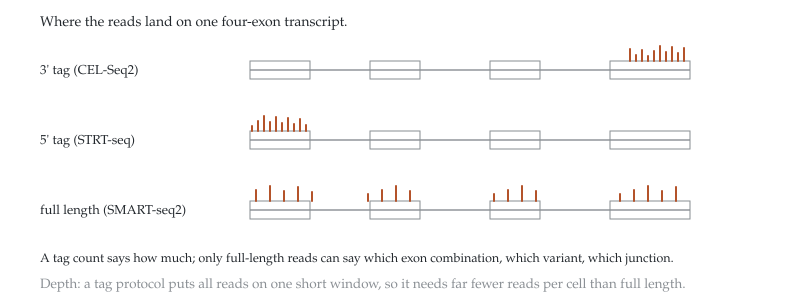{width=74%}

- Tag reads can quantify a gene; only full-length reads can tell which exons were used

## When there is very little RNA

A single cell holds only picograms of RNA, and every step now loses a visible fraction. SMART-seq2 makes the first three choices below; the fourth is where Smart-seq3 differs:

- **Keep the reaction in one tube.** Lyse, RT and template switch without a cleanup, because each bead step loses material
- **Amplify before you split.** PCR to nanograms first, then fragment and index
- **Count cycles.** Extra cycles add duplicates and the bias of the early cycles, so use the fewest that give enough library
- **Add a UMI** where the question is counting; the TSO can carry it, as in Smart-seq3
- **Know the background.** A tube with no cell gives a library too, so a no-input control is part of the design

[Picelli et al. 2013, doi:10.1038/nmeth.2639; Hagemann-Jensen et al. 2020, doi:10.1038/s41587-020-0497-0]{.small}

## Tn5 on RNA:DNA hybrids

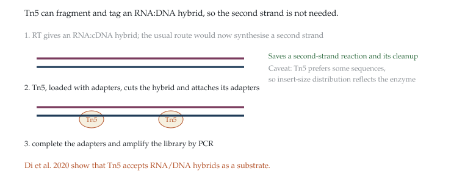{width=75%}

- Skipping second-strand synthesis shortens the workflow, and it can be done because the transposase accepts the hybrid
- SMART-seq2 tagments double-stranded cDNA after the pre-amplification; here the same enzyme cuts before any second strand exists

[Di et al. 2020, doi:10.1073/pnas.1919800117]{.small}

## Cap trapping

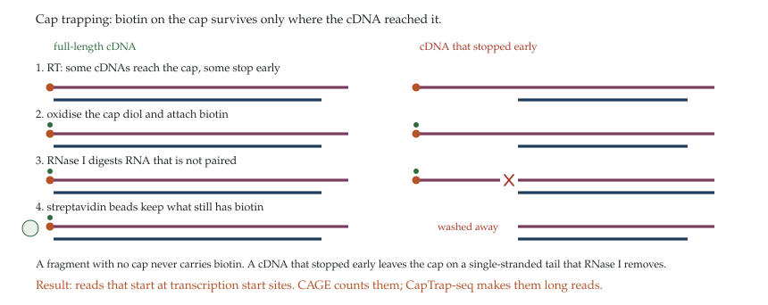{width=71%}

- Selecting through the cap takes only RNAs that were copied all the way, so reads start where transcription starts

[Carninci et al. 1996, doi:10.1006/geno.1996.0567; Takahashi et al. 2012, doi:10.1038/nprot.2012.005]{.small}

## Choosing a route

| Question | Route | Collection example |
|---|---|---|
| microRNAs, tRNA fragments | two ligations, size select | [NEBNext Low-bias Small RNA](https://henriksson-lab.github.io/NGS_101/nebnext-low-bias-small-rna/nebnext-low-bias-small-rna.html) |
| Translation, codon by codon | footprint, repair, circularise | [Ribo-seq](https://henriksson-lab.github.io/NGS_101/ribo-seq__10.1126+science.1168978/ribo-seq.html) |
| Counts from many cells | 3' tag with barcode in the RT | CEL-Seq2 |
| Where transcription starts | 5' tag or cap selection | STRT-seq, [CAGE](https://henriksson-lab.github.io/NGS_101/cage__10.1038+nprot.2012.005/cage.html) |
| Isoforms from few cells | full length by template switching | SMART-seq2 |

## What to take with you

- Every RNA library is a decision about **which end to put a handle on**, and how
- Ligation works on small RNAs if the ends are right, the order is right and the dimers are controlled
- Template switching is the way to give a cDNA a second handle without a second ligation, and **SMART-seq2** is that idea run from one cell to a finished library
- Tag against full length is a decision about counting against structure
- The [exercises](exercise.qmd) ask you to make these choices for a given sample

## Where this connects

**Blocks this protocol uses** — pick by the ends, ligate both adapters, size-select, reverse transcribe, amplify

- [End chemistry](../end-chemistry/lec.qmd) — 5'-P and 3'-OH decide which RNAs can enter the library at all
- [Ligases and kinases](../enzymes/lec-ligases.qmd) — pre-adenylated donors, splints, and circularising a footprint
- [Handles](../handles/lec.qmd) — RNA ligation and template switching, two of the five ways, compared side by side
- [Fragmentation and size control](../fragmentation/lec.qmd) — the bead ratios and the gel that keep a 22 nt insert
- [Amplification](../amplification/lec.qmd) — IVT as linear amplification, and the cycle count at picogram input
- [Barcodes and UMIs](../barcodes-umis/lec.qmd) — why the UMI goes in the TSO or RT primer and never in the PCR

**Also drawn on here**

- [Selection](../selection/lec.qmd) — the gradient that keeps ribosome-bound RNA; selection as a ratio, not a switch
- [Compartments](../compartments/lec.qmd) — the plate well that makes CEL-Seq2 and STRT one reaction per cell
