## Start from the question

An RNA library is built around what you want to know. The same cell gives different libraries for different questions:

- **How much of each gene?** Count molecules, either at the 3' end or across the gene
- **Which isoform, which variant?** You need reads that cover the whole transcript, or the whole transcript in one read
- **Which strand?** Needed wherever genes overlap or antisense transcription matters
- **Which class of RNA?** Small RNAs, nascent RNA and translated RNA each need a different handle

This deck covers the first of these for bulk mRNA and total RNA, and follows one protocol through: **TruSeq Stranded mRNA**. The [next deck](lec-small-rna.qmd) covers small RNA and tag protocols, and follows **SMART-seq2** through for full-length cDNA from very little RNA.

## Know your RNA

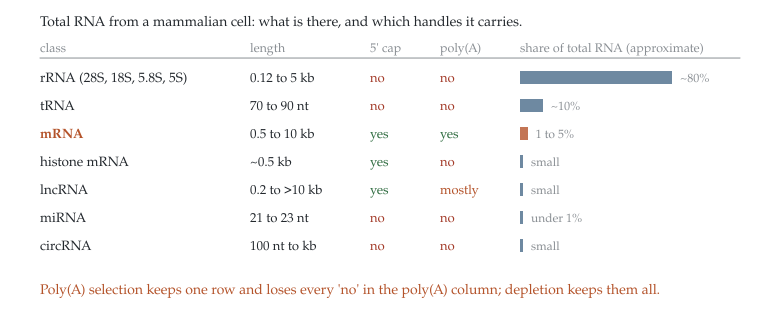{width=69%}

- The ends are your handles: a cap and a poly(A) tail for selection, a 5' phosphate and 3' hydroxyl for ligation

## What poly(A) selection keeps, and what it loses

Oligo-dT beads hold the 3' tail of mature mRNA. That is selective, cheap and clean, and it has a price:

- **Kept:** polyadenylated mRNA, and polyadenylated lncRNA
- **Lost:** histone mRNA, circRNA, many non-polyadenylated lncRNAs, and everything small
- **Lost by degradation:** an RNA that has been cut loses its tail, and the 5' piece is washed away with the rRNA
- **Needs intact RNA.** Fixed, archival or degraded samples are better served by depletion

The question is whether the RNA class you need has a tail.

## Four ways to remove rRNA

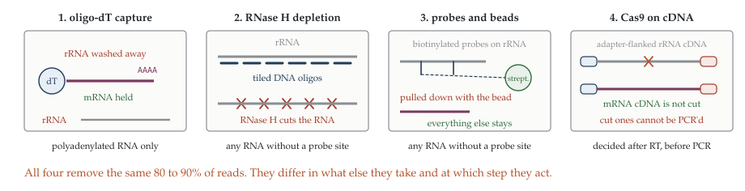{width=95%}

- Positive selection and three kinds of depletion ([the four families](../selection/lec.qmd)); depletion keeps non-polyadenylated RNA

[Morlan et al. 2012, doi:10.1371/journal.pone.0042882]{.small}

## RNase H depletion

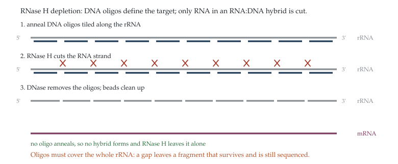{width=68%}

- The oligo set is the product: a probe set for human rRNA must tile all of it, and one designed for another species will not do. [RNase H](../enzymes/lec-nucleases.qmd) cuts only the RNA of an RNA:DNA hybrid

[Morlan et al. 2012, doi:10.1371/journal.pone.0042882]{.small}

## Cas9 on cDNA

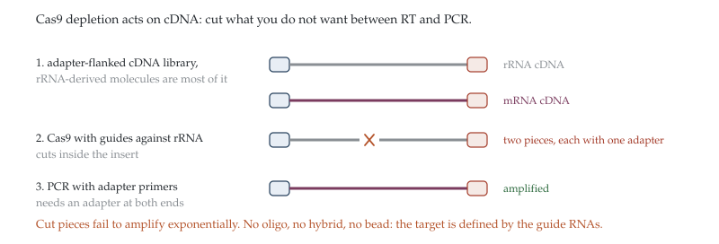{width=95%}

- A guide RNA per target site replaces a bead step; the same idea has been used to remove other abundant cDNAs

[Gu et al. 2016, doi:10.1186/s13059-016-0904-5]{.small}

## Choosing between selection and depletion

| Sample | Choose | Why |
|---|---|---|
| Fresh, intact RNA, mRNA is the question | poly(A) selection | cheapest, lowest rRNA, deepest per read |
| Degraded or fixed RNA (FFPE) | rRNA depletion | tails are lost, so selection loses the 5' piece |
| Need non-polyadenylated RNA | rRNA depletion | histone mRNA, many lncRNAs, nascent RNA |
| Very low input | neither; amplify from the tail or from a TSO, as SMART-seq2 does | each bead step loses material |

Depletion costs more reads per transcript because the intronic and pre-mRNA fraction is higher.

[Adiconis et al. 2013, doi:10.1038/nmeth.2483]{.small}

## Degraded RNA and 3' bias

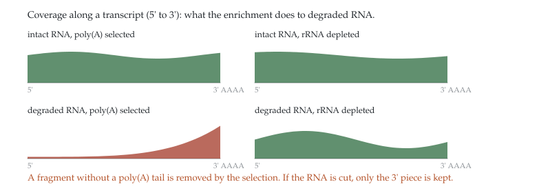{width=79%}

- Poly(A) selection of cut RNA keeps only the 3' piece, so the coverage tilts towards the 3' end

[Adiconis et al. 2013, doi:10.1038/nmeth.2483]{.small}

## Priming the first strand

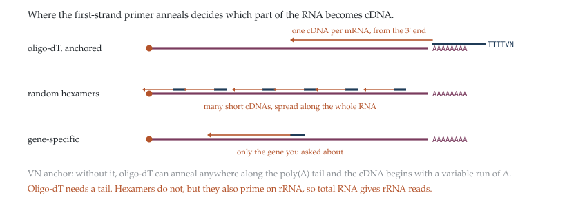{width=79%}

- Choose the primer by what you want covered: the 3' end, the whole body, or one gene. The primer is also where a tail can [carry a handle](../handles/lec.qmd)

## What the primer costs you

- **Anchored oligo-dT (VN).** The V and N pin the primer at the junction between tail and transcript. Without them the primer slips along the tail
- **Random hexamers.** Even coverage, no tail needed, but the first bases of every read are not random: hexamers anneal preferentially to some sequences [Hansen et al. 2010, doi:10.1093/nar/gkq224]{.small}
- **Antisense artefacts.** [Reverse transcriptase](../enzymes/lec.qmd) can also copy DNA. Actinomycin D in the first-strand mix blocks DNA-templated extension, which would otherwise make a spurious second strand [Perocchi et al. 2007, doi:10.1093/nar/gkm683]{.small}

A strand-specific library depends on an RT that copies only RNA, so this chemistry is part of the design, not a detail.

## Second strand

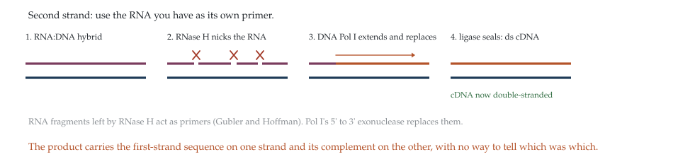{width=95%}

- The RNA is its own primer: RNase H nicks it and DNA polymerase I replaces each piece

## Why strand matters

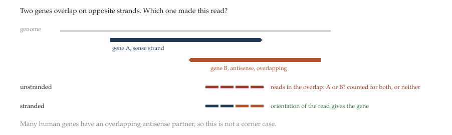{width=94%}

- A standard double-stranded library loses the information in orientation, so overlapping genes and antisense transcripts cannot be told apart

[Levin et al. 2010, doi:10.1038/nmeth.1491]{.small}

## The dUTP trick

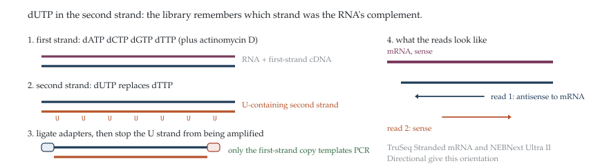{width=95%}

- Replace dTTP with dUTP in the second strand only; the marked strand is then not amplified

[Parkhomchuk et al. 2009, doi:10.1093/nar/gkp596]{.small}

## Two ways to silence the U-marked strand

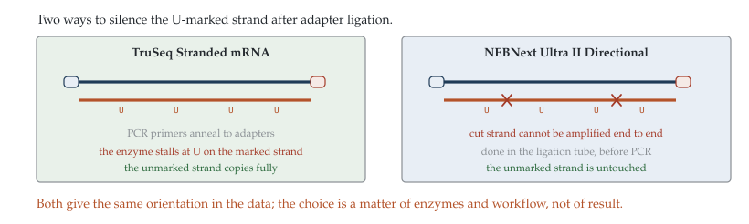{width=94%}

- The same idea implemented with a polymerase that stalls at dU, or with USER enzyme

[Source: Illumina and NEB reference guides; links on the next slides]{.small}

## TruSeq Stranded mRNA, followed to the end

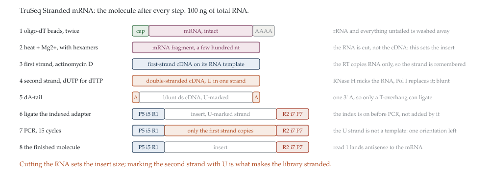{width=93%}

- Every slide so far is one row of this walk; [TruSeq Stranded mRNA](https://henriksson-lab.github.io/NGS_101/truseq-stranded-mrna/truseq-stranded-mrna.html) is the protocol, and in it the order is the logic
- **Fragmenting the RNA rather than the cDNA** is what gives the insert size, because RNA breaks at random positions under heat and metal ions — [where you cut changes the answer](../fragmentation/lec.qmd)

## NEBNext Ultra II Directional: what differs

| | TruSeq Stranded mRNA | NEBNext Ultra II Directional |
|---|---|---|
| Entry | poly(A) beads | poly(A) beads or rRNA depletion, as separate modules |
| Fragmentation | RNA, with priming | RNA, 94 °C with random primers |
| Strand mark | dUTP, second strand | dUTP in the second-strand mix |
| Silencing | polymerase stalls at dU | USER enzyme acts in the ligation tube |
| Adapter | indexed adapter ligated | hairpin adapter opened by USER |
| PCR | 15 cycles in the guide's example | 6 to 13, set by input |

Read the [NEBNext Ultra II Directional](https://henriksson-lab.github.io/NGS_101/nebnext-ultra-ii-directional-rna/nebnext-ultra-ii-directional-rna.html) page and ask why a [hairpin adapter](../end-chemistry/lec.qmd) lets USER do two jobs in one tube. How the USER step acts exactly is not fully published, so check it against the vendor's manual.

## What to look at in the data

- **Strandedness:** the fraction of reads on the expected strand should be very high; a low value means **row 7** did not silence the U strand, or the RT in **row 3** copied DNA
- **rRNA fraction:** a poly(A) library should have very little; a high value says the beads in **row 1** did not hold
- **3' bias:** coverage tilted towards the 3' end says the RNA was already cut before **row 1**, so only its tailed piece was kept
- **Intronic fraction:** higher after depletion, since pre-mRNA is retained — a different entry into **row 1**

Every one of these is a row of the walk failing. That is what following one protocol to the end buys you.

## Where this goes next

- **Small RNA, tag protocols, low input and full length** are in the [next deck](lec-small-rna.qmd): it shares the ideas here, adds ligation chemistry for short RNAs and linear amplification, and runs **SMART-seq2** through as this deck ran TruSeq
- Try the [exercises](exercise.qmd) on choosing a route for a given sample
- The [readings](readings.qmd) cover the primary papers for every protocol named here

## Where this connects

**Blocks this protocol uses** — select the RNA, cut it, copy it, mark the strand, add adapters, amplify

- [Selection](../selection/lec.qmd) — oligo-dT, RNase H and Cas9 depletion are three of its families, applied to rRNA
- [Fragmentation](../fragmentation/lec.qmd) — heat and metal ions cut RNA, and cutting before the RT is what sets the insert
- [Polymerases and RTs](../enzymes/lec.qmd) — an RT that copies RNA but not DNA, and a polymerase that stalls at dU
- [Handles](../handles/lec.qmd) — the RT primer, the tailed primer and the ligated adapter as alternatives
- [End chemistry](../end-chemistry/lec.qmd) — blunt ends from second-strand synthesis, dA-tailing, USER on a hairpin
- [Amplification](../amplification/lec.qmd) — the cycle count, and why the dU-marked strand never becomes a template
- [Barcodes](../barcodes-umis/lec.qmd) — index design, and why the index sits in the adapter that is ligated before PCR

**If this fails**

- [Cleanup and QC](../qc/lec.qmd) — the trace of a library made from degraded RNA, and the adapter dimers below it
