## The experiment is over; what is left in the tube?

After selection the information is **which guides are still there, and how many**. It is stored in the genomic DNA of the surviving cells, one integrated copy per cell.

The readout has to:

- pick out a ~100 bp feature from 6 Gb of human DNA
- keep the **proportions** between members intact
- end up as a library a sequencer can read

## Finding the needle

{width=78%}

- Hence 100 µg of DNA per sample, spread over many PCR reactions
- Starting from fewer cells loses members before PCR starts: no PCR can recover them

[Moffat protocol page](https://henriksson-lab.github.io/NGS_101/moffat-two-step-crispr-screen-readout/moffat-two-step-crispr-screen-readout.html){.small}

## Both ends known, or one

{width=77%}

- Guides, barcodes, variants: flanking sequence is constant, so two primers work
- Integration sites, tagged breaks, transposon insertions: one flank is unknown
- The first half of this deck is the first case, the second half is the second

## Joung: the whole library in one PCR

{width=90%}

- Forward primers carry P5 and bind the U6 promoter, reverse primers carry P7, an index and the scaffold
- Both bind constant vector sequence, so vector geometry (cPPT position) does not matter
- 80 cycles of Read 1 and 8 of the index read

[Joung et al. 2017, doi:10.1038/nprot.2017.016; protocol page](https://henriksson-lab.github.io/NGS_101/joung-one-pcr-crispr-screen-readout__10.1038+nprot.2017.016/joung-one-pcr-crispr-screen-readout.html){.small}

## Staggered primers: diversity from the PCR

{width=85%}

- Every amplicon starts with the same U6 sequence, the low-diversity failure from the [sequencer deck](../sequencers/lec.qmd)
- Ten forward primers with different spacers shift the start, so the early cycles look like random sequence
- The alternative is a large PhiX spike-in, which costs reads

## Moffat: enrich first, index second

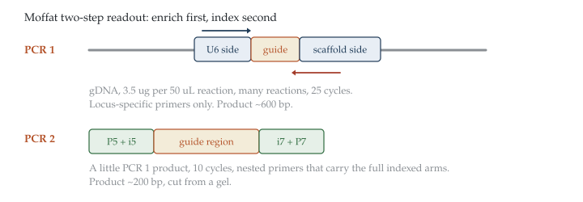{width=79%}

- PCR 1 uses plain primers on large amounts of DNA; PCR 2 adds indexes to a small aliquot of the product
- Splitting the jobs keeps the expensive, long, indexed primers away from 100 µg of gDNA
- A gel cut removes primer dimers before sequencing

[Moffat Lab Pooled CRISPR Screen Protocol v2; protocol page](https://henriksson-lab.github.io/NGS_101/moffat-two-step-crispr-screen-readout/moffat-two-step-crispr-screen-readout.html){.small}

## One PCR or two: why the protocols differ

| | Joung | Moffat |
|---|---|---|
| Steps | one PCR, ~12 cycles | 25 cycles, then 10 |
| Index | in the reverse primer | added in PCR 2 |
| Indexing | single | dual |
| Diversity | staggered primers | dark cycles and run design |
| Cost | fewer reagents and handling | more flexible, more handling |

Neither is wrong. The question is what you want to avoid: extra cycles, or long primers in a big reaction.

## Dark cycles

{width=80%}

- The Moffat run starts with 21 cycles that are not imaged, stepping past a stretch that is the same for every molecule
- The read then begins at the guide

## What does PCR do to the counts?

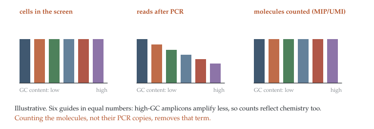{width=79%}

- Amplification efficiency depends on sequence, so counts reflect chemistry and not only cells
- GC content and oversampling bias were reported in pooled CRISPR screens by the CRISPR-MIP preprint
- Cut down cycles, replicate PCRs, and where it matters, avoid PCR before counting

[Selinger et al. 2024, doi:10.1101/2024.03.28.587082 (preprint)]{.small}

## Molecular inversion probes

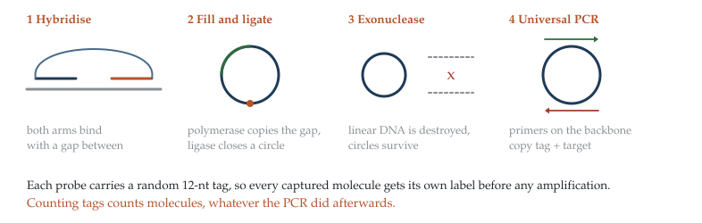{width=86%}

- A probe with a random tag is closed into a circle by polymerase and ligase around the captured target ([targeted sequencing](../targeted/lec.qmd) uses the same probe to enrich a panel)
- Exonuclease removes everything linear, so the background is destroyed rather than diluted
- The tag is attached to a molecule *before* PCR

[Hiatt et al. 2013, doi:10.1101/gr.147686.112; protocol page](https://henriksson-lab.github.io/NGS_101/smmip__10.1101+gr.147686.112/smmip.html){.small}

## UMIs give absolute counts

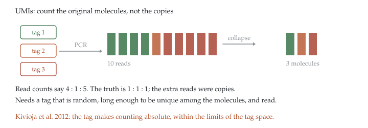{width=79%}

- Reads sharing a tag are one original molecule, so counting tags counts molecules
- The tag space must be much larger than the number of molecules of one kind
- Also needs enough sequencing: every molecule must be seen at least once

[Kivioja et al. 2012, doi:10.1038/nmeth.1778]{.small}

## CROP-seq: the guide inside the transcriptome

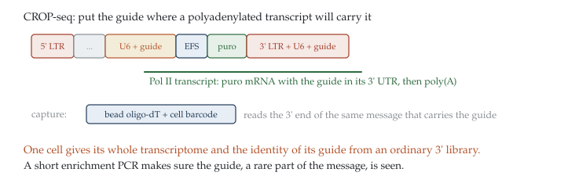{width=84%}

- The LTR duplication from the first deck puts the guide into a transcript that ends in poly(A)
- An ordinary 3' [single-cell library](../single-cell/lec-combinatorial.qmd) then returns the cell's RNA and its guide together
- Guide-bearing reads are rare, so a targeted enrichment PCR is added

[Datlinger et al. 2017, doi:10.1038/nmeth.4177; protocol page](https://henriksson-lab.github.io/NGS_101/crop-seq__10.1038+nmeth.4177/crop-seq.html){.small}

## Perturb-seq: proxy or direct

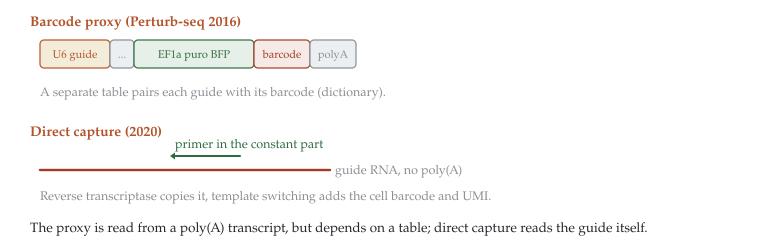{width=84%}

- The original design read a polyadenylated barcode and translated it to a guide through a table
- Direct capture copies the guide RNA itself in the reverse transcription of a 10x 5' library
- The proxy is exposed to the swapping problem from the first deck ([a trap: two RNAs in one virion](lec.qmd)), where reverse transcriptase jumps between the two viral genomes in one particle and carries a barcode over to the wrong guide; direct capture is not. That is a different event from the TSO [template switching](../handles/lec.qmd) used to build libraries

[Dixit et al. 2016, doi:10.1016/j.cell.2016.11.038; the case against the proxy: Hill et al. 2018, doi:10.1038/nmeth.4604; Replogle et al. 2020, doi:10.1038/s41587-020-0470-y]{.small}

## Insertion sites: inverse PCR

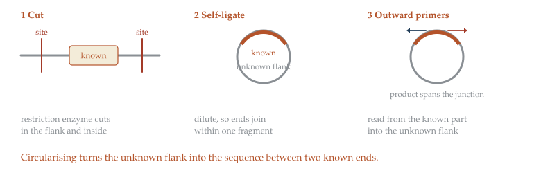{width=85%}

- Cut the genome with an enzyme, dilute, and ligate: each fragment closes into a circle
- Primers that point *outward* from the known provirus end now read across the junction into the host DNA
- The principle is general; here it maps lentiviral integrations

[Ochman et al. 1988, doi:10.1093/genetics/120.3.621; protocol page](https://henriksson-lab.github.io/NGS_101/inverse-pcr__10.1093+genetics+120.3.621/inverse_pcr.html){.small}

## Splinkerette: an adapter that suppresses background

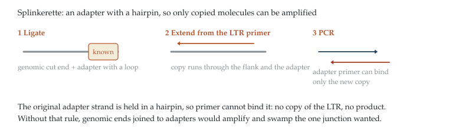{width=92%}

- Ligate a hairpin adapter to the cut ends; extend from the known end through the flank into the adapter
- The adapter primer finds a site only on this *copy*, so ends that carry just adapter do not amplify
- Described for transposon insertions in fly; the logic applies to any one-end-known problem

[Potter and Luo 2010, doi:10.1371/journal.pone.0010168; protocol page](https://henriksson-lab.github.io/NGS_101/splinkerette-pcr__10.1371+journal.pone.0010168/splinkerette.html){.small}

## GUIDE-seq: a tag at the break

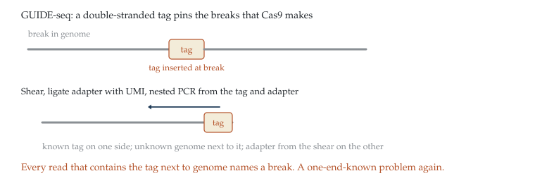{width=80%}

- A short double-stranded oligo integrates where Cas9 cut. Its sequence is known; the genome beside it is not. [Break mapping](../modifications/lec.qmd) treats the same protocol from the other side, as a way of finding damage
- Shear, ligate an adapter with a random 8-nt index, and amplify with nested primers from the tag
- Every read with tag and genome is an off-target site, and the index counts independent molecules

[Tsai et al. 2015, doi:10.1038/nbt.3117; protocol page](https://henriksson-lab.github.io/NGS_101/guide-seq__10.1038+nbt.3117/guide-seq.html){.small}

## Mapping, counting, and the limits

- Reads begin at the known end and run into host DNA; the host part is mapped to the genome
- Where shearing, not enzyme cutting, is used, the shear point differs between molecules and can be used to judge clone size. It is a rough measure
- Integration site mapping needs a mappable flank: repeats and short flanks are lost
- Three anchors for the unknown side: **circularise** (inverse PCR), **ligate an adapter** (splinkerette, GUIDE-seq), **add one by [tagmentation](../enzymes/lec-transposases.qmd)**

## MPRA: tag each candidate

{width=80%}

- Thousands of oligos, each a candidate regulatory sequence, are linked to a short tag
- The ratio of RNA tags to DNA tags measures activity
- Several tags per candidate average away position effects

[Melnikov et al. 2012, doi:10.1038/nbt.2137; protocol page](https://henriksson-lab.github.io/NGS_101/mpra__10.1038+nbt.2137/mpra.html){.small}

## STARR-seq: the fragment is its own tag

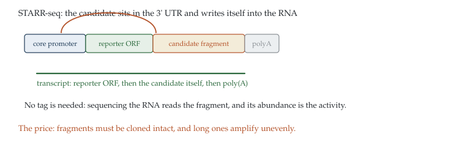{width=90%}

- Place a candidate in the 3' UTR of a reporter: if it is an enhancer, it boosts its own transcription
- Sequencing the reporter RNA reads the fragment directly, and no tag is needed
- Introduced with fly cells and random genomic fragments; the design is a general plasmid screen

[Arnold et al. 2013, doi:10.1126/science.1232542; protocol page](https://henriksson-lab.github.io/NGS_101/starr-seq__10.1126+science.1232542/starr-seq.html){.small}

## Deep mutational scanning

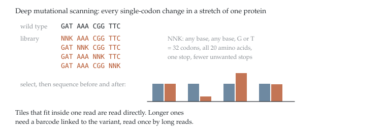{width=79%}

- Synthesise every codon change in a region, express the library, select, and sequence before and after
- The enrichment of each variant measures its effect. The readout is the variant itself, so tiles must be short or barcoded
- Saturation genome editing applies the idea to the endogenous gene in human cells

[Fowler et al. 2010, doi:10.1038/nmeth.1492; Findlay et al. 2018, doi:10.1038/s41586-018-0461-z]{.small}

## Lineage recording

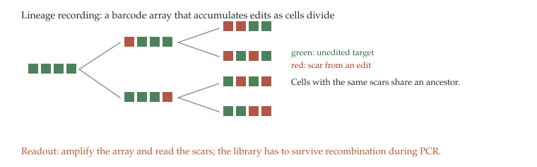{width=88%}

- Cas9 writes scars into an engineered array each time it cuts; descendants inherit the scars of their ancestors
- Reading the array in each cell gives a tree, so the readout is an amplicon where sequence differences carry the information
- Demonstrated in human cells and in mouse embryos

[Perli et al. 2016, doi:10.1126/science.aag0511; Chan et al. 2019, doi:10.1038/s41586-019-1184-5]{.small}

## Which readout, and why

| Question | Readout | Block that matters |
|---|---|---|
| Guide counts, bulk | one-PCR or two-step | constant flanks, diversity, index |
| Absolute numbers | MIP + UMI | tag before amplification |
| Guide + transcriptome | CROP-seq, Perturb-seq | guide in a poly(A) or captured RNA |
| Where it integrated | inverse PCR, splinkerette | anchor the unknown side |
| Where Cas9 cut | GUIDE-seq | tag at the break |
| Activity of sequence | MPRA, STARR-seq | tag or self-transcription |
| Effect of a mutation | DMS | variant read directly |

## When counts look wrong

- Skewed counts also in the plasmid pool: the library was uneven before the screen
- A few guides with huge counts: **PCR jackpotting**, where one template happens to be copied in the first cycles and its lead is then amplified with everything else, or too few cells carried through
- Reads for the wrong guide with the right barcode: reverse transcriptase switching between the two genomes in a virion
- Unexpected index pairs: index hopping, so use unique dual indexes
- Many reads, few distinct integration sites: not enough input DNA

## What to remember

- Reading a screen is amplifying a ~100 bp feature out of the human genome **without distorting proportions**
- One flank unknown means an anchoring trick: circularise, ligate an adapter, or tag
- Tags attached before amplification (UMIs, MIPs) count molecules, not copies
- Every readout in the collection is one of these, tuned to what you most want to avoid

## Where this connects

**Blocks this protocol uses**

- [Amplification](../amplification/lec.qmd) — nested and anchored PCR, inverse PCR and the splinkerette are all taught there as blocks; this deck is what they are for, and what extra cycles do to a count
- [Selection](../selection/lec.qmd) — an exonuclease destroying everything linear around a closed MIP is selection by *end structure*, not by sequence; suppression PCR is the same idea in a primer
- [Barcodes and UMIs](../barcodes-umis/lec.qmd) — a tag attached before amplification counts molecules; staggered primers buy base diversity; unique dual indexes stop hopping between samples
- [Attaching a handle](../handles/lec.qmd) — when one flank is unknown you must put a handle there: circularise, ligate, or tag. The five ways are the whole menu
- [End chemistry](../end-chemistry/lec.qmd) — the splinkerette hairpin and blocked 3' ends are how a one-sided ligation is forced to stay one-sided
- [Fragmentation](../fragmentation/lec.qmd) — shearing before adapter ligation is also what makes the shear point usable as a crude clone-size label

**Before this**

- [Building the library](lec.qmd) — the pool, the vector geometry and the cell numbers that decide what can still be counted here

**If this fails**

- [QC](../qc/lec.qmd) — the gel cut before sequencing, the dimer trace, and pooling many indexed amplicon libraries to equal molarity
