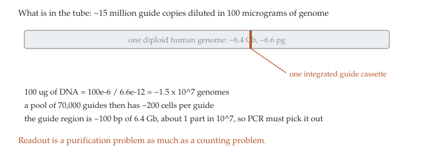
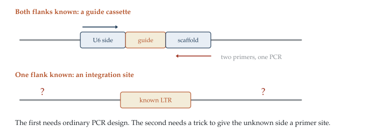
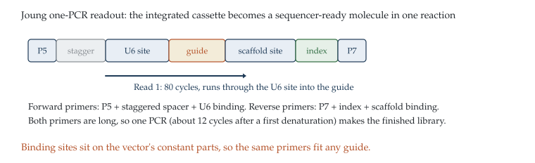
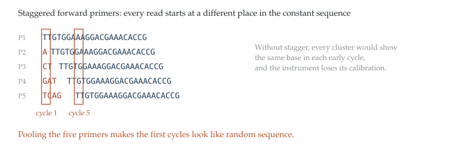
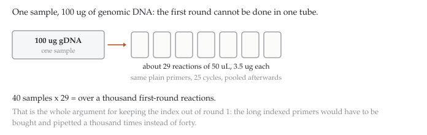
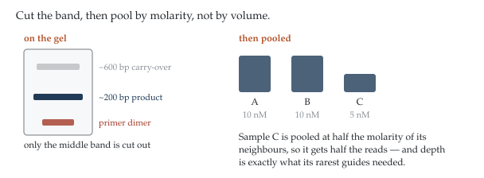
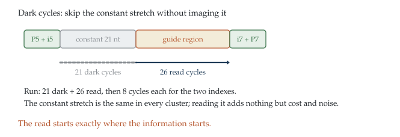
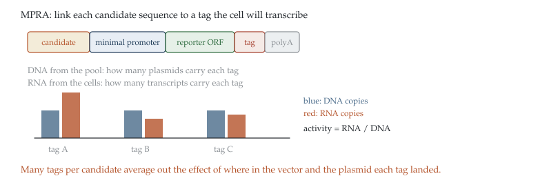

## The experiment is over; what is left in the tube?

After selection the information is **which guides are still there, and how many**. It is stored in the genomic DNA of the surviving cells, one integrated copy per cell.

The readout has to:

- pick out a ~100 bp feature from 6 Gb of human DNA
- keep the **proportions** between members intact
- end up as a library a sequencer can read

## Finding the needle

{width=78%}

- Hence 100 µg of DNA per sample, spread over many PCR reactions
- Starting from fewer cells loses members before PCR starts: no PCR can recover them

[Moffat protocol page](https://henriksson-lab.github.io/NGS_101/moffat-two-step-crispr-screen-readout/moffat-two-step-crispr-screen-readout.html){.small}

## Both ends known, or one

{width=77%}

- Guides, barcodes, variants: flanking sequence is constant, so two primers work
- Integration sites, tagged breaks, transposon insertions: one flank is unknown
- This deck follows the first case through one named protocol from tube to counts, then takes the second

## Joung: the whole library in one PCR

{width=90%}

- Forward primers carry P5 and bind the U6 promoter, reverse primers carry P7, an index and the scaffold
- Both bind constant vector sequence, so vector geometry (cPPT position) does not matter
- 80 cycles of Read 1 and 8 of the index read

[Joung et al. 2017, doi:10.1038/nprot.2017.016; protocol page](https://henriksson-lab.github.io/NGS_101/joung-one-pcr-crispr-screen-readout__10.1038+nprot.2017.016/joung-one-pcr-crispr-screen-readout.html){.small}

## Staggered primers: diversity from the PCR

{width=85%}

- Every amplicon starts with the same U6 sequence, the low-diversity failure from the [sequencer deck](../sequencers/lec.qmd)
- Ten forward primers with different spacers shift the start, so the early cycles look like random sequence
- The alternative is a large PhiX spike-in, which costs reads

## Moffat, step 1: 100 µg, split across reactions

{width=60%}

- A 50 µL reaction takes about 3.5 µg of genomic DNA, so one sample of 100 µg is roughly **29 reactions**
- All of them run the same plain locus-specific primers for 25 cycles, and are pooled afterwards
- A screen with 40 samples is then over a thousand first-round reactions. That number is the reason the indexes are kept out of this step

[Moffat Lab Pooled CRISPR Screen Protocol v2; protocol page](https://henriksson-lab.github.io/NGS_101/moffat-two-step-crispr-screen-readout/moffat-two-step-crispr-screen-readout.html){.small}

## Moffat, step 2: PCR 1 enriches

{width=74%}

- Both primers sit in constant vector sequence either side of the guide, so every member gives the same ~600 bp product
- Twenty-five cycles on that much template is what turns a feature that was one part in 10^7 into the main thing in the tube
- The samples are still separate tubes; nothing yet distinguishes them

## Moffat, step 3: PCR 2 adds the indexes

- A small **aliquot** of the pooled first-round product is the template, so the long indexed primers are bought and handled once per sample instead of 29 times
- Nested primers carry P5, P7 and a **unique dual index** pair; ten cycles; the product is ~200 bp
- The indexes are what make the samples separable again, and unique dual pairs are what stops [hopping](../barcodes-umis/lec.qmd) moving reads between them

## Moffat, step 4: gel cut, then pooled to equal molarity

{width=58%}

- The ~200 bp band is cut from a gel. That removes primer dimers, which would otherwise cluster well and cost reads, and any first-round product carried over
- Each indexed library is then quantified and the samples are mixed to **equal molarity**
- A sample pooled at half the molarity of its neighbours gets half the reads, and depth is exactly what the rare guides in it need ([QC](../qc/lec.qmd))

## Moffat, step 5: the run reads the guide and nothing else

{width=76%}

- The first 21 cycles are not imaged: they step past a stretch that is identical in every cluster
- The read then begins at the guide, 26 cycles, followed by 8 cycles for each index
- This library has no base diversity of its own at the start, and dark cycles are how this protocol pays for that rather than with staggered primers

## Moffat, step 6: reading the counts off the trace

{width=70%}

- Efficiency depends on sequence, so a high-GC guide comes back low: a count carries the chemistry of both PCRs as well as the number of cells
- **Jackpotting**: a template copied early in PCR 1 keeps that lead through the 35 cycles of the two rounds and returns as one guide with an enormous count. Splitting the sample over 29 reactions is part of the defence
- Skew that was already in the plasmid pool is no PCR effect at all, which is why that pool is sequenced first
- Counting molecules rather than their copies removes the PCR term: a UMI, or a [MIP](../targeted/lec.qmd) tag, both taught as [blocks](../barcodes-umis/lec.qmd) elsewhere

[Selinger et al. 2024, doi:10.1101/2024.03.28.587082 (preprint)]{.small}

## One PCR or two: why the protocols differ

| | Joung | Moffat |
|---|---|---|
| Steps | one PCR, ~12 cycles | 25 cycles, then 10 |
| Index | in the reverse primer | added in PCR 2 |
| Indexing | single | dual |
| Diversity | staggered primers | dark cycles and run design |
| Cost | fewer reagents and handling | more flexible, more handling |

Neither is wrong. The question is what you want to avoid: extra cycles, or long primers in a big reaction.

## CROP-seq: the guide inside the transcriptome

{width=84%}

- The LTR duplication from the first deck puts the guide into a transcript that ends in poly(A)
- An ordinary 3' [single-cell library](../single-cell/lec-combinatorial.qmd) then returns the cell's RNA and its guide together
- Guide-bearing reads are rare, so a targeted enrichment PCR is added

[Datlinger et al. 2017, doi:10.1038/nmeth.4177; protocol page](https://henriksson-lab.github.io/NGS_101/crop-seq__10.1038+nmeth.4177/crop-seq.html){.small}

## Perturb-seq: proxy or direct

{width=84%}

- The original design read a polyadenylated barcode and translated it to a guide through a table
- Direct capture copies the guide RNA itself in the reverse transcription of a 10x 5' library
- The proxy is exposed to the swapping problem from the first deck ([a trap: two RNAs in one virion](lec.qmd)), where reverse transcriptase jumps between the two viral genomes in one particle and carries a barcode over to the wrong guide; direct capture is not. That is a different event from the TSO [template switching](../handles/lec.qmd) used to build libraries

[Dixit et al. 2016, doi:10.1016/j.cell.2016.11.038; the case against the proxy: Hill et al. 2018, doi:10.1038/nmeth.4604; Replogle et al. 2020, doi:10.1038/s41587-020-0470-y]{.small}

## GUIDE-seq: a tag at the break

{width=80%}

- A short double-stranded oligo integrates where Cas9 cut. Its sequence is known; the genome beside it is not. [Break mapping](../modifications/lec.qmd) treats the same protocol from the other side, as a way of finding damage
- Shear, ligate an adapter with a random 8-nt index, and amplify with nested primers from the tag
- Every read with tag and genome is an off-target site, and the index counts independent molecules

[Tsai et al. 2015, doi:10.1038/nbt.3117; protocol page](https://henriksson-lab.github.io/NGS_101/guide-seq__10.1038+nbt.3117/guide-seq.html){.small}

## Mapping, counting, and the limits

- Reads begin at the known end and run into host DNA; the host part is mapped to the genome
- Where shearing, not enzyme cutting, is used, the shear point differs between molecules and can be used to judge clone size. It is a rough measure
- Integration site mapping needs a mappable flank: repeats and short flanks are lost
- Three anchors for the unknown side, all [amplification](../amplification/lec.qmd) blocks: **circularise** (inverse PCR), **ligate an adapter** (splinkerette, GUIDE-seq), **add one by [tagmentation](../enzymes/lec-transposases.qmd)**

## The same amplicon logic, other questions

{width=64%}

- **MPRA**: each candidate regulatory sequence carries a short tag; RNA tags over DNA tags is its activity
- **STARR-seq**: the candidate sits in the reporter's 3' UTR and boosts its own transcription, so it is its own tag
- **Deep mutational scanning**: every codon change in a region, counted before and after selection; the variant is read directly, so tiles are short or barcoded
- **Lineage recording**: Cas9 writes inherited scars into an array, and the differences between amplicons are the tree

Each changes the middle of the amplicon and leaves the construction alone.

[Melnikov et al. 2012, doi:10.1038/nbt.2137; Arnold et al. 2013, doi:10.1126/science.1232542; Fowler et al. 2010, doi:10.1038/nmeth.1492; Findlay et al. 2018, doi:10.1038/s41586-018-0461-z; Chan et al. 2019, doi:10.1038/s41586-019-1184-5]{.small}

## Which readout, and why

| Question | Readout | Block that matters |
|---|---|---|
| Guide counts, bulk | one-PCR or two-step | constant flanks, diversity, index |
| Absolute numbers | MIP + UMI | tag before amplification |
| Guide + transcriptome | CROP-seq, Perturb-seq | guide in a poly(A) or captured RNA |
| Where it integrated | inverse PCR, splinkerette | anchor the unknown side |
| Where Cas9 cut | GUIDE-seq | tag at the break |
| Activity of sequence | MPRA, STARR-seq | tag or self-transcription |
| Effect of a mutation | DMS | variant read directly |

## When counts look wrong

| What you see | Where it came from |
|---|---|
| A few guides with enormous counts | jackpotting in PCR 1, or too few cells carried through |
| Skew that is already in the plasmid pool | the library was uneven before the screen started |
| The wrong guide with the right barcode | RT switching between the two genomes in a virion |
| Unexpected index pairs | index hopping between samples on the flow cell |
| Many reads, few distinct integration sites | not enough input DNA |

Each row is read off a step of the trace, not off the counts alone.

## What to remember

- Reading a screen is amplifying a ~100 bp feature out of the human genome **without distorting proportions**
- One flank unknown means an anchoring trick: circularise, ligate an adapter, or tag
- Tags attached before amplification (UMIs, MIPs) count molecules, not copies
- Every readout in the collection is one of these, tuned to what you most want to avoid

## Where this connects

**Blocks this protocol uses**

- [Amplification](../amplification/lec.qmd) — nested and anchored PCR, inverse PCR and the splinkerette are all taught there as blocks; this deck is what they are for, and what extra cycles do to a count
- [Selection](../selection/lec.qmd) — an exonuclease destroying everything linear around a closed MIP is selection by *end structure*, not by sequence; suppression PCR is the same idea in a primer
- [Targeted sequencing](../targeted/lec.qmd) — where the molecular inversion probe is built and traced
- [Barcodes and UMIs](../barcodes-umis/lec.qmd) — a tag attached before amplification counts molecules; staggered primers buy base diversity; unique dual indexes stop hopping between samples
- [Attaching a handle](../handles/lec.qmd) — when one flank is unknown you must put a handle there: circularise, ligate, or tag. The five ways are the whole menu
- [End chemistry](../end-chemistry/lec.qmd) — the splinkerette hairpin and blocked 3' ends are how a one-sided ligation is forced to stay one-sided
- [Fragmentation](../fragmentation/lec.qmd) — shearing before adapter ligation is also what makes the shear point usable as a crude clone-size label

**Before this**

- [Building the library](lec.qmd) — the pool, the vector geometry and the cell numbers that decide what can still be counted here

**If this fails**

- [QC](../qc/lec.qmd) — the gel cut before sequencing, the dimer trace, and pooling many indexed amplicon libraries to equal molarity
