## Twenty thousand questions in one flask

Which genes does a cell need to survive a drug? Testing them one at a time is 20,000
experiments. A **pooled screen** asks all of them at once: every cell gets one perturbation,
the cells compete, and sequencing counts how many carried each one at the end.

That turns a biological question into a **library-preparation problem**, twice:

- first **building** a pool of thousands of defined DNA sequences, and getting one into each cell
- then **reading** it back, so that counts mean cells

This deck is the first half. The second deck, *reading screens out*, is the second.

## The whole screen as a pipeline

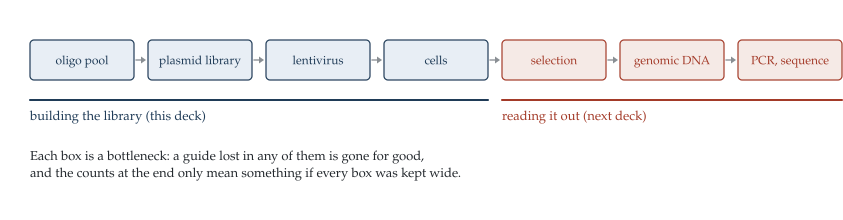{width=100%}

- Every arrow is a bottleneck. A member lost at any step cannot be recovered later
- Library preparation here is mostly about **keeping the pool even and complete**

[Shalem et al. 2014, doi:10.1126/science.1247005]{.small}

## What is in an oligo pool

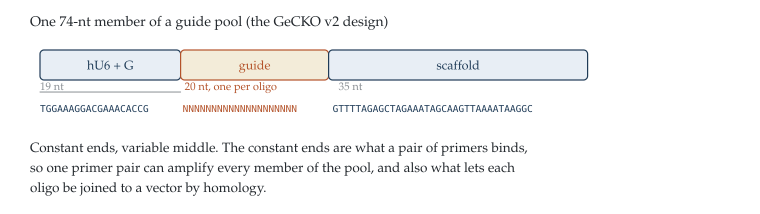{width=97%}

- Every member shares its ends and differs in the middle; this is the same logic as [a library molecule](../library-molecule/lec.qmd), with the insert designed rather than random
- Six or so guides per gene, 20 nt each, gives a pool of about 10^5 members

[Sanjana et al. 2014, doi:10.1038/nmeth.3047]{.small}

## Where the pool comes from: array synthesis

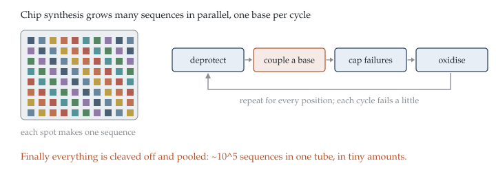{width=79%}

- Oligos are built base by base on a chip, one sequence per spot, then released together
- Cheap per sequence, because the cost is shared across 10^5 spots; the output is only a tiny mass of DNA

[Kosuri and Church 2014, doi:10.1038/nmeth.2918]{.small}

## Why pool oligos are short

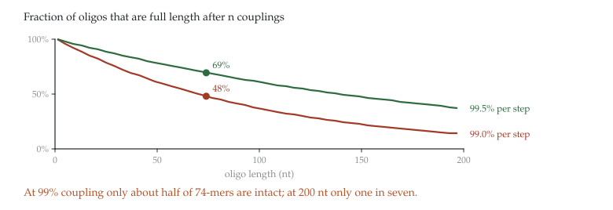{width=80%}

- Each coupling fails a little, and the losses multiply: 0.99^73 ≈ 48%
- Truncated and erroneous products are present in every pool, and become unwanted library members
- A 20-nt guide inside a 74-mer is a compromise between length and quality

## The pool is amplified once, gently

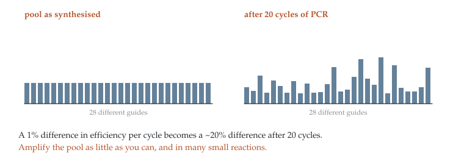{width=79%}

- Primers on the constant ends amplify every member together
- Small efficiency differences compound with each cycle, so members drift apart
- Use few cycles and several reactions, and sequence the pool before anything else

## Joining the pool to a vector: Gibson assembly

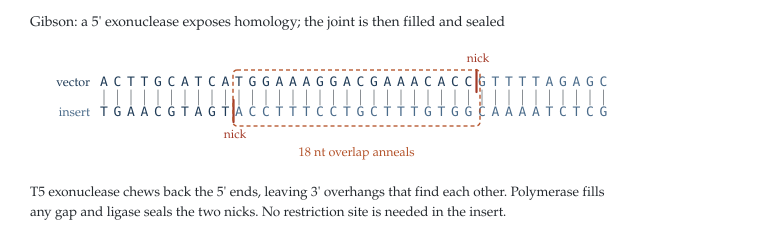{width=88%}

- An 18-nt homology on the oligo ends replaces a restriction site, so any member can be cloned in one step
- GeCKO v2: 74-mer oligos are amplified into 140-bp inserts and Gibson-assembled into a BsmBI-cut vector

[Gibson et al. 2009, doi:10.1038/nmeth.1318; Sanjana et al. 2014, doi:10.1038/nmeth.3047]{.small}

## Golden Gate: cut and ligate in one tube

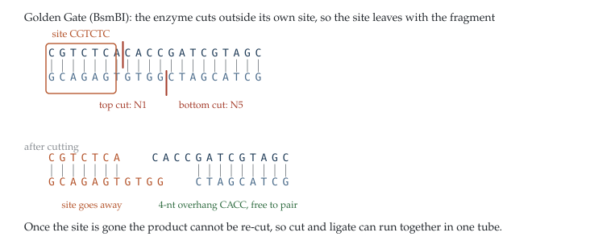{width=66%}

- A type IIS enzyme cuts *outside* its recognition site, so you choose the overhang freely
- The site is lost in the product, so the product is not cut again and the reaction runs to completion

[Engler et al. 2008, doi:10.1371/journal.pone.0003647]{.small}

## One guide, by Golden Gate logic

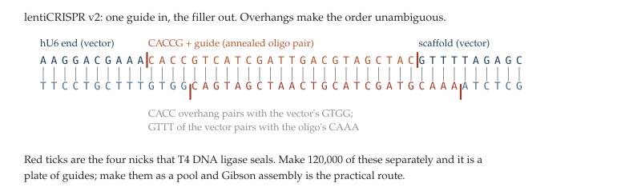{width=87%}

- lentiCRISPR v2 has two BsmBI sites that remove a 1.9 kb filler; annealed oligos with CACC and AAAC overhangs take its place
- The overhangs fix orientation: the guide can go in one way only

[Sanjana et al. 2014, doi:10.1038/nmeth.3047; Shalem et al. 2014, doi:10.1126/science.1247005]{.small}

## Same vector, two routes: why they differ

| | Single guide | Whole pool |
|---|---|---|
| Insert | two annealed oligos | amplified 74-mer pool |
| Joining | BsmBI digest and T4 ligation | Gibson assembly |
| Scale | one construct per tube | 10^5 members in one tube |
| What can go wrong | wrong guide | uneven or truncated library |

The route follows the scale. Individual guides are checked by Sanger; pools are checked by
sequencing the pool itself.

## How many colonies?

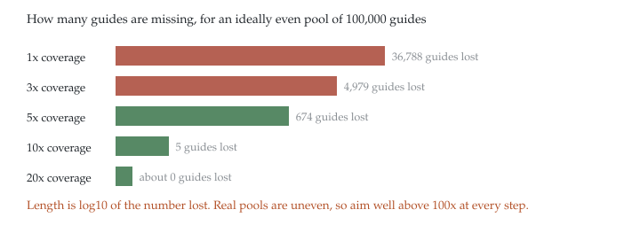{width=78%}

- Each library member must be present in many independent bacterial clones
- At 100x for 120,000 guides you need about 12 million transformants, which is why pools are electroporated, not heat-shocked
- Evenness matters more than the mean: a bacterial clone that grows faster takes over

## Check the plasmid library before using it

Sequence the plasmid pool with the same readout that you will use on the cells. Look at:

- **Complete?** Fraction of designed guides with any reads, and with at least a tenth of the median
- **Even?** The ratio between the 90th and 10th percentile of counts is a common summary
- **Correct?** Fraction of reads that match a designed sequence exactly. Synthesis errors show up here

This plasmid count is the **time-zero reference** for the cells too: a guide that was rare to begin with looks "depleted" without it.

## The lentiviral transfer vector

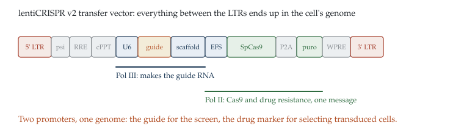{width=94%}

- Only the region between the LTRs is copied into the human genome
- The guide is made by RNA polymerase III from U6; Cas9 and puromycin resistance by polymerase II from a second promoter
- The **cPPT**, or central polypurine tract, is a short viral sequence where reverse transcription starts a second DNA strand; it raises the titre, and it is on the map because its position differs between vector versions

[Sanjana et al. 2014, doi:10.1038/nmeth.3047; Naldini et al. 1996, doi:10.1126/science.272.5259.263]{.small}

## Packaging: the virus carries RNA and nothing else

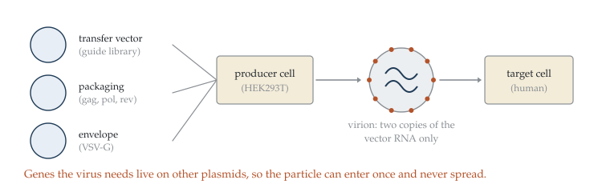{width=84%}

- The structural genes are on separate plasmids, so the particle can infect once and cannot spread
- Each particle contains two RNA copies. If two different members share a particle, the next step can mix them

## Reverse transcription duplicates the cassette

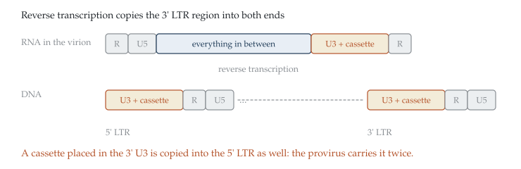{width=84%}

- The new DNA gets its 5' LTR from the 3' U3 of the RNA, so anything placed in the 3' LTR is duplicated
- [CROP-seq](../single-cell/lec-combinatorial.qmd) exploits exactly this to put a guide into a poly(A) transcript

[Datlinger et al. 2017, doi:10.1038/nmeth.4177]{.small}

## Integration into the human genome

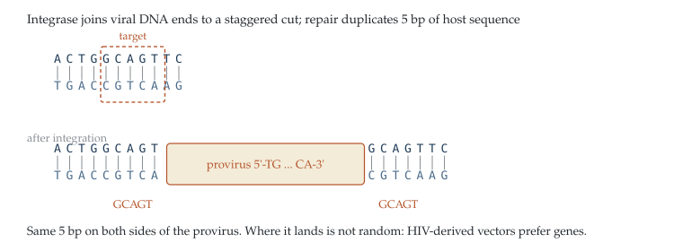{width=74%}

- Integrase joins the viral ends to the cell's DNA; repair leaves a 5-bp duplication on each side
- Integration is not random: HIV-derived vectors favour actively transcribed genes

[Schröder et al. 2002, doi:10.1016/S0092-8674(02)00864-4]{.small}

## One copy per cell, by dilution

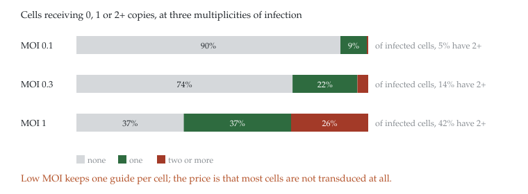{width=74%}

- Infection is a [Poisson process](../compartments/lec.qmd): at multiplicity 0.3, 74% of cells receive nothing, 22% one copy, 4% two or more — the arithmetic that loads droplets, worked here on virions
- Puromycin then removes the uninfected cells
- A cell with two guides gives a mixed phenotype, so keep the multiplicity low

## Cell numbers, worked out

120,000 guides, 500 cells per guide, MOI 0.3 (26% of cells infected):

- Cells that must carry a guide at the start: 120,000 x 500 = **60 million**
- Cells to infect: 60 million / 0.26 = **~230 million**
- Library is then kept at that coverage through every passage; reducing cell numbers is the same as losing guides

This is the same arithmetic as clone counts in bacteria, now with cells instead of colonies.

## A trap: two RNAs in one virion

Reverse transcriptase jumps between the two RNA copies. If a particle holds two *different* vectors, the DNA can be a hybrid.

- Harmless when the guide is also the barcode, because the whole cassette is one stretch
- Damaging when the guide and a separate barcode sit far apart on the vector, as in barcode-proxy designs: the barcode can be swapped to a different guide
- Fixes: keep the two elements close, make the guide itself the readout, and keep the multiplicity low. It is the general [chimera](../design/lec.qmd) failure, with reverse transcriptase switching between two viral genomes rather than onto a [template-switch oligo](../handles/lec.qmd)

[Hill et al. 2018, doi:10.1038/nmeth.4604]{.small}

## Other ways to put DNA into a genome

- **Lentivirus**: single copy, stable, most human cell types. The default for pooled screens
- **Transposons** (Sleeping Beauty, piggyBac): a [transposase](../enzymes/lec-transposases.qmd) cuts the element out of a plasmid and pastes it into the genome. Used for insertional mutagenesis in mammalian cells, where the site of insertion is the readout
- **AAV and plasmids**: mostly stay outside the genome, so copies dilute with division. Useful for short experiments and reporter assays
- **Electroporated RNPs**: no library inside the cell at all; good for arrays, awkward for pools

Which one you use decides what you must later read: a guide, a barcode, or an insertion site.

## The same pool, different payloads

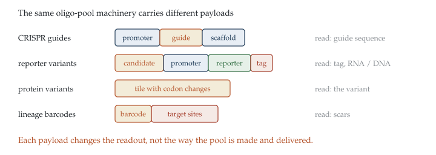{width=77%}

- Reporter libraries, protein variants and lineage barcodes use the same machinery
- Only the middle of the oligo changes, and with it the readout

## Display: the same link, without a cell

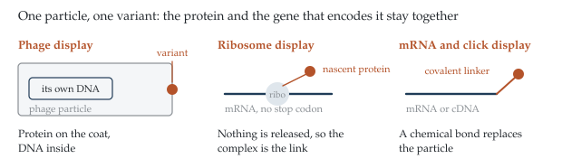{width=78%}

- A pooled screen uses the cell to hold variant and gene together. Display does it in a particle or a complex instead, so the library never has to enter a genome
- **Phage**: the variant is a fusion to a coat protein, its own DNA is inside the particle [Smith 1985, doi:10.1126/science.4001944]{.small}. Human antibody and nanobody (a single camelid antibody domain that binds on its own) discovery is built on it [McCafferty et al. 1990, doi:10.1038/348552a0]{.small}
- **In vitro**: ribosome display stalls the complex by removing the stop codon [Hanes and Plückthun 1997, doi:10.1073/pnas.94.10.4937]{.small}; mRNA display ties protein to its own message through puromycin [Roberts and Szostak 1997, doi:10.1073/pnas.94.23.12297]{.small}

## Panning, and what sequencing changed

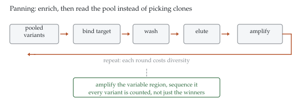{width=72%}

- Bind the pool to an immobilised target, wash, elute what stays, amplify, repeat
- The old endpoint was to pick colonies and sequence a few winners, which sees only the top of the distribution
- Counting every variant instead turns panning into a [measurement](../barcodes-umis/lec.qmd): the signal is a variant's enrichment between rounds
- Rounds are not free. Each one costs diversity and enriches binders of the plastic and the streptavidin as much as of the target, so fewer rounds plus deep sequencing can beat more rounds [Olson et al. 2012, doi:10.1002/anie.201207005]{.small}

## A display readout is an amplicon

- The library is the variable region, amplified with [tailed primers](../handles/lec.qmd) in two steps — the same construction as a guide readout, so the same [skew and dimer](../amplification/lec.qmd) traps apply
- The read must span the diversity. A randomised peptide fits in one read; an **scFv** (single-chain variable fragment: the two antibody variable domains joined by a linker, some 750 bases) or a multi-domain binder does not, which pushes the readout to [long reads](../long-reads/lec.qmd)
- Chemistry can be encoded in the DNA: [silent cPTM phage encoding](https://henriksson-lab.github.io/NGS_101/silent-cptm-phage-encoding__10.1021+jacs.5b10390/01_chem.html) marks each chemically modified sub-pool with synonymous codons, so one panning run is decoded by sequencing [Tjhung et al. 2015, doi:10.1021/jacs.5b10390]{.small}
- [Click display](https://henriksson-lab.github.io/NGS_101/click-display__10.1093+nar+gkad643/chem.html) and [CFMS mRNA display](https://henriksson-lab.github.io/NGS_101/cfms-mrna-display__10.1002+anie.201207005/chem.html) are in the collection; [PHAGE-ATAC](https://henriksson-lab.github.io/NGS_101/phage-atac__10.1038+s41587-021-01065-5/phage-atac.html) runs the idea backwards, using a nanobody-phage as the staining reagent in a [single-cell](../single-cell/lec.qmd) assay [Fiskin et al. 2022, doi:10.1038/s41587-021-01065-5]{.small}

## Vector geometry decides the readout

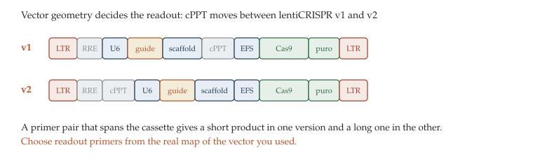{width=93%}

- lentiCRISPR v1 and v2 share the guide scaffold but differ in the position of the cPPT
- That alters which primer pairs make a short product: read the map, not the name

[Sanjana et al. 2014, doi:10.1038/nmeth.3047]{.small}

## The problem handed to the next deck

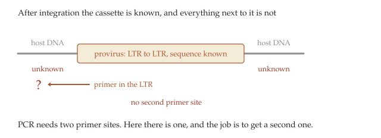{width=75%}

- For a guide, both ends are known and PCR is simple
- For an insertion site (a lentiviral integration, a transposon mutant, a Cas9 break tagged with an oligo) only one end is known
- *Reading screens out* starts here

## What to remember

- A pooled screen is an oligo pool, cloned and delivered **without losing members**
- Numbers decide: yield per base, colonies per member, cells per guide
- Gibson assembly for pools, Golden Gate logic for single constructs
- Lentivirus gives one integrated copy per cell at low multiplicity; **where** it lands is not random
- Sequence the plasmid pool: it is the time-zero reference

## Where this connects

**Blocks this library is assembled from**

- [Attaching a handle](../handles/lec.qmd) — the constant ends of a pool member are an adapter you designed; everything downstream primes off them
- [End chemistry](../end-chemistry/lec.qmd) — four-base overhangs are what make a cloning reaction directional, and a 5' phosphate is what makes it ligatable at all
- [Nucleases](../enzymes/lec-nucleases.qmd) — Type IIS enzymes such as BsmBI cut *outside* their site, which is the whole basis of Golden Gate
- [Ligases, kinases, phosphatases](../enzymes/lec-ligases.qmd) — T4 ligase joining an annealed oligo duplex into a cut vector, and what it demands of both ends
- [Amplification](../amplification/lec.qmd) — the pool is amplified once, and every extra cycle compounds the efficiency differences that skew it

**Before this**

- [Nucleic acids as a building material](../nucleic-acids/lec.qmd) — annealing two oligos into an insert, Tm, degenerate positions, and what you are actually ordering from a synthesis chip

**Where this goes next**

- [Reading the library out](lec-readout.qmd) — amplifying a 100 bp feature out of 6 Gb without distorting the proportions you spent the screen creating
