## Most of a sample is not what you came for

A human genome is about 3.1 billion base pairs, and in total RNA the great majority of molecules are ribosomal. A plasma sample carries a few molecules of tumour DNA among thousands of normal ones.

Sequencing everything and filtering afterwards wastes reads. **Selection** puts the effort in the chemistry instead: the wanted molecule is kept, or the unwanted one removed, before the sequencer sees either.

This deck covers the ways to do it, what each costs, and how each one fails.

::: {.notes}
Frame selection as the step where a property that differs between wanted and unwanted molecules is turned into a physical separation or a chemical fate.
:::

## Four families, one question

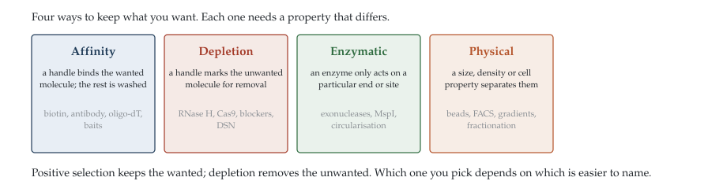{width=90%}

- The question is always the same: **what property differs between what I want and what I do not?**
- Sequence, an end, a size, a modification, a compartment: each suggests a different tool

## Selection is a ratio, not a switch

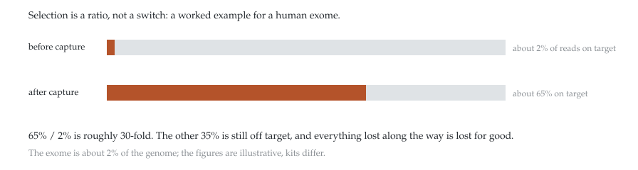{width=90%}

- Enrichment raises the **on-target fraction**; it never reaches 100%
- Every step also loses material, so more rounds trade purity for yield and [duplicates](../amplification/lec.qmd)

## Affinity: streptavidin and biotin

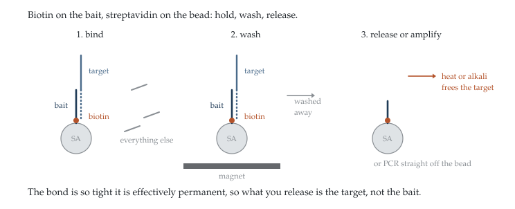{width=68%}

- Biotin is a small tag that can be put on an oligo, a nucleotide or an antibody; streptavidin on a magnetic bead binds it almost irreversibly
- That strength lets you wash hard, but you cannot release the bait intact: release the target by heat or alkali, or amplify on the bead

## Antibodies and oligo-dT

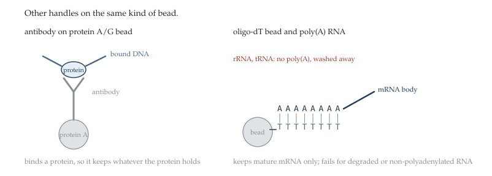{width=78%}

- An **antibody** selects a protein and carries along whatever the protein holds: this is
  [chromatin immunoprecipitation](../chromatin/lec.qmd) (ChIP) and [the CLIP family](../modifications/lec-rna.qmd)
- **Oligo-dT** selects a 3' poly(A) tail, which keeps mature mRNA and discards rRNA, but is blind to degraded or non-polyadenylated RNA

## Hybridisation capture with baits

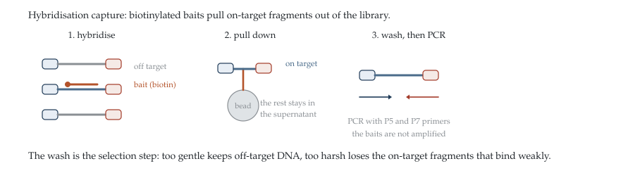{width=90%}

- Long biotinylated baits (about 100 to 120 nt) tile the region of interest and pull in any library fragment that overlaps them
- A bait can tolerate some mismatches, so related sequences are captured too

[Gnirke et al. 2009, doi:10.1038/nbt.1523]{.small}

## Why a captured library needs blockers

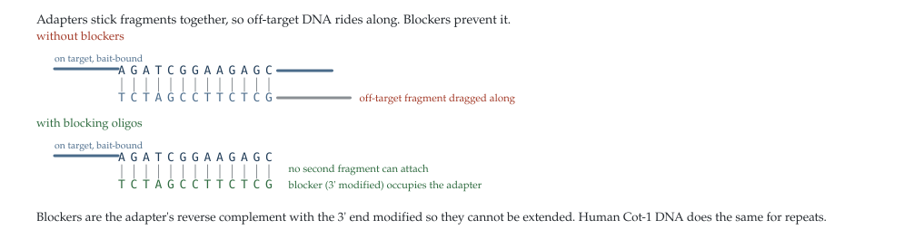{width=90%}

- Adapters are identical on every fragment, so on-target fragments hybridise to off-target ones through them: **off-target daisy-chaining**
- Blocking oligos cover the adapters; **Cot-1 DNA** covers human repeats, which are present in many fragments and would otherwise pull each other down

## Capture worked example: tumour DNA in plasma

Circulating tumour DNA is a few percent of cell-free DNA, or far less. A panel of roughly a hundred kilobases captures the recurrently mutated regions and spends the reads there.

CAPP-Seq designed its panel by choosing regions that are mutated in most patients with a given cancer, so one panel serves many patients. See the protocol on [NGS 101](https://henriksson-lab.github.io/NGS_101/capp-seq__10.1038+nm.3519/01_chem.html).

The trade: capture is **sequence-specific, but not cheap**. It costs a long hybridisation, two bead steps and a PCR, and it loses molecules on the way.

[Newman et al. 2014, doi:10.1038/nm.3519]{.small}

## Depletion: RNase H and DNA oligos

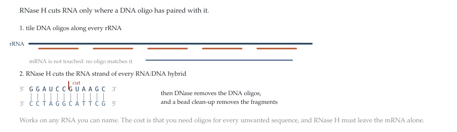{width=90%}

- Instead of keeping the wanted RNA, mark the unwanted one: oligos tiled along rRNA turn it into an RNA:DNA hybrid
- [RNase H](../enzymes/lec-nucleases.qmd) cuts only the RNA in a hybrid, so mRNA is left alone, and this works on degraded or fixed samples where oligo-dT does not

[Morlan et al. 2012, doi:10.1371/journal.pone.0042882]{.small}

## Depletion by Cas9 cutting

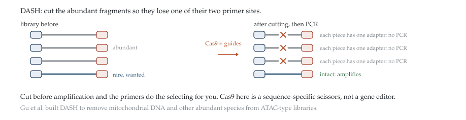{width=90%}

- Cas9 with a pool of guides cuts the abundant fragments after adapter ligation
- Each cut piece keeps only **one** adapter, so the PCR step cannot amplify it
- Specificity comes from the guide, and the cut is made in vitro on library molecules

[Gu et al. 2016, doi:10.1186/s13059-016-0904-5]{.small}, [protocol on NGS 101](https://henriksson-lab.github.io/NGS_101/dash__10.1186+s13059-016-0904-5/01_dash.html)

## Blocking oligos and clamps

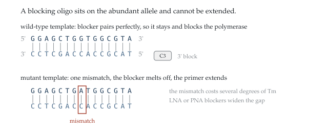{width=68%}

- A [3'-modified oligo](../nucleic-acids/lec.qmd) cannot be extended, so a polymerase that meets it stops
- The blocker is tuned so that one mismatch lets it fall off: a **rare variant amplifies while the wild-type is held back**
- Blockers also protect adapters and repeats in capture

## Duplex-specific nuclease

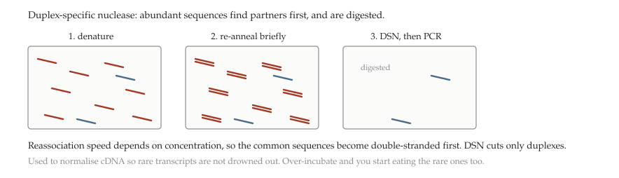{width=90%}

- Denature the cDNA, re-anneal for a set time, then digest what became double-stranded
- It **normalises** abundance: common transcripts are removed, rare ones remain

[Zhulidov et al. 2004, doi:10.1093/nar/gnh031]{.small}

## Choosing between capture and depletion

| | Positive selection | Depletion |
|---|---|---|
| You must know | the sequence to keep | the sequence to remove |
| Good when | the target is small and defined | the unwanted is abundant and few species |
| Bias | misses variants the bait does not match | leaves what the oligos do not cover |
| Typical case | exome, gene panel | rRNA, mitochondrial DNA, globin |

A worked rule: if what you want is a few hundred genes, capture them. If what you want is the whole transcriptome except two or three abundant species, deplete those.

Depletion keeps the unknown; capture finds only the known.

## Enzymatic selection: exonucleases

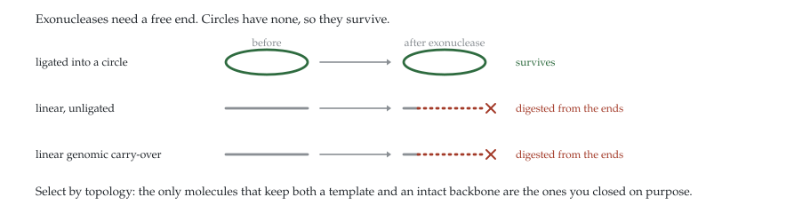{width=90%}

- A closed circle has no end, so an exonuclease cannot start on it
- Everything else linear is removed: unligated probe, unreacted adapter, carry-over genomic DNA

[Tsai et al. 2017, doi:10.1038/nmeth.4278]{.small}, [CIRCLE-seq on NGS 101](https://henriksson-lab.github.io/NGS_101/crispr-circle-seq__10.1038+nmeth.4278/crispr-circle-seq.html)

## An exonuclease is a trap for your own product

The same selectivity applies to your good molecules the moment they have a free end.

- **Pick by polarity and by strand.** Some enzymes digest only single-stranded DNA, some only double-stranded; the wrong choice leaves the unwanted species or eats the wanted one.
- **Remove the enzyme completely.** Residual activity during later steps trims adapter ends and produces damaged ends that fail to ligate. Heat-inactivate or clean up with beads.
- **Check the ends of the circle.** If the circle was made by ligation, only a fully sealed, nick-free molecule survives; a nicked circle is a linear molecule with a break.
- **3' ends can be protected** with a phosphorothioate bond, which an exonuclease reads slowly.

## Methylation-sensitive digestion

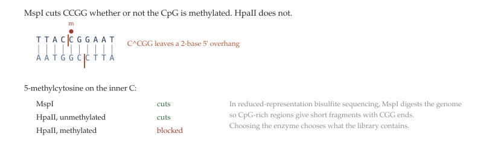{width=90%}

- A restriction enzyme that cares about methylation reads the epigenome; one that does not reads the sequence
- MspI is insensitive to the CpG methylation at its site, which is why it is used to enrich CpG-rich regions for **reduced-representation [bisulfite](../chemistry-to-sequence/lec.qmd) sequencing**

[Meissner et al. 2008, doi:10.1038/nature07107]{.small}, [protocol on NGS 101](https://henriksson-lab.github.io/NGS_101/rrbs-illumina__10.1038+nature07107/rrbs-illumina.html)

## Selective circularisation

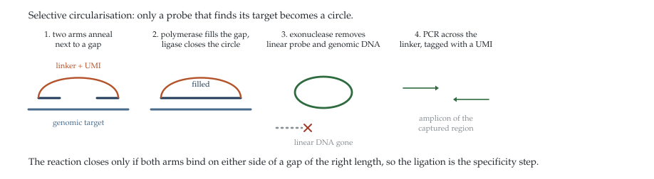{width=90%}

- A **molecular inversion probe** (MIP) closes into a circle only if both arms bind adjacent to a gap that polymerase fills and [ligase seals](../enzymes/lec-ligases.qmd)
- Exonuclease then removes everything linear, which is nearly everything in the tube, so on-target circles dominate
- The linker can carry a **[UMI](../barcodes-umis/lec.qmd)**, so each captured molecule is counted once: that version is the [smMIP](../targeted/lec.qmd)

[Hiatt et al. 2013, doi:10.1101/gr.147686.112]{.small}, [smMIP on NGS 101](https://henriksson-lab.github.io/NGS_101/smmip__10.1101+gr.147686.112/smmip.html)

## Physical selection

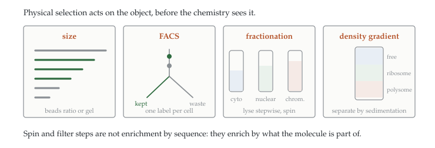{width=82%}

- **Size:** a [bead ratio or gel](../fragmentation/lec.qmd) keeps fragments in a window, removing adapter dimers and over-long molecules
- **FACS:** one cell at a time on a fluorescent label, which selects cell types before extraction
- **Fractionation and gradients:** select by compartment or by what the RNA is bound to, such as nascent RNA on chromatin or ribosome-bound RNA

## Select early, and select on what you can measure

- A selection upstream of the library is cheaper than one after it: you do not pay to make a library from molecules you will discard.
- Sorting nuclei or cells keeps the cell types you want, but **a sort changes the cells**: dissociation and fixation introduce stress-response genes and RNA loss.
- Fractionation depends on how well the lysis steps separate compartments. Run a marker for each fraction, such as a nuclear RNA that should be absent from the cytoplasmic fraction.
- A density gradient or a size column cannot tell two molecules of the same size apart; any selection by a physical property has that limit.

[Nojima et al. 2015, doi:10.1016/j.cell.2015.03.027]{.small}

## Trick: suppression PCR

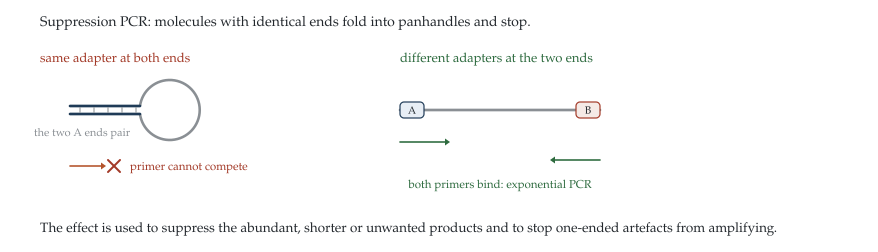{width=90%}

- A short adapter at both ends of a fragment lets the strand fold back and anneal to itself faster than a primer can
- Only molecules with **different** ends keep amplifying, so the PCR itself becomes a filter

[Siebert et al. 1995, doi:10.1093/nar/23.6.1087]{.small}

## Trick: select by end structure, not by sequence

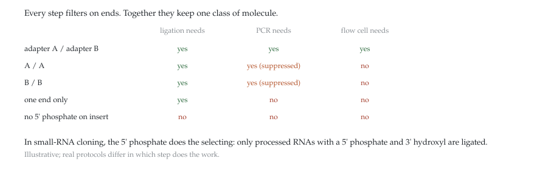{width=90%}

- You do not need to know a sequence to select if the molecule has a **feature at its end**
- A ligation requires a particular end chemistry, PCR requires two different ends, and the flow cell requires both adapters
- The library prep itself is a chain of end-structure filters; designing the ends is designing the selection

## Trick: carrier nucleic acid for low input

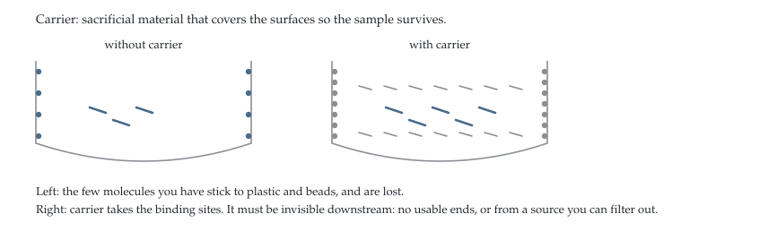{width=90%}

- At picogram input, the sample is lost to tube walls, beads and columns, not to the chemistry
- A carrier occupies the binding sites; it must **not be sequenced**
- Options: carrier that lacks the ends needed for ligation, DNA from an unrelated species mapped out later, or an RNA that is degraded after extraction
- The right choice depends on the protocol; check what the kit supplies

## Trick: spike-in standards

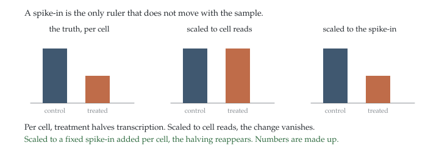{width=82%}

- A spike-in is a known amount of foreign material added at a defined point, such as at lysis, in proportion to cell number
- It is the only way to see a **global** change, since a normalisation to total reads removes it
- Choose a spike-in that cannot map to your genome, and add it before the step you want to control for

[Jiang et al. 2011, doi:10.1101/gr.121095.111]{.small}, [Orlando et al. 2014, doi:10.1016/j.celrep.2014.10.018]{.small}

## What each selection costs

| Method | Costs you | Fails by |
|---|---|---|
| Streptavidin pull-down | low yield on release | non-specific binding to beads |
| Hybridisation capture | long protocol, duplicates | off-target daisy-chaining, GC bias |
| RNase H depletion | oligo set per species | incomplete tiling, enzyme left active |
| Cas9 depletion | guide design | cuts in wanted molecules with the same site |
| Exonuclease | enzyme removal step | nicked products digested |
| Restriction selection | enzyme-defined bias | incomplete digestion looks like methylation |
| Spike-ins | reads spent on spike | spike added at the wrong step |

Plan for the failure as well as the method, and run a control that would show it.

## Designing a selection: a short worked case

**Question:** which of 400 genes carry a mutation in 10 ng of cell-free DNA?

1. **Select by sequence:** hybridisation capture with baits over the 400 genes. Alternatively, selective circularisation if the targets are small and defined.
2. **Protect the adapters** with blockers, and use unique molecular identifiers so duplicates can be told from independent molecules.
3. **Low input:** add a carrier that cannot be sequenced, and keep cleanup steps few.
4. **Check:** the on-target fraction, and the uniformity of coverage across baits.

Each step uses a block from this deck, and each one has a way to fail that you now know.

## Where this connects

**Where this block is used**

- [Targeted sequencing](../targeted/lec.qmd) — capture, MIPs and reduced representation worked through as whole protocols
- [mRNA and total RNA](../rna/lec.qmd) — poly(A) selection against rRNA depletion, the commonest selection decision in the course
- [Chromatin](../chromatin/lec.qmd) — an antibody selects a protein and brings its DNA along; the tethered-enzyme variants avoid the pull-down
- [Three-dimensional genome](../3d-genome/lec.qmd) — biotin at the junction is what makes a Hi-C library affordable to sequence
- [Long reads](../long-reads/lec.qmd) — Cas9 enrichment, and selection moved onto the instrument as adaptive sampling

**Tricks**

- [Ligation, clean-up and handles](../tricks/lec.qmd) — exonuclease clean-up, RNase H and Cas9 depletion as catalogue entries
- [Counting, low input and bases](../tricks/lec-more.qmd) — spike-ins, and where material goes when there is little of it

Protocols using these blocks are drawn in [NGS 101](https://henriksson-lab.github.io/NGS_101/).
