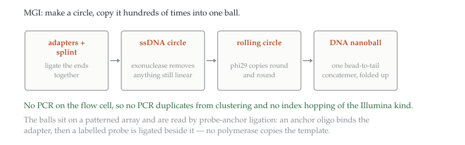
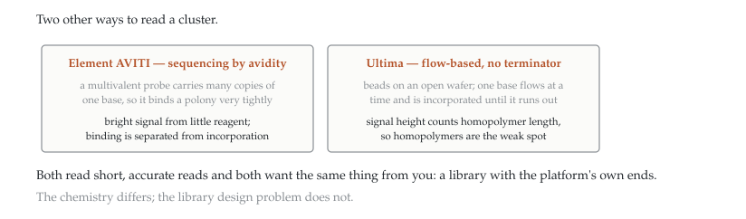
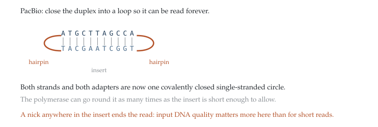
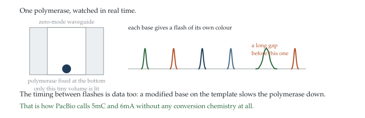
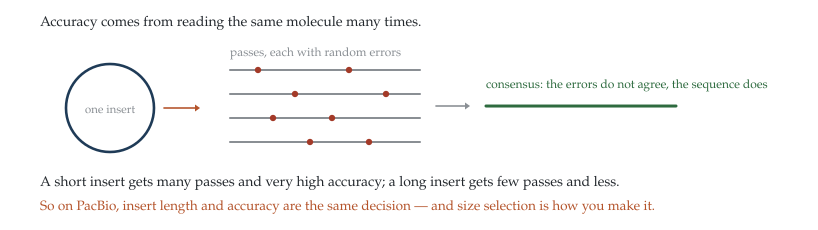
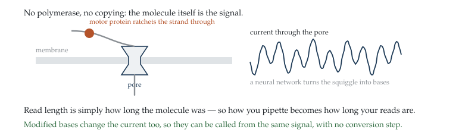
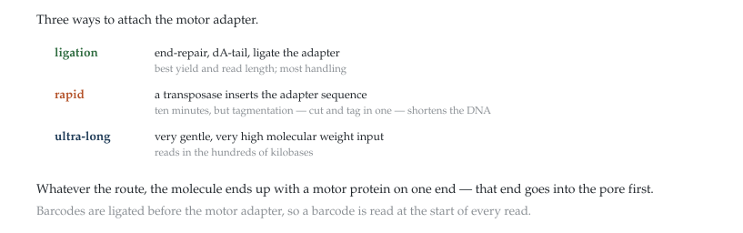
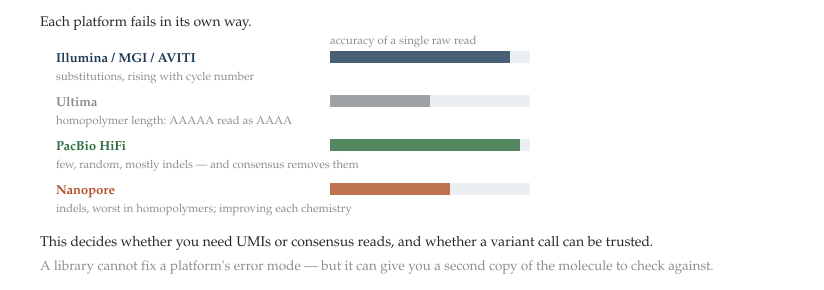
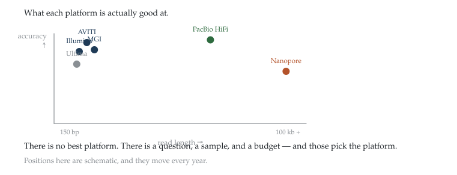

## Why look past Illumina

Three reasons, and all of them change what you build:

- **Length.** Illumina reads a few hundred bases. Isoforms, repeats, structural variants and
  haplotypes are often longer than that.
- **The molecule itself.** PacBio and Nanopore read a native molecule, so chemical
  modifications can be detected without converting anything.
- **Cost and access.** Different platforms win at different scales, and the sequencer you can
  actually get time on is a real constraint.

Each has its own ends, and therefore its own library prep.

## MGI: circularise, then copy

{width=92%}

- No on-slide PCR, so no cluster duplicates and no index hopping of the Illumina kind

[Drmanac et al. 2010, doi:10.1126/science.1181498]{.small}

## Two more short-read readouts

{width=92%}

- Different chemistry, same library problem: give the platform its own ends

[Avidity: Arslan et al. 2023, doi:10.1038/s41587-023-01750-7]{.small}

## PacBio: the SMRTbell

{width=83%}

- Hairpin adapters close the duplex into one single-stranded circle

## One polymerase, watched in real time

{width=87%}

- The timing between flashes reports modified bases — no conversion chemistry

[Eid et al. 2009, doi:10.1126/science.1162986]{.small}

## HiFi: accuracy from repetition

{width=92%}

- Insert length and accuracy are the same decision, and size selection is how you make it

[Wenger et al. 2019, doi:10.1038/s41587-019-0217-9]{.small}

## What PacBio asks of your library

- **Intact DNA.** A nick inside the insert ends the read. Shearing, vortexing, freeze-thaw
  and old samples all cost you length.
- **A tight size distribution.** Short molecules are loaded preferentially, so a few short
  fragments can dominate the run. Size selection is not optional.
- **No damaged ends.** Damage repair before ligation is a standard step.
- **Barcodes in the adapters or primers**, read as part of the insert rather than as separate
  index reads.

The whole prep is shorter than an Illumina one, and far more sensitive to how you handled the
sample.

## Nanopore: the molecule is the signal

{width=92%}

- Read length is how long your molecule was, so pipetting technique becomes read length

[Jain et al. 2016, doi:10.1186/s13059-016-1103-0]{.small}

## Three ways to attach the motor

{width=90%}

- Ligation for yield and length; rapid for speed; ultra-long for hundreds of kilobases

[Ultra-long: Jain et al. 2018, doi:10.1038/nbt.4060]{.small}

## Direct RNA, and modifications

- Nanopore can sequence **RNA itself** — no reverse transcription, no PCR, no cDNA bias. The
  adapter is ligated to the RNA's 3' end, and the molecule is read 3' to 5'.
- Yield is lower and error higher than cDNA routes, and you need a lot of intact RNA.
- Both platforms call **base modifications** from the raw signal: 5mC and 6mA on DNA, and a
  growing list on RNA including m6A and pseudouridine.

This is the one capability that no amount of clever library chemistry gives you on a
short-read instrument — there you must convert the modification into a base change first.

## Basecalling and error

{width=80%}

- Decides whether you need UMIs, duplex reads or consensus to trust a variant call

[Nanopore review: Wang et al. 2021, doi:10.1038/s41587-021-01108-x]{.small}

## Adaptive sampling

A nanopore can decide, part-way through a molecule, that it does not want it — and eject it.

- The first fraction of a second of signal is basecalled and compared with a target list
- Unwanted molecules are rejected and the pore takes the next one
- Enrichment without any wet-lab capture step

It is a reminder that on these platforms, some of what used to be library chemistry has moved
into software. When you design a prep, ask whether the selection step you are planning could
be done at the pore instead.

## Choosing a platform

{width=73%}

- There is no best platform: there is a question, a sample and a budget

## What each platform asks for

| Platform | Ends it needs | Cares most about |
|---|---|---|
| Illumina | P5 / P7, dual indexes | insert size, dimers, diversity |
| MGI | its own adapters, circularisable | same, plus clean circularisation |
| PacBio | hairpin SMRTbell adapters | intact HMW DNA, size selection |
| Nanopore | motor-protein adapter | molecule length, gentle handling |

The chemistry in the rest of this course is largely shared. What changes between platforms is
the handle you put on the ends — and how much you must protect the molecule to get there.

## Where this goes next

- **Anatomy of a library molecule** — the construct in detail, and how to read one
- **The building blocks** — the steps that get a handle onto an unknown molecule
- Every protocol in [NGS 101](https://henriksson-lab.github.io/NGS_101/) names its platform;
  look at how the first and last steps change when the platform does
