## Design backwards from the instrument

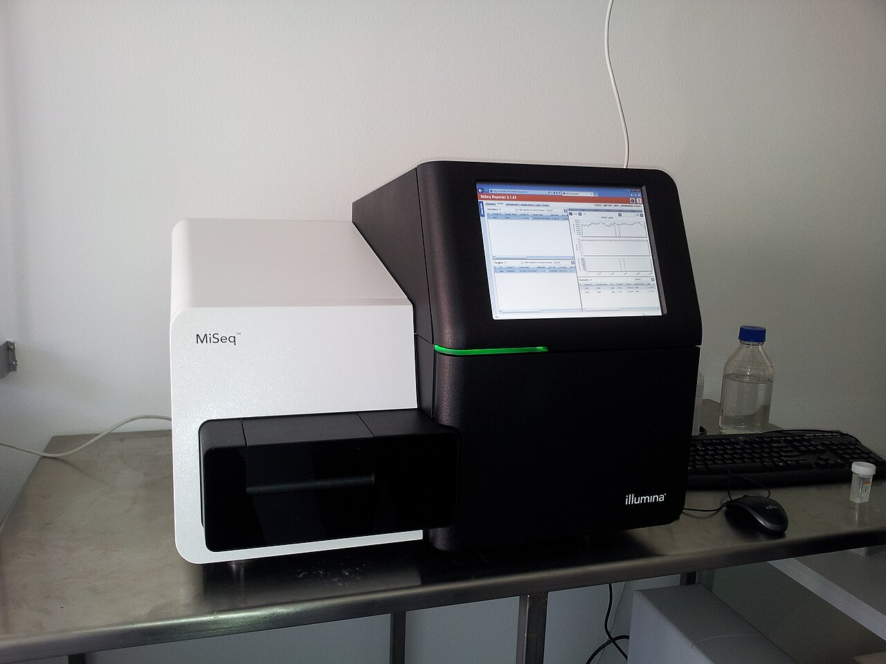{width=42%}

Every library preparation exists to produce a molecule that one machine can read.
[A MiSeq on a bench. Photo: Konrad Förstner, CC0]{.small}

So before any chemistry: **what does the machine actually require, and what does it do with
the molecule once it has it?**

This deck is about Illumina, because it is still most of the world's sequencing and because
its constraints shaped most of the protocols you will meet. The next deck covers the others.

::: {.notes}
The aim is that by the end, a student can say what every part of an Illumina adapter is for.
:::

## Sanger: the baseline

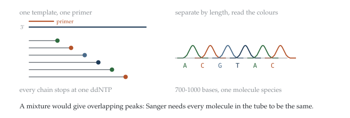{width=83%}

- One template, one primer, one reaction — chains terminated at random by ddNTPs
- Still the right tool for checking a clone, a guide site or a PCR product

[Sanger et al. 1977, doi:10.1073/pnas.74.12.5463]{.small}

## What makes massively parallel sequencing possible

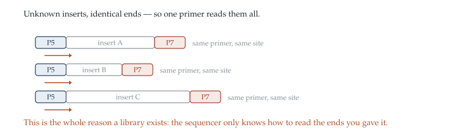{width=92%}

- Give every fragment the **same ends**, and one primer can read all of them at once
- The inserts stay unknown; only the ends are designed
- This is why "library preparation" is a thing at all

## The flow cell is a lawn of two oligos

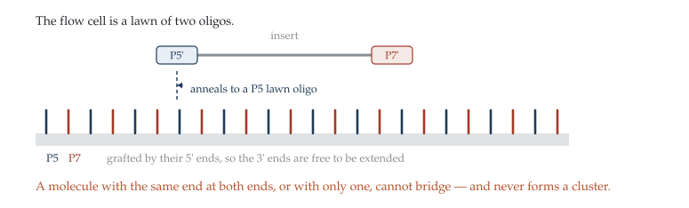{width=70%} 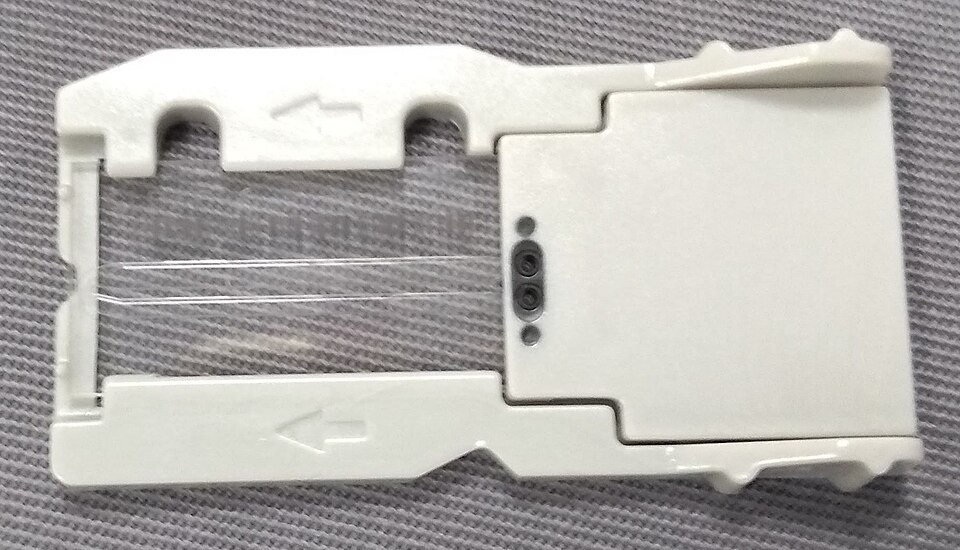{width=19%}

- Two sequences, **P5** and **P7**, grafted to the surface by their 5' ends
- The object itself is the glass channel above right: a MiSeq flow cell, one lane [Photo: Cirosantilli2, CC BY-SA 4.0]{.small}
- Your molecule must carry the complement of one at each end
- Same end at both ends → no bridge → no cluster → no read

## Clustering: amplify in place

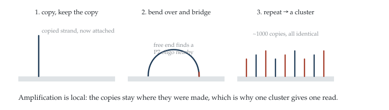{width=92%}

- The free end bends over, finds a neighbouring lawn oligo, and is copied
- Repeated, this makes ~1000 identical copies in a spot a micron across

## Why a cluster must be clonal

Every copy in a cluster is read at the same time, and the camera sees the sum of their
signals. That has consequences you will meet constantly:

- **One cluster, one read.** Two molecules seeding the same spot give a mixed signal and the
  read is filtered out.
- **Loading concentration matters.** Too much library and clusters merge; too little and you
  waste the run. Getting from ng/µL to a loading molarity is [QC](../qc/lec.qmd).
- **Patterned flow cells** (NovaSeq, NextSeq 2000) have fixed wells and use a different
  amplification chemistry (**ExAmp**: the first molecule to reach a well amplifies at constant
  temperature and fills it, shutting the others out), which changes how duplicates and index
  hopping arise.

A library is not just molecules — it is molecules at a known concentration.

## One strand at a time

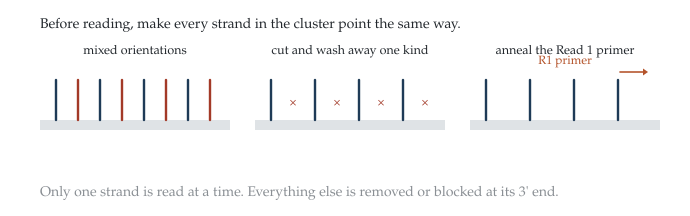{width=90%}

- The cluster starts with both orientations; one kind is cut and washed away
- Free 3' ends are blocked so nothing else can prime
- The sequencing primer anneals to the adapter, pointing into the insert

## Sequencing by synthesis

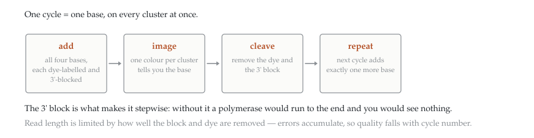{width=92%}

- The 3' block is what makes it stepwise — one base per cycle, across the whole flow cell

[Bentley et al. 2008, doi:10.1038/nature07517]{.small}

## Four colours, two, or one

How the four bases are distinguished has changed, and it affects your library:

- **Four-colour** (MiSeq, HiSeq 2500): one dye per base
- **Two-colour** (NextSeq, NovaSeq): red, green, both, or neither — **G is "no signal"**
- **One-colour** (iSeq): distinguished across two images

The practical consequence: on two-colour instruments a long run of **G** is indistinguishable
from a dead cluster, and a library with poly-G stretches or empty wells produces characteristic
poly-G tails at the ends of reads.

## Four reads, in this order

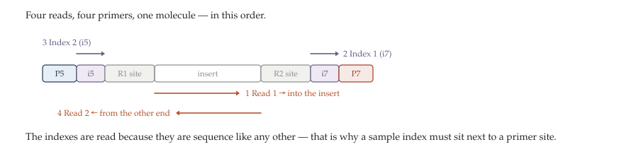{width=92%}

- The indexes are sequence like any other, read by their own primers

## Getting to the other end

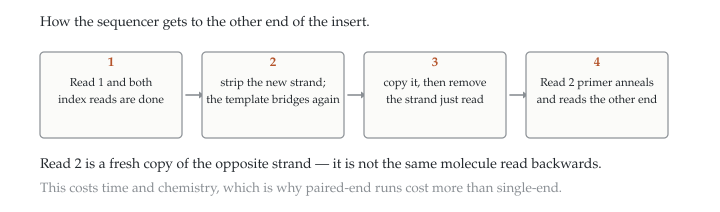{width=92%}

- Read 2 is a fresh copy of the opposite strand, not the same molecule read backwards

## The i5 index is read two different ways

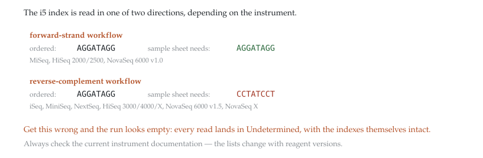{width=86%}

- The commonest cause of an "empty" run that was actually fine

[Dual indexing: Kircher et al. 2012, doi:10.1093/nar/gkr771]{.small}

## Insert size versus read length

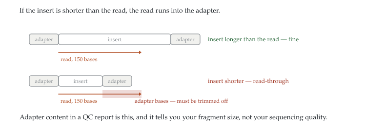{width=83%}

- Adapter content in a QC report is a measure of your **fragment size**, not your sequencing
- The practical rule: size-select so the insert is comfortably longer than the read
  ([fragmentation and size control](../fragmentation/lec.qmd))

## Index hopping

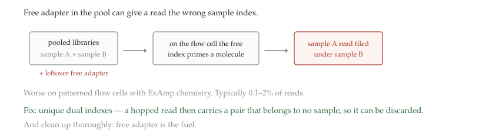{width=92%}

- Fix in the library: unique dual indexes ([barcodes and UMIs](../barcodes-umis/lec.qmd)), and
  clean up free adapter properly

[Costello et al. 2018, doi:10.1186/s12864-018-4703-0]{.small}

## Base diversity

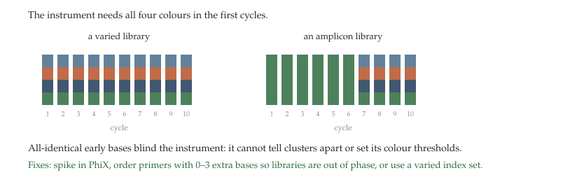{width=89%}

- Amplicon libraries are the classic failure: every molecule starts with the same primer

## Custom primers and dark cycles

Two tools worth knowing exist, because protocols in the collection rely on them:

- **Custom sequencing primers.** If your construct does not present a standard Read 1 site
  where the instrument expects it, you can supply your own primer. It costs a reagent
  position and some goodwill from your sequencing facility, but it removes a design
  constraint entirely.
- **Dark cycles.** The chemistry runs without imaging, stepping blindly past a constant
  stretch — a linker, a fixed barcode scaffold — so the real read starts where you want it.

Both are routine in single-cell and spatial protocols, and both are reasons a protocol's read
structure may look impossible at first glance — see the entries in the
[trick catalogue](../tricks/lec.qmd).

## Things that degrade a run

- **Cluster density** — too high merges clusters; too low wastes capacity
- **Phasing and pre-phasing** — a few molecules in each cluster fall behind or run ahead, so
  the signal gets noisier with every cycle. This is why quality falls along a read
- **Low diversity** — see above; fix with PhiX ([a balanced spike-in library](../qc/lec.qmd))
  or staggered primers
- **Free adapter** — dimers cluster beautifully and index-hop
- **Over-amplified library** — duplicates and skewed coverage, invisible until analysis
  ([amplification](../amplification/lec.qmd))

None of these are the sequencer's fault. All of them are set by the library.

## What comes back

- **FASTQ** per read: name, sequence, `+`, per-base quality
- **Phred score** Q = −10 log₁₀(P_error): Q30 = 1 error in 1000. Modern instruments bin
  qualities into a few levels rather than reporting all 40
- **Demultiplexing** splits reads by index, allowing a mismatch or two if the barcode set is
  far enough apart. Reads that match nothing land in *Undetermined* — the first place to look
  when a run seems empty

## Read-structure notation

A run is specified as cycles per read, for example `28 / 10 / 10 / 90`:

| Read | Cycles | What it holds |
|---|---|---|
| Read 1 | 28 | 16 nt cell barcode + 12 nt UMI |
| Index 1 (i7) | 10 | sample index |
| Index 2 (i5) | 10 | sample index |
| Read 2 | 90 | the cDNA insert |

You design the construct; the read structure follows from it — a barcode-plus-UMI Read 1 like
this one is the signature of a droplet protocol ([single cells](../single-cell/lec.qmd)).
Getting the two out of step is among the most expensive mistakes in this field, because you
only find out after the run.

## What this imposes on every library you build

1. Both ends must carry the right flow-cell sequence, and they must differ
2. The insert must be short enough to cluster and long enough not to be read through
3. Anything you want to read needs a primer site next to it, in the right orientation
4. Indexes must be far enough apart to survive errors, and unique in pairs if hopping matters
5. The first cycles must be diverse, or the run must be rescued with PhiX
6. The molecule must be free of adapter dimers, and quantified, before it is loaded

## Where this connects

**Before this**

- [Nucleic acids](../nucleic-acids/lec.qmd) — ends, hybridisation and what a ligase needs

**Read these next**

- [The other platforms](lec-platforms.qmd) — MGI, AVITI, Ultima, PacBio, Nanopore
- [Anatomy of a library molecule](../library-molecule/lec.qmd) — the construct that satisfies
  the six requirements above

**Where these constraints bite**

- [Attaching a handle](../handles/lec.qmd) — how the universal ends get onto unknown molecules
- [Targeted sequencing](../targeted/lec.qmd) — amplicon panels, the classic low-diversity library
- [Design patterns](../design/lec.qmd) — each run-level failure above, with the control that
  identifies it

The protocols in [NGS 101](https://henriksson-lab.github.io/NGS_101/) are drawn with their
read structure, so you can check any of them against this deck.
