## Start from the question

Atlases of whole organs and embryos need millions of cells. [Microfluidic loading](lec.qmd) is limited by the device and the cost per cell, and doublets rise with throughput.

**Remove the hardware: let the cell be its own compartment.** Fix the cells so they stay intact, barcode them in a plate, pool, re-split and barcode again. A cell's barcode is the sequence of wells it passed through.

The second half of the deck asks a different question: once every molecule carries a barcode, what other molecules can be given the same barcode? Chromatin, surface proteins, guide RNAs and receptor sequences are all captured by the same trick, with a different handle.

## Split and pool: the barcode is the path

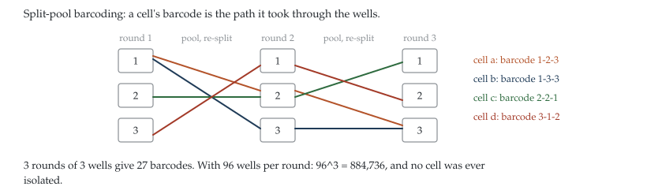{width=89%}

- Each round adds a well-specific tag by RT, ligation or PCR; between rounds, all cells are pooled and re-split at random
- After three rounds of 96 wells, each cell has one of 96^3 = 884,736 paths, and no cell was ever isolated
- The molecules are labelled inside the cells, so the cells must stay intact until the last round

## Collisions replace doublets

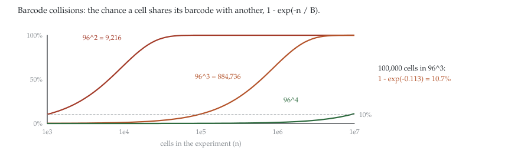{width=87%}

- Two cells with the same path look like one cell with twice the RNA
- With n cells and B barcodes, the chance that a given cell shares its path is 1 - exp(-n / B), so **load far fewer cells than there are barcodes**
- 100,000 cells in 96^3 paths: 1 - exp(-0.113) = 10.7% collide; a fourth round of 96 brings it to about 0.1%

## sci-RNA-seq3: RT, ligation and PCR barcodes

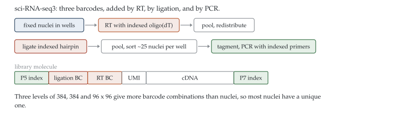{width=92%}

- Nuclei are distributed to wells and reverse-transcribed with an indexed oligo(dT) carrying a UMI; they are pooled and re-split
- An indexed hairpin is ligated to the RT barcode, the nuclei are pooled again and sorted a few tens to a well, and the final index is added by PCR ([sci-RNA-seq3](https://henriksson-lab.github.io/NGS_101/https://henriksson-lab.github.io/NGS_101/sci-rna-seq3__10.1038+s41586-019-0969-x/sci-rna-seq3.html))
- The method was built on mouse embryos; the human fetal atlas used the same chemistry

[Cao et al. 2019, doi:10.1038/s41586-019-0969-x; Cao et al. 2020, doi:10.1126/science.aba7721]{.small}

## SPLiT-seq: ligating barcodes while the cells stay intact

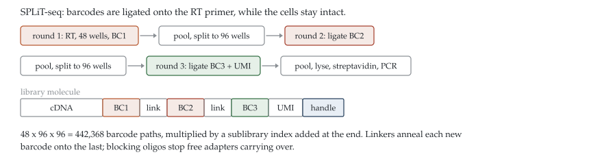{width=92%}

- Fixed, permeabilised cells are reverse-transcribed in wells, then barcodes are ligated onto the cDNA's primer in two further rounds, using short linkers ([SPLiT-seq](https://henriksson-lab.github.io/NGS_101/https://henriksson-lab.github.io/NGS_101/split-seq__10.1126+science.aam8999/split-seq.html))
- The last oligo also carries the UMI and a biotin; the cells are then lysed and cDNA is purified on streptavidin
- Aliquots of the pool are amplified with a different **sublibrary index**, one more barcode added per aliquot in that PCR, so the total barcode space multiplies, as does the number of samples

[Rosenberg et al. 2018, doi:10.1126/science.aam8999]{.small}

## The cell must keep its molecules

- Fixation or intact nuclei hold the barcoded cDNA inside the cell for the whole procedure
- A leaky cell lets barcoded cDNA escape and re-enter another, which looks like contamination and lowers specificity
- Cells are counted before distribution, because the number per well sets the collision rate
- The cost: no live-cell capture, and RNA captured is lower per cell than in droplets, but each cell costs a fraction as much

## The barnyard test

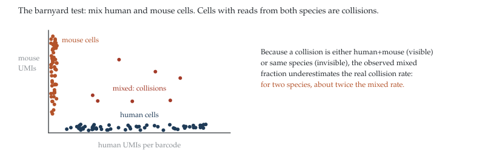{width=82%}

- Mix human and mouse cells in a known ratio and run the whole protocol on the mixture
- Reads from both genomes in one barcode mark a collision; reads from one genome could still hide one between two cells of that species
- With two species, the real collision rate is about twice the observed mixed rate; split-pool methods are validated this way

## sci-ATAC-seq: Tn5 as the first barcoding step

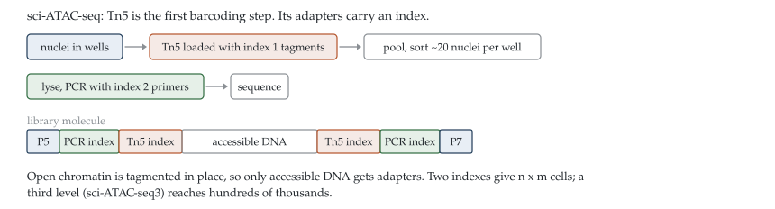{width=92%}

- Isolated nuclei are tagmented in wells, each with Tn5 loaded with its own index, so accessible DNA is cut and tagged in place ([sci-ATAC-seq](https://henriksson-lab.github.io/NGS_101/https://henriksson-lab.github.io/NGS_101/sci-atac-seq__10.1126+science.aab1601/sci-atac-seq.html))
- Nuclei are pooled, sorted into a second plate, and a PCR index is added; three levels ([sci-ATAC-seq3](https://henriksson-lab.github.io/NGS_101/https://henriksson-lab.github.io/NGS_101/sci-atac-seq3__10.1126+science.aba7612/sci-atac-seq3.html)) reach hundreds of thousands of cells
- Validated on human cell lines, and later used for the human fetal chromatin atlas

[Cusanovich et al. 2015, doi:10.1126/science.aab1601; Domcke et al. 2020, doi:10.1126/science.aba7612]{.small}

## Why chromatin data are sparse

- A diploid cell has two copies of each locus, so an accessible site can be sampled only a handful of times in one cell
- A typical cell gives thousands of unique fragments, spread over hundreds of thousands of potential sites: most entries are zero
- Counts per cell cannot be improved by sequencing deeper once the library is saturated; the limit is the number of molecules in the cell
- This is why analysis aggregates sites (peaks, motifs, bins) and why cell numbers, not depth, carry the statistical power

## Multimodal assays: one barcode, two molecules

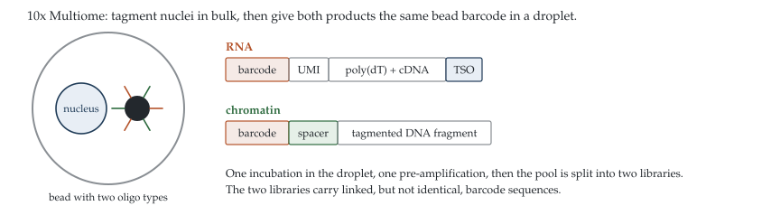{width=92%}

- Chromatin and RNA come from the same nucleus: tagment in bulk, then partition nuclei with beads that carry both an RNA-capture oligo and a chromatin-capture oligo
- Both oligos on one bead share the cell barcode, so the two libraries can be tied to the same cell ([10x Multiome](https://henriksson-lab.github.io/NGS_101/https://henriksson-lab.github.io/NGS_101/10x-chromium-single-cell-multiome-atac-gene-expression/multiome.html))
- Two libraries are made from one pre-amplified pool, with their own [read structures](../library-molecule/lec.qmd) and sequencing depth

## SHARE-seq: the split-pool version

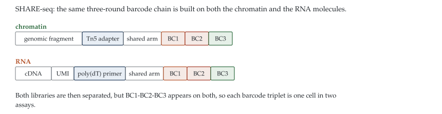{width=92%}

- Fixed cells are tagmented and reverse-transcribed in the same tube; the Tn5 product and the RT primer share one arm ([SHARE-seq](https://henriksson-lab.github.io/NGS_101/https://henriksson-lab.github.io/NGS_101/share-seq__10.1016+j.cell.2020.09.056/share-seq.html))
- Three rounds of hybridisation and ligation add BC1, BC2 and BC3 to both molecule types; biotin on the cDNA primer lets the two libraries be separated by streptavidin
- The ligation chain gives each cell a unique barcode triplet in both assays

[Ma et al. 2020, doi:10.1016/j.cell.2020.09.056]{.small}

## CITE-seq: antibodies that look like mRNA

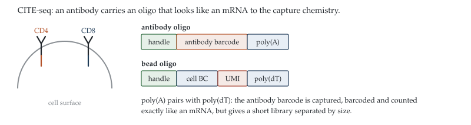{width=92%}

- Each antibody carries an oligo with a PCR handle, an antibody barcode and a poly(A) tail, so the capture oligo(dT) treats it as an mRNA ([CITE-seq](https://henriksson-lab.github.io/NGS_101/https://henriksson-lab.github.io/NGS_101/cite-seq__10.1038+nmeth.4380/cite-seq.html))
- The number of antibody barcodes with a given UMI counts the surface proteins on that cell
- The short antibody-derived library is separated from the long cDNA by size, then amplified and indexed on its own

[Stoeckius et al. 2017, doi:10.1038/nmeth.4380; Peterson et al. 2017, doi:10.1038/nbt.3973]{.small}

## Cell hashing: the same trick for sample identity

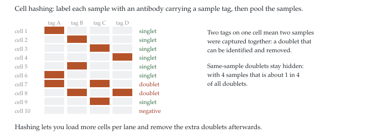{width=74%}

- Antibodies against ubiquitous surface proteins carry a sample barcode, so each sample has its own tag
- Pool the samples, overload the device, and use cells with two tags to find the doublets; the samples share one batch, so there is no batch effect between them
- The idea extends to nuclei, where oligo-labelled reagents let thousands of chemical conditions be run in one experiment ([sci-Plex](https://henriksson-lab.github.io/NGS_101/https://henriksson-lab.github.io/NGS_101/sci-plex__10.1126+science.aax6234/sci-plex.html))

[Stoeckius et al. 2018, doi:10.1186/s13059-018-1603-1; Srivatsan et al. 2020, doi:10.1126/science.aax6234]{.small}

## Pooled CRISPR screens read out by RNA

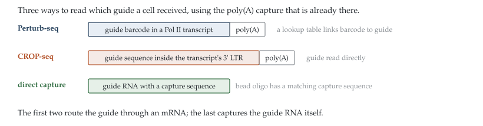{width=92%}

- Each cell receives one or more guide RNAs, and the effect of each guide is read as a whole-transcriptome phenotype
- The guide must be read in the same cell: route it through a poly(A) transcript, or capture the guide RNA directly ([Perturb-seq](https://henriksson-lab.github.io/NGS_101/https://henriksson-lab.github.io/NGS_101/perturb-seq-original-barcode-proxy__10.1016+j.cell.2016.11.038/chem.html), [direct capture](https://henriksson-lab.github.io/NGS_101/https://henriksson-lab.github.io/NGS_101/5-direct-capture-perturb-seq__10.1038+s41587-020-0470-y/5-direct-capture-perturb-seq.html))
- Without a poly(A) route, a guide is invisible to the oligo(dT) capture used for the transcriptome

[Dixit et al. 2016, doi:10.1016/j.cell.2016.11.038; Replogle et al. 2020, doi:10.1038/s41587-020-0470-y]{.small}

## CROP-seq: the guide travels in the lentiviral genome

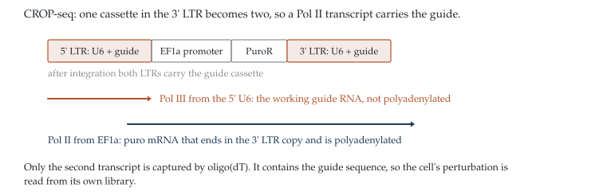{width=77%}

- The guide cassette is placed in the 3' LTR; reverse transcription copies it to the 5' LTR, so the provirus has two ([CROP-seq](https://henriksson-lab.github.io/NGS_101/https://henriksson-lab.github.io/NGS_101/crop-seq__10.1038+nmeth.4177/crop-seq.html))
- Pol III makes the working guide from one copy; Pol II makes a polyadenylated mRNA that ends in the other, and that mRNA is captured with the transcriptome
- No extra barcode lookup is needed, because the guide sequence is read directly; the enrichment PCR that makes those rare reads affordable is in [reading screens out](../screens/lec-readout.qmd)

[Datlinger et al. 2017, doi:10.1038/nmeth.4177]{.small}

## T and B cell receptors: reading the junction

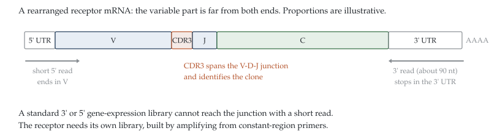{width=92%}

- Receptor mRNAs are rearranged: the junction that distinguishes the clone (CDR3) is far from either end of the transcript
- A short 3' tag read does not reach it, and a short 5' read ends in the variable gene
- The solution is a dedicated library built from the same barcoded cDNA by amplifying out of the constant region

## 5' capture and V(D)J enrichment

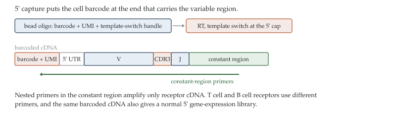{width=78%}

- In 5' kits the barcode is on the template-switch oligo, so it is added at the end of the cDNA that carries the variable region ([5' VDJ kit](https://henriksson-lab.github.io/NGS_101/https://henriksson-lab.github.io/NGS_101/10x-chromium-gem-x-single-cell-5-vdj-v3/01_10x-5p-vdj-v3.html))
- [Nested](../amplification/lec.qmd) constant-region primers amplify TCR or BCR cDNA only; full-length receptor sequences are then read in paired-end mode
- Because both chains share one cell barcode, alpha with beta, and heavy with light, are **paired**, which bulk sequencing cannot do ([earlier plate-based work](https://henriksson-lab.github.io/NGS_101/https://henriksson-lab.github.io/NGS_101/single-cell-tcr-phenotype-sequencing-han__10.1038+nbt.2938/chem.html))

[Han et al. 2014, doi:10.1038/nbt.2938]{.small}

## One barcode, many libraries

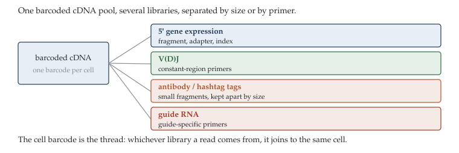{width=79%}

- A single barcoded cDNA pool gives gene expression, receptor, antibody and guide libraries, separated by size or by primer ([ECCITE-seq](https://henriksson-lab.github.io/NGS_101/https://henriksson-lab.github.io/NGS_101/eccite-seq__10.1038+s41592-019-0392-0/eccite-seq.html))
- Each library has its own read structure and needs its own share of the sequencing run
- Illustrative budget for 10,000 cells: 20,000 + 5,000 + 5,000 reads per cell = **300 million reads**

[Mimitou et al. 2019, doi:10.1038/s41592-019-0392-0]{.small}

## Combinatorial or droplets: choosing by constraint

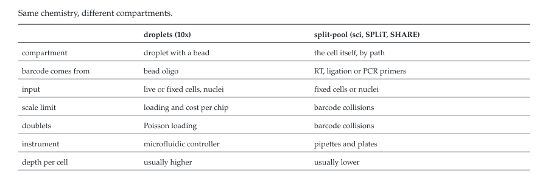{width=80%}

- Droplets are the easier route for fresh cells, a few thousand to tens of thousands, with high capture and depth
- Split-pool wins when cell numbers are very large, when many samples or conditions must be run together, and when no instrument is available
- Multimodal layers attach to either; the choice is set by what is being measured

## The design rule

- **The barcode must be attached before the molecules are pooled**, to every molecule class you want to track
- **It must survive every later step**: fixation holds it in the cell, ligation and PCR preserve it, size selection must not discard the short libraries
- **The same barcode joins the libraries**, so each modality needs its own handle, primer or tag, and its own share of reads
- Check the failure modes: collisions, ambient RNA, PCR chimeras that swap barcodes between molecules, and [index hopping](../sequencers/lec.qmd) between sublibraries

## Where this connects

**Blocks this protocol uses**

- [Compartments](../compartments/lec.qmd) — split-and-pool as a *virtual* compartment: a fixed cell is the tube, and the collision rate replaces the doublet rate
- [Barcodes and UMIs](../barcodes-umis/lec.qmd) — how a few hundred oligos make a million addresses, how many of them you may fill, and how a barcode read with errors is corrected
- [Attaching a handle](../handles/lec.qmd) — each round adds a handle by RT, ligation or PCR; the same five ways, applied three times to one molecule
- [Ligases, kinases, phosphatases](../enzymes/lec-ligases.qmd) — rounds 2 and 3 of SPLiT-seq and SHARE-seq are splinted ligations, which is why the linker oligo matters as much as the barcode
- [Transposases and modifying enzymes](../enzymes/lec-transposases.qmd) — an indexed Tn5 makes tagmentation itself the first barcoding step in sci-ATAC-seq
- [Selection](../selection/lec.qmd) — biotin on the cDNA primer is how one barcoded pool is split into two libraries on streptavidin

**Where these blocks are also used**

- [Chromatin](../chromatin/lec.qmd) — ATAC and CUT&Tag in bulk; sci-ATAC is that assay with an indexed enzyme
- [Pooled screens](../screens/lec.qmd) — where the guide library that Perturb-seq and CROP-seq read out is built
