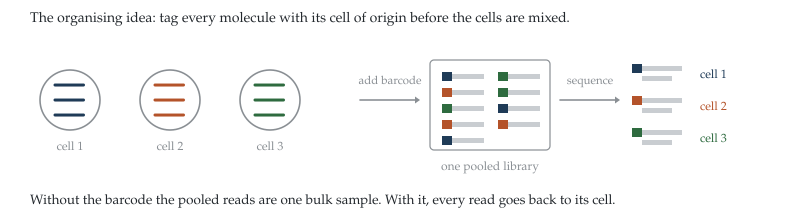
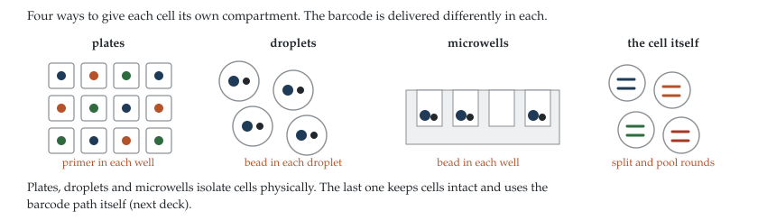
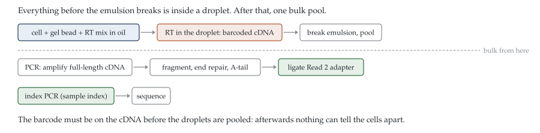
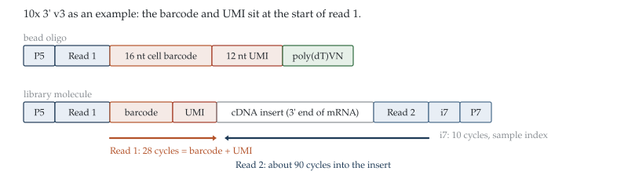
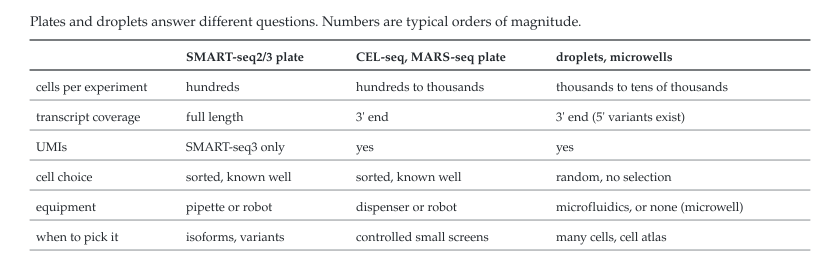

## Start from the question

A tissue is a mixture of cell types and states, and a bulk library averages them. To ask which cells express what, you need one library per cell, or something equivalent.

A human cell holds on the order of 10^5 mRNA molecules, in a few picograms of RNA. That is a tiny sample, and the protocol must capture a useful share of it without losing track of which cell it came from.

**The organising idea of this unit:** the blocks are the ones you already know (RT, template switching, amplification, tagmentation, adapters). What is new is that **every molecule must carry a compartment barcode** from the moment it is made, so that the cells can be pooled and still be told apart.

## The barcode is what makes pooling possible

{width=92%}

- Cost and batch effects scale with the number of libraries, so pool as early as the chemistry allows
- A barcode on the first-strand primer tags every cDNA of a cell at the moment it is made
- Everything after pooling is an [ordinary library molecule](../library-molecule/lec.qmd); everything before it is where single-cell methods differ

## Four ways to give each cell its own compartment

{width=92%}

- **Plates and microwells:** a physical well holds one cell; the barcode comes in the primer of that well, or on a bead in it
- **Droplets:** a microfluidic device puts one cell and one barcoded bead in each droplet of oil
- **The cell itself:** fixed cells are barcoded by successive split and pool rounds, so no hardware isolates them (next deck)

## SMART-seq: one cell per well, full-length cDNA

{width=90%}

- Reverse transcriptase adds a few non-templated Cs at the 5' end of a cDNA that reaches the cap; a template-switch oligo pairs there and the enzyme copies it: **full-length cDNA with a known handle at each end** ([SMART-seq2](https://henriksson-lab.github.io/NGS_101/smart-seq2__10.1038+nmeth.2639/smart-seq2.html))
- One PCR primer amplifies every cDNA; Tn5 then tagments, and the **well index** is added by index PCR ([the TSO itself is designed in the low-input RNA deck](../rna/lec-small-rna.qmd))
- The cell is never barcoded inside the molecule, so cells cannot be pooled before the end

[Picelli et al. 2013, doi:10.1038/nmeth.2639]{.small}

## Tag or full length: a design choice

- **3' or 5' tag methods** read one end of each mRNA, which is enough to count molecules and identify cell types, and allow UMIs
- **Full-length methods** read the whole transcript: isoforms, splice junctions and variants within a cell, at higher cost per cell
- [SMART-seq3](https://henriksson-lab.github.io/NGS_101/smart-seq3__10.1038+s41587-020-0497-0/smart-seq3.html) puts a UMI at the 5' end and combines the two: reads from the UMI-carrying end count molecules, and internal reads give isoform and variant information
- The question decides: *which cells exist* wants thousands of cells and a tag; *what does this cell express in detail* wants a plate and a full-length protocol

[Hagemann-Jensen et al. 2020, doi:10.1038/s41587-020-0497-0]{.small}

## CEL-seq and MARS-seq: barcode the RT primer, then pool

{width=92%}

- The reverse-transcription primer carries a **cell barcode**, a UMI and oligo(dT); after RT the wells are pooled, and one tube goes through the rest ([CEL-seq](https://henriksson-lab.github.io/NGS_101/cel-seq__10.1016+j.celrep.2012.08.003/cel-seq.html), [MARS-seq](https://henriksson-lab.github.io/NGS_101/mars-seq__10.1126+science.1247651/mars-seq.html))
- T7 in vitro transcription amplifies linearly, which avoids the exponential bias of early PCR cycles
- The cells are still sorted into wells, so the experimenter knows which cell is where (for example by index sorting)
- The UMI rides on that first-strand primer because a tag added later would count copies, not molecules ([barcodes and UMIs](../barcodes-umis/lec.qmd))

[Hashimshony et al. 2012, doi:10.1016/j.celrep.2012.08.003; Jaitin et al. 2014, doi:10.1126/science.1247651]{.small}

## 10x 3' v3: one cell, one gel bead, one GEM

{width=86%}

- A chip brings a stream of cells together with a stream of gel beads and cuts the flow into droplets of oil of about a nanolitre, called GEMs ([3' v3 protocol](https://henriksson-lab.github.io/NGS_101/10x-chromium-single-cell-3-ge-v3/01_10x-3prime-v3.html))
- Every oligo on one bead carries the same 16 nt cell barcode, its own 12 nt UMI, and poly(dT)VN to prime on poly(A)
- Cells arrive at random, so most GEMs are empty and a few hold two cells; the loading rate chosen sets that doublet fraction ([worked in compartments](../compartments/lec.qmd))

## Inside the GEM: reverse transcription, then a handle at the other end

- The gel bead dissolves and releases its oligos; the mRNA primes on poly(dT)VN and is copied, so the barcode and UMI are on the cDNA while the droplet still exists
- Reaching the cap, the reverse transcriptase adds a few non-templated Cs and switches to a [template-switch oligo](../handles/lec.qmd), which leaves a second known handle at the 5' end
- The cDNA now has one handle at each end, so a single primer pair amplifies every molecule in the pool whatever gene it came from

## Break the emulsion: from here it is an ordinary library

{width=92%}

- The barcode must be on the cDNA **before** the oil is broken; afterwards a pool of millions of molecules cannot be traced back to cells
- The pooled cDNA is amplified off its two handles, then fragmented, end-repaired and A-tailed ([end chemistry](../end-chemistry/lec.qmd)), and the Read 2 adapter is ligated
- Index PCR adds the sample index and the P5 and P7 ends; since the cDNA was fragmented, only the 3'-most fragment carries both the cell barcode and the Read 2 adapter

## The read structure that falls out of it

{width=92%}

- The bead oligo sets the layout: Read 1 holds the 16 nt cell barcode and the 12 nt UMI, Read 2 holds the cDNA, and the index read holds the sample index
- The run is set up to match: about 28 cycles for Read 1, about 90 for Read 2, in the read-structure notation of the [sequencer deck](../sequencers/lec.qmd)
- Reading only the 3' end keeps the library short and puts the UMI next to the barcode, so one short read identifies the cell and the molecule at once

## Which barcodes of this library are cells?

{width=79%}

- Most of the barcodes seen are GEMs that held no cell but still captured RNA leaked from broken ones: ambient RNA
- Ranking the barcodes by UMI count gives a plateau of cells and a tail; the knee is the first cut, refined by statistical models ([where the knee is derived](../compartments/lec.qmd))
- Ambient RNA also contaminates real cells; correct it before calling a gene expressed in a cell type [Young and Behjati 2020, doi:10.1093/gigascience/giaa151]{.small}
- A barcode one mismatch from exactly one entry of the bead whitelist is corrected to it; two equally close entries, and the read is dropped ([why that is safe](../barcodes-umis/lec.qmd))

## The same trace, a different bead

{width=92%}

- [Drop-seq](https://henriksson-lab.github.io/NGS_101/drop-seq__10.1016+j.cell.2015.05.002/drop-seq.html): rigid beads load at random, so most droplets have none, and RT waits until the pooled beads are out of the oil
- [inDrop](https://henriksson-lab.github.io/NGS_101/indrop-v1__10.1016+j.cell.2015.04.044/indrop-v1.html): hydrogel beads close-pack, so nearly every droplet gets one; [HyDrop](https://henriksson-lab.github.io/NGS_101/hydrop-rna__10.7554+eLife.73971/hydrop-rna.html) beads are made in the lab, for RNA or ATAC
- Microwells ([Seq-Well](https://henriksson-lab.github.io/NGS_101/seq-well__10.1038+nmeth.4179/seq-well.html), BD Rhapsody): gravity instead of a chip, and a membrane instead of oil
- The bead sets loading efficiency and when the barcode is released; after that, the trace above

[Macosko et al. 2015, doi:10.1016/j.cell.2015.05.002; Klein et al. 2015, doi:10.1016/j.cell.2015.04.044; De Rop et al. 2022, doi:10.7554/eLife.73971; Gierahn et al. 2017, doi:10.1038/nmeth.4179]{.small}

## Fresh cells, nuclei and fixed cells

- **Whole cells** need fast, gentle dissociation; some tissue types (neurons, adipocytes, frozen biopsies) do not survive it
- **Nuclei** can be isolated from frozen tissue; they carry less cytoplasmic RNA and more intronic reads, so a gene-expression reference with introns is used
- **Fixed cells** decouple sampling from processing: [hybridised probes](../selection/lec.qmd) can replace RT as the capture step ([Flex](https://henriksson-lab.github.io/NGS_101/10x-fixed-rna-profiling-flex/flex.html)), and combinatorial methods need fixation by design
- Each choice changes the capture chemistry, but the barcode logic is the same

## Plates and droplets answer different questions

{width=82%}

- Plates give depth and full length for a limited number of cells you chose
- Droplets and microwells give thousands of cells with no selection, at modest depth per cell
- A systematic comparison of protocols is the best way to see the trade-off [Ziegenhain et al. 2017, doi:10.1016/j.molcel.2017.01.023]{.small}

## The read budget

- 5,000 cells with 3' droplet libraries at 50,000 reads per cell: **250 million reads**
- 384 cells with SMART-seq at 1 million reads per cell: **384 million reads** for a much smaller experiment
- The first reads of each library are the most informative, and a library saturates: past a point, extra reads re-sequence molecules already counted
- Check how many new UMIs the last 10% of reads added before ordering a deeper run

## One question to ask of any single-cell protocol

- **Where does the barcode enter, and what physical compartment does it label?** A well, a droplet, a bead in a microwell
- **When are the cells pooled?** After RT (CEL-seq, MARS-seq, droplets) or only at the end (SMART-seq)
- **What does the 3' tag give up?** Isoforms, splice junctions and variants, for the sake of scale
- The next deck removes the hardware: cells that are their own compartments, and assays that measure more than RNA

## Where this connects

**Blocks this protocol uses**

- [Compartments](../compartments/lec.qmd) — the well, the droplet and the microwell, with the Poisson arithmetic that sets doublets, empty droplets and the knee in the barcode-rank plot
- [Barcodes and UMIs](../barcodes-umis/lec.qmd) — why a whitelist can be corrected at one mismatch, why the UMI must go on the RT primer, and how the read budget is divided
- [Attaching a handle](../handles/lec.qmd) — the two handles every protocol here uses: the barcoded RT primer, and the template-switch oligo at the other end
- [Polymerases and RTs](../enzymes/lec.qmd) — template switching is an RT side-activity, and which enzyme you buy decides how well it works
- [Amplification](../amplification/lec.qmd) — IVT in CEL-seq is linear precisely to avoid the exponential bias of early PCR cycles; duplicates are what the UMI exists to collapse
- [Fragmentation](../fragmentation/lec.qmd) — tagmenting the amplified cDNA is why only the 3' end carries both the barcode and the second adapter

**Before this**

- [mRNA and total RNA](../rna/lec.qmd) — poly(A) capture, RT priming and second strand; the single-cell version is the same chemistry in a nanolitre

**Where this goes next**

- [Combinatorial indexing and multimodal](lec-combinatorial.qmd) — the same barcode logic with the hardware removed, and extended to chromatin, protein and guides
