## A tissue is not a tube

Every library so far began by grinding something up. That destroys the one thing a tissue
section has that a suspension does not: **which cell was next to which**.

The question for this deck: *how do you carry position through a protocol whose every step
is, by default, a bulk reaction in a tube?*

The answer is always the same. **Position must become a molecule** — a barcode, a pixel
address, or a rolling-circle amplicon pinned in place — and the protocol must not let the
RNA move before that happens.

::: {.notes}
Connect back to C7: there the compartment barcode named a cell. Here it names a place.
:::

## Three ways to put position into a sequence

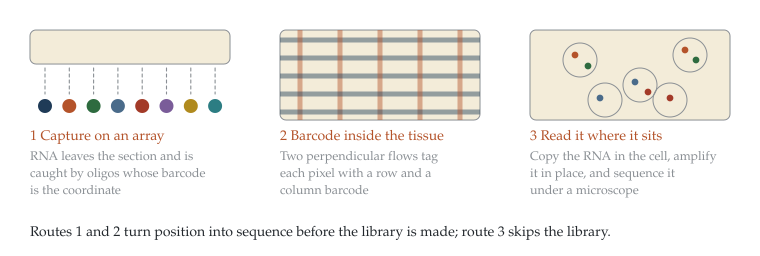{width=81%}

- Routes 1 and 2 end in an ordinary library; route 3 is sequenced under a microscope
- Every method in this deck is one of these, plus a fixation and a permeabilisation recipe

## A coordinate is just a barcode

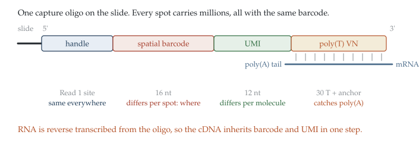{width=85%}

- The same idea as a [cell barcode in droplets](../single-cell/lec.qmd): one oligo family per spot, shared handle, per-molecule UMI — only the compartment is a place, not a cell
- The UMI counts molecules, not reads, which matters more when a spot holds only a few hundred

[Ståhl et al. 2016, doi:10.1126/science.aaf2403]{.small}

## The sandwich: RNA has to go down, not sideways

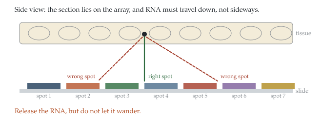{width=72%}

- Array capture works only if each transcript lands under the cell it came from
- Lateral diffusion is the physical limit on resolution, whatever the spot size

[Ståhl et al. 2016, doi:10.1126/science.aaf2403]{.small}

## Permeabilisation decides whether anything works

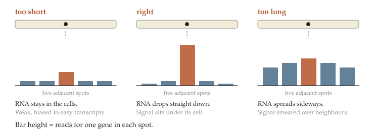{width=75%}

- Digest too little and RNA stays in the cell; too much and it spreads
- The right time depends on tissue type, fixation, thickness and age of the block ([fix and permeabilise instead of isolating](../compartments/lec.qmd) is the general form of this step)
- Visium therefore ships a **tissue optimisation** slide: permeabilise for a series of times, make fluorescent cDNA, and read the footprint

::: {.notes}
The 2016 paper already treated this as the central optimisation. Everything downstream is standard.
:::

## Fixation decides what is left to capture

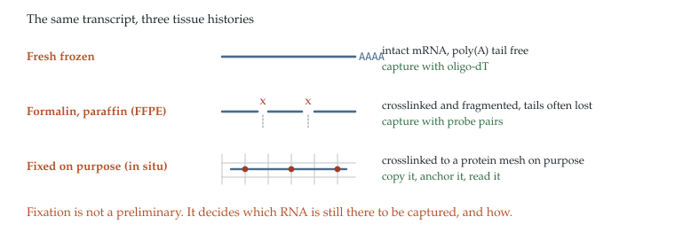{width=79%}

- Fresh frozen sections are methanol-fixed and stained for imaging; FFPE tissue needs probe-based capture because crosslinking and age damage poly(A) RNA
- In situ methods turn the same crosslinks into a tool: they anchor the copy in place

[Salmén et al. 2018, doi:10.1038/s41596-018-0045-2]{.small}

## The Visium workflow, in order

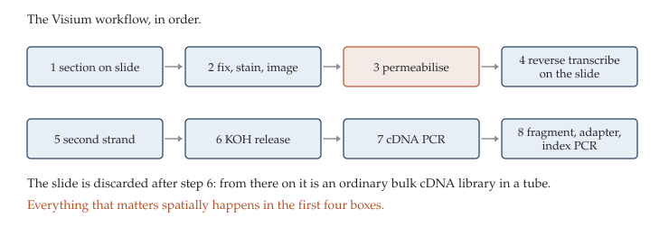{width=89%}

- Imaging comes first, because the permeabilised, reverse-transcribed section is no longer a picture
- After release the slide is thrown away; the barcode was copied onto cDNA by reverse transcription and nothing else of the array is needed

[Ståhl et al. 2016; Salmén et al. 2018, doi:10.1038/s41596-018-0045-2]{.small}

## What comes back from the sequencer

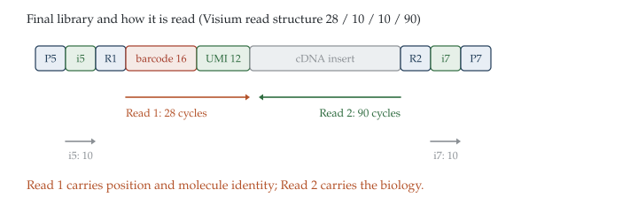{width=85%}

- 16 nt barcode and 12 nt UMI fit in a short Read 1; the 90 nt Read 2 is the transcript — the [same construct](../library-molecule/lec.qmd) as a 10x 3' library, with the barcode naming a spot
- The barcode is looked up in a table that comes with the slide, giving x and y
- Position is a lookup; the biology is read 2

## Resolution is a design choice, not a feature

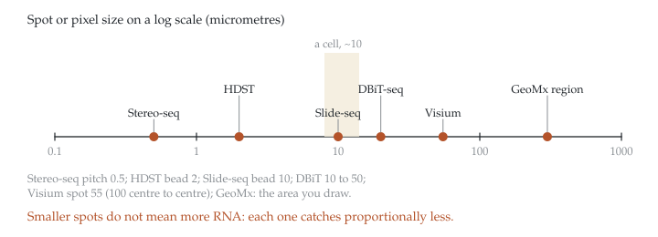{width=76%}

- Spot size spans four orders of magnitude between methods
- A spot larger than a cell mixes cell types; a spot smaller than a cell splits one transcriptome over many spots

## Where does a barcode get its coordinate?

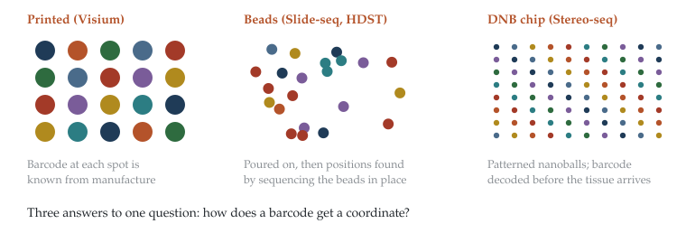{width=81%}

- Printed arrays: the manufacturer knows the position of each barcode
- Randomly placed beads, one barcode per bead, poured onto the slide (**Slide-seq** and **HDST**, two slides on): positions are found afterwards by sequencing the beads in place (Slide-seq), or by optical decoding after combinatorial synthesis (HDST)
- Patterned DNA nanoballs: the position is fixed in advance and decoded by sequencing

[Rodriques et al. 2019, doi:10.1126/science.aaw1219; Vickovic et al. 2019, doi:10.1038/s41592-019-0548-y]{.small}

## Stereo-seq: sequence the array before it sees tissue

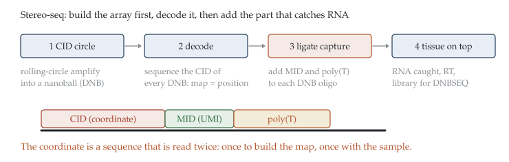{width=86%}

- Circles of coordinate-identifier DNA are amplified by rolling circle into nanoballs (the same chemistry as [DNBSEQ](../sequencers/lec-platforms.qmd)), which sit on a patterned chip
- Sequencing the chip once gives a map from every identifier to a position
- Only afterwards is the capture oligo ligated on, and the tissue added

[Chen et al. 2022, doi:10.1016/j.cell.2022.04.003]{.small}

## Beads: decode after you pour

Slide-seq and HDST need a map from barcode to position, but the beads land at random.

**Sequencing by ligation** reads a base with a ligase instead of a polymerase: a labelled probe oligo is joined onto a primer only if it matches the template at the position being queried, the colour is imaged, and the cycle repeats. It was largely replaced by sequencing by synthesis in bulk instruments, but it is still the readout in several in-situ methods, because it needs no flow cell and works where the molecules cannot be moved. Worth knowing on both counts, since an imaging chemistry that lost one competition can win another.

- **Slide-seq** — 10 µm beads, each coated with one barcode; positions read by sequencing-by-ligation on the beads, in place
- **Slide-seqV2** — the same idea with improved bead chemistry and a better library, giving higher sensitivity
- **HDST** — 2 µm beads in wells; the barcode is built from three combinatorial pools, so a small number of optical rounds decodes every well

All three then work like Visium: tissue on top, permeabilise, reverse transcribe, release.

[Stickels et al. 2021, doi:10.1038/s41587-020-0739-1; Rodriques et al. 2019, doi:10.1126/science.aaw1219]{.small}

## Smaller spots, fewer molecules

A worked example. A Visium spot is 55 µm across, a Slide-seq bead 10 µm.

- Area ratio: (55 / 10)² ≈ **30**. At the same capture density, a bead catches one thirtieth as many molecules
- A typical cell is about 10 µm. A Stereo-seq spot at 0.5 µm pitch holds roughly (10 / 0.5)² = **400** positions per cell, each with a handful of UMIs
- So fine arrays are **binned** afterwards, and sensitivity per position is the cost of resolution

The practical rule: sequence deeper per area, not per spot, and judge saturation on UMIs, not reads.

## DBiT-seq: let the tissue be the array

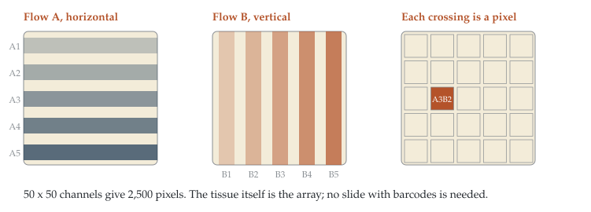{width=76%}

- No barcoded slide at all: microfluidic channels are laid on a fixed section
- Flow A carries oligo-dT with barcode A for in situ reverse transcription; flow B, perpendicular, adds barcode B
- Each crossing is a pixel with its own pair address; antibody-derived tags can ride along

[Liu et al. 2020, doi:10.1016/j.cell.2020.10.026]{.small}

## How barcode B finds barcode A

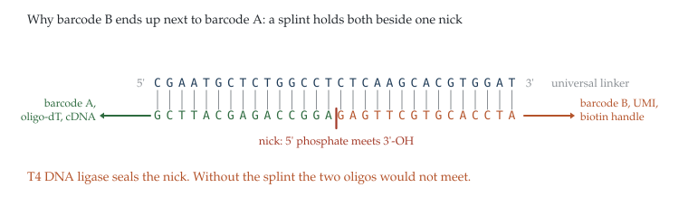{width=95%}

- The universal linker is the template for a ligation, in tissue, with T4 DNA ligase
- The 5' end of B-oligo carries a biotin handle, so tagged cDNA can be captured on streptavidin beads afterwards
- Reverse transcription runs inside fixed cells, so permeabilisation is again what decides whether the barcodes reach the RNA

[Liu et al. 2020, doi:10.1016/j.cell.2020.10.026; Su et al. 2021, doi:10.1016/j.xpro.2021.100532]{.small}

## GeoMx: choose a region, collect its tags

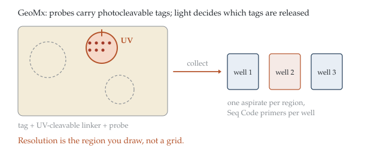{width=68%}

- Probes (for RNA) or antibodies (for protein) carry a DNA tag on a UV-cleavable linker
- You draw regions on a stained image; light releases the tags only there
- Probes bind short stretches of RNA, and nothing is reverse transcribed in the tissue, so degraded or formalin-fixed material is less of a problem

[Merritt et al. 2020, doi:10.1038/s41587-020-0472-9]{.small}

## The GeoMx library is only a PCR away

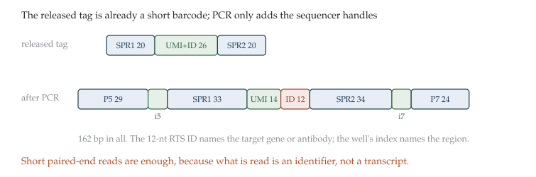{width=83%}

- The tag already contains a UMI and a 12 nt target identifier
- Each well is amplified with a well-specific index pair, so a sequencing run is a count table per region
- Throughput is limited by regions and wells, not by tissue area

[Merritt et al. 2020, doi:10.1038/s41587-020-0472-9]{.small}

## FISSEQ: sequence RNA where it sits

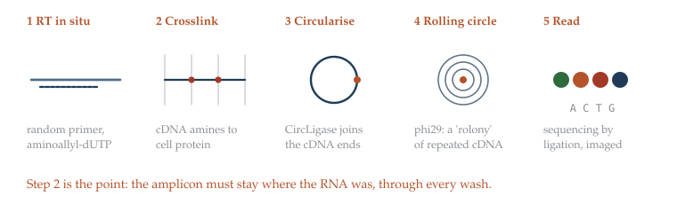{width=82%}

- Reverse transcribe in the fixed cell with modified nucleotides, crosslink the cDNA to protein, circularise, amplify by rolling circle
- Each amplicon is a **rolony**: copies of one cDNA, pinned where its RNA sat
- Read by sequencing-by-ligation under a microscope, in the SOLiD style. No library, no flow cell
- A published method rather than a kit, and one that others have found hard to reproduce. The
  chemistry it borrows had already lost the bulk-sequencing competition

[Lee et al. 2014, doi:10.1126/science.1250212]{.small}

## STARmap: probes instead of random priming

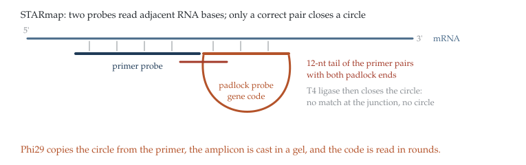{width=87%}

- FISSEQ copies everything; STARmap targets a **chosen gene panel** with a [padlock probe](../targeted/lec.qmd) pair per transcript
- The code in the padlock, not the transcript sequence, is what is read, so a short read round count is enough; the rounds are run by SEDAL, STARmap's own sequencing-by-ligation chemistry
- Amplicons are cast into a hydrogel and the tissue is cleared with protease so that light and reagents can get in

[Wang et al. 2018, doi:10.1126/science.aat5691]{.small}

## The methods side by side

| Method | Position from | RNA captured by | What is sequenced |
|---|---|---|---|
| Visium | printed barcode | oligo-dT on slide | library, Illumina |
| Slide-seq, HDST | beads decoded in place | oligo-dT on beads | library, Illumina |
| Stereo-seq | DNB chip, decoded first | oligo-dT on DNBs | library, DNBSEQ |
| DBiT-seq | channel crossing | in situ RT, then ligation | library, Illumina |
| GeoMx | the region you draw | probe hybridisation | tags only |
| FISSEQ, STARmap | rolony position | in situ RT or padlock | the tissue itself |

Which row is cheapest to repeat? Which asks least of the tissue? Those are different rows.

## Why the real protocols differ

Read the protocols in the [NGS 101 collection](https://henriksson-lab.github.io/NGS_101/) with these questions in mind:

- Is RNA captured by its **poly(A) tail** or by a **probe**? That is a statement about fixation
- Is **position** known in advance, found afterwards, or made in the tissue?
- Is the RNA **released** before capture (permeabilise) or **left in place** (crosslink)?
- Is the readout **a library** or a **microscope image**?

Linked pages: [Visium](https://henriksson-lab.github.io/NGS_101/10x-visium-spatial-gene-expression/visium.html), [Slide-seq](https://henriksson-lab.github.io/NGS_101/slide-seq__10.1126+science.aaw1219/slide-seq.html), [Stereo-seq](https://henriksson-lab.github.io/NGS_101/stereo-seq__10.1016+j.cell.2022.04.003/stereo-seq.html), [HDST](https://henriksson-lab.github.io/NGS_101/hdst__10.1038+s41592-019-0548-y/hdst.html), [DBiT-seq](https://henriksson-lab.github.io/NGS_101/dbit-seq__10.1016+j.cell.2020.10.026/dbit-seq.html), [GeoMx](https://henriksson-lab.github.io/NGS_101/geomx-dsp__10.1038+s41587-020-0472-9/geomx-dsp.html), [FISSEQ](https://henriksson-lab.github.io/NGS_101/fisseq__10.1126+science.1250212/fisseq.html), [STARmap](https://henriksson-lab.github.io/NGS_101/starmap__10.1126+science.aat5691/starmap.html)

## When the data look wrong: ask the chemistry

| Observation | Likely cause |
|---|---|
| Signal blurred across the tissue edge and the empty slide | Over-permeabilisation: RNA diffused |
| Few genes in every spot, even at high depth | Under-permeabilisation, or RNA degraded before fixation |
| Strong signal only in some tissue regions | Region-dependent permeabilisation (fat, collagen, necrosis) |
| Many reads, few UMIs | Over-amplified library: the information was in the tissue, not the sequencer |
| Rolonies fade or drift between rounds | Crosslinking or gel embedding was incomplete |

None of these is fixed by the analysis. All of them are decided before the library exists.

## What to remember

- **Position becomes sequence** (array, pixel, region) or is read in place; pick by the question
- **Permeabilisation and fixation** are the limiting chemistry, and the first thing to optimise
- **UMIs and sampling** matter more when each position holds few molecules
- After release, spatial libraries are ordinary RNA libraries — the earlier decks apply unchanged

## Where this connects

**Blocks this protocol uses**

- [Compartments](../compartments/lec.qmd) — a spot is a compartment you do not have to build; the array does for position what a droplet does for a cell
- [Barcodes and UMIs](../barcodes-umis/lec.qmd) — the spot barcode is a whitelist lookup that returns x and y, and the UMI is what makes a few hundred molecules per spot countable
- [Attaching a handle](../handles/lec.qmd) — the capture oligo is a bead-bound RT primer, and DBiT-seq adds its second barcode by splinted ligation instead
- [Selection](../selection/lec.qmd) — oligo-dT for fresh frozen, probe hybridisation for FFPE, streptavidin on the biotinylated B-oligo: the capture step *is* a selection, and fixation decides which one is available
- [Ligases, kinases, phosphatases](../enzymes/lec-ligases.qmd) — T4 ligase working inside tissue across a universal linker (DBiT-seq) or closing a padlock (STARmap)
- [Amplification](../amplification/lec.qmd) — rolling circle is what turns one cDNA into a visible rolony, and what builds a nanoball array in the first place

**Before this**

- [mRNA and total RNA](../rna/lec.qmd) — once the barcode is on and the slide is discarded, this is an ordinary 3' RNA library

**If this fails**

- [QC](../qc/lec.qmd) — many reads and few UMIs is over-amplification, and the trace says so before the tissue is blamed
