## Spend the reads where the question is

Most questions concern a small part of a human genome:

- Is a known set of cancer genes mutated in this biopsy?
- Is a tumour mutation present at 0.1% in plasma?
- Which CpG-rich promoters are methylated in this cell type?
- Which of 500 000 variants does this person carry?

Sequencing everything is wasteful; worse, it cannot reach the depth that a rare variant needs.
Targeting adds a **selection** block to the library recipe, and rare-variant work adds a **molecule-counting** block.

::: {.notes}
Part C pattern: question and sample, then derive the library, then compare with real protocols.
Reuse the five blocks from the genomic DNA unit and add one.
:::

## Three ways to select

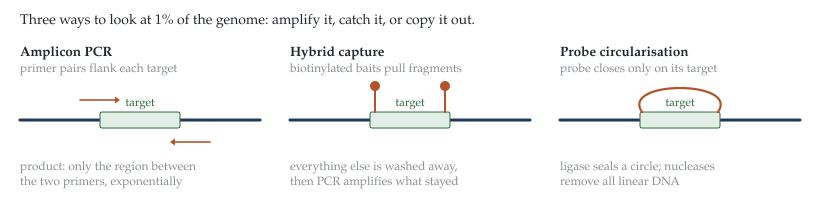{width=95%}

- **Amplify** the target (PCR), **catch** it (hybridisation), or **copy it out** (circularising probes)
- A fourth family selects by the genome itself: restriction enzymes, or a guide RNA
- The [selection block](../selection/lec.qmd) gives the general case; here it is applied to a panel of loci
- Each gives up something: uniformity, input, panel size, or flexibility

## Amplicons: multiplex PCR with tiled primers

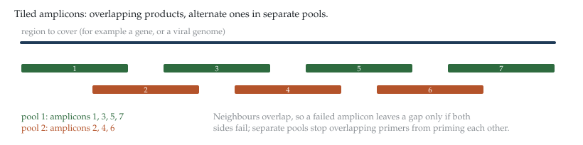{width=95%}

- Primer pairs flank each target; many pairs in one tube ([multiplex PCR](../amplification/lec.qmd))
- For regions longer than one amplicon, tile overlapping amplicons and split them into two pools
- The method was made widely known on viral genomes ([ARTIC](https://henriksson-lab.github.io/NGS_101/artic-tiled-amplicon-sequencing__10.1038+nprot.2017.066/artic-tiled-amplicon.html)); the logic is the same for tiling a human gene

[Quick et al. 2017, doi:10.1038/nprot.2017.066]{.small}

## What goes wrong with amplicons

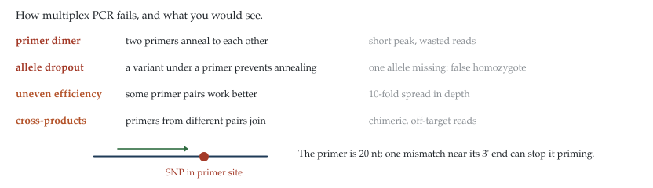{width=95%}

- Every extra primer pair adds more ways for primers to interact
- Primers sit on the genome: a common variant under one of them silently removes an allele
- Amplicons are the cheapest and fastest option, but they cannot tell a PCR error from a mutation without a UMI

## Hybrid capture: make the library, then fish

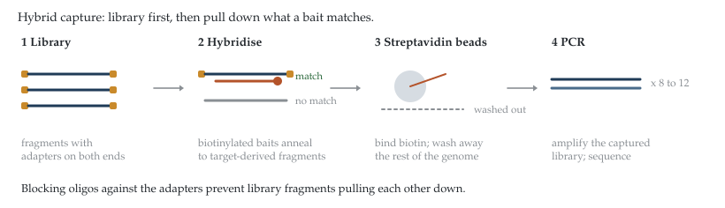{width=95%}

- Biotinylated RNA or DNA baits anneal to fragments from the target; streptavidin beads pull them out
- Because the whole library is carried through, capture tolerates a wide variety of fragment ends and targets of any size
- Hybridisation takes hours at one temperature, so baits must work together: a [Tm](../nucleic-acids/lec.qmd) question

[Gnirke et al. 2009, doi:10.1038/nbt.1523]{.small}

## Worked example: how much enrichment?

Human exome: about 50 Mb of 3.1 Gb, so **1.6%** of a random library lands on target.

- A capture with **70%** on target is a 70 / 1.6, about **44-fold** enrichment
- At 100x mean target depth you read 100 × 50 Mb / 0.7 = 7.1 Gb, versus 100 × 3.1 Gb = 310 Gb without capture
- Reads fall on fragment flanks as well as baits, so depth is highest in the middle of targets and decays at the edges

Real on-target rates depend on the kit and the number of rounds. Treat 70% as an illustration.

## Probes that circularise: MIPs and padlocks

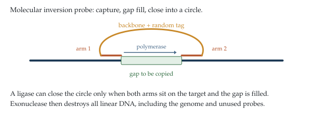{width=80%}

- The probe's two arms match the target on each side of a gap; the polymerase fills the gap, the ligase closes the circle
- Everything linear is digested: very low background from only the exact target
- A random tag in the backbone gives each captured molecule an identity: the **smMIP**

[Hiatt et al. 2013, doi:10.1101/gr.147686.112; Porreca et al. 2007, doi:10.1038/nmeth1110]{.small}

## Cas9-guided enrichment

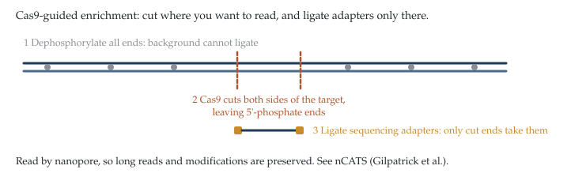{width=93%}

- [Block the ends](../end-chemistry/lec.qmd) of the whole genome, cut only at the target, and only the cut ends accept adapters
- No PCR is needed, so native DNA and its modifications are kept; combine with nanopore for long reads
- See [nCATS](https://henriksson-lab.github.io/NGS_101/nanopore-cas9-targeted-sequencing-ncats__10.1038+s41587-020-0407-5/ncats.html); the need for relatively large input and the modest depth are the trade-offs

[Gilpatrick et al. 2020, doi:10.1038/s41587-020-0407-5]{.small}

## Reduced representation: let an enzyme choose

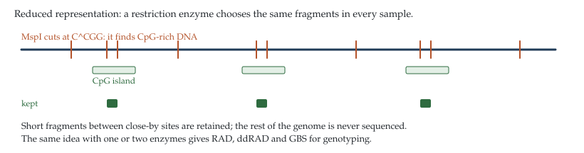{width=95%}

- MspI cuts C^CGG ([restriction enzymes](../enzymes/lec-nucleases.qmd)): sites cluster in CpG-rich DNA such as promoters and CpG islands
- Digest, keep short fragments (tens to a couple of hundred bp), and the same positions are sampled in every sample
- Same idea, different enzymes: [RAD](https://henriksson-lab.github.io/NGS_101/rad-seq__10.1371+journal.pone.0003376/rad-seq.html), [ddRAD](https://henriksson-lab.github.io/NGS_101/ddrad-seq__10.1371+journal.pone.0037135/ddrad-seq.html) and [GBS](https://henriksson-lab.github.io/NGS_101/gbs__10.1371+journal.pone.0019379/gbs.html) sample restriction fragments to genotype many individuals

[Baird et al. 2008, doi:10.1371/journal.pone.0003376; Elshire et al. 2011, doi:10.1371/journal.pone.0019379]{.small}

## RRBS: reading methylation on the selected fragments

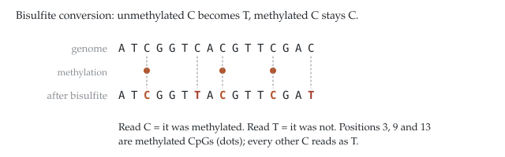{width=90%}

- Bisulfite converts unmethylated C to U (read as T); methylated C is protected ([the readout](../chemistry-to-sequence/lec.qmd))
- After MspI digestion, end repair and A-tailing, adapters are ligated, then bisulfite, then PCR
- The adapters carry 5-methylcytosine in place of C so that they survive the conversion

[Meissner et al. 2008, doi:10.1038/nature07107; see [RRBS](https://henriksson-lab.github.io/NGS_101/rrbs-illumina__10.1038+nature07107/rrbs-illumina.html)]{.small}

## RRBS design details worth knowing

- The cytosine filled in during end repair is unmethylated by construction, so those end positions cannot be scored
- Bisulfite is harsh: the DNA fragments further, so input and complexity matter
- The original work used mouse cells; the method applies to human DNA unchanged
- Only a fraction of the human genome is covered, mostly CpG-rich regions: a good choice for promoters, a poor one for distal enhancers
- The same selection with single cells: [scRRBS](https://henriksson-lab.github.io/NGS_101/scrrbs__10.1101+gr.161679.113/scrrbs.html)

## Rare variants: signal and noise overlap

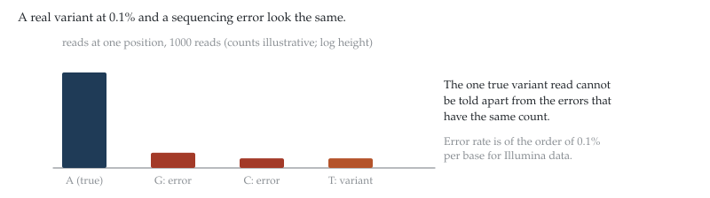{width=95%}

- A mutation present in 1 of 1000 DNA molecules gives one read in 1000
- Errors from PCR, from damage and from the sequencer occur at about the same rate
- More depth does not help: you would sample the same errors again

## UMIs: collapse reads to molecules

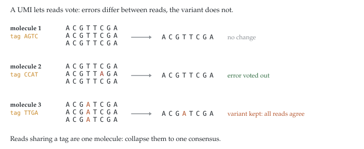{width=68%}

- A [random tag](../barcodes-umis/lec.qmd) put on each molecule **before** any amplification identifies its descendants
- Reads with one tag are one molecule; their consensus removes errors that differ between reads
- A variant is believed only if most reads of that molecule agree

[Kinde et al. 2011, doi:10.1073/pnas.1105422108; see [Safe-SeqS](https://henriksson-lab.github.io/NGS_101/safe-seqs__10.1073+pnas.1105422108/safe-seqs.html)]{.small}

## Duplex tags: use both strands

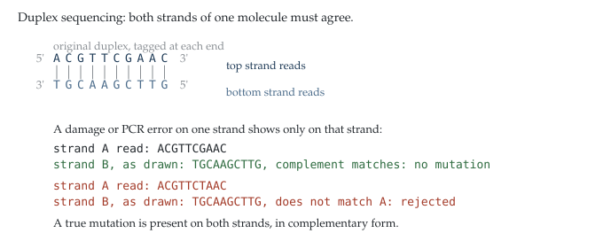{width=70%}

- A UMI cannot tell a DNA lesion present from the start from a true mutation, since it is copied faithfully
- Tag both strands: a true mutation is on both, a lesion on only one
- Much stronger error suppression, at the cost of needing both strands of each molecule read

[Schmitt et al. 2012, doi:10.1073/pnas.1208715109; see [Duplex Sequencing](https://henriksson-lab.github.io/NGS_101/duplex-sequencing__10.1073+pnas.1208715109/duplex-sequencing.html)]{.small}

## Where does the tag go?

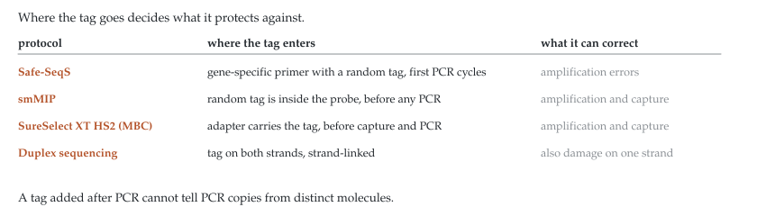{width=95%}

- The tag must be present before the first amplification, otherwise copies cannot be told from originals
- Earlier is better, but each protocol only protects against steps downstream of the tag
- smMIPs and SureSelect XT HS2 put the tag in the reagent that selects or ligates; Safe-SeqS in the first PCR primer

## Worked example: molecules, not reads

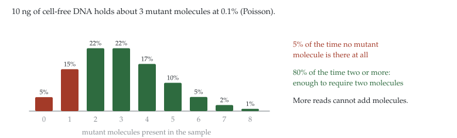{width=93%}

- 10 ng of cell-free DNA is about 3000 haploid genomes: a locus is present on 3000 molecules
- A variant at 0.1% is on about 3 of them; with that few, chance decides whether any is in your tube
- Sensitivity is set by **input molecules**, so low-VAF assays are limited by blood volume, not sequencing

## Family sizes tell you what to fix

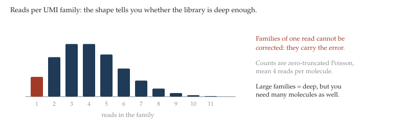{width=93%}

- Mostly singletons: sequenced too shallow to correct, or too many molecules for the reads
- Large families and few of them: too little input, or too many PCR cycles
- A good run balances molecules and reads per molecule: here a mean of 4 gives few singletons

## SureSelect XT HS2: capture with molecular barcodes

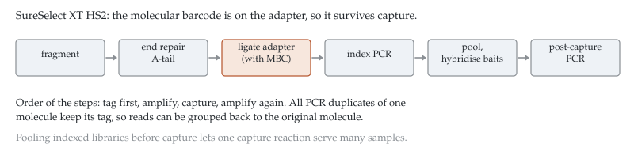{width=95%}

- 10 to 200 ng of DNA, sheared or enzymatically fragmented, end repair and A-tailing, ligation of adapters
- The barcode is in the adapter, so it is present for the index PCR, the capture and the second PCR
- See [SureSelect XT HS2](https://henriksson-lab.github.io/NGS_101/sureselect-xt-hs2-dna/sureselect-xt-hs2.html)

## Putting it together: CAPP-Seq for circulating tumour DNA

- Question: is tumour DNA in plasma, and how much? Sample: a few to tens of ng, short fragments
- Design: a hybrid-capture **selector** targeting regions recurrently mutated in the cancer type, so most patients carry several trackable mutations
- Plasma DNA is already short, so it is not sheared; adapters are ligated, with long incubation and excess adapter to rescue every molecule
- Capture, then PCR; the original design used no molecule tags, and later versions added them to reach lower VAFs
- See [CAPP-Seq](https://henriksson-lab.github.io/NGS_101/capp-seq__10.1038+nm.3519/01_chem.html)

[Newman et al. 2014, doi:10.1038/nm.3519]{.small}

## Comparing targeting methods

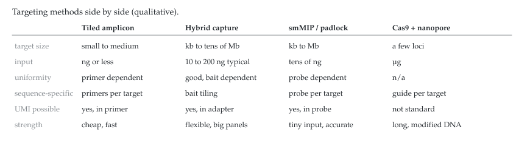{width=95%}

- Choose from the question: how many targets, how much DNA, how rare the variant
- Smaller panels favour PCR or probes; larger ones favour capture
- Read the rows as tendencies: each protocol moves these numbers

## Design from the question, then compare

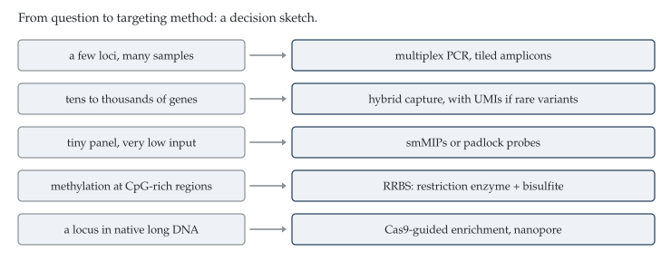{width=72%}

- The recurring exercise: question and sample first, then the blocks, then the kit
- Ask of every protocol: where does selection happen, where does the tag go, and where does PCR enter?

## Summary

- Targeting adds a selection block: amplify, catch, circularise, cut or digest
- Capture is flexible and scales to big panels; amplicons are fast and cheap; probes need little input
- Rare variants are limited by error and by molecule count, not by depth
- UMIs correct amplification errors; duplex tags also correct damage; the tag must precede amplification
- RRBS uses restriction digestion as selection and bisulfite as the readout

## Where this connects

**Blocks this protocol uses** — make an ordinary library, add a selection, then count molecules

- [Selection](../selection/lec.qmd) — the four families in general: this deck is one of them applied to a panel
- [Fragmentation](../fragmentation/lec.qmd) — in RRBS the digest is the fragmentation and the selection at once
- [End chemistry](../end-chemistry/lec.qmd) — blocking every other end is what makes a Cas9 cut the only entry point
- [Ligases](../enzymes/lec-ligases.qmd) — the circle a padlock must close, and the ends a ligase insists on
- [Amplification](../amplification/lec.qmd) — tiled multiplex PCR, and the errors that cycles add under the variant
- [Barcodes and UMIs](../barcodes-umis/lec.qmd) — UMI length, collapsing, duplex tags, and why never in the PCR
- [Converting chemistry into sequence](../chemistry-to-sequence/lec.qmd) — bisulfite and its gentler successors

**If this fails**

- [Design patterns and failure modes](../design/lec.qmd) — index hopping and low complexity both fake a rare variant
