## Four more families

The first deck was about ends and adapters. This one is about what the read means:

5. **Counting honestly:** reads are not molecules
6. **Very little or very degraded material:** losing nothing
7. **Keeping molecules together:** which cell or particle did this come from
8. **Turning a property into a base:** methylation, binding, position

Same format: the problem, the trick, the molecular reason it works, protocols that use it.

::: {.notes}
Entries are independent. Part D1-D4 is in the other deck.
:::

## D5. Reads are not molecules

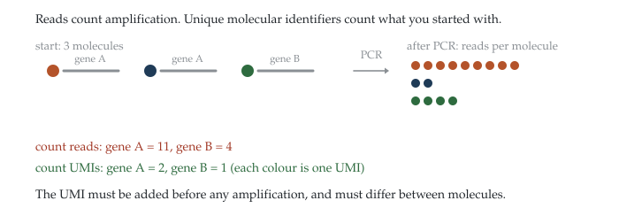{width=81%}

- **Problem:** PCR copies some molecules far more than others, so read count tracks amplification ([PCR bias and duplicates](../amplification/lec.qmd))
- **Trick:** a unique molecular identifier (UMI) is a random tag added to each molecule before any PCR; count distinct UMIs
- **Reason:** copies share a tag, independent molecules rarely do [Kivioja et al. 2012, doi:10.1038/nmeth.1778]{.small}

## Where may the UMI be added?

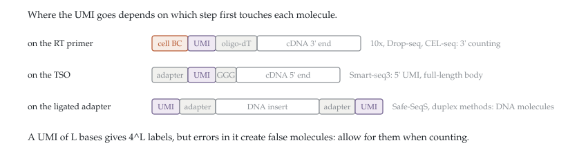{width=92%}

- It must be added **before the first amplification**, by whichever step first touches each molecule ([where a label can sit](../library-molecule/lec.qmd))
- RT primer: [10x 3'](https://henriksson-lab.github.io/NGS_101/10x-chromium-single-cell-3-ge-v3/01_10x-3prime-v3.html), [Drop-seq](https://henriksson-lab.github.io/NGS_101/drop-seq__10.1016+j.cell.2015.05.002/drop-seq.html), [CEL-Seq2](https://henriksson-lab.github.io/NGS_101/cel-seq2__10.1186+s13059-016-0938-8/cel-seq2.html); template-switch oligo: [SMART-seq3](https://henriksson-lab.github.io/NGS_101/smart-seq3__10.1038+s41587-020-0497-0/smart-seq3.html) [Hagemann-Jensen et al. 2020, doi:10.1038/s41587-020-0497-0]{.small}
- DNA molecules: [Safe-SeqS](https://henriksson-lab.github.io/NGS_101/safe-seqs__10.1073+pnas.1105422108/safe-seqs.html) [Kinde et al. 2011, doi:10.1073/pnas.1105422108]{.small}

## How long must a UMI be?

A UMI of L bases, ordered as [degenerate positions](../nucleic-acids/lec.qmd), has K = 4^L labels. The number of distinct labels seen from N molecules of one gene is about K(1 - e^(-N/K)).

Worked example, L = 10, so K = 1,048,576:

- **N = 1,000** molecules: about 1,000 × (1 − 0.0005) = 999.5 labels. Collisions are negligible
- **N = 100,000** molecules (an abundant transcript): K(1 − e^(−0.0954)) = about 95,400. You under-count by about 5%

Sequencing and PCR errors work the other way: they invent labels that do not exist. Count UMIs that differ by one base as one molecule, unless the UMI set is so full that real neighbours exist.

A longer UMI costs read cycles, so the choice is a design trade-off ([read-structure budgeting](../barcodes-umis/lec.qmd)).

## Duplex tags

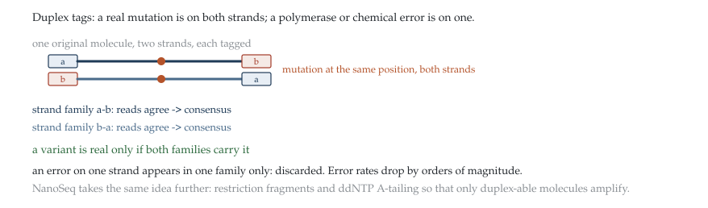{width=92%}

- **Problem:** polymerase and chemical damage errors reach 1 in 10^3 to 10^4 bases, which swamps a mutation at 1 in 10^6
- **Trick:** tag both strands of each molecule; accept a variant only if both strand families carry it ([rare variants](../targeted/lec.qmd))
- **Used in:** [Duplex Sequencing](https://henriksson-lab.github.io/NGS_101/duplex-sequencing__10.1073+pnas.1208715109/duplex-sequencing.html) [Schmitt et al. 2012, doi:10.1073/pnas.1208715109]{.small}; [NanoSeq](https://henriksson-lab.github.io/NGS_101/nanoseq__10.1038+s41586-021-03477-4/nanoseq.html) [Abascal et al. 2021, doi:10.1038/s41586-021-03477-4]{.small}

## Rolling circle consensus

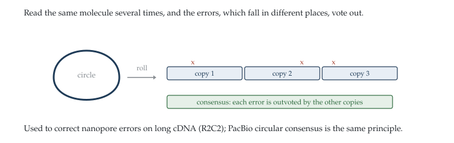{width=89%}

- **Problem:** nanopore reads have random errors in each pass
- **Trick:** circularise the molecule and copy it around the circle, so one long read contains it several times
- **Reason:** errors fall in different places in each copy, so the consensus is far better than any single pass ([the same idea as PacBio HiFi](../sequencers/lec-platforms.qmd))
- **Used in:** [R2C2](https://henriksson-lab.github.io/NGS_101/r2c2__10.1073+pnas.1806447115/r2c2.html) [Volden et al. 2018, doi:10.1073/pnas.1806447115]{.small}

## Spike-ins

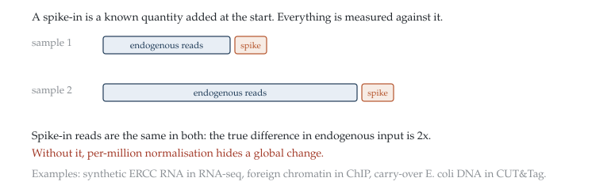{width=89%}

- **Problem:** normalising to total reads assumes the total did not change
- **Trick:** add a known amount of a foreign sequence at the start, and scale to that ([spike-in standards](../selection/lec.qmd))
- **Examples:** synthetic ERCC RNAs in RNA-seq [Jiang et al. 2011, doi:10.1101/gr.121095.111]{.small}; foreign chromatin in ChIP; carry-over *E. coli* DNA from the tethered transposase in [CUT&Tag](https://henriksson-lab.github.io/NGS_101/cut-tag__10.1038+s41467-019-09982-5/cut-tag.html)

## The molecule budget and PCR-free

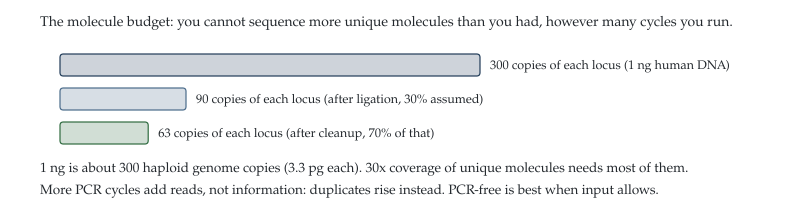{width=92%}

- 1 ng of human DNA is about 300 haploid genomes (3.3 pg each), so each locus exists in at most 300 copies ([counting the molecules you have](../genomic-dna/lec.qmd))
- **Trick:** use as much input as you have and as few PCR cycles as you can; with enough DNA, skip PCR
- **Used in:** [TruSeq DNA PCR-Free](https://henriksson-lab.github.io/NGS_101/truseq-dna-pcr-free/truseq-dna-pcr-free.html); the case for it is in [Kozarewa et al. 2009, doi:10.1038/nmeth.1311]{.small}
- How to choose the cycle number is in [the QC unit](../qc/lec.qmd): a small qPCR on an aliquot

## D6. Where does material go?

Every tube transfer, every bead step and every pipette tip takes a share.

- **Carrier:** add nucleic acid that is inert for the chemistry (no adapter sites, not primed by oligo-dT), so the sample is not a trace on the plastic. For RNA, tRNA or a non-poly(A) carrier; for precipitation, glycogen or linear acrylamide ([when there is very little RNA](../rna/lec-small-rna.qmd))
- **Rule:** the carrier must not be ligated, tailed or primed by anything in your protocol
- **Low-volume reactions:** see the figure ahead; fewer, smaller steps lose less

Counting losses is a skill: write the recovery of each step, then multiply. Six steps at 80% leave 26%.

## Pre-amplify, then split

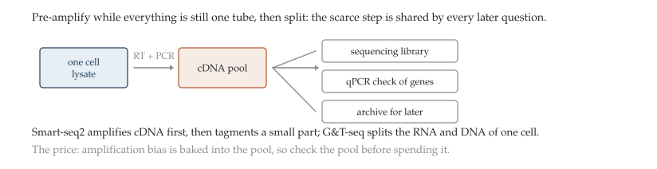{width=92%}

- **Problem:** one cell has a few picograms of RNA, and you want several assays from it ([one cell, several libraries](../single-cell/lec.qmd))
- **Trick:** amplify the whole transcriptome while it is still one tube, then take aliquots
- **Used in:** [SMART-seq2](https://henriksson-lab.github.io/NGS_101/smart-seq2__10.1038+nmeth.2639/smart-seq2.html); [G&T-seq](https://henriksson-lab.github.io/NGS_101/g-t-seq__10.1038+nmeth.3370/g-t-seq.html) [Macaulay et al. 2015, doi:10.1038/nmeth.3370]{.small}; whole-genome amplification [MALBAC](https://henriksson-lab.github.io/NGS_101/malbac__10.1126+science.1229164/malbac.html)

## Bead-bound handles

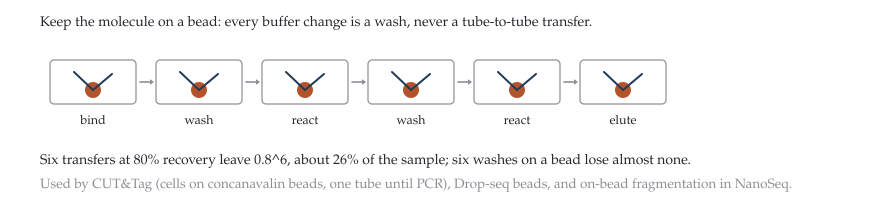{width=92%}

- **Problem:** moving a sample between tubes loses a fraction every time
- **Trick:** hold the molecule on a bead by an affinity handle and exchange buffers around it ([bead-bound handles](../handles/lec.qmd))
- **Used in:** [CUT&Tag](https://henriksson-lab.github.io/NGS_101/cut-tag__10.1038+s41467-019-09982-5/cut-tag.html) (cells on beads until PCR); [Single-stranded ancient DNA](https://henriksson-lab.github.io/NGS_101/single-stranded-ancient-dna__10.1038+nprot.2013.038/single-stranded-library.html) (streptavidin capture); [NanoSeq](https://henriksson-lab.github.io/NGS_101/nanoseq__10.1038+s41586-021-03477-4/nanoseq.html) (on-bead fragmentation)

## Low-volume reactions

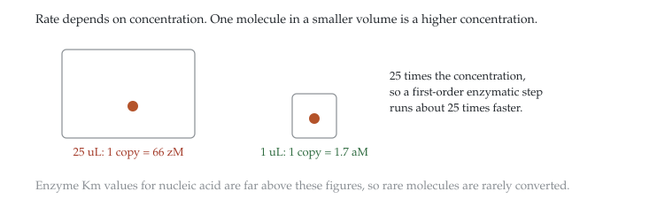{width=89%}

- 1 copy in 1 µL is 1.7 pM; in 25 µL it is 66 fM. A first-order step runs 25× faster in the smaller volume
- **Trick:** shrink the volume to microlitres, or nanolitres in a droplet or nanowell
- **Used in:** [SMART-seq3xpress](https://henriksson-lab.github.io/NGS_101/smart-seq3xpress__10.1038+s41587-022-01311-4/smart-seq3xpress.html) [Hagemann-Jensen et al. 2022, doi:10.1038/s41587-022-01311-4]{.small}

## D7. A droplet is a test tube

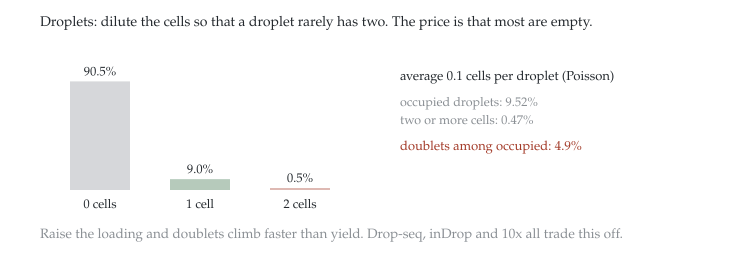{width=80%}

- **Problem:** pooling cells loses which one a molecule came from
- **Trick:** isolate each cell in its own compartment with its own barcode
- **Used in:** [Drop-seq](https://henriksson-lab.github.io/NGS_101/drop-seq__10.1016+j.cell.2015.05.002/drop-seq.html); [inDrop v1](https://henriksson-lab.github.io/NGS_101/indrop-v1__10.1016+j.cell.2015.04.044/indrop-v1.html); [10x](https://henriksson-lab.github.io/NGS_101/10x-chromium-single-cell-3-ge-v3/01_10x-3prime-v3.html)
- Cell loading follows Poisson statistics: you choose the doublet rate by choosing how many cells are empty ([the calculation](../compartments/lec.qmd))

## Split-and-pool

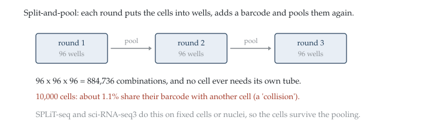{width=92%}

- **Problem:** droplets need a microfluidic device
- **Trick:** the cells themselves are the compartments: split into plates, tag, pool, repeat ([combinatorial indexing](../single-cell/lec-combinatorial.qmd))
- **Used in:** [SPLiT-seq](https://henriksson-lab.github.io/NGS_101/split-seq__10.1126+science.aam8999/split-seq.html) [Rosenberg et al. 2018, doi:10.1126/science.aam8999]{.small}; [sci-RNA-seq3](https://henriksson-lab.github.io/NGS_101/sci-rna-seq3__10.1038+s41586-019-0969-x/sci-rna-seq3.html); [sci-ATAC-seq](https://henriksson-lab.github.io/NGS_101/sci-atac-seq__10.1126+science.aab1601/sci-atac-seq.html) [Cusanovich et al. 2015, doi:10.1126/science.aab1601]{.small}

## Fix and permeabilise, then react in place

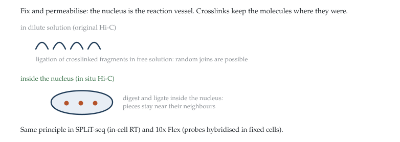{width=79%}

- **Problem:** isolating a live cell is slow and sensitive
- **Trick:** fix it, permeabilise it, and do the reactions inside the intact cell or nucleus
- **Reason:** crosslinks hold the molecules where they are; enzymes and oligos are small enough to enter ([fixation in tissue](../spatial/lec.qmd))
- **Used in:** [in situ Hi-C](https://henriksson-lab.github.io/NGS_101/in-situ-hi-c__10.1016+j.cell.2014.11.021/in-situ-hi-c.html) [Rao et al. 2014, doi:10.1016/j.cell.2014.11.021]{.small}; [10x Flex](https://henriksson-lab.github.io/NGS_101/10x-fixed-rna-profiling-flex/flex.html)

## Two-stage encapsulation

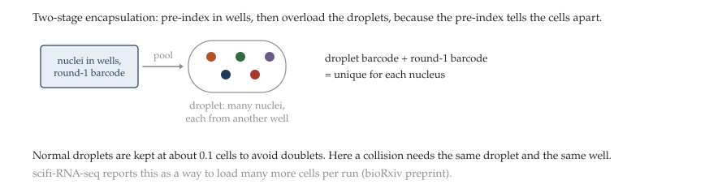{width=92%}

- **Problem:** droplets are mostly empty, so most of the device's capacity is wasted
- **Trick:** pre-barcode nuclei in wells, then load many per droplet; collisions need the same droplet and the same well
- **Used in:** [scifi-RNA-seq](https://henriksson-lab.github.io/NGS_101/scifi-rna-seq__10.1101+2019.12.17.879304/scifi-rna-seq.html) [Datlinger et al. 2019, bioRxiv, doi:10.1101/2019.12.17.879304]{.small}

## D8. Chemical conversion

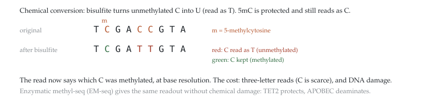{width=92%}

- **Problem:** methylation is not in the sequence, so a read cannot show it
- **Trick:** change the chemistry so that the property decides which base is read ([converting chemistry into sequence](../chemistry-to-sequence/lec.qmd))
- **Used in:** [scBS-seq](https://henriksson-lab.github.io/NGS_101/scbs-seq__10.1038+nmeth.3035/scbs-seq.html); [RRBS](https://henriksson-lab.github.io/NGS_101/rrbs-illumina__10.1038+nature07107/rrbs-illumina.html); [SLAM-seq](https://henriksson-lab.github.io/NGS_101/slam-seq__10.1038+nmeth.4435/slam-seq.html), where labelled uridines become T-to-C changes [Herzog et al. 2017, doi:10.1038/nmeth.4435]{.small}

## Protect, then convert

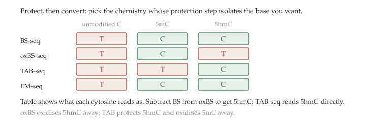{width=87%}

- **Problem:** 5mC and 5hmC both survive bisulfite, so they look the same
- **Trick:** protect or oxidise one form first ([oxBS, TAB-seq and EM-seq](../modifications/lec.qmd))
- **Used in:** [oxBS-seq](https://henriksson-lab.github.io/NGS_101/oxbs-seq__10.1126+science.1220671/oxbs-seq.html) [Booth et al. 2012, doi:10.1126/science.1220671]{.small}; [TAB-seq](https://henriksson-lab.github.io/NGS_101/tab-seq__10.1016+j.cell.2012.04.027/tab-seq.html) [Yu et al. 2012, doi:10.1016/j.cell.2012.04.027]{.small}; [EM-seq](https://henriksson-lab.github.io/NGS_101/nebnext-enzymatic-methyl-seq-v2/nebnext-em-seq-v2.html), an enzymatic replacement

## Position is the information

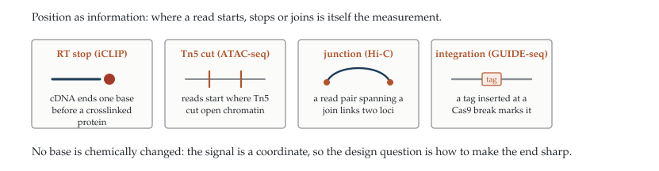{width=92%}

- **Problem:** there is no chemical mark to read
- **Trick:** make the read start, stop or join exactly at the feature ([a read as the address of a cut](../chromatin/lec.qmd))
- **Used in:** [iCLIP](https://henriksson-lab.github.io/NGS_101/iclip__10.1038+nsmb.1838/iclip_partial.html), [ATAC-seq](https://henriksson-lab.github.io/NGS_101/atac-seq__10.1038+nmeth.2688/atac-seq.html) [Buenrostro et al. 2013, doi:10.1038/nmeth.2688]{.small}, [in situ Hi-C](https://henriksson-lab.github.io/NGS_101/in-situ-hi-c__10.1016+j.cell.2014.11.021/in-situ-hi-c.html), [GUIDE-seq](https://henriksson-lab.github.io/NGS_101/guide-seq__10.1038+nbt.3117/guide-seq.html) [Tsai et al. 2015, doi:10.1038/nbt.3117]{.small}

## Affinity for a modification

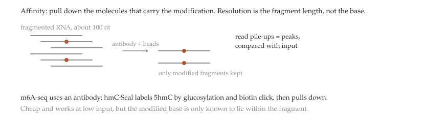{width=92%}

- **Problem:** the modification is rare, and conversion is too harsh
- **Trick:** enrich the molecules that carry it with an antibody or a chemical handle ([m6A by antibody](../modifications/lec-rna.qmd))
- **Used in:** [m6A-seq](https://henriksson-lab.github.io/NGS_101/m6a-seq__10.1038+nature11112/m6a-seq.html) [Dominissini et al. 2012, doi:10.1038/nature11112]{.small}; [hmC-Seal](https://henriksson-lab.github.io/NGS_101/hmc-seal__10.1038+nbt.1732/01_hmc_seal.html) [Song et al. 2011, doi:10.1038/nbt.1732]{.small}
- You trade base resolution for sensitivity

## Native signal readout

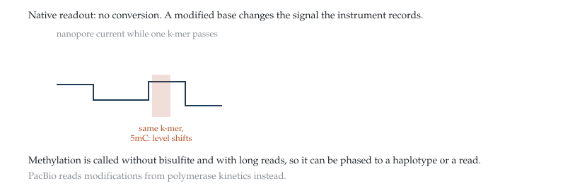{width=82%}

- **Problem:** conversion destroys DNA and shortens reads
- **Trick:** read the modification directly from the signal of a long-read instrument ([native, with no conversion](../long-reads/lec.qmd))
- **Used in:** nanopore methylation calling [Simpson et al. 2017, doi:10.1038/nmeth.4184]{.small}; [ONT kits](https://henriksson-lab.github.io/NGS_101/oxford-nanopore-ligation-sequencing-v14/nanopore-ligation-v14.html)

## Tricks collide

Each trick has a cost that another may inherit.

- **Bisulfite** damages DNA and reduces the alphabet to three letters; UMIs and unique molecules become harder to count
- **Pre-amplification** helps low input but bakes in bias; a UMI added after it counts amplicons, not molecules
- **Inline barcodes** use read cycles that a long UMI also needs
- **Depletion** by Cas9 or RNase H adds steps and sample loss

When you design, list the tricks you want and draw the construct after each: conflicts show up on the page, not at the sequencer.

## Summary

| Problem | Trick |
|---|---|
| Reads are not molecules | UMI; duplex tag; consensus; spike-in |
| Material is scarce | carrier; pre-amplify; beads; small volume |
| Which cell was this? | droplets; split-pool; in-cell reactions |
| A property, not a base | conversion; protection; position; affinity; native |

## Where this connects

**The other half of the catalogue**

- [Ligation, clean-up, handles and the read](lec.qmd) — the end-and-adapter tricks these are built on

**The chemistry underneath**

- [Polymerases and RTs](../enzymes/lec.qmd) — strand displacement, the engine of rolling circles and MDA
- [How sequencers read DNA](../sequencers/lec.qmd) — the cycles a UMI or an inline barcode must be paid out of

**Where these tricks are assembled**

- [Three-dimensional genome](../3d-genome/lec.qmd) — in-nucleus reactions, and a contact written as a ligation
- [Reading out a screen](../screens/lec-readout.qmd) — UMIs turn guide reads back into guide molecules

**When the trick is the problem**

- [Design patterns and failure modes](../design/lec.qmd) — tricks that collide, and the controls that separate them
