## Indexed by the problem, not the block

Most protocols are assembled from a small stock of tricks. Once you can name the trick you can recognise it in a protocol you have never seen, and reach for it when you design your own.

Every entry has four parts: **the problem**, **the trick**, **the molecular reason it works**, and **protocols that use it**.

This deck covers four families:

1. Making the right thing ligate
2. Killing what you do not want
3. Getting a handle onto an impossible end
4. Squeezing information into the read

The second deck covers counting, low input, compartments and base conversion. Both can be read in any order, and the entries stand alone.

::: {.notes}
Use this as a reference: when a protocol step looks odd, ask which problem it is solving.
:::

## D1. A ligase cannot tell what you meant

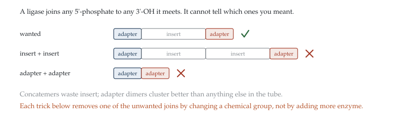{width=92%}

- T4 DNA ligase joins any 5'-phosphate to any 3'-OH on adjacent, annealed ends ([what a ligase actually requires](../nucleic-acids/lec.qmd))
- Insert concentration, adapter concentration and ends decide the product mixture
- Every trick in D1 changes an end so that one unwanted join becomes impossible

## Block one strand: dephosphorylate

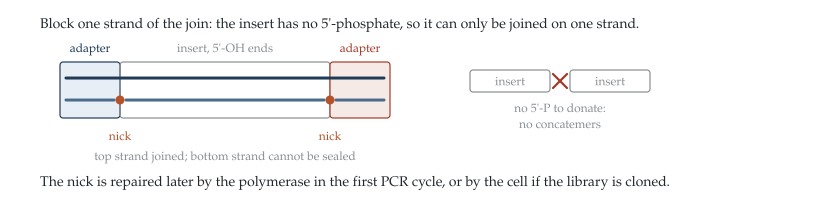{width=92%}

- **Problem:** inserts join each other into concatemers
- **Trick:** remove the 5'-phosphate (alkaline phosphatase); only the adapter supplies a phosphate ([phosphatases and kinases](../enzymes/lec-ligases.qmd))
- **Reason:** ligation needs a 5'-P donor and a 3'-OH acceptor; without the donor the join is impossible on that strand
- **Used in:** RNA adapter ligation in [eCLIP](https://henriksson-lab.github.io/NGS_101/eclip__10.1038+nmeth.3810/eclip.html), where RNA ends are dephosphorylated first

## A single base is enough: A-tails and T-overhangs

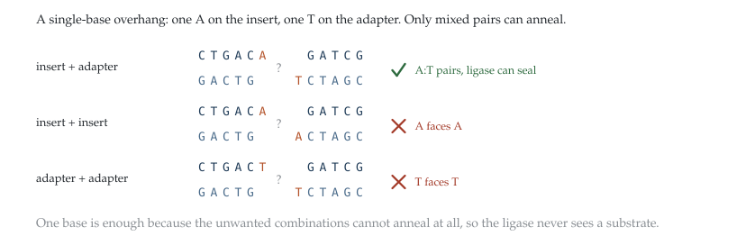{width=87%}

- **Problem:** blunt ligation joins everything to everything, and slowly
- **Trick:** A-tail the inserts (an exo-minus polymerase adds one A) and give the adapters a T overhang
- **Reason:** identical ends cannot pair: A faces A, T faces T. Mixed pairs anneal, which also raises the local concentration for the ligase ([which polymerase adds the A](../enzymes/lec.qmd))
- **Used in:** [TruSeq DNA PCR-Free](https://henriksson-lab.github.io/NGS_101/truseq-dna-pcr-free/truseq-dna-pcr-free.html), [NEBNext Ultra II](https://henriksson-lab.github.io/NGS_101/nebnext-ultra-ii-dna-library-prep-user-adaptor/nebnext-ultra-ii-user.html), [ONT ligation kit](https://henriksson-lab.github.io/NGS_101/oxford-nanopore-ligation-sequencing-v14/nanopore-ligation-v14.html)

## A hairpin is ligated once, then cut open

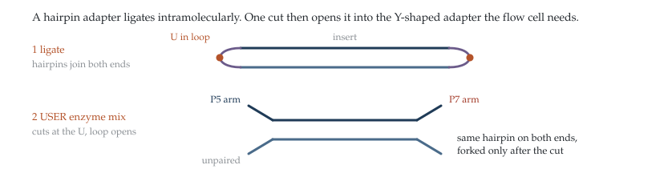{width=92%}

- **Problem:** a Y-shaped adapter is two annealed oligos, and mixing them makes mismatched pairs
- **Trick:** ligate one hairpin that carries a uracil, then cleave the U with USER (UDG plus endonuclease VIII) ([hairpin adapters and dU](../end-chemistry/lec.qmd))
- **Reason:** the hairpin ligates as one molecule, and opens only after it is on the insert
- **Used in:** [NEBNext Ultra II (USER adaptor)](https://henriksson-lab.github.io/NGS_101/nebnext-ultra-ii-dna-library-prep-user-adaptor/nebnext-ultra-ii-user.html)

## A splint brings the ends together

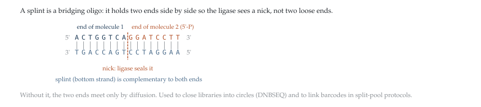{width=92%}

- **Problem:** two single-stranded ends, or two ends that are not blunt, will not meet on their own
- **Trick:** an oligo complementary to both holds them side by side; ligase then sees a nick ([splinted ligation](../handles/lec.qmd))
- **Reason:** nick sealing is fast, joining two loose ends is not
- **Used in:** circularisation for [DNBSEQ](https://henriksson-lab.github.io/NGS_101/dnbseq-library-circularization/dnbseq.html); barcode rounds in [SPLiT-seq](https://henriksson-lab.github.io/NGS_101/split-seq__10.1126+science.aam8999/split-seq.html)

## Dilute ligation makes circles

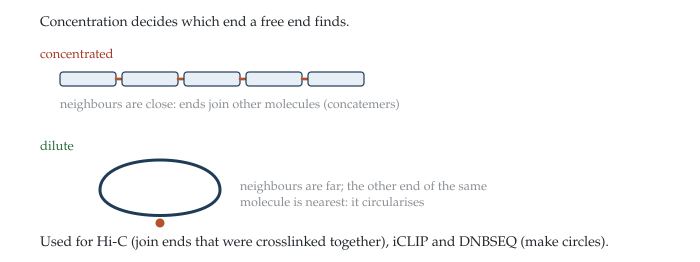{width=75%}

- **Problem:** you want an end to join *its own* other end (circle) or the end it was crosslinked to, not a stranger ([proximity ligation](../3d-genome/lec.qmd))
- **Trick:** dilute the DNA until the other end of the same molecule is the nearest end
- **Reason:** the effective local concentration of the partner end on the same molecule is fixed by its length; dilute below it and intramolecular joins win
- **Used in:** [Hi-C](https://henriksson-lab.github.io/NGS_101/hi-c-original__10.1126+science.1181369/hi-c-original.html) [Lieberman-Aiden et al. 2009, doi:10.1126/science.1181369]{.small}; [iCLIP](https://henriksson-lab.github.io/NGS_101/iclip__10.1038+nsmb.1838/iclip_partial.html)

## PEG crowding: speed at a price

The opposite problem: ligation is too slow, because the ends are rare compared with the water.

- **Trick:** 5-15% PEG 6000 or 8000 excludes volume, raising the effective concentration of everything else
- **Reason:** it speeds up blunt and RNA ligation markedly and is built into most ligation master mixes; high-concentration RNA ligase in PEG 8000 is how [eCLIP](https://henriksson-lab.github.io/NGS_101/eclip__10.1038+nmeth.3810/eclip.html) ligates its RNA adapter
- **Price:** the mix is viscous, so pipetting is inaccurate, and PEG carries into the next step.

This is why a ligation is always followed by a bead step: it removes the PEG and the free adapter at the same time ([cleanup and QC](../qc/lec.qmd)).

## D2. The adapter dimer

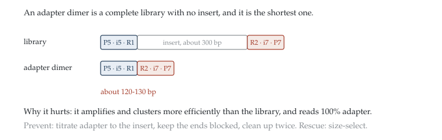{width=88%}

- **Problem:** with low input and excess adapter, adapters ligate to each other and carry both flow-cell ends
- **Trick:** match adapter amount to insert amount; use blocked ends so adapters cannot join; clean up twice; run a size selection before PCR ([bead size selection](../fragmentation/lec.qmd))
- **Reason:** prevention removes the joins; selection exploits the 150 bp gap in size

## Suppression PCR

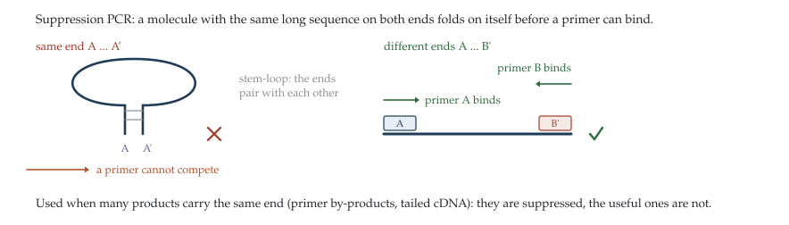{width=92%}

- **Problem:** molecules with the same end on both sides (primer by-products, tailed cDNA) amplify as well as the useful ones
- **Trick:** use a long adapter so those molecules form a stem-loop on denaturation ([the same trick used as a selection](../selection/lec.qmd))
- **Reason:** intramolecular annealing beats primer annealing, so a molecule with identical ends is not copied
- **Used in:** [Quartz-Seq](https://henriksson-lab.github.io/NGS_101/quartz-seq__10.1186+gb-2013-14-4-r31/quartz-seq.html) [Sasagawa et al. 2013, doi:10.1186/gb-2013-14-4-r31]{.small}

## Exonuclease clean-up of what did not react

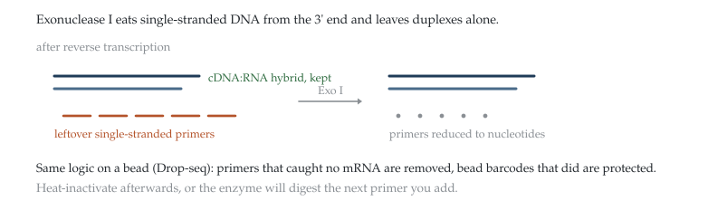{width=92%}

- **Problem:** unextended primers carry on into PCR and make primer dimers
- **Trick:** Exonuclease I digests single-stranded DNA from the 3' end, and does not touch a duplex ([exonucleases](../enzymes/lec-nucleases.qmd))
- **Used in:** [Quartz-Seq](https://henriksson-lab.github.io/NGS_101/quartz-seq__10.1186+gb-2013-14-4-r31/quartz-seq.html) after reverse transcription; [Drop-seq](https://henriksson-lab.github.io/NGS_101/drop-seq__10.1016+j.cell.2015.05.002/drop-seq.html) on beads [Macosko et al. 2015, doi:10.1016/j.cell.2015.05.002]{.small}
- Always heat-kill it: a surviving exonuclease will remove the next primer you add

## RNase H depletion of abundant RNA

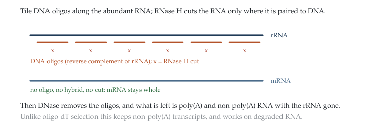{width=81%}

- **Problem:** about 80% of total RNA is ribosomal; sequencing it wastes most of the run
- **Trick:** hybridise DNA oligos along the rRNA, cut the RNA in those hybrids with RNase H, remove the oligos with DNase ([rRNA depletion in practice](../rna/lec.qmd))
- **Reason:** RNase H cleaves only the RNA strand of an RNA:DNA hybrid
- **Source:** [Morlan et al. 2012, doi:10.1371/journal.pone.0042882]{.small}

## Cas9 depletion of a finished library

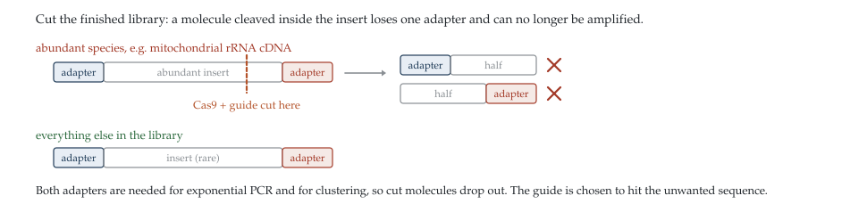{width=92%}

- **Problem:** a few species, such as mitochondrial rRNA, take up the reads even after library construction
- **Trick:** Cas9 and guides cut those molecules inside the insert; a cut molecule has one adapter and cannot form a cluster
- **Reason:** PCR and clustering need both ends, so the rest of the library is untouched (the same enzyme aimed at [enrichment](../targeted/lec.qmd) instead)
- **Used in:** [DASH](https://henriksson-lab.github.io/NGS_101/dash__10.1186+s13059-016-0904-5/01_dash.html) on human RNA-seq libraries [Gu et al. 2016, doi:10.1186/s13059-016-0904-5]{.small}

## Methylation-sensitive digestion

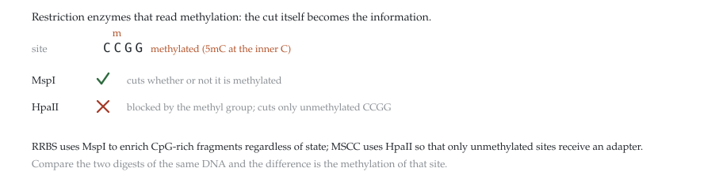{width=92%}

- **Problem:** you want only CpG-rich DNA, or only the unmethylated fraction ([reduced representation](../modifications/lec.qmd))
- **Trick:** an enzyme whose cut depends on the methyl group; its isoschizomer cuts either way
- **Used in:** [RRBS](https://henriksson-lab.github.io/NGS_101/rrbs-illumina__10.1038+nature07107/rrbs-illumina.html) with MspI [Meissner et al. 2008, doi:10.1038/nature07107]{.small}; [MSCC](https://henriksson-lab.github.io/NGS_101/mscc__10.1038+nbt.1533/01_chemistry.html) with HpaII [Ball et al. 2009, doi:10.1038/nbt.1533]{.small}

## D3. Template switching

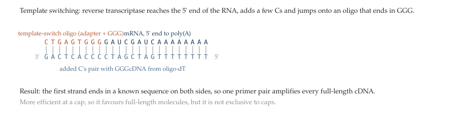{width=92%}

- **Problem:** reverse transcription makes a first strand with a known 3' end (the primer) but an unknown 5' end
- **Trick:** supply an oligo ending in GGG; when the enzyme falls off the template it adds a few Cs and moves onto the oligo ([designing the TSO](../rna/lec-small-rna.qmd))
- **Reason:** the added Cs pair with the GGG. Moloney-murine-leukaemia-virus RT has this activity, and it is stronger at a cap
- **Used in:** [SMART-seq2](https://henriksson-lab.github.io/NGS_101/smart-seq2__10.1038+nmeth.2639/smart-seq2.html) [Picelli et al. 2013, doi:10.1038/nmeth.2639]{.small}; [10x 3' v3](https://henriksson-lab.github.io/NGS_101/10x-chromium-single-cell-3-ge-v3/01_10x-3prime-v3.html); [Zhu et al. 2001, doi:10.2144/01304pf02]{.small}

## Tailing with terminal transferase

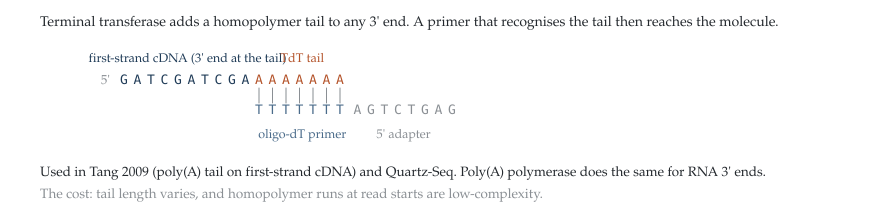{width=92%}

- **Problem:** the 3' end of first-strand cDNA has no sequence to prime on
- **Trick:** add a homopolymer tail with TdT (or poly(A) polymerase for RNA); a primer anneals to the tail ([tails without a template](../enzymes/lec-transposases.qmd))
- **Reason:** TdT needs no template and takes any 3'-OH
- **Used in:** [Tang 2009](https://henriksson-lab.github.io/NGS_101/tang-2009__10.1038+nmeth.1315/tang-2009.html) [Tang et al. 2009, doi:10.1038/nmeth.1315]{.small}; [Quartz-Seq](https://henriksson-lab.github.io/NGS_101/quartz-seq__10.1186+gb-2013-14-4-r31/quartz-seq.html)

## Single-strand ligation

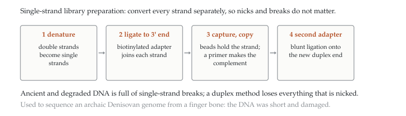{width=92%}

- **Problem:** damaged DNA has nicks and overhangs, so duplex end repair and ligation lose most molecules ([degraded and ancient DNA](../genomic-dna/lec.qmd))
- **Trick:** denature, ligate an adapter to every single strand, copy it, then ligate the second adapter
- **Used in:** [Single-stranded ancient DNA](https://henriksson-lab.github.io/NGS_101/single-stranded-ancient-dna__10.1038+nprot.2013.038/single-stranded-library.html) [Gansauge and Meyer 2013, doi:10.1038/nprot.2013.038]{.small}, behind the Denisovan genome [Meyer et al. 2012, doi:10.1126/science.1224344]{.small}

## Cap trapping

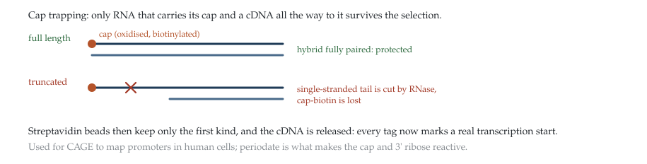{width=92%}

- **Problem:** most cDNA is truncated; you want molecules that begin at the true 5' end ([TSS mapping](../modifications/lec-rna.qmd))
- **Trick:** oxidise the cap diol with periodate, attach biotin, digest unprotected single-stranded RNA, pull down on streptavidin
- **Reason:** only a fully paired hybrid with its cap intact keeps biotin and survives
- **Used in:** [CAGE](https://henriksson-lab.github.io/NGS_101/cage__10.1038+nprot.2012.005/cage.html) [Takahashi et al. 2012, doi:10.1038/nprot.2012.005]{.small}

## Circularise to make an end internal

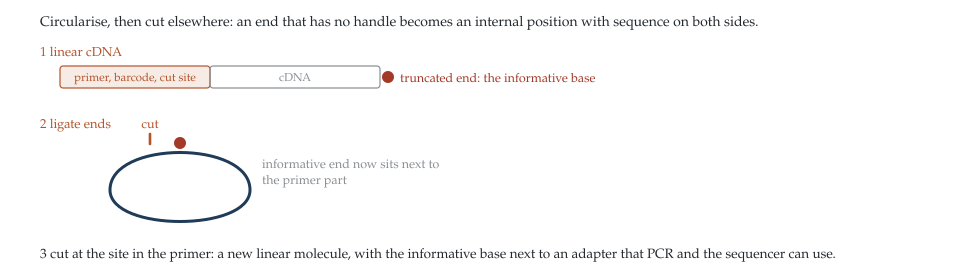{width=92%}

- **Problem:** the informative end (a truncated cDNA, a cut site) has no adapter on it
- **Trick:** ligate the ends of the single-stranded molecule together, then open the ring elsewhere
- **Reason:** the end now has known sequence on one side and an adapter at the cut (the same move as [inverse PCR](../amplification/lec.qmd) on genomic DNA)
- **Used in:** [iCLIP](https://henriksson-lab.github.io/NGS_101/iclip__10.1038+nsmb.1838/iclip_partial.html) [König et al. 2010, doi:10.1038/nsmb.1838]{.small}

## D4. Complete the adapter later

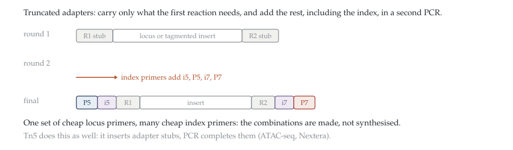{width=92%}

- **Problem:** full-length adapters with indexes are long and costly, one per sample per locus
- **Trick:** run the first reaction with stubs (read-primer sites only); add index, P5 and P7 in a second PCR
- **Reason:** the stubs are shared, so index combinations come from mixing two small primer sets
- **Used in:** [Nextera XT DNA Library Prep](https://henriksson-lab.github.io/NGS_101/nextera-xt-dna-library-prep/nextera-xt.html), [ATAC-seq](https://henriksson-lab.github.io/NGS_101/atac-seq__10.1038+nmeth.2688/atac-seq.html), [Moffat two-step](https://henriksson-lab.github.io/NGS_101/moffat-two-step-crispr-screen-readout/moffat-two-step-crispr-screen-readout.html); the one-step alternative is [Joung one-PCR CRISPR screen readout](https://henriksson-lab.github.io/NGS_101/joung-one-pcr-crispr-screen-readout__10.1038+nprot.2017.016/joung-one-pcr-crispr-screen-readout.html)

## Inline barcode or index read?

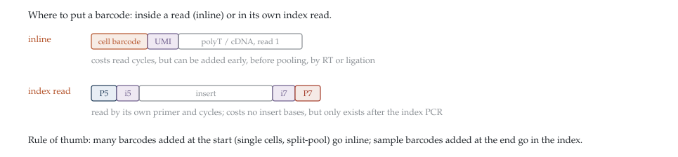{width=92%}

- **Inline:** costs read cycles but can be added by RT or ligation at the very start, so samples or cells can be pooled early
- **Index read:** costs no insert bases, but is only added in the last PCR ([budgeting the read](../barcodes-umis/lec.qmd))
- Dual indexes on both ends protect against index hopping [Kircher et al. 2012, doi:10.1093/nar/gkr771]{.small}

## Staggered primers

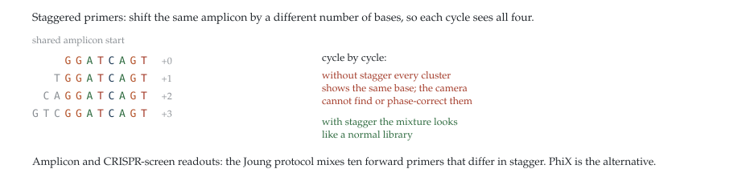{width=92%}

- **Problem:** every molecule starts with the same bases, so cycles 1 to 10 show one colour and the run fails
- **Trick:** a mix of primers that shift the amplicon by 0 to several bases
- **Used in:** CRISPR-screen readouts [(Joung)](https://henriksson-lab.github.io/NGS_101/joung-one-pcr-crispr-screen-readout__10.1038+nprot.2017.016/joung-one-pcr-crispr-screen-readout.html), amplicon panels; PhiX is the alternative ([screen readouts](../screens/lec-readout.qmd))

## Custom primers and dark cycles

The sequencer can be told to read where you want, not only where it expects.

- **Custom read primer:** for a construct that has no standard Read 1 site
- **Dark cycles:** chemistry without imaging, to step over a constant linker so the read begins at the barcode
- **Reason:** both move the start of the read; they cost a reagent position or wasted cycles

[The sequencer deck](../sequencers/lec.qmd) explains how each works. Here they are the last move when a design leaves the read in the wrong place.

## Summary: from problem to trick

| Problem | Trick |
|---|---|
| Inserts join each other | dephosphorylate; A/T overhangs |
| Adapters join each other | titrate; block; size-select |
| Ends will not meet | splint; dilute ligation |
| Same end on both sides | suppression PCR |
| Unreacted primer | exonuclease I |
| Abundant RNA or DNA | RNase H; Cas9 |
| Unknown 5' or 3' end | template switch; tail; ligate single strand |
| End has no adapter | circularise |
| Read is monotonous | stagger; custom primer; dark cycles |

## Where this connects

**The other half of the catalogue**

- [Counting, low input, compartments and bases](lec-more.qmd) — UMIs, carriers, droplets, base conversion

**Where these tricks are assembled**

- [Chromatin](../chromatin/lec.qmd) — ATAC-seq: tagmentation, stub adapters and an index PCR in one protocol
- [Long reads](../long-reads/lec.qmd) — A/T overhang ligation and nuclease clean-up, on molecules you cannot replace
- [Single cells](../single-cell/lec.qmd) — template switching and bead-bound primers, one cell at a time

**Where the construct is drawn**

- [Anatomy of a library molecule](../library-molecule/lec.qmd) — stub and full adapters, and where a label can sit

**When the trick is the problem**

- [Design patterns and failure modes](../design/lec.qmd) — the signature each trick leaves when it fails, and the control that proves it
